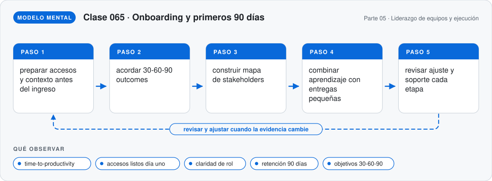

# Clase 065 — Onboarding y primeros 90 días

<!-- nav:inicio -->
> **Parte 05 · Gestión de talento y personas** — clase 5 de 12 · [índice de la parte](../../README.md) · [temario](../../../../SYLLABUS.md)
<!-- nav:fin -->

**Parte:** 05 — Gestión de talento y personas  
**Nivel:** Etapa 2 — Líder → Jefe / Team Lead  
**Duración sugerida:** 150–180 minutos · **Estándar:** deep-class-v2

## 🎯 Propósito

Una organización puede gastar meses en encontrar a la persona adecuada y después dejarla sola el primer día: sin computador, sin saber a quién preguntar, con una agenda vacía y un correo de bienvenida. Los primeros meses determinan si alguien se ajusta, rinde y se queda; y gran parte de lo que ocurre es responsabilidad del jefe y de la organización, no de la persona nueva.

La clase usa el metaanálisis de Bauer y colegas sobre el ajuste de los recién llegados —qué factores lo favorecen y qué resultados produce— y el enfoque de Michael Watkins sobre la transición en los primeros noventa días. Al terminar sabrás diseñar un onboarding con claridad de rol, aprendizaje guiado y relaciones, y conducir una transición propia o de otra persona con un plan de 30, 60 y 90 días.

## 📚 Resultados de aprendizaje

Al finalizar podrás:

1. **Explicar** qué factores favorecen el ajuste de una persona nueva según el metaanálisis de Bauer y colegas.
2. **Diseñar** un onboarding con preparación previa, primer día, primeras semanas y revisión a los noventa días.
3. **Definir** expectativas y ganancias tempranas a 30, 60 y 90 días.
4. **Organizar** el apoyo: jefe, acompañante, red de relaciones.
5. **Medir** la efectividad del onboarding y corregirlo.

## 🧭 Agenda

| Tramo | Qué se hace |
|---|---|
| 0–20 min | Recuperación: recuerda tu primer mes en tu último trabajo; ¿qué te ayudó y qué te faltó? |
| 20–60 min | Factores de ajuste y estructura del onboarding. |
| 60–105 min | Ejemplo trabajado: plan de 30, 60 y 90 días para una persona nueva. |
| 105–140 min | Caso ejecutivo: una persona excelente que se va a los cuatro meses. |
| 140–170 min | Límites y entregable. |

## 🧩 Conceptos centrales

| Concepto | Definición | Cómo se reconoce |
|---|---|---|
| **Onboarding** | Proceso mediante el cual una persona nueva adquiere los conocimientos, las conductas y las relaciones para desempeñarse en su cargo. | Tiene un plan, un responsable y fechas. |
| **Socialización organizacional** | Proceso por el cual los recién llegados aprenden las normas y el rol de la organización (Bauer et al., 2007). | La persona aprende cómo se hacen las cosas aquí. |
| **Claridad del rol** | Comprensión de lo que se espera del cargo (Bauer et al., 2007). | Sabe qué resultados se le piden. |
| **Autoeficacia** | Confianza en la propia capacidad de desempeñar las tareas (Bauer et al., 2007). | Siente que puede hacerlo. |
| **Aceptación social** | Sentirse parte del grupo y valorado (Bauer et al., 2007). | Tiene relaciones de trabajo y pertenencia. |
| **Ganancia temprana** | Resultado visible logrado pronto que da credibilidad (Watkins, 2003). | Un logro concreto en los primeros meses. |

## 🧠 Modelo mental

**Cómo leer el diagrama.** Tres columnas, tres resultados de ajuste que la investigación asocia con mejor desempeño y permanencia. Debajo de cada uno, lo que puede hacer el jefe: dar claridad con resultados esperados por escrito, construir confianza con tareas que permitan éxito y feedback pronto, y fomentar la pertenencia con presentaciones, un acompañante y contacto regular.

## 📖 Desarrollo

### 1. Qué dice la investigación

Bauer y colegas hicieron un metaanálisis sobre el **ajuste de los recién llegados** y encontraron que tres resultados —claridad del rol, autoeficacia y aceptación social— se asocian con mejor desempeño, mayor satisfacción y menor intención de irse. Entre los factores que los favorecen están la información que recibe la persona, la conducta proactiva y el apoyo del jefe y de los compañeros. Las tácticas de socialización estructuradas (secuencias, apoyo, información clara) se asocian con mejores ajustes que dejar que cada uno se las arregle.

### 2. Antes del primer día

El onboarding comienza al aceptar la oferta. Antes de que llegue: confirmar fecha y condiciones; preparar el puesto, accesos y equipo; informar al equipo; designar un **acompañante**; y enviar un breve plan con la primera semana. La persona que llega y encuentra todo listo comprende que importa. La que encuentra desorden concluye que no.

### 3. Los primeros días

El primer día no es para papeleo; es para **pertenencia y claridad**. Qué hacer: recibirla personalmente, presentarla, almorzar con el equipo, explicar la semana, recordar el propósito del equipo y mostrar cómo su cargo se conecta con él. La primera semana, tareas pequeñas con éxito posible, reuniones con las personas clave y una conversación sobre expectativas (clase 051). Evita llenar la agenda de capacitaciones masivas sin contexto.

### 4. Un plan de 30, 60 y 90 días

Watkins propone que, en la transición, la persona **aprenda** rápido, construya **relaciones** y logre **ganancias tempranas**. Un plan por tramos: **30 días**, aprender: entender el negocio, las personas, los procesos, las expectativas; **60 días**, contribuir: asumir tareas con apoyo y lograr algún resultado pequeño; **90 días**, responsabilizarse: tomar un resultado propio y presentar un plan. Se acuerda por escrito y se revisa en conversaciones regulares con el jefe.

### 5. Claridad del rol

Un recién llegado necesita saber: qué se espera, cómo se medirá, quién decide qué, con quién trabaja y qué significa hacerlo bien en cada etapa. Es el trabajo de las clases 050, 051 y 061 aplicado a una persona. Una conversación inicial, y de nuevo a los 30 días, con una pregunta clave: «¿qué no te ha quedado claro de lo que se espera de ti?».

### 6. Feedback y apoyo social

La autoeficacia se construye con **éxitos tempranos y feedback pronto**: asignar tareas alcanzables, observar y reconocer lo que sale bien, corregir con prontitud y sin dramatismo. La aceptación social se favorece con un acompañante o «par de apoyo», presentaciones a los equipos con quienes interactuará y actividades de contacto. El jefe mantiene contacto frecuente: en las primeras semanas, un uno a uno semanal (clase 055).

### 7. Evaluar el onboarding

Para saber si funciona: preguntas de **pulso** a los 30, 60 y 90 días a la persona nueva («¿tienes claro lo que se espera?, ¿tienes lo que necesitas?, ¿con quién cuentas?»), medición del tiempo hasta la autonomía, desempeño a los 90 y 180 días, y **rotación temprana**. Si alguien se va antes de seis meses, se analiza el proceso: ¿qué señal temprana se perdió? Un mal onboarding suele pagarse con una nueva contratación.

## 📚 Lectura comparada

| Obra | Qué aporta | Qué no resuelve | Pregunta para contrastar |
|---|---|---|---|
| Bauer et al. (2007) | Factores y resultados del ajuste del recién llegado. | Es un metaanálisis con estudios de calidad variable. | ¿Qué factor falta en tu onboarding? |
| Watkins (2003) | Transición en los primeros noventa días, aprendizaje y ganancias tempranas. | Se centra en líderes que asumen un nuevo cargo. | ¿Qué plan tiene la persona para sus primeros 90 días? |
| Bock (2015) | Prácticas de onboarding en una empresa de tecnología. | Relato de una empresa. | ¿Qué aplicaría tu organización? |
| Grove (1983) | Uso del uno a uno para transferir conocimiento. | No trata de onboarding. | ¿Cuántos uno a uno tendrás en el primer mes? |
| Edmondson (2018) | Seguridad psicológica para preguntar. | No trata de plan. | ¿La persona nueva puede preguntar sin temor? |

## 🧮 Ejemplo trabajado

**Situación (hipotética).** Una empresa contrata a Camila como analista de datos. Su jefe, Rodrigo, prepara el plan.

| Tramo | Aprender | Contribuir | Resultado esperado |
|---|---|---|---|
| **Antes del día 1** | Accesos, equipo, plan de la primera semana, acompañante (Julio). | — | Todo listo. |
| **Semana 1** | Presentaciones con cinco personas clave; revisión de los datos principales. | Una tarea pequeña: limpiar una tabla. | Éxito temprano y feedback. |
| **Día 30** | Entiende el proceso, las fuentes y las necesidades de dos áreas. | Entrega un informe breve con apoyo. | Claridad del rol: lista de lo que se espera. |
| **Día 60** | Profundiza en dos modelos. | Asume el informe mensual de una área. | Informe validado por el área. |
| **Día 90** | Ha trabajado con cuatro equipos. | Presenta un plan para mejorar una métrica clave. | Una ganancia temprana: reducir en 20 % el tiempo de preparación de un informe. |

**Seguimiento.** Uno a uno semanal el primer mes, quincenal después. Preguntas de pulso a los 30, 60 y 90 días. Revisión de desempeño a los 90 días con el criterio de «¿asumió un resultado propio?».

**Qué muestra.** (1) El plan atiende claridad, autoeficacia y aceptación social. (2) Hay ganancias tempranas concretas. (3) Se mide el proceso.

## 🔀 Comparación y límites

**Onboarding frente a inducción.** La inducción es el conjunto de actividades informativas del ingreso; el onboarding es el proceso completo de ajuste, que dura meses.

**Límites.** Los factores del metaanálisis son asociaciones: no garantizan que aplicarlos producirá los resultados. El plan de 30, 60 y 90 días de Watkins está pensado para líderes en transición y se adapta con criterio a otros cargos. Un onboarding perfecto no compensa una selección errónea ni un cargo mal diseñado. Y las exigencias legales sobre inducción en seguridad, contratos y entrega de documentos se verifican con asesoría.

## 🪜 De profesional a owner

| Nivel | Cómo trabaja el onboarding |
|---|---|
| **Profesional** | Como recién llegado, pregunta, pide claridad y construye relaciones. |
| **Jefe / Team Lead** | Prepara el plan, acompaña y mide. |
| **Gerente** | Estandariza el onboarding de su área y revisa la rotación temprana. |
| **CEO / Director** | Define el onboarding de líderes y vigila la transición de su propio equipo. |
| **Founder / Owner** | Integra a las primeras personas cuando hay poco proceso: lo diseña de forma simple. |

## 🏢 Caso ejecutivo

Una empresa contrató a una ingeniera con excelente currículum. El primer día encontró su puesto sin preparar y a su jefe en un viaje; durante tres semanas hizo capacitaciones masivas sin conocer a su equipo; recibió su primera tarea el día 25. A los cuatro meses renunció diciendo que «no entendió qué se esperaba de ella». El jefe dice que «tenía que ser más proactiva».

Entrega un **plan de onboarding** que contenga: (a) el diagnóstico de lo que falló, con los tres factores de ajuste; (b) la preparación previa y el primer día; (c) el plan de 30, 60 y 90 días con ganancias tempranas; (d) el apoyo: jefe, acompañante y red; (e) las preguntas de pulso y el seguimiento; (f) cómo evaluarás si el onboarding funciona.

## 🧪 Práctica

1. Escribe un plan de 30, 60 y 90 días para una persona nueva de tu equipo.
2. Define una ganancia temprana para el día 90.
3. Redacta cinco preguntas de pulso para el día 30.
4. Designa un acompañante y escribe qué le pedirás.
5. Revisa la rotación temprana de los últimos dos años y qué proceso falló.

## ⚠️ Errores frecuentes

| Error | Por qué ocurre | Cómo corregirlo |
|---|---|---|
| Dejar a la persona sola | Se asume proactividad | Plan, acompañante y uno a uno. |
| Primer día de papeleo | Es un trámite | Pertenencia y claridad. |
| Capacitaciones masivas sin contexto | Se quiere cubrir todo | Aprendizaje guiado con tareas reales. |
| Esperar demasiado para dar trabajo | Se quiere preparar | Tareas pequeñas desde la primera semana. |
| No medir | Se da por hecho | Preguntas de pulso y rotación temprana. |
| Culpar a la persona | Es fácil | Revisar el proceso. |

## ❓ Preguntas de comprobación

1. ¿Qué tres resultados de ajuste identifican Bauer y colegas?
2. ¿Qué se prepara antes del primer día?
3. ¿Qué tres tramos tiene el plan de Watkins?
4. ¿Qué es una ganancia temprana?
5. ¿Cómo se fomenta la aceptación social?
6. ¿Cómo se evalúa el onboarding?
7. ¿Qué límite tienen los factores del metaanálisis?

Claves de respuesta

1. Claridad del rol, autoeficacia y aceptación social.
2. Accesos y equipo, plan de la primera semana, informar al equipo y un acompañante.
3. Aprender, contribuir y responsabilizarse, a 30, 60 y 90 días.
4. Un resultado visible logrado pronto que da credibilidad.
5. Con presentaciones, un acompañante, contacto regular y pertenencia al equipo.
6. Con preguntas de pulso, tiempo hasta la autonomía, desempeño posterior y rotación temprana.
7. Son asociaciones, no garantías de que aplicarlos produzca los resultados.

## 📥 Entregable

Guarda en `portfolio/065-onboarding-y-primeros-90-dias/`:

- `risk-governance-brief.md` (plantilla [Risk & Governance Brief](../../../../templates/risk-governance-brief.md)) con el plan de onboarding del caso ejecutivo;
- `one-on-one.md` (plantilla [One-on-one](../../../../templates/one-on-one.md)) con la estructura del seguimiento;
- `decision-journal.md` con el pulso a 30, 60 y 90 días.

## 📗 Fuentes y verificación

- Talya N. Bauer, Todd Bodner, Berrin Erdogan, Donald M. Truxillo & Jennifer S. Tucker — *Newcomer adjustment during organizational socialization: A meta-analytic review of antecedents, outcomes, and methods* (Journal of Applied Psychology, 2007). **Uso en esta clase:** factores y resultados del ajuste del recién llegado. Lectura selectiva sobre **onboarding y primeros 90 días**. **Localizador:** [DOI 10.1037/0021-9010.92.3.707](https://doi.org/10.1037/0021-9010.92.3.707).
- Michael D. Watkins — *The First 90 Days* (Harvard Business School Press, 2003). **Uso en esta clase:** transición de los primeros noventa días y ganancias tempranas. Lectura selectiva sobre **onboarding y primeros 90 días**. **Localizador:** [ISBN-13 9781591391104](https://openlibrary.org/isbn/9781591391104).
- Laszlo Bock — *Work Rules!* (Twelve, 2015). **Uso en esta clase:** prácticas de onboarding en una empresa de tecnología. Lectura selectiva sobre **onboarding y primeros 90 días**. **Localizador:** [ISBN-13 9781455554799](https://openlibrary.org/isbn/9781455554799).
- Andrew S. Grove — *High Output Management* (Random House, 1983). **Uso en esta clase:** el uno a uno como transferencia de conocimiento. Lectura selectiva sobre **onboarding y primeros 90 días**. **Localizador:** [ISBN-13 9780394532349](https://openlibrary.org/isbn/9780394532349).
- Amy C. Edmondson — *The Fearless Organization* (Wiley, 2018). **Uso en esta clase:** seguridad psicológica para preguntar. Lectura selectiva sobre **onboarding y primeros 90 días**. **Localizador:** [ISBN-13 9781119477242](https://openlibrary.org/isbn/9781119477242).

> **Regla de fuentes para Onboarding y primeros 90 días:** las obras anteriores estructuran las perspectivas de esta materia; cualquier norma, ley o estándar vivo mencionado debe comprobarse nuevamente en su fuente primaria vigente, incluidas las obligaciones de inducción en seguridad y de contrato. Los ejemplos y casos son hipotéticos. El desarrollo es original y no reproduce capítulos protegidos.

<!-- pie:inicio -->
---

| Anterior | Índice | Siguiente |
|---|---|---|
| [← 064 · Entrevistas estructuradas](../064-entrevistas-estructuradas/README.md) | [Parte 05](../../README.md) · [Programa](../../../../SYLLABUS.md) | [066 · Gestión de desempeño →](../066-gestion-de-desempeno/README.md) |
<!-- pie:fin -->
