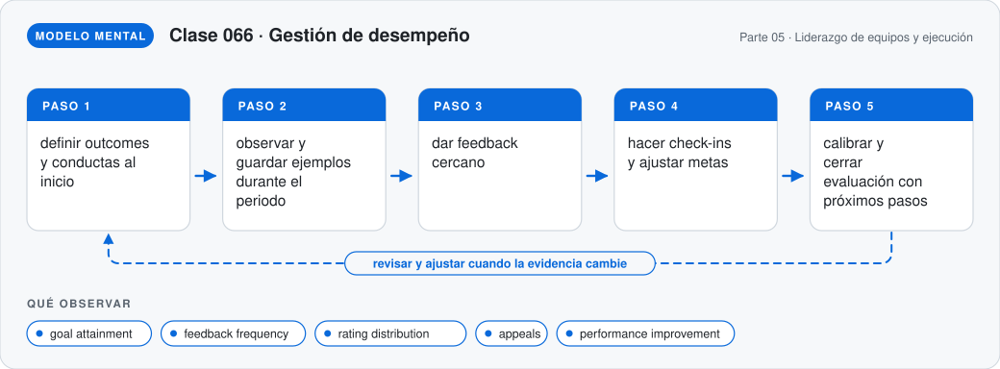

# Clase 066 — Gestión de desempeño

<!-- nav:inicio -->
> **Parte 05 · Gestión de talento y personas** — clase 6 de 12 · [índice de la parte](../../README.md) · [temario](../../../../SYLLABUS.md)
<!-- nav:fin -->

**Parte:** 05 — Gestión de talento y personas  
**Nivel:** Etapa 2 — Líder → Jefe / Team Lead  
**Duración sugerida:** 150–180 minutos · **Estándar:** deep-class-v2

## 🎯 Propósito

La evaluación anual de desempeño es uno de los rituales corporativos más criticados: se postergan las conversaciones durante meses, se resumen doce meses en un formulario, se califican personas con escalas que nadie entiende igual y se decide la remuneración sobre la base de impresiones. Y, sin embargo, las organizaciones necesitan **gestionar el desempeño**: acordar qué se espera, ayudar a lograrlo y tomar decisiones justas sobre las personas.

La clase se apoya en la investigación sobre metas de Locke y Latham, sobre retroalimentación de Kluger y DeNisi y en la crítica de las prácticas habituales, y propone un ciclo continuo en lugar de un evento anual. Al terminar sabrás construir un sistema de gestión de desempeño simple, con expectativas claras, conversaciones frecuentes, evidencia registrada y decisiones justificadas.

## 📚 Resultados de aprendizaje

Al finalizar podrás:

1. **Distinguir** gestión de desempeño de evaluación anual.
2. **Diseñar** un ciclo con expectativas, conversaciones frecuentes, evidencia, revisión y decisiones.
3. **Usar** metas específicas y feedback centrado en la tarea.
4. **Reducir** sesgos de evaluación con criterios, evidencia y calibración.
5. **Conducir** la conversación de revisión y vincularla a decisiones sobre las personas.

## 🧭 Agenda

| Tramo | Qué se hace |
|---|---|
| 0–20 min | Recuperación: recuerda tu última evaluación; ¿qué te sorprendió y qué sabías ya? |
| 20–60 min | El ciclo continuo, metas, feedback y sesgos. |
| 60–105 min | Ejemplo trabajado: rediseñar una evaluación anual. |
| 105–140 min | Caso ejecutivo: calificaciones que no reflejan el desempeño. |
| 140–170 min | Límites y entregable. |

## 🧩 Conceptos centrales

| Concepto | Definición | Cómo se reconoce |
|---|---|---|
| **Gestión de desempeño** | Proceso continuo de acordar expectativas, apoyar, observar, evaluar y decidir sobre el desempeño de las personas. | Hay conversaciones todo el año. |
| **Evaluación de desempeño** | Juicio formal periódico sobre el desempeño. | Es una parte de la gestión. |
| **Meta específica y difícil** | Objetivo claro y exigente (Locke y Latham, 2002). | Mejora el desempeño con compromiso y feedback. |
| **Feedback de tarea** | Información sobre el desempeño en la tarea, más útil que la dirigida a la persona (Kluger y DeNisi, 1996). | Es específico y oportuno. |
| **Sesgo de evaluación** | Error sistemático por factores ajenos al desempeño: afinidad, halo, recencia. | Las calificaciones favorecen a quien se parece al jefe. |
| **Calibración** | Revisión conjunta de evaluaciones para homogeneizar criterios. | Los jefes comparan evidencia y criterios. |

## 🧠 Modelo mental

**Cómo leer el diagrama.** Cinco pasos que se repiten. Lo importante está al inicio y en el medio: **expectativas claras** y **conversaciones frecuentes**. La revisión y las decisiones son consecuencia de lo anterior: si las expectativas fueron claras y el feedback frecuente, la revisión no sorprende. Un ciclo que solo existe en el paso cuatro es una evaluación anual.

## 📖 Desarrollo

### 1. Por qué fallan las evaluaciones

Una evaluación anual aislada tiene problemas conocidos: se basa en la memoria reciente (sesgo de recencia), mezcla propósitos incompatibles (desarrollo, remuneración y despido), y llega tarde para cambiar el desempeño. Kluger y DeNisi muestran que el feedback ayuda cuando se centra en la tarea y empeora cuando apunta a la persona; una calificación con una etiqueta tiende a hacer lo segundo. Y la tendencia a calificar bien a quien nos cae bien es una constante.

### 2. Expectativas claras

El ciclo comienza al acordar **qué se espera**: resultados (qué se logrará), conductas (cómo) y desarrollo (qué se aprenderá). Locke y Latham muestran que las metas específicas y exigentes, con compromiso y feedback, mejoran el desempeño. Se escriben, se conversan y se revisan cuando cambian las prioridades. Un cargo bien definido (clase 061) facilita este paso.

### 3. Conversaciones frecuentes

Entre los acuerdos y la revisión, las conversaciones regulares —uno a uno semanal o quincenal (clase 055)— sustituyen la sorpresa: se da feedback sobre la tarea (clase 030), se ajustan metas y se resuelven obstáculos. La literatura de gestión sugiere que las conversaciones frecuentes, cortas y orientadas al futuro son más eficaces que la evaluación retrospectiva. Cada conversación deja una nota breve de los hechos y acuerdos.

### 4. Evidencia

Para evaluar con justicia se necesita **evidencia registrada durante el año**: resultados cuantitativos, ejemplos de conducta, feedback de clientes o pares, logros y dificultades. Un registro sencillo, mensual, evita depender de la memoria y de la última semana. La evidencia distingue entre lo que la persona logró y lo que se esperaba, y entre su contribución y factores del contexto.

### 5. La revisión

Una revisión útil es una **conversación** y no la lectura de un formulario: se revisan expectativas, evidencia y logros; se escucha la autoevaluación; se reconoce lo logrado; se conversa sobre brechas; y se acuerda lo que viene. El jefe llega con ejemplos concretos. Si hubo conversaciones frecuentes, no hay sorpresas. Se evita atribuir carácter («falta de iniciativa») y se describe conducta y efecto.

### 6. Sesgos y calibración

Los jefes tienden a evaluar con distinta severidad: unos califican alto a todos, otros bajo. Y están sujetos a sesgos de afinidad, halo, recencia y confirmación. Medidas: criterios y evidencia previos, evaluación en varias fuentes cuando corresponde, y **calibración**: los jefes se reúnen a comparar evidencia y criterios para homogeneizar. La calibración no debe forzar distribuciones artificiales; busca consistencia. Y se revisan los resultados por grupos para detectar sesgos sistemáticos.

### 7. De la revisión a las decisiones

La revisión alimenta decisiones distintas: **desarrollo** (qué aprenderá), **compensación y promoción** (clase 068), **plan de mejora** (clase 067) y, en último término, **desvinculación** (clase 071). Conviene separar en el tiempo la conversación de desarrollo de la de remuneración, porque mezclarlas inhibe la franqueza. Las decisiones deben justificarse con evidencia y respetar la normativa aplicable, que se verifica con asesoría.

## 📚 Lectura comparada

| Obra | Qué aporta | Qué no resuelve | Pregunta para contrastar |
|---|---|---|---|
| Locke y Latham (2002) | Metas específicas y difíciles con compromiso y feedback. | No diseña el sistema completo. | ¿Tus metas son específicas y exigentes? |
| Kluger y DeNisi (1996) | El efecto variable del feedback según su foco. | Es una revisión de estudios, no una guía de evaluación. | ¿Tu evaluación apunta a la tarea o a la persona? |
| Grove (1983) | La evaluación como responsabilidad del jefe y su vínculo con la gestión. | Escrita en otro contexto. | ¿Cuánto del año se refleja en tu evaluación? |
| Kahneman, Sibony y Sunstein (2021) | Ruido y sesgos en el juicio de desempeño. | No es un manual de gestión de desempeño. | ¿Cuánto varían tus jefes en la severidad? |
| Bock (2015) | Calibración y evaluación en una empresa de tecnología. | Relato de una empresa. | ¿Qué parte aplica a tu realidad? |
| Sutton (2010) | Qué conductas del jefe dañan o elevan el desempeño de otros. | Es divulgación con casos seleccionados. | ¿Qué efecto tiene tu forma de evaluar en el equipo? |

## 🧮 Ejemplo trabajado

**Situación (hipotética).** Una empresa de 150 personas usa una evaluación anual con una escala de 1 a 5. El 70 % de las personas obtiene 4; los jefes dicen que «no vale la pena discutir». Nadie ve relación entre la calificación y la remuneración.

| Elemento | Antes | Después |
|---|---|---|
| **Expectativas** | Formulario de objetivos en enero, olvidado. | Tres resultados y dos conductas acordadas por escrito, revisadas trimestralmente. |
| **Conversaciones** | Una al año. | Uno a uno mensual con una nota breve de hechos y acuerdos. |
| **Evidencia** | Memoria del jefe. | Registro mensual de resultados y ejemplos. |
| **Revisión** | Formulario y calificación. | Conversación semestral con ejemplos, autoevaluación y plan. |
| **Calibración** | No hay. | Reunión de jefes con evidencia; revisión de distribución por área. |
| **Decisiones** | Remuneración y desarrollo juntos. | Conversación de desarrollo en abril; decisión de remuneración en noviembre. |

**Resultado.** La proporción de personas con calificación máxima baja de 70 % a 35 %; en una encuesta, el 68 % dice que «sabe lo que se espera de mí», frente al 41 % anterior.

**Qué muestra.** (1) Se cambió el ciclo, no solo el formulario. (2) La evidencia reemplazó a la memoria. (3) Se separaron desarrollo y remuneración.

## 🔀 Comparación y límites

**Gestión frente a evaluación.** La evaluación es un momento; la gestión es un ciclo. Puede haber evaluación sin gestión, pero no al revés.

**Límites.** La investigación sobre sistemas de gestión del desempeño es heterogénea y sus conclusiones dependen del contexto. Los ciclos frecuentes aumentan la carga sobre los jefes si no se simplifican. La calibración puede convertirse en un ritual que ajusta personas a una distribución. Y las decisiones sobre las personas —promoción, remuneración, desvinculación— están sujetas a normas y a acuerdos colectivos que se verifican con asesoría.

## 🪜 De profesional a owner

| Nivel | Cómo trabaja el desempeño |
|---|---|
| **Profesional** | Acuerda expectativas, pide feedback y lleva su propia evidencia. |
| **Jefe / Team Lead** | Conversa con frecuencia, registra y evalúa con ejemplos. |
| **Gerente** | Calibra con otros jefes y cuida la consistencia entre equipos. |
| **CEO / Director** | Diseña el sistema, cuida que premie lo que importa y revisa sus sesgos. |
| **Founder / Owner** | Construye un sistema simple que no dependa de su memoria. |

## 🏢 Caso ejecutivo

En una empresa de servicios, las calificaciones de desempeño del último año muestran que el área comercial tiene el 80 % de sus personas en la categoría máxima, mientras operaciones solo el 20 %. Las personas de operaciones se quejan de que «los comerciales tienen mejores jefes, no mejor desempeño». La dirección quiere reemplazar la escala por una «curva forzada» que obligue a distribuir. Los jefes comerciales dicen que «sus resultados son realmente mejores».

Entrega un **rediseño del sistema de gestión de desempeño** que contenga: (a) el diagnóstico de las diferencias y sus posibles causas; (b) el ciclo completo con expectativas, conversaciones, evidencia, revisión y decisiones; (c) cómo evitarás los sesgos y cómo calibrarás sin forzar una curva; (d) la separación entre desarrollo y remuneración; (e) la capacitación de los jefes; (f) cómo medirás si el sistema mejora el desempeño.

## 🧪 Práctica

1. Redacta las expectativas de una persona de tu equipo con tres resultados y dos conductas.
2. Diseña un registro mensual de evidencia de cinco líneas.
3. Prepara una revisión con tres ejemplos concretos para una persona.
4. Identifica un sesgo que podrías tener al evaluar y cómo lo comprobarías.
5. Define cuándo conversarás sobre desarrollo y cuándo sobre remuneración.

## ⚠️ Errores frecuentes

| Error | Por qué ocurre | Cómo corregirlo |
|---|---|---|
| Evaluar una vez al año | Es la costumbre | Conversaciones frecuentes. |
| Basarse en la memoria | No se registra | Evidencia mensual. |
| Calificar la persona | Se usan etiquetas | Describir conducta y efecto. |
| Mezclar desarrollo y remuneración | Se ahorra tiempo | Separarlos en el tiempo. |
| Curva forzada | Se quiere diferenciar | Calibración de evidencia sin cuotas artificiales. |
| Sorprender en la revisión | No hubo feedback | Conversar durante el año. |

## ❓ Preguntas de comprobación

1. ¿Qué diferencia hay entre gestión y evaluación de desempeño?
2. ¿Cuáles son los cinco pasos del ciclo?
3. ¿Qué dicen Locke y Latham sobre las metas?
4. ¿Qué dicen Kluger y DeNisi sobre el foco del feedback?
5. Nombra tres sesgos de evaluación.
6. ¿Qué es la calibración y qué riesgo tiene?
7. ¿Por qué separar desarrollo y remuneración?

Claves de respuesta

1. La gestión es un ciclo continuo; la evaluación es un juicio periódico dentro de él.
2. Expectativas, conversaciones frecuentes, evidencia, revisión y decisiones.
3. Las específicas y difíciles, con compromiso y feedback, mejoran el desempeño.
4. El centrado en la tarea ayuda; el dirigido a la persona tiende a debilitar.
5. Afinidad, halo, recencia o confirmación.
6. Revisión conjunta de evaluaciones para homogeneizar criterios; el riesgo es convertirla en un ajuste a una distribución.
7. Porque mezclarlas inhibe la franqueza de la conversación de desarrollo.

## 📥 Entregable

Guarda en `portfolio/066-gestion-de-desempeno/`:

- `people-decision-brief.md` (plantilla [People Decision Brief](../../../../templates/people-decision-brief.md)) con el rediseño del caso ejecutivo;
- `role-scorecard.md` (plantilla [Role scorecard](../../../../templates/role-scorecard.md)) con expectativas y evidencia de una persona;
- `decision-journal.md` con la calibración y las decisiones.

## 📗 Fuentes y verificación

- Edwin A. Locke & Gary P. Latham — *Building a Practically Useful Theory of Goal Setting and Task Motivation: A 35-Year Odyssey* (American Psychologist, 2002). **Uso en esta clase:** metas específicas y difíciles con compromiso y feedback. Lectura selectiva sobre **gestión de desempeño**. **Localizador:** [DOI 10.1037/0003-066X.57.9.705](https://doi.org/10.1037/0003-066X.57.9.705).
- Avraham N. Kluger & Angelo DeNisi — *The Effects of Feedback Interventions on Performance: A Historical Review, a Meta-Analysis, and a Preliminary Feedback Intervention Theory* (Psychological Bulletin, 1996). **Uso en esta clase:** el efecto variable del feedback según su foco. Lectura selectiva sobre **gestión de desempeño**. **Localizador:** [DOI 10.1037/0033-2909.119.2.254](https://doi.org/10.1037/0033-2909.119.2.254).
- Andrew S. Grove — *High Output Management* (Random House, 1983). **Uso en esta clase:** la evaluación como responsabilidad del jefe. Lectura selectiva sobre **gestión de desempeño**. **Localizador:** [ISBN-13 9780394532349](https://openlibrary.org/isbn/9780394532349).
- Daniel Kahneman, Olivier Sibony & Cass R. Sunstein — *Noise* (Little, Brown Spark, 2021). **Uso en esta clase:** ruido y sesgos en el juicio de desempeño. Lectura selectiva sobre **gestión de desempeño**. **Localizador:** [ISBN-13 9780316451383](https://openlibrary.org/isbn/9780316451383).
- Laszlo Bock — *Work Rules!* (Twelve, 2015). **Uso en esta clase:** calibración y evaluación en una empresa de tecnología. Lectura selectiva sobre **gestión de desempeño**. **Localizador:** [ISBN-13 9781455554799](https://openlibrary.org/isbn/9781455554799).
- Robert I. Sutton — *Good Boss, Bad Boss* (Business Plus, 2010). **Uso en esta clase:** conductas del jefe que dañan o elevan el desempeño. Lectura selectiva sobre **gestión de desempeño**. **Localizador:** [ISBN-13 9780446556088](https://openlibrary.org/isbn/9780446556088).

> **Regla de fuentes para Gestión de desempeño:** las obras anteriores estructuran las perspectivas de esta materia; cualquier norma, ley o estándar vivo mencionado debe comprobarse nuevamente en su fuente primaria vigente, incluidas las normas laborales sobre evaluación y las que protegen contra la discriminación. Los ejemplos y casos son hipotéticos, con cifras ilustrativas. El desarrollo es original y no reproduce capítulos protegidos.

<!-- pie:inicio -->
---

| Anterior | Índice | Siguiente |
|---|---|---|
| [← 065 · Onboarding y primeros 90 días](../065-onboarding-y-primeros-90-dias/README.md) | [Parte 05](../../README.md) · [Programa](../../../../SYLLABUS.md) | [067 · Feedback, coaching y planes de mejora →](../067-feedback-coaching-y-planes-de-mejora/README.md) |
<!-- pie:fin -->
