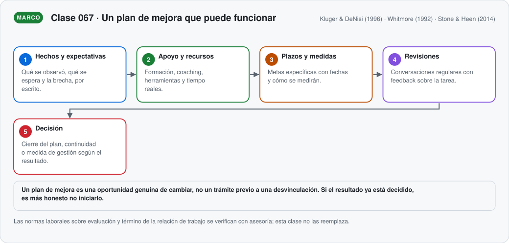

# Clase 067 — Feedback, coaching y planes de mejora

<!-- nav:inicio -->
> **Parte 05 · Gestión de talento y personas** — clase 7 de 12 · [índice de la parte](../../README.md) · [temario](../../../../SYLLABUS.md)
<!-- nav:fin -->

**Parte:** 05 — Gestión de talento y personas  
**Nivel:** Etapa 2 — Líder → Jefe / Team Lead  
**Duración sugerida:** 150–180 minutos · **Estándar:** deep-class-v2

## 🎯 Propósito

Cuando el desempeño de una persona no alcanza lo esperado, la mayoría de los jefes reacciona de dos maneras: evita la conversación esperando que mejore, o salta a un «plan de mejora» formal que la persona y el equipo leen como el comienzo del fin. Ambas respuestas desperdician la oportunidad. Entre la evitación y la medida formal hay un recorrido: **feedback**, **coaching** y, solo si hace falta, un **plan de mejora** genuino, con apoyo real y resultado abierto.

Esta clase integra lo visto en las clases 030 (feedback) y 054 (coaching) con la gestión de desempeño (066), y se apoya en la revisión de Kluger y DeNisi, en el modelo GROW de Whitmore y en el análisis de Stone y Heen sobre cómo se recibe el feedback. Al terminar sabrás escalar de forma gradual y proporcional, diseñar un plan de mejora honesto y decidir con evidencia cuando el plan no funciona.

## 📚 Resultados de aprendizaje

Al finalizar podrás:

1. **Diagnosticar** la causa de un desempeño insuficiente: claridad, capacidad, recursos o motivación.
2. **Elegir** entre feedback, coaching, plan de mejora o decisión de gestión.
3. **Diseñar** un plan de mejora con hechos, apoyo, metas, plazos y revisiones.
4. **Conducir** la conversación con respeto y sin atribuir intención.
5. **Decidir** al final del plan con evidencia y proceso, verificando la norma aplicable.

## 🧭 Agenda

| Tramo | Qué se hace |
|---|---|
| 0–20 min | Recuperación: recuerda un caso de bajo desempeño en tu entorno; ¿qué se hizo y cuándo? |
| 20–60 min | Diagnóstico de causas, escalamiento y diseño de un plan. |
| 60–105 min | Ejemplo trabajado: un plan de mejora de 60 días. |
| 105–140 min | Caso ejecutivo: un colaborador que «no da el ancho». |
| 140–170 min | Límites y entregable. |

## 🧩 Conceptos centrales

| Concepto | Definición | Cómo se reconoce |
|---|---|---|
| **Brecha de desempeño** | Diferencia entre el desempeño observado y el esperado, con hechos. | Se puede describir con ejemplos y fechas. |
| **Diagnóstico de causas** | Examen de si la brecha se debe a falta de claridad, de capacidad, de recursos o de motivación. | Se descartan causas del sistema antes de atribuir a la persona. |
| **Plan de mejora** | Acuerdo escrito, con plazo, apoyo y metas, para cerrar una brecha. | Es específico, apoyado y revisado. |
| **Feedback de tarea** | Información centrada en lo que se hizo y su efecto (Kluger y DeNisi, 1996). | Es concreto y accionable. |
| **Coaching** | Conversación para que la persona descubra cómo mejorar (Whitmore, 1992). | Se hacen preguntas y se acuerda una acción. |
| **Disparador de verdad, relación o identidad** | Reacciones que dificultan recibir feedback (Stone y Heen, 2014). | La persona discute el dato, al jefe o se siente atacada. |

## 🧠 Modelo mental

**Cómo leer el diagrama.** Cinco pasos con un orden deliberado. Antes de fijar plazos y medidas, hay que **establecer los hechos y las expectativas** y **ofrecer apoyo real**. Las revisiones son conversaciones de ayuda, no vigilancia. La decisión final llega al cierre. Un plan donde la decisión ya estaba tomada es un trámite y debe evitarse.

## 📖 Desarrollo

### 1. Primero, el diagnóstico

Ante un desempeño insuficiente, la pregunta inicial es **por qué**. Cuatro causas frecuentes: **claridad** (la persona no sabe qué se espera), **capacidad** (no sabe o no puede hacerlo), **recursos** (le faltan herramientas, tiempo o apoyo) y **motivación** (sabe y puede, pero no quiere o no encuentra sentido). Cada una pide una respuesta distinta: aclarar, formar, dar medios, o conversar sobre motivación y encaje. Muchos desempeños insuficientes son fallas del sistema; atribuirlos a la persona sin descartarlas es injusto.

### 2. Escalar de manera proporcional

Una secuencia proporcional: **1)** feedback oportuno sobre la tarea; **2)** conversación de coaching para ayudar a que la persona piense soluciones; **3)** si la brecha persiste, una conversación explícita sobre expectativas, hechos y consecuencias posibles; **4)** un plan de mejora formal; **5)** una decisión de gestión. Saltarse etapas es injusto; quedarse en las primeras sin decir que hay un problema serio también lo es. Kluger y DeNisi advierten que el feedback dirigido a la persona tiende a empeorar, así que cada paso debe centrarse en la tarea.

### 3. La conversación de hechos

Cuando el problema es serio, se tiene una conversación **explícita**: los hechos, con ejemplos y fechas; el efecto en el trabajo y en otros; lo que se espera; y la pregunta «¿qué está pasando?». Se escucha, y se evita atribuir intención o hacer inferencias sobre el carácter. Stone y Heen explican por qué es difícil recibir esto: se activan disparadores de verdad, relación e identidad. Se espera una reacción emocional y se permite, sin ceder el contenido (clase 039).

### 4. Qué contiene un plan de mejora

Un plan honesto contiene: **hechos y brecha** descritos con ejemplos; **expectativas** concretas y medibles; **apoyo y recursos** reales (formación, coaching, herramientas, tiempo, un mentor); **metas intermedias** con **fechas**; **cómo se medirá** el avance; **revisiones** regulares (semanales o quincenales); y **qué ocurre** al final del plazo, de manera transparente. Se redacta con la persona, que lo firma como constancia de haberlo recibido y entendido, no necesariamente de estar de acuerdo.

### 5. El plan como oportunidad

El plan debe ser una oportunidad genuina: el jefe quiere que la persona mejore y aporta lo necesario. Si la decisión de desvincular ya fue tomada, es más honesto no iniciar un plan que sea una pantalla. Las señales de un plan genuino: apoyo concreto del jefe, metas alcanzables, revisiones con feedback y disposición a reconocer el avance. Las personas perciben rápidamente si es sincero, y el equipo también.

### 6. Durante el plan

Durante el plazo, el jefe da **feedback frecuente y específico**, registra el avance con hechos, ajusta el apoyo si hace falta y reconoce lo logrado. Si surgen factores nuevos —problemas de salud, una situación personal grave, un cambio en el trabajo—, se reevalúa. Algunas de estas situaciones están protegidas por la normativa y requieren asesoría antes de seguir. Y se cuida la confidencialidad: el plan no se comenta con terceros que no necesitan saberlo.

### 7. El cierre

Al final del plazo, se compara el desempeño con las metas. Hay tres resultados posibles: la persona **alcanzó** lo esperado (se cierra el plan y se reconoce); logró un **avance parcial** (se evalúa extender o ajustar, con razón); **no alcanzó** (se toma una decisión de gestión: reasignación a un cargo más adecuado, otra medida o, como último recurso, la desvinculación, con proceso y evidencia, verificando con asesoría las normas aplicables). La decisión debe poder explicarse con hechos documentados.

## 📚 Lectura comparada

| Obra | Qué aporta | Qué no resuelve | Pregunta para contrastar |
|---|---|---|---|
| Kluger y DeNisi (1996) | Foco del feedback y efectos variables. | No diseña planes. | ¿Tu feedback apunta a la tarea? |
| Stone y Heen (2014) | Cómo se recibe el feedback. | No describe el proceso de gestión. | ¿Qué disparador se activa en la persona? |
| Whitmore (1992) | Estructura de la conversación de coaching. | No cubre decisiones de gestión. | ¿Qué opciones generó la persona? |
| Locke y Latham (2002) | Metas específicas y retroalimentación. | No trata de aspectos legales. | ¿Son alcanzables las metas del plan? |
| Edmondson (2018) | Seguridad psicológica para reconocer una dificultad. | No trata de planes formales. | ¿Puede la persona decir que necesita ayuda? |

## 🧮 Ejemplo trabajado

**Situación (hipotética).** Daniela, ejecutiva de cuentas, lleva tres trimestres bajo la meta. Su jefe, Mario, detectó que tarda en responder a los clientes y que no registra las visitas.

| Paso | Qué hace Mario |
|---|---|
| **Diagnóstico** | Revisa datos; conversa con ella. Descubre que su cartera creció 40 % sin ajuste de carga y que no recibió formación en el CRM nuevo. Causa: recursos y capacidad, más que motivación. |
| **Feedback y coaching** | Conversan con GROW: Daniela propone priorizar a sus diez clientes principales y pide capacitación. |
| **Brecha persiste** | Tras seis semanas, mejora la respuesta pero no las ventas. Mario tiene una conversación explícita con hechos y la posibilidad de un plan formal. |
| **Plan de 60 días** | Hechos: tres trimestres bajo la meta; respuesta promedio 48 h. Expectativas: respuesta en 24 h, visitas registradas semanalmente, cierre de cuatro oportunidades. Apoyo: formación en el CRM, un mentor, reducción temporal de cartera en 20 %. Revisiones: quincenales. |
| **Resultado a los 60 días** | Respuesta promedio 18 h; registro completo; dos oportunidades cerradas. Avance parcial. |
| **Decisión** | Extiende 30 días con metas ajustadas y documenta la razón. |

**Qué muestra.** (1) Se diagnosticó antes de atribuir. (2) El plan tuvo apoyo real y plazos. (3) La decisión de extender se justificó con hechos.

## 🔀 Comparación y límites

**Plan de mejora frente a advertencia.** El plan busca que la persona mejore con ayuda; la advertencia disciplinaria es una medida formal por una falta, con reglas propias. No se confunden.

**Límites.** No todo desempeño insuficiente es mejorable con un plan, y a veces la causa es un desajuste entre persona y cargo que se resuelve con un cambio. Los planes mal usados se vuelven una vía lenta a la desvinculación. Las normas laborales sobre evaluación, advertencias, protección de ciertas situaciones y término de la relación de trabajo son específicas de cada jurisdicción y deben verificarse con asesoría antes de actuar. Y esta clase no sustituye atención profesional en situaciones de salud.

## 🪜 De profesional a owner

| Nivel | Cómo trabaja la mejora |
|---|---|
| **Profesional** | Pide feedback temprano y propone cómo mejorar. |
| **Jefe / Team Lead** | Diagnostica, escala de forma proporcional y acompaña. |
| **Gerente** | Revisa que los planes sean genuinos y con proceso. |
| **CEO / Director** | Protege a la organización de decisiones arbitrarias y a las personas de planes de fachada. |
| **Founder / Owner** | Aborda temprano lo que antes toleraba por afecto o por falta de tiempo. |

## 🏢 Caso ejecutivo

Un gerente tiene en su equipo a un analista senior cuyo trabajo ha decaído hace un año: entregas tardías, errores y poca participación. Nadie le ha dicho nada formal. El gerente piensa iniciar un plan de mejora «para dejar constancia» y luego desvincularlo. La directora de personas le advierte que el analista tuvo una licencia médica larga hace seis meses y que el historial no tiene evaluaciones recientes. El analista, al enterarse de rumores, dice que «lo quieren sacar».

Entrega un **plan de mejora o de decisión** que contenga: (a) el diagnóstico de causas con evidencia; (b) lo que se hizo y no se hizo hasta ahora; (c) la conversación inicial con hechos y escucha; (d) el diseño del plan —o por qué no corresponde aún—; (e) las salvaguardas legales y de salud a consultar; (f) la decisión posible y cómo la justificarías.

## 🧪 Práctica

1. Toma un caso de bajo desempeño y clasifica la causa: claridad, capacidad, recursos o motivación.
2. Redacta tres hechos con fechas sin adjetivos.
3. Escribe las metas intermedias y las fechas de un plan de 60 días.
4. Define el apoyo concreto que ofrecerías y su costo.
5. Escribe qué señales te harían concluir que el plan es genuino o una pantalla.

## ⚠️ Errores frecuentes

| Error | Por qué ocurre | Cómo corregirlo |
|---|---|---|
| Evitar la conversación | Incomoda | Feedback temprano y explícito. |
| Atribuir a la persona | Es la explicación fácil | Diagnosticar causas del sistema primero. |
| Plan de fachada | Se quiere dejar constancia | Decidir con honestidad si hay una oportunidad real. |
| Plan sin apoyo | Se exige sin dar medios | Formación, coaching y tiempo. |
| Sorprender al final | No hubo revisiones | Revisiones regulares con feedback. |
| Ignorar normas | Se actúa por urgencia | Verificar con asesoría antes de decidir. |

## ❓ Preguntas de comprobación

1. ¿Cuáles son las cuatro causas posibles de un desempeño insuficiente?
2. ¿Cómo escala una respuesta proporcional?
3. ¿Qué contiene un plan de mejora?
4. ¿Qué diferencia hay entre un plan genuino y uno de fachada?
5. ¿Qué resultados posibles tiene el cierre de un plan?
6. ¿Por qué el feedback debe centrarse en la tarea?
7. ¿Qué verificaciones se hacen antes de decidir una desvinculación?

Claves de respuesta

1. Claridad, capacidad, recursos o motivación.
2. Feedback de tarea, coaching, conversación explícita, plan de mejora y decisión de gestión.
3. Hechos y brecha, expectativas, apoyo y recursos, metas con fechas, medición, revisiones y qué ocurre al final.
4. El genuino tiene apoyo real y resultado abierto; el de fachada tiene la decisión ya tomada.
5. Alcanzó lo esperado, avance parcial o no alcanzó, con la decisión correspondiente.
6. Porque el feedback dirigido a la persona tiende a debilitar el desempeño.
7. La norma laboral aplicable, las protecciones de ciertas situaciones, el proceso seguido y la documentación, con asesoría.

## 📥 Entregable

Guarda en `portfolio/067-feedback-coaching-y-planes-de-mejora/`:

- `people-decision-brief.md` (plantilla [People Decision Brief](../../../../templates/people-decision-brief.md)) con el diagnóstico y el plan del caso ejecutivo;
- `termination-risk-checklist.md` (plantilla [Checklist de riesgo en término de contrato](../../../../templates/termination-risk-checklist.md)) con las verificaciones previas;
- `decision-journal.md` con las conversaciones, los hechos y el resultado.

## 📗 Fuentes y verificación

- Avraham N. Kluger & Angelo DeNisi — *The Effects of Feedback Interventions on Performance: A Historical Review, a Meta-Analysis, and a Preliminary Feedback Intervention Theory* (Psychological Bulletin, 1996). **Uso en esta clase:** foco del feedback y efectos variables. Lectura selectiva sobre **feedback, coaching y planes de mejora**. **Localizador:** [DOI 10.1037/0033-2909.119.2.254](https://doi.org/10.1037/0033-2909.119.2.254).
- Douglas Stone & Sheila Heen — *Thanks for the Feedback* (Viking, 2014). **Uso en esta clase:** cómo se recibe el feedback y los tres disparadores. Lectura selectiva sobre **feedback, coaching y planes de mejora**. **Localizador:** [ISBN-13 9780670014668](https://openlibrary.org/isbn/9780670014668).
- John Whitmore — *Coaching for Performance* (Ediciones Paidos Iberica, 2003). **Uso en esta clase:** estructura de la conversación de coaching. Lectura selectiva sobre **feedback, coaching y planes de mejora**. **Localizador:** [ISBN-13 9788449314322](https://openlibrary.org/isbn/9788449314322).
- Edwin A. Locke & Gary P. Latham — *Building a Practically Useful Theory of Goal Setting and Task Motivation: A 35-Year Odyssey* (American Psychologist, 2002). **Uso en esta clase:** metas específicas y retroalimentación. Lectura selectiva sobre **feedback, coaching y planes de mejora**. **Localizador:** [DOI 10.1037/0003-066X.57.9.705](https://doi.org/10.1037/0003-066X.57.9.705).
- Amy C. Edmondson — *The Fearless Organization* (Wiley, 2018). **Uso en esta clase:** seguridad psicológica para reconocer una dificultad. Lectura selectiva sobre **feedback, coaching y planes de mejora**. **Localizador:** [ISBN-13 9781119477242](https://openlibrary.org/isbn/9781119477242).

> **Regla de fuentes para Feedback, coaching y planes de mejora:** las obras anteriores estructuran las perspectivas de esta materia; cualquier norma, ley o estándar vivo mencionado debe comprobarse nuevamente en su fuente primaria vigente, en particular las normas laborales sobre evaluación, advertencias y término de la relación de trabajo, y las que protegen ciertas situaciones de salud. Los ejemplos y casos son hipotéticos. El desarrollo es original y no reproduce capítulos protegidos.

<!-- pie:inicio -->
---

| Anterior | Índice | Siguiente |
|---|---|---|
| [← 066 · Gestión de desempeño](../066-gestion-de-desempeno/README.md) | [Parte 05](../../README.md) · [Programa](../../../../SYLLABUS.md) | [068 · Compensación e incentivos: fundamentos →](../068-compensacion-e-incentivos-fundamentos/README.md) |
<!-- pie:fin -->
