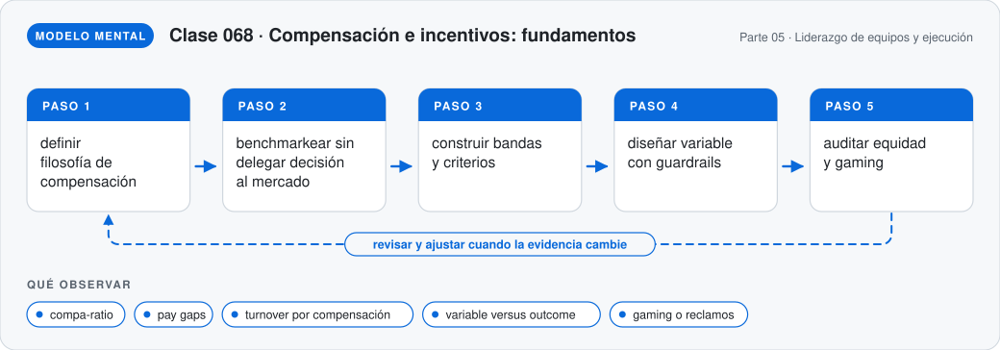

# Clase 068 — Compensación e incentivos: fundamentos

<!-- nav:inicio -->
> **Parte 05 · Gestión de talento y personas** — clase 8 de 12 · [índice de la parte](../../README.md) · [temario](../../../../SYLLABUS.md)
<!-- nav:fin -->

**Parte:** 05 — Gestión de talento y personas  
**Nivel:** Etapa 2 — Líder → Jefe / Team Lead  
**Duración sugerida:** 150–180 minutos · **Estándar:** deep-class-v2

## 🎯 Propósito

La compensación es la herramienta de gestión de personas más cara y la que más se usa con ideas heredadas: «lo que se premia se repite», «el dinero motiva», «un bono por resultados alinea a todos». Cada una contiene algo cierto y algo engañoso. La investigación muestra que las personas **comparan** lo que reciben con lo que aportan y con lo que otros reciben, que un incentivo puede cambiar la conducta de un modo que nadie pretendía y que, en ciertas tareas, premiar con dinero puede reducir el interés por la tarea.

Esta clase presenta los fundamentos con tres investigaciones: la teoría de la equidad de J. Stacy Adams, el metaanálisis de Deci, Koestner y Ryan sobre recompensas y motivación intrínseca y el estudio de Gneezy y Rustichini sobre el efecto de una multa en guarderías. Al terminar sabrás evaluar si un sistema de compensación es percibido como justo, anticipar efectos no deseados de un incentivo y diseñar un esquema sencillo y coherente.

## 📚 Resultados de aprendizaje

Al finalizar podrás:

1. **Explicar** la teoría de la equidad y cómo se juzga una compensación.
2. **Describir** qué hallaron Deci y colegas sobre recompensas y motivación intrínseca.
3. **Anticipar** efectos no deseados de un incentivo, como el caso de la multa.
4. **Distinguir** remuneración fija, variable y reconocimiento no monetario, y su función.
5. **Diseñar** un esquema de compensación simple, coherente y comunicable.

## 🧭 Agenda

| Tramo | Qué se hace |
|---|---|
| 0–20 min | Recuperación: recuerda un incentivo en tu trabajo que cambió la conducta de modo inesperado. |
| 20–60 min | Equidad, recompensas e incentivos con efectos no deseados. |
| 60–105 min | Ejemplo trabajado: un bono por ventas que daña la colaboración. |
| 105–140 min | Caso ejecutivo: una brecha salarial entre pares. |
| 140–170 min | Límites y entregable. |

## 🧩 Conceptos centrales

| Concepto | Definición | Cómo se reconoce |
|---|---|---|
| **Equidad percibida** | Juicio sobre si la relación entre lo que se aporta y lo que se recibe es justa en comparación con otros (Adams, 1963). | La persona compara con pares y con el mercado. |
| **Inequidad** | Percepción de que la propia relación aporte-resultado es menos favorable que la de otro. | Genera tensión que se busca reducir. |
| **Recompensa tangible contingente** | Premio material que depende de realizar una tarea o alcanzar un resultado (Deci et al., 1999). | «Si haces X, recibes Y.» |
| **Motivación intrínseca** | Interés por la tarea en sí (Ryan y Deci, 2000). | Se haría sin recompensa. |
| **Efecto de desplazamiento** | Reducción del interés intrínseco al introducir una recompensa externa (Deci et al., 1999). | Tras el premio, baja la conducta espontánea. |
| **Incentivo mal alineado** | Incentivo que premia una conducta distinta de la deseada (Gneezy y Rustichini, 2000). | Se produce lo medido, no lo querido. |

## 🧠 Modelo mental

**Cómo leer el diagrama.** A la izquierda, tres rasgos de la equidad percibida: se compara aporte con resultado, con distintos referentes, y la inequidad percibida mueve a actuar. A la derecha, tres hallazgos sobre incentivos: las recompensas contingentes pueden reducir la motivación intrínseca, una multa puede convertirse en un precio, y se premia lo medido aunque se pretenda otra cosa.

## 📖 Desarrollo

### 1. La compensación comunica

Un sistema de compensación **dice** qué valora la organización: lo que se paga, a quién y por qué. Más que una herramienta de motivación, es una declaración. Si dice cosas contradictorias con la estrategia —se predica colaboración y se premia el éxito individual—, la conducta seguirá lo premiado. Por eso conviene revisar qué mensaje implícito transmite cada elemento del esquema.

### 2. La teoría de la equidad

Adams propone que las personas comparan la razón entre sus **aportes** (esfuerzo, formación, experiencia) y sus **resultados** (pago, reconocimiento, estatus) con la de otras personas de referencia. Si perciben que la propia razón es menos favorable, experimentan inequidad y buscan reducirla: pueden bajar su esfuerzo, pedir un cambio, reinterpretar la comparación o irse. La percepción importa más que la realidad: dos personas con el mismo pago pueden sentir cosas distintas según con quién se comparen. La **transparencia** de criterios reduce los malentendidos, aunque no elimina las comparaciones.

### 3. Recompensas y motivación intrínseca

Deci, Koestner y Ryan integraron un gran número de experimentos sobre el efecto de las recompensas extrínsecas en la motivación intrínseca y concluyeron que las recompensas **tangibles contingentes** —premios materiales que dependen de realizar la tarea— tienden a **reducir** el interés intrínseco, mientras que el elogio informativo puede aumentarlo. Esto no significa que el dinero no motive: significa que, en tareas interesantes, premiar su realización puede cambiar el significado de la tarea («lo hago por el premio»). En tareas rutinarias, el efecto es menos relevante.

### 4. Cuando una multa es un precio

Gneezy y Rustichini estudiaron guarderías donde se introdujo una multa por recoger tarde a los niños. En lugar de disminuir, los retrasos **aumentaron**: la multa convirtió una obligación moral en un precio que los padres podían pagar. El caso ilustra un principio: un incentivo monetario puede **reemplazar** una norma social por un cálculo económico, con resultados contrarios a los buscados. Antes de usar un incentivo, conviene preguntarse qué norma o valor hoy sostiene la conducta y si el incentivo lo desplazará.

### 5. Los tres componentes

Un esquema simple distingue: la **remuneración fija**, que debe ser justa, competitiva y comprensible, y cumple una función de condición básica; la **remuneración variable**, ligada a resultados, que funciona mejor cuando la persona controla el resultado, es medible y no incentiva conductas dañinas; y el **reconocimiento no monetario**, que informa sobre la competencia (clase 057). Los beneficios y la estabilidad también son parte de la oferta. Cuantos más componentes dependan de un solo indicador, más riesgo de distorsión.

### 6. Diseñar el incentivo

Preguntas de diseño: ¿qué conducta o resultado se quiere?, ¿la persona puede influir en él?, ¿cómo se medirá, y qué se puede manipular?, ¿qué se descuidará por no estar medido?, ¿qué efecto tendrá sobre la colaboración? Para tareas complejas y de equipo, suele funcionar mejor un incentivo **colectivo** o de largo plazo, con criterios de calidad. Se prueba con un piloto y se revisa. Y se comunica con claridad cómo se calcula.

### 7. Equidad interna y externa

La **equidad interna** compara cargos dentro de la organización según su aporte; la **externa**, con el mercado. Las brechas entre personas con aportes parecidos deben poder explicarse con criterios objetivos (cargo, desempeño, antigüedad), y revisarse por posibles sesgos de género u otros. Las normas sobre igualdad de remuneración y sobre el contenido de los contratos son específicas de cada jurisdicción y se verifican con asesoría.

## 📚 Lectura comparada

| Obra | Qué aporta | Qué no resuelve | Pregunta para contrastar |
|---|---|---|---|
| Adams (1963) | Teoría de la equidad. | Es un modelo de comparación, con medición compleja. | ¿Con quién se compara tu equipo? |
| Deci, Koestner y Ryan (1999) | Efecto de las recompensas sobre la motivación intrínseca. | Los efectos varían según el tipo de recompensa. | ¿Tu bono premia una tarea interesante? |
| Gneezy y Rustichini (2000) | Una multa puede ser un precio. | Es un estudio en un contexto específico. | ¿Qué norma sustituye tu incentivo? |
| Ryan y Deci (2000) | Motivación autónoma y control. | No es una guía de compensación. | ¿Tu incentivo informa o controla? |
| Pink (2009) | Autonomía, maestría y propósito; límites de los incentivos. | Divulgación. | ¿Qué parte del argumento verificarías? |

## 🧮 Ejemplo trabajado

**Situación (hipotética).** Una empresa de servicios paga un bono trimestral a quien más nuevos clientes capte. Observa que aumentó la captación, pero cayó la retención, los vendedores dejaron de compartir contactos y las quejas de postventa subieron.

| Elemento | Lectura |
|---|---|
| **Qué se mide** | Clientes nuevos captados. |
| **Qué se descuida** | Retención, calidad de la venta, apoyo a colegas. |
| **Efecto sobre la norma** | Se desplazó la cooperación. |
| **Equidad** | Los vendedores de zonas pequeñas sienten que el bono es injusto: «no es mi esfuerzo, es mi zona». |

**Rediseño.** (1) Un componente variable con tres indicadores: captación (40 %), retención a 6 meses (40 %) y satisfacción de postventa (20 %). (2) Un tramo de bono colectivo por la meta del equipo regional. (3) Cuotas ajustadas por potencial de la zona. (4) Un reconocimiento no monetario mensual a la colaboración. (5) Un piloto de seis meses y revisión.

**Resultado.** En un año, la captación se mantiene, la retención sube de 70 % a 82 % y las quejas bajan.

**Qué muestra.** (1) El incentivo original premiaba solo lo medido. (2) Se atendió la equidad percibida con cuotas ajustadas. (3) Se combinaron incentivos individuales, colectivos y reconocimiento.

## 🔀 Comparación y límites

**Pago justo frente a motivación.** Un pago justo evita la insatisfacción pero no genera por sí solo motivación; el trabajo, el reconocimiento y el sentido hacen más a ese respecto.

**Límites.** Los experimentos sobre recompensas se hicieron sobre todo en entornos de laboratorio y educativos; su aplicación a la remuneración laboral debe hacerse con prudencia, y hay debate sobre la generalidad del efecto. El estudio de las guarderías es un caso en un contexto particular. La teoría de la equidad no dice qué comparaciones son razonables. Y los esquemas de compensación están sujetos a normas sobre remuneración mínima, igualdad, gratificaciones y contratos que se verifican con asesoría.

## 🪜 De profesional a owner

| Nivel | Cómo trabaja la compensación |
|---|---|
| **Profesional** | Entiende cómo se calcula su compensación y la compara con criterio. |
| **Jefe / Team Lead** | Explica los criterios y detecta efectos no deseados de un incentivo. |
| **Gerente** | Diseña incentivos alineados con la estrategia y revisa la equidad. |
| **CEO / Director** | Se asegura de que el esquema premie lo que la estrategia necesita. |
| **Founder / Owner** | Equilibra caja, equidad y atracción de talento, y usa equity con cuidado. |

## 🏢 Caso ejecutivo

En una empresa de 200 personas, una auditoría muestra que dos analistas con el mismo cargo, la misma antigüedad y evaluaciones similares ganan un 18 % de diferencia: una es mujer, el otro hombre. La diferencia viene de las condiciones de ingreso de cada uno. La directora de personas propone ajustar de inmediato; el gerente financiero dice que «es un tema de negociación individual». Además, el bono por metas individuales ha generado rivalidad entre equipos.

Entrega un **análisis y propuesta de compensación** que contenga: (a) el análisis de equidad interna y externa con criterios objetivos; (b) cómo tratarás la brecha entre los dos analistas; (c) el efecto del bono individual sobre la colaboración; (d) el rediseño del esquema con sus tres componentes; (e) cómo lo comunicarás; (f) las verificaciones legales y cómo medirás el efecto.

## 🧪 Práctica

1. Identifica un incentivo de tu organización y escribe qué mide y qué descuida.
2. Escribe con quién se comparan las personas de tu equipo y qué diferencias percibirían.
3. Diseña un indicador de calidad para equilibrar uno de cantidad.
4. Revisa dos cargos comparables y los criterios que explican la diferencia.
5. Redacta la explicación breve de cómo se calcula un bono.

## ⚠️ Errores frecuentes

| Error | Por qué ocurre | Cómo corregirlo |
|---|---|---|
| Premiar un solo indicador | Es simple | Equilibrar cantidad y calidad. |
| Usar dinero para tareas interesantes | Se supone que motiva | Informar sobre competencia y dar sentido. |
| Ignorar la equidad percibida | Se supone que cada uno ve lo suyo | Explicar criterios y revisar comparaciones. |
| Introducir multas | Se quiere disuadir | Anticipar si sustituyen una norma. |
| Esquema opaco | Se evita el debate | Comunicar cómo se calcula. |
| Brechas sin explicación | Se heredan de negociaciones | Revisar con criterios objetivos. |

## ❓ Preguntas de comprobación

1. ¿Qué dice la teoría de la equidad de Adams?
2. ¿Qué hallaron Deci, Koestner y Ryan sobre recompensas contingentes?
3. ¿Qué mostró el estudio de las guarderías?
4. ¿Qué tres componentes tiene un esquema de compensación?
5. ¿Qué preguntas haces al diseñar un incentivo?
6. ¿Qué diferencia hay entre equidad interna y externa?
7. ¿Qué límite tienen los experimentos sobre recompensas?

Claves de respuesta

1. Que las personas comparan la razón entre sus aportes y sus resultados con la de otras personas, y buscan reducir la inequidad que perciben.
2. Que las recompensas tangibles contingentes tienden a reducir la motivación intrínseca, mientras el elogio informativo puede aumentarla.
3. Que una multa por retraso aumentó los retrasos, porque convirtió una obligación moral en un precio.
4. Remuneración fija, variable y reconocimiento no monetario.
5. Qué conducta se quiere, si la persona la controla, cómo se mide y se puede manipular, qué se descuidará y el efecto en la colaboración.
6. La interna compara cargos dentro de la organización; la externa, con el mercado.
7. Provienen sobre todo de entornos de laboratorio y educativos; su aplicación a la remuneración laboral exige prudencia.

## 📥 Entregable

Guarda en `portfolio/068-compensacion-e-incentivos-fundamentos/`:

- `leadership-decision-brief.md` (plantilla [Leadership Decision Brief](../../../../templates/leadership-decision-brief.md)) con el análisis y la propuesta del caso ejecutivo;
- `reading-note.md` con una tensión entre Adams y Deci, Koestner y Ryan;
- `decision-journal.md` con los efectos anticipados del incentivo y su revisión.

## 📗 Fuentes y verificación

- J. Stacy Adams — *Towards an understanding of inequity* (The Journal of Abnormal and Social Psychology, 1963). **Uso en esta clase:** teoría de la equidad en la compensación. Lectura selectiva sobre **compensación e incentivos: fundamentos**. **Localizador:** [DOI 10.1037/h0040968](https://doi.org/10.1037/h0040968).
- Edward L. Deci, Richard Koestner & Richard M. Ryan — *A meta-analytic review of experiments examining the effects of extrinsic rewards on intrinsic motivation* (Psychological Bulletin, 1999). **Uso en esta clase:** efecto de las recompensas sobre la motivación intrínseca. Lectura selectiva sobre **compensación e incentivos: fundamentos**. **Localizador:** [DOI 10.1037/0033-2909.125.6.627](https://doi.org/10.1037/0033-2909.125.6.627).
- Uri Gneezy & Aldo Rustichini — *A Fine is a Price* (The Journal of Legal Studies, 2000). **Uso en esta clase:** una multa que se convierte en un precio. Lectura selectiva sobre **compensación e incentivos: fundamentos**. **Localizador:** [DOI 10.1086/468061](https://doi.org/10.1086/468061).
- Richard M. Ryan & Edward L. Deci — *Self-Determination Theory and the Facilitation of Intrinsic Motivation, Social Development, and Well-Being* (American Psychologist, 2000). **Uso en esta clase:** motivación autónoma y control. Lectura selectiva sobre **compensación e incentivos: fundamentos**. **Localizador:** [DOI 10.1037/0003-066X.55.1.68](https://doi.org/10.1037/0003-066X.55.1.68).
- Daniel H. Pink — *Drive* (Riverhead Books, 2009). **Uso en esta clase:** límites de los incentivos en tareas complejas. Lectura selectiva sobre **compensación e incentivos: fundamentos**. **Localizador:** [ISBN-13 9781594488849](https://openlibrary.org/isbn/9781594488849).

> **Regla de fuentes para Compensación e incentivos: fundamentos:** las obras anteriores estructuran las perspectivas de esta materia; cualquier norma, ley o estándar vivo mencionado debe comprobarse nuevamente en su fuente primaria vigente, en particular las normas sobre remuneración, igualdad de remuneraciones y contenido de los contratos. Los ejemplos y casos son hipotéticos, con cifras ilustrativas. El desarrollo es original y no reproduce capítulos protegidos.

<!-- pie:inicio -->
---

| Anterior | Índice | Siguiente |
|---|---|---|
| [← 067 · Feedback, coaching y planes de mejora](../067-feedback-coaching-y-planes-de-mejora/README.md) | [Parte 05](../../README.md) · [Programa](../../../../SYLLABUS.md) | [069 · Aprendizaje y upskilling →](../069-aprendizaje-y-upskilling/README.md) |
<!-- pie:fin -->
