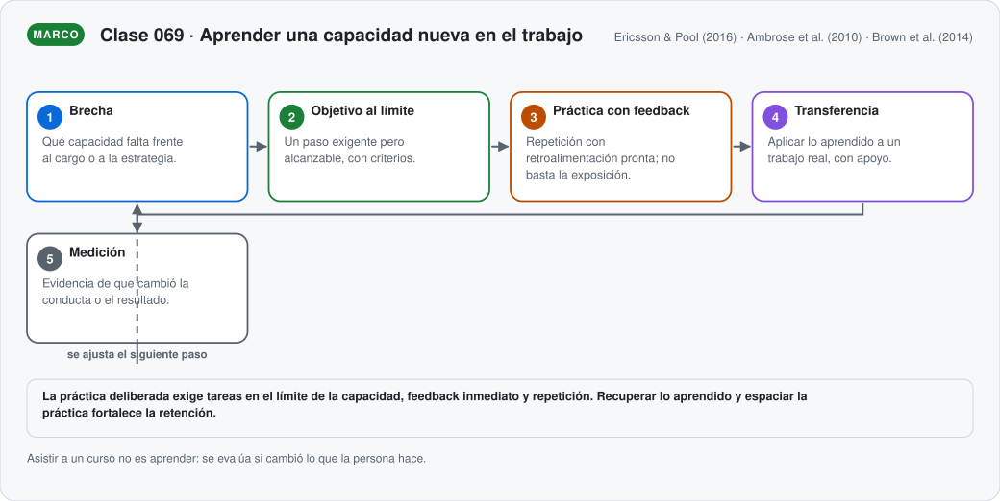

# Clase 069 — Aprendizaje y upskilling

<!-- nav:inicio -->
> **Parte 05 · Gestión de talento y personas** — clase 9 de 12 · [índice de la parte](../../README.md) · [temario](../../../../SYLLABUS.md)
<!-- nav:fin -->

**Parte:** 05 — Gestión de talento y personas  
**Nivel:** Etapa 2 — Líder → Jefe / Team Lead  
**Duración sugerida:** 150–180 minutos · **Estándar:** deep-class-v2

## 🎯 Propósito

Las organizaciones gastan mucho en capacitación y obtienen poco cambio en lo que las personas hacen. La razón es conocida por quienes estudian el aprendizaje: **asistir a un curso no es aprender**, y aprender no es lo mismo que cambiar una conducta en el trabajo. Para que una capacidad nueva se instale hace falta práctica en el límite de lo que la persona puede, retroalimentación pronta, repetición espaciada y oportunidades reales de aplicarla.

Esta clase usa la investigación sobre práctica deliberada de Anders Ericsson, los principios de aprendizaje que sintetizan Ambrose y colegas y las conclusiones de Brown, Roediger y McDaniel sobre aprendizaje efectivo. Al terminar sabrás diagnosticar brechas de capacidades, diseñar un plan de aprendizaje con práctica y transferencia, y evaluar si cambió algo que importe.

## 📚 Resultados de aprendizaje

Al finalizar podrás:

1. **Distinguir** capacitación, aprendizaje y cambio de conducta.
2. **Describir** los rasgos de la práctica deliberada.
3. **Aplicar** principios de aprendizaje: conocimiento previo, práctica, retroalimentación y recuperación.
4. **Diseñar** un plan de upskilling con objetivo, práctica, transferencia y medición.
5. **Evaluar** el efecto de una intervención de aprendizaje en el trabajo.

## 🧭 Agenda

| Tramo | Qué se hace |
|---|---|
| 0–20 min | Recuperación: recuerda un curso del que no aplicaste nada y otro que sí cambió lo que haces; ¿qué los diferenció? |
| 20–60 min | Práctica deliberada y principios de aprendizaje. |
| 60–105 min | Ejemplo trabajado: un plan de upskilling en análisis de datos. |
| 105–140 min | Caso ejecutivo: un programa de capacitación masivo sin efecto. |
| 140–170 min | Límites y entregable. |

## 🧩 Conceptos centrales

| Concepto | Definición | Cómo se reconoce |
|---|---|---|
| **Upskilling** | Desarrollo de capacidades que una persona necesita para su cargo actual o próximo. | Hay una capacidad objetivo y evidencia de dominio. |
| **Práctica deliberada** | Práctica diseñada para mejorar un aspecto específico, al límite de la capacidad, con retroalimentación inmediata (Ericsson y Pool, 2016). | Es exigente, repetida y con corrección. |
| **Conocimiento previo** | Lo que la persona ya sabe y condiciona lo que aprende (Ambrose et al., 2010). | Se explora antes de enseñar. |
| **Práctica de recuperación** | Intentar recordar lo aprendido, en lugar de releerlo (Brown et al., 2014). | Se evalúa sin mirar los apuntes. |
| **Práctica espaciada** | Repetir con intervalos de tiempo en vez de concentrar todo (Brown et al., 2014). | Hay sesiones repartidas. |
| **Transferencia** | Aplicación de lo aprendido a situaciones reales. | Cambia lo que se hace en el trabajo. |

## 🧠 Modelo mental

**Cómo leer el diagrama.** El aprendizaje no es un evento sino una secuencia: se identifica la **brecha**, se fija un objetivo exigente pero alcanzable, se **practica con feedback**, se **transfiere** a un trabajo real y se **mide** el cambio. Un curso suele cubrir solo el tercer paso, sin práctica ni transferencia, y por eso su efecto es bajo.

## 📖 Desarrollo

### 1. Capacitación no es aprendizaje

Una asistencia al curso se mide fácil; el aprendizaje, no. Y el cambio de conducta en el trabajo depende de factores adicionales: si la persona tiene la oportunidad de aplicar lo aprendido, si su jefe lo apoya y si el entorno lo permite. Por eso conviene definir el **resultado esperado en el trabajo** —qué hará distinto la persona— antes de elegir la actividad de aprendizaje.

### 2. Práctica deliberada

Ericsson, estudiando a expertos en música, deporte y ajedrez, concluyó que el alto desempeño no resulta de la mera experiencia sino de una **práctica deliberada**: tareas diseñadas para mejorar aspectos específicos, un poco más allá de lo que la persona hace con comodidad, con **retroalimentación inmediata** y con repetición. Suele requerir un buen guía o mentor. No es agradable ni siempre divertida. En el trabajo, se traduce en asignaciones que estiran, con alguien que observe y dé feedback.

### 3. Principios de aprendizaje

Ambrose y colegas resumen siete principios con base en la investigación. Entre los más útiles para quien diseña aprendizaje: el **conocimiento previo** puede ayudar o interferir, y conviene activarlo y corregirlo; la **organización** del conocimiento influye en cómo se recupera y aplica; la **motivación** y el valor percibido de la tarea orientan el esfuerzo; la **práctica dirigida con retroalimentación** es clave; y el aprendiz se beneficia de desarrollar su **autorregulación** (monitorear su propio aprendizaje).

### 4. Estrategias que funcionan

Brown, Roediger y McDaniel sintetizan estrategias respaldadas por la investigación: la **práctica de recuperación** (intentar recordar, no releer), la **práctica espaciada** (repartir en el tiempo), la **intercalación** de temas (mezclar tipos de problemas) y la elaboración (explicar con palabras propias). Se sienten más difíciles que releer o repetir seguido, y precisamente por eso funcionan: la dificultad deseable fortalece el aprendizaje. Muchas prácticas habituales de capacitación —una jornada intensiva única— son poco eficaces.

### 5. Aprender en el trabajo

La mayor parte del aprendizaje de un adulto ocurre en el trabajo. Medios útiles: **asignaciones de desarrollo** (tareas nuevas con apoyo), **rotaciones**, **proyectos**, **mentoría**, **coaching** (clase 054), **comunidades de práctica** y **retroalimentación** (clase 030). Un modelo popular propone distribuciones fijas entre experiencia, relaciones y formación, pero esas proporciones carecen de respaldo sólido y no deben usarse como regla: lo importante es combinar experiencia, apoyo y formación según la capacidad.

### 6. Diseñar un plan

Pasos: **1)** definir la **capacidad objetivo** por resultados en el trabajo; **2)** diagnosticar la **brecha** con evidencia, no solo con autoevaluación; **3)** fijar un **objetivo** al límite de la capacidad, con criterios; **4)** elegir **actividades** que incluyan práctica con feedback y recuperación espaciada; **5)** planificar la **transferencia**: una situación real y apoyo del jefe; **6)** definir cómo se **medirá** el cambio. Un plan para un trimestre suele ser más realista que uno anual.

### 7. Medir el efecto

Se evalúa en varios niveles: **reacción** (satisfacción, poco informativa), **aprendizaje** (qué saben o pueden hacer), **conducta** (qué hacen distinto en el trabajo), y **resultados** (qué cambia en el desempeño). El más difícil y relevante es la conducta: se observa con indicadores de trabajo, feedback del jefe y de pares. Si no hay cambio, se examina si faltó práctica, oportunidad de aplicar o apoyo, antes de culpar a la persona.

## 📚 Lectura comparada

| Obra | Qué aporta | Qué no resuelve | Pregunta para contrastar |
|---|---|---|---|
| Ericsson y Pool (2016) | Práctica deliberada. | Parte de la evidencia es de dominios con reglas claras. | ¿Qué práctica estira a la persona? |
| Ambrose et al. (2010) | Principios de aprendizaje con base en investigación. | No es específico de la empresa. | ¿Qué conocimiento previo debes explorar? |
| Brown, Roediger y McDaniel (2014) | Estrategias de recuperación y espaciado. | Se centra en el aprendizaje académico. | ¿Qué parte de tu capacitación es recuperación? |
| Whitmore (1992) | Coaching para facilitar el aprendizaje. | No cubre formación. | ¿Qué pregunta ayuda a la persona a reflexionar? |
| Charan, Drotter y Noel (2001) | Desarrollo para pasajes de liderazgo. | Se centra en líderes. | ¿Qué capacidad exige el próximo pasaje? |

## 🧮 Ejemplo trabajado

**Situación (hipotética).** Una empresa necesita que sus analistas comerciales usen análisis de datos para proponer precios. El área de personas ofreció un curso de dos días; seis meses después, casi nadie lo usa.

| Paso | Plan de upskilling |
|---|---|
| **Capacidad objetivo** | Proponer ajustes de precio con análisis de sensibilidad en dos cuentas por trimestre. |
| **Brecha** | Tres de ocho analistas la manejan; evidencia: un ejercicio práctico con datos reales. |
| **Objetivo al límite** | Para cada persona: un análisis de sensibilidad completo sobre una cuenta real en seis semanas. |
| **Práctica con feedback** | Sesiones semanales de una hora con un mentor; cada analista presenta su avance y recibe feedback de tarea. |
| **Recuperación y espaciado** | Cada semana, un problema nuevo resuelto sin consultar apuntes; repaso a las dos y seis semanas. |
| **Transferencia** | Un caso real revisado por el gerente comercial; el jefe protege dos horas semanales. |
| **Medición** | Número de propuestas con análisis, cambios de precio y margen; feedback del gerente. |

**Resultado.** A los tres meses, siete de ocho analistas presentan propuestas con análisis; el margen de las cuentas revisadas sube 1,5 puntos.

**Qué muestra.** (1) Se definió el resultado en el trabajo antes de la actividad. (2) Hubo práctica con feedback y recuperación. (3) El jefe protegió el tiempo y se midió la conducta.

## 🔀 Comparación y límites

**Capacitación frente a desarrollo.** La capacitación transmite conocimientos específicos; el desarrollo prepara a la persona para responsabilidades futuras, e incluye experiencias, relaciones y reflexión.

**Límites.** La práctica deliberada se estudió sobre todo en dominios con reglas y medidas claras, y su generalización a tareas de gestión es una extrapolación. Las estrategias de recuperación y espaciado provienen de investigación educativa. Y el aprendizaje depende del contexto: no ocurre si el entorno no permite aplicar lo aprendido o penaliza los errores. Las obligaciones de capacitación en seguridad y las normas sobre franquicias de capacitación se verifican en su fuente vigente.

## 🪜 De profesional a owner

| Nivel | Cómo trabaja el aprendizaje |
|---|---|
| **Profesional** | Diseña su propia práctica y pide feedback. |
| **Jefe / Team Lead** | Asigna tareas que estiran y protege el tiempo para practicar. |
| **Gerente** | Planifica el desarrollo de capacidades de su área según la estrategia. |
| **CEO / Director** | Invierte en capacidades críticas y evalúa su efecto en el negocio. |
| **Founder / Owner** | Aprende constantemente y desarrolla a su equipo con recursos limitados. |

## 🏢 Caso ejecutivo

Una empresa invirtió USD 120.000 en un programa de liderazgo digital de dos días para 80 gerentes. En las evaluaciones inmediatas, el 92 % lo calificó bien; seis meses después, una encuesta muestra que el 85 % no usa nada de lo aprendido. Los jefes dicen que «no hay tiempo». El director quiere repetir el programa con otro proveedor.

Entrega un **plan de upskilling** que contenga: (a) el diagnóstico de por qué no hubo cambio; (b) la capacidad objetivo definida por resultados en el trabajo; (c) el diseño con práctica, feedback, recuperación espaciada y transferencia; (d) el papel de los jefes; (e) cómo medirás reacción, aprendizaje, conducta y resultados; (f) qué decidirás sobre el presupuesto restante.

## 🧪 Práctica

1. Define una capacidad que necesitas por resultados en el trabajo, no por un curso.
2. Diagnostica tu brecha con evidencia (un ejercicio real).
3. Diseña tres sesiones espaciadas de práctica con feedback.
4. Define cómo aplicarás lo aprendido en una situación real.
5. Elige el indicador de conducta que revisarás a los tres meses.

## ⚠️ Errores frecuentes

| Error | Por qué ocurre | Cómo corregirlo |
|---|---|---|
| Medir asistencia | Es fácil | Medir conducta y resultados. |
| Jornada intensiva única | Es cómoda | Espaciar la práctica. |
| Releer en lugar de recuperar | Se siente productivo | Practicar la recuperación. |
| Sin oportunidad de aplicar | No se piensa en el entorno | Definir la situación de transferencia. |
| Sin apoyo del jefe | Se delega a personas | Comprometer al jefe y proteger tiempo. |
| Usar proporciones fijas de aprendizaje | Parecen científicas | Combinar según la capacidad. |

## ❓ Preguntas de comprobación

1. ¿Qué diferencia hay entre capacitación y cambio de conducta?
2. ¿Qué rasgos tiene la práctica deliberada?
3. ¿Qué estrategias de aprendizaje respaldan Brown, Roediger y McDaniel?
4. ¿Qué cuatro niveles de evaluación del aprendizaje se pueden usar?
5. ¿Qué papel tiene el jefe?
6. ¿Por qué no usar proporciones fijas de experiencia, relaciones y formación?
7. ¿Qué límite tiene la evidencia de práctica deliberada?

Claves de respuesta

1. La capacitación es la actividad; el cambio de conducta es lo que la persona hace distinto en el trabajo, y depende de la oportunidad y el apoyo.
2. Está diseñada para un aspecto específico, al límite de la capacidad, con retroalimentación inmediata y repetición.
3. Práctica de recuperación, práctica espaciada, intercalación y elaboración.
4. Reacción, aprendizaje, conducta y resultados.
5. Protege el tiempo, da oportunidades de aplicar y feedback sobre la conducta.
6. Porque carecen de respaldo sólido; importa combinar según la capacidad.
7. Se estudió sobre todo en dominios con reglas y medidas claras; su extensión a la gestión es una extrapolación.

## 📥 Entregable

Guarda en `portfolio/069-aprendizaje-y-upskilling/`:

- `leadership-decision-brief.md` (plantilla [Leadership Decision Brief](../../../../templates/leadership-decision-brief.md)) con el plan del caso ejecutivo;
- `reading-note.md` con una tensión entre Ericsson y Brown, Roediger y McDaniel;
- `decision-journal.md` con la medición de conducta y el ajuste.

## 📗 Fuentes y verificación

- Anders Ericsson & Robert Pool — *Peak* (Penguin Random House, 2016). **Uso en esta clase:** práctica deliberada. Lectura selectiva sobre **aprendizaje y upskilling**. **Localizador:** [ISBN-13 9781473513143](https://openlibrary.org/isbn/9781473513143).
- Susan A. Ambrose et al. — *How Learning Works* (John Wiley & Sons, Incorporated, 2010). **Uso en esta clase:** principios de aprendizaje con base en investigación. Lectura selectiva sobre **aprendizaje y upskilling**. **Localizador:** [ISBN-13 9780470617601](https://openlibrary.org/isbn/9780470617601).
- Peter C. Brown, Henry L. Roediger III & Mark A. McDaniel — *Make It Stick* (Harvard University Press, 2014). **Uso en esta clase:** práctica de recuperación y espaciada. Lectura selectiva sobre **aprendizaje y upskilling**. **Localizador:** [ISBN-13 9780674986572](https://openlibrary.org/isbn/9780674986572).
- John Whitmore — *Coaching for Performance* (Ediciones Paidos Iberica, 2003). **Uso en esta clase:** coaching para facilitar el aprendizaje. Lectura selectiva sobre **aprendizaje y upskilling**. **Localizador:** [ISBN-13 9788449314322](https://openlibrary.org/isbn/9788449314322).
- Ram Charan, Stephen Drotter & James Noel — *The Leadership Pipeline* (Jossey-Bass, 2000). **Uso en esta clase:** desarrollo para los pasajes de liderazgo. Lectura selectiva sobre **aprendizaje y upskilling**. **Localizador:** [ISBN-13 9780787951726](https://openlibrary.org/isbn/9780787951726).

> **Regla de fuentes para Aprendizaje y upskilling:** las obras anteriores estructuran las perspectivas de esta materia; cualquier norma, ley o estándar vivo mencionado debe comprobarse nuevamente en su fuente primaria vigente, incluidas las obligaciones de capacitación en seguridad. Los ejemplos y casos son hipotéticos, con cifras ilustrativas. El desarrollo es original y no reproduce capítulos protegidos.

<!-- pie:inicio -->
---

| Anterior | Índice | Siguiente |
|---|---|---|
| [← 068 · Compensación e incentivos: fundamentos](../068-compensacion-e-incentivos-fundamentos/README.md) | [Parte 05](../../README.md) · [Programa](../../../../SYLLABUS.md) | [070 · Sucesión y liderazgo interno →](../070-sucesion-y-liderazgo-interno/README.md) |
<!-- pie:fin -->
