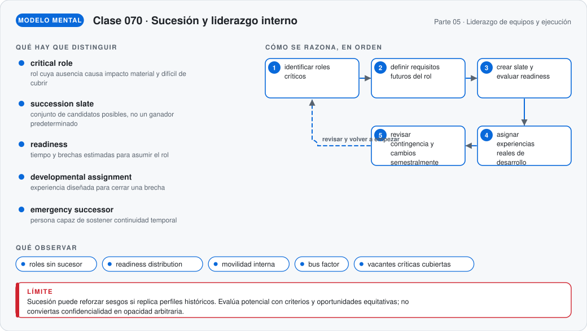

# Clase 070 — Sucesión y liderazgo interno

<!-- nav:inicio -->
> **Parte 05 · Gestión de talento y personas** — clase 10 de 12 · [índice de la parte](../../README.md) · [temario](../../../../SYLLABUS.md)
<!-- nav:fin -->

**Parte:** 05 — Gestión de talento y personas  
**Nivel:** Etapa 2 — Líder → Jefe / Team Lead  
**Duración sugerida:** 150–180 minutos · **Estándar:** deep-class-v2

## 🎯 Propósito

La mayoría de las organizaciones descubre que no tiene sucesor el día en que alguien clave se va. Esa sorpresa es evitable: la sucesión es una decisión que se prepara con años de anticipación y no solo una lista de nombres. Pero la sucesión tiene una trampa: se piensa como un reemplazo del cargo anterior, y se promueve a quien mejor lo hacía sin comprobar que puede hacer el nuevo. Por eso muchas promociones al primer cargo de jefatura fracasan: la persona fue un excelente profesional y es un jefe mediocre.

La clase usa el modelo de **pasajes de liderazgo** de Charan, Drotter y Noel, que describe seis transiciones y lo que cambia en cada una: las habilidades, el uso del tiempo y los valores. Al terminar sabrás identificar cargos críticos, evaluar a candidatos internos para el pasaje que enfrentarán, diseñar un plan de desarrollo y prepararte para una sucesión de emergencia.

## 📚 Resultados de aprendizaje

Al finalizar podrás:

1. **Describir** los seis pasajes de liderazgo y qué cambia en cada uno.
2. **Identificar** cargos y personas críticas y evaluar el riesgo de vacancia.
3. **Evaluar** a un candidato para el pasaje que enfrentará, no para el cargo anterior.
4. **Diseñar** un plan de desarrollo con experiencias que preparen el pasaje.
5. **Preparar** un plan de sucesión de emergencia y uno planificado.

## 🧭 Agenda

| Tramo | Qué se hace |
|---|---|
| 0–20 min | Recuperación: ¿quién te reemplazaría hoy en tu cargo y qué le faltaría? |
| 20–60 min | Pasajes de liderazgo y mapa de sucesión. |
| 60–105 min | Ejemplo trabajado: la promoción de un profesional a jefe. |
| 105–140 min | Caso ejecutivo: el director comercial que se jubila en un año. |
| 140–170 min | Límites y entregable. |

## 🧩 Conceptos centrales

| Concepto | Definición | Cómo se reconoce |
|---|---|---|
| **Sucesión** | Proceso de preparar personas para ocupar cargos clave cuando queden vacantes. | Hay candidatos identificados y en desarrollo. |
| **Cargo crítico** | Posición cuya vacancia genera un riesgo material para la organización. | Se prioriza en el plan. |
| **Pasaje de liderazgo** | Transición a un nivel con nuevas habilidades, uso del tiempo y valores (Charan et al., 2001). | Cambia lo que debe hacerse y lo que debe valorarse. |
| **Canal de liderazgo (pipeline)** | Secuencia de pasajes por los que avanza un líder en la organización (Charan et al., 2001). | Se puede ver quién está en qué pasaje. |
| **Sucesión de emergencia** | Plan para reemplazar de inmediato a una persona por salida inesperada. | Hay un interino definido y un plan. |
| **Preparación (readiness)** | Grado en que un candidato está listo para el siguiente pasaje. | Se evalúa con evidencia, no con antigüedad. |

## 🧠 Modelo mental

**Cómo leer el diagrama.** Seis pasajes que ascienden. Cada uno exige **otras habilidades**, **otro uso del tiempo** y **otros valores**. Un error frecuente es evaluar a un candidato por su desempeño en el nivel actual: eso mide qué tan bueno es en lo que ya hace, no qué tan preparado está para lo que viene.

## 📖 Desarrollo

### 1. Los seis pasajes

Charan, Drotter y Noel describen un canal de liderazgo con seis pasajes: **1)** de liderarse a sí mismo a liderar a otros; **2)** de liderar a otros a liderar jefes; **3)** de jefe de jefes a gerente funcional; **4)** de gerente funcional a gerente de negocio; **5)** de gerente de negocio a gerente de grupo; y **6)** de gerente de grupo a gerente de empresa. En cada uno cambian tres cosas: las **habilidades** requeridas, las **aplicaciones del tiempo** y los **valores de trabajo**. Quien no cambia en las tres dimensiones sigue haciendo el trabajo anterior.

### 2. El primer pasaje

El más frecuente y de mayor fracaso es el primero: de profesional a jefe. El valor ya no está en hacer el trabajo, sino en **lograr que otros lo hagan**; el tiempo se reparte entre planificar, asignar, desarrollar y dar feedback; y los valores pasan de valorar el propio trabajo a valorar el trabajo de otros. Muchos nuevos jefes siguen haciendo el trabajo técnico, no delegan y dejan de lado a su equipo (clases 053 y 054). Prepararlos requiere práctica antes de la promoción.

### 3. Cargos críticos y riesgo

Un plan de sucesión empieza por identificar los **cargos críticos**: aquellos cuya vacancia produciría un daño material. Para cada uno se evalúan: el **riesgo de salida** (jubilación, oferta externa, desgaste) y el **impacto** de la vacancia. Se identifican **candidatos** internos con su **preparación** (listo ahora, en uno a dos años, en tres a cinco) y las **brechas** a cerrar. También se identifican las personas críticas que no ocupan un cargo de jerarquía, pero tienen conocimiento difícil de reemplazar.

### 4. Evaluar la preparación

Evaluar a un candidato para el siguiente pasaje significa preguntar: ¿ha demostrado las **habilidades** del nuevo nivel en pequeña escala?, ¿cómo usa su **tiempo**: se mete en el detalle o delega?, ¿qué **valora**: su propio logro o el del equipo? La evidencia proviene de asignaciones, desempeño anterior y feedback de varias personas. Se evita evaluar por antigüedad, por simpatía o por parecido con quien se va. Las decisiones sobre personas respetan las normas contra la discriminación.

### 5. Desarrollo con experiencias

Se desarrolla con **experiencias** que ejerciten las habilidades del siguiente pasaje: dirigir un proyecto transversal, un cargo interino, una función nueva, una misión de reestructuración, una responsabilidad de resultados. Se acompañan con **coaching y feedback**, y con **mentoría** de alguien que haya hecho el pasaje. Y se acepta que parte de las personas no desea o no puede dar el pasaje: es legítimo que se queden como profesionales altamente valorados, con carreras especialistas.

### 6. Sucesión de emergencia

Además del plan a futuro, se prevé la salida repentina: enfermedad, renuncia, fallecimiento. Un plan de emergencia define **quién asume interinamente** cada cargo crítico, **qué información** necesita (accesos, relaciones, procesos clave) y **quién decide**. Se mantiene actualizado y se revisa cada año. Contar con documentación de procesos y delegaciones claras reduce la dependencia de personas.

### 7. Cultura y transparencia

Un plan de sucesión es sensible: no debe prometer cargos, generar rivalidades ni filtrarse de manera descontrolada. Conviene separar la **información confidencial** del plan de la **cultura de desarrollo**, que sí se comunica: todas las personas deben saber que hay oportunidades y criterios. Y el directorio supervisa la sucesión de los cargos más altos (clases 214 y 203). Los candidatos externos también son una opción legítima: la sucesión interna no es un dogma.

## 📚 Lectura comparada

| Obra | Qué aporta | Qué no resuelve | Pregunta para contrastar |
|---|---|---|---|
| Charan, Drotter y Noel (2001) | Seis pasajes y sus tres dimensiones de cambio. | Describe empresas grandes y estructuradas. | ¿En qué pasaje está tu candidato? |
| Watkins (2003) | Transición a un cargo nuevo. | Se centra en quien asume. | ¿Cómo apoyas a quien hace el pasaje? |
| Drucker (2006) | Decisiones de ubicación de personas. | No trae un modelo de sucesión. | ¿Qué resultados necesita el cargo? |
| Cappelli (2008) | Hacer o comprar talento, incluida la sucesión. | Se centra en el mercado de Estados Unidos. | ¿Cuándo conviene un candidato externo? |
| Edmondson (2018) | Cultura para que el desarrollo sea posible. | No trata de sucesión. | ¿Puede un candidato mostrar sus brechas sin riesgo? |

## 🧮 Ejemplo trabajado

**Situación (hipotética).** Una empresa promovió a Andrea, su mejor ejecutiva de ventas, a jefa de un equipo de ocho. A los seis meses, el equipo se queja de que «no la vemos» y de que «nos quita las cuentas importantes». Su desempeño personal sigue alto; el del equipo, bajo.

| Dimensión | Lo que se esperaba en el nuevo pasaje | Lo que ocurre |
|---|---|---|
| **Habilidades** | Planificar, asignar, desarrollar, dar feedback. | Hace las ventas ella misma. |
| **Uso del tiempo** | El 60 % en el equipo. | El 80 % en clientes. |
| **Valores** | Valorar el éxito de otros. | Valora su propio resultado. |

**Diagnóstico.** Se evaluó la preparación por desempeño en el cargo anterior y no por las habilidades del nuevo.

**Intervención.** (1) Acordar con Andrea un plan de 90 días: delegar cuentas por tramos, uno a uno semanales con cada persona, coaching por un jefe experimentado. (2) Medir el tiempo en el equipo y el desempeño del equipo. (3) Para el futuro: antes de promover, dar una asignación de liderazgo de proyecto durante tres meses y evaluar con las tres dimensiones.

**Resultado.** A los seis meses, el tiempo con el equipo sube del 20 % al 55 % y la meta del equipo se cumple.

**Qué muestra.** (1) El primer pasaje suele fallar por valores y uso del tiempo. (2) Se puede desarrollar a posteriori, pero es mejor preparar antes. (3) La evaluación debe usar criterios del nuevo nivel.

## 🔀 Comparación y límites

**Sucesión frente a promoción.** La promoción es un movimiento; la sucesión es un sistema que prepara y selecciona. Una buena sucesión reduce el riesgo de promover mal.

**Límites.** El modelo de Charan et al. describe organizaciones grandes y estructuradas, y en otras los pasajes se comprimen o se saltan. Los pasajes son un marco de reflexión, no una descripción exacta de cada empresa. La evaluación de preparación tiene sesgos y la información puede ser incompleta. Y las decisiones sobre promociones y reemplazos están sujetas a normas contra la discriminación y a contratos que se verifican con asesoría.

## 🪜 De profesional a owner

| Nivel | Cómo trabaja la sucesión |
|---|---|
| **Profesional** | Documenta su trabajo, comparte conocimiento y piensa en su próximo pasaje. |
| **Jefe / Team Lead** | Identifica y desarrolla a quien podría reemplazarlo. |
| **Gerente** | Mantiene un mapa de sucesión de su área y una evaluación con criterios del nuevo nivel. |
| **CEO / Director** | Lidera la sucesión de su equipo y la supervisa el directorio. |
| **Founder / Owner** | Pasa de ser el único que sabe a construir un equipo que pueda reemplazarlo. |

## 🏢 Caso ejecutivo

El director comercial de una empresa de 500 personas se jubila en catorce meses. Tiene dos candidatos internos: un gerente de ventas muy exitoso, dueño de las mejores cuentas, y una gerente de marketing con visión estratégica pero sin experiencia en ventas. El gerente de ventas dice que «es el heredero natural»; algunos dicen que sería un error. Además, el director comercial es el único que conoce las relaciones con tres clientes clave.

Entrega un **plan de sucesión** que contenga: (a) el análisis de los cargos y personas críticos; (b) la evaluación de cada candidato para el pasaje que enfrentará, con evidencia; (c) el plan de desarrollo de ambos con experiencias; (d) cómo transferir las relaciones críticas; (e) el plan de emergencia; (f) cómo evaluarás candidatos externos y cómo comunicarás el proceso.

## 🧪 Práctica

1. Identifica los tres cargos críticos de tu área y el riesgo de vacancia de cada uno.
2. Para una persona, evalúa habilidades, uso del tiempo y valores del siguiente pasaje.
3. Diseña una asignación de desarrollo para ese pasaje.
4. Escribe el plan de emergencia de tu propio cargo.
5. Documenta tres conocimientos críticos que solo tú posees.

## ⚠️ Errores frecuentes

| Error | Por qué ocurre | Cómo corregirlo |
|---|---|---|
| Promover al mejor profesional | Se premia el desempeño pasado | Evaluar para el nuevo pasaje. |
| Planificar al final | Se posterga | Anticipar de uno a tres años. |
| Sucesión como lista de nombres | Es fácil | Desarrollar con experiencias. |
| Depender de una persona | Se acumula conocimiento | Documentar y delegar. |
| Prometer cargos | Se quiere retener | Hablar de desarrollo, no de promesas. |
| Excluir candidatos externos | Se considera una cuestión de lealtad | Evaluar todas las opciones. |

## ❓ Preguntas de comprobación

1. ¿Cuáles son los seis pasajes de liderazgo?
2. ¿Qué tres cosas cambian en cada pasaje?
3. ¿Por qué el primer pasaje suele fallar?
4. ¿Cómo se evalúa la preparación de un candidato?
5. ¿Qué incluye un plan de emergencia?
6. ¿Por qué no se debe promover solo por desempeño en el cargo actual?
7. ¿Qué límite tiene el modelo?

Claves de respuesta

1. De liderarse a sí mismo a liderar a otros; a liderar jefes; a gerente funcional; a gerente de negocio; a gerente de grupo; a gerente de empresa.
2. Las habilidades, el uso del tiempo y los valores.
3. Porque exige pasar de hacer el trabajo a lograr que otros lo hagan, y muchos siguen haciendo el trabajo técnico.
4. Con evidencia sobre las habilidades del nuevo nivel, el uso del tiempo y los valores, no por antigüedad ni afinidad.
5. Quién asume interinamente, qué información necesita y quién decide, revisado cada año.
6. Porque ese desempeño mide qué tan bien hace el trabajo actual y no su preparación para el nuevo.
7. Describe organizaciones grandes y estructuradas, y en otras los pasajes se comprimen.

## 📥 Entregable

Guarda en `portfolio/070-sucesion-y-liderazgo-interno/`:

- `people-decision-brief.md` (plantilla [People Decision Brief](../../../../templates/people-decision-brief.md)) con el plan de sucesión del caso ejecutivo;
- `reading-note.md` con una tensión entre Charan et al. y Cappelli;
- `decision-journal.md` con la evaluación de candidatos y el plan de emergencia.

## 📗 Fuentes y verificación

- Ram Charan, Stephen Drotter & James Noel — *The Leadership Pipeline* (Jossey-Bass, 2000). **Uso en esta clase:** los seis pasajes de liderazgo y sus tres dimensiones de cambio. Lectura selectiva sobre **sucesión y liderazgo interno**. **Localizador:** [ISBN-13 9780787951726](https://openlibrary.org/isbn/9780787951726).
- Michael D. Watkins — *The First 90 Days* (Harvard Business School Press, 2003). **Uso en esta clase:** transición a un cargo nuevo y apoyo a quien asume. Lectura selectiva sobre **sucesión y liderazgo interno**. **Localizador:** [ISBN-13 9781591391104](https://openlibrary.org/isbn/9781591391104).
- Peter F. Drucker — *The Effective Executive* (Collins, 2002). **Uso en esta clase:** decisiones de ubicación de personas por resultados. Lectura selectiva sobre **sucesión y liderazgo interno**. **Localizador:** [ISBN-13 9780060516079](https://openlibrary.org/isbn/9780060516079).
- Peter Cappelli — *Talent on Demand* (Harvard Business Press, 2008). **Uso en esta clase:** hacer o comprar talento, incluida la sucesión. Lectura selectiva sobre **sucesión y liderazgo interno**. **Localizador:** [ISBN-13 9781422104477](https://openlibrary.org/isbn/9781422104477).
- Amy C. Edmondson — *The Fearless Organization* (Wiley, 2018). **Uso en esta clase:** cultura que hace posible el desarrollo. Lectura selectiva sobre **sucesión y liderazgo interno**. **Localizador:** [ISBN-13 9781119477242](https://openlibrary.org/isbn/9781119477242).

> **Regla de fuentes para Sucesión y liderazgo interno:** las obras anteriores estructuran las perspectivas de esta materia; cualquier norma, ley o estándar vivo mencionado debe comprobarse nuevamente en su fuente primaria vigente, incluidas las normas contra la discriminación y las laborales sobre promociones. Los ejemplos y casos son hipotéticos, con cifras ilustrativas. El desarrollo es original y no reproduce capítulos protegidos.

<!-- pie:inicio -->
---

| Anterior | Índice | Siguiente |
|---|---|---|
| [← 069 · Aprendizaje y upskilling](../069-aprendizaje-y-upskilling/README.md) | [Parte 05](../../README.md) · [Programa](../../../../SYLLABUS.md) | [071 · Desvinculación responsable y documentación →](../071-desvinculacion-responsable-y-documentacion/README.md) |
<!-- pie:fin -->
