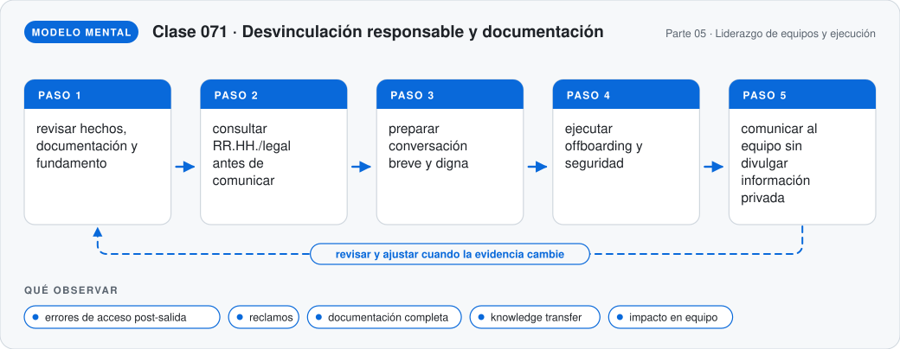

# Clase 071 — Desvinculación responsable y documentación

<!-- nav:inicio -->
> **Parte 05 · Gestión de talento y personas** — clase 11 de 12 · [índice de la parte](../../README.md) · [temario](../../../../SYLLABUS.md)
<!-- nav:fin -->

**Parte:** 05 — Gestión de talento y personas  
**Nivel:** Etapa 2 — Líder → Jefe / Team Lead  
**Duración sugerida:** 150–180 minutos · **Estándar:** deep-class-v2

## 🎯 Propósito

Poner término a una relación de trabajo es una de las decisiones más difíciles de un jefe y una de las más riesgosas: para la persona, que pierde su ingreso y su rutina; para el equipo, que observa cómo se trata a quien se va; y para la organización, que puede enfrentar un litigio si el proceso fue deficiente. Se hace mal de dos maneras: tarde, tras meses de tolerar el problema, y con improvisación, sin hechos documentados ni conocimiento de las normas.

Esta clase trata la desvinculación como un proceso de **responsabilidad**: decidir con evidencia, verificar la norma aplicable con asesoría, comunicar con dignidad, cuidar a quien se va y a quienes se quedan, y aprender para no repetir el error. La base conceptual es la de las cuatro formas de justicia de Colquitt y colegas. **Las causales, plazos, avisos, indemnizaciones y formalidades dependen de la normativa vigente de cada jurisdicción**: esta clase no las explica ni las interpreta, y remite a las fuentes oficiales y a la asesoría laboral.

## 📚 Resultados de aprendizaje

Al finalizar podrás:

1. **Distinguir** una decisión de desvinculación fundada de una improvisada.
2. **Documentar** hechos, expectativas, apoyo ofrecido y resultado de forma verificable.
3. **Identificar** qué debe verificarse con asesoría antes de actuar.
4. **Conducir** la conversación de término con claridad y dignidad.
5. **Gestionar** la comunicación al equipo, la transición y el aprendizaje posterior.

## 🧭 Agenda

| Tramo | Qué se hace |
|---|---|
| 0–20 min | Recuperación: recuerda cómo se trató a alguien que dejó tu organización; ¿qué mensaje recibió el equipo? |
| 20–60 min | Decisión, documentación, verificaciones y conversación. |
| 60–105 min | Ejemplo trabajado: un término tras un plan de mejora sin resultado. |
| 105–140 min | Caso ejecutivo: una desvinculación por reestructuración. |
| 140–170 min | Límites y entregable. |

## 🧩 Conceptos centrales

| Concepto | Definición | Cómo se reconoce |
|---|---|---|
| **Desvinculación** | Término de la relación de trabajo por decisión de la organización o de la persona. | Hay una decisión, un proceso y una comunicación. |
| **Desvinculación responsable** | Término decidido con evidencia, proceso verificado, trato digno y cuidado de quienes se quedan. | Se puede explicar y defender. |
| **Documentación** | Registro de hechos, expectativas, apoyo y resultados que sustenta la decisión. | Está fechada y es verificable. |
| **Justicia procedimental** | Percepción de que el proceso fue justo (Colquitt et al., 2001). | Hubo oportunidad de mejora y criterios conocidos. |
| **Justicia interpersonal** | Percepción de que se trató a la persona con respeto (Colquitt et al., 2001). | La conversación fue digna. |
| **Verificación legal** | Revisión de la norma aplicable por un asesor antes de actuar. | Está registrada antes de la comunicación. |

## 🧠 Modelo mental

**Cómo leer el diagrama.** Seis pasos, con un orden que importa: la **causa documentada** y el **proceso verificado con asesoría** ocurren **antes** de la conversación. Después vienen el trato (conversación, apoyo, comunicación al equipo) y el aprendizaje. El paso rojo —verificar la norma— es el que más a menudo se omite por urgencia y el más caro cuando se omite.

## 📖 Desarrollo

### 1. Cuándo y por qué

Una desvinculación puede deberse a **desempeño** insuficiente tras un proceso de mejora (clase 067), a una **conducta** grave, a una **reestructuración** o a decisiones de la persona. Cada causa tiene un proceso y consecuencias distintas. Antes de decidir, el jefe se pregunta: ¿qué se intentó?, ¿la persona sabía lo que se esperaba?, ¿hay alternativas razonables, como un cambio de cargo?, ¿la decisión sería la misma con otra persona en esa situación? La coherencia con casos similares es parte de la justicia del proceso.

### 2. Documentar

La documentación es el sustento de la decisión: **hechos** con fechas y ejemplos; las **expectativas** comunicadas; el **apoyo** ofrecido (formación, coaching, plazos); el **resultado**; y las conversaciones sostenidas. Se escribe con lenguaje descriptivo, sin juicios sobre la persona, y se conserva con confidencialidad. Se redacta **cuando ocurren los hechos**, no después de decidir. Una documentación improvisada tras la decisión pierde credibilidad y puede perjudicar a la organización.

### 3. Verificar con asesoría

Las normas sobre término de la relación de trabajo —causales, aviso previo, formalidades de la comunicación, indemnizaciones, finiquito, protecciones especiales de ciertas situaciones y personas, plazos para acciones— son **específicas de cada jurisdicción y cambian**. Esta clase no las interpreta. La práctica correcta es consultar a un asesor laboral antes de comunicar la decisión y contrastar con las fuentes oficiales vigentes, como el texto del Código del Trabajo y la orientación de la autoridad laboral. Un error de forma puede tener consecuencias costosas.

### 4. La justicia del proceso

Colquitt y colegas muestran que las personas evalúan cuatro cosas: el resultado, el proceso, el trato y la explicación. Aplicado a una desvinculación: **procedimental** —criterios conocidos, oportunidad de mejorar, decisión consistente—; **interpersonal** —respeto y dignidad—; **informacional** —razones veraces y claras—; **distributiva** —un trato final proporcionado—. También las evalúan quienes se quedan: cómo se trata a quien se va es un mensaje sobre cómo se los tratará.

### 5. La conversación

La conversación de término se prepara y es breve. Principios: en **privado**, con alguien de apoyo (por ejemplo, de personas) y **en un momento adecuado**; el jefe da la noticia **desde el inicio**, sin rodeos; expresa los **hechos y la razón** sin recapitular toda la historia; **reconoce** la emoción sin discutir la decisión; explica los **pasos siguientes** (documentos, pagos, devolución de equipos, referencias) y entrega la información por escrito. Evita frases como «es por tu bien» o «esto me duele más a mí». No se negocia la decisión en esa conversación.

### 6. Apoyo y logística

La organización cuida detalles que importan: la **transición** de las tareas, el **acceso** a sistemas, la **devolución** de equipos y la entrega de pertenencias, con respeto; el **cumplimiento** de pagos y documentos en los plazos; la **referencia** que se dará; y, cuando corresponda, apoyo de reubicación o asesoría. Despedir con respeto, sin humillaciones públicas, ni escoltas innecesarias, es una responsabilidad. Se aplica el mismo cuidado a la seguridad de la información de la organización, sin presumir mala fe.

### 7. Equipo y aprendizaje

El equipo se entera por un mensaje **breve y respetuoso**: que la persona dejó la organización, desde qué fecha, quién asume sus responsabilidades y cómo se manejarán los clientes o proyectos. No se dan detalles personales ni se comentan las razones. Después, el jefe conversa con las personas afectadas y escucha lo que preocupa. Y se hace una **revisión sin culpas**: ¿qué falló antes —en la selección, el onboarding, el apoyo, las expectativas— que habría podido evitar esta situación? Aprender evita repetir el ciclo.

## 📚 Lectura comparada

| Obra | Qué aporta | Qué no resuelve | Pregunta para contrastar |
|---|---|---|---|
| Colquitt et al. (2001) | Las cuatro dimensiones de justicia. | No trata de normas laborales. | ¿Qué dimensión descuidarías al despedir? |
| Código del Trabajo (texto vigente) | La norma de la jurisdicción de la clase. | Requiere interpretación experta. | ¿Qué parte verificarías con asesoría? |
| Kluger y DeNisi (1996) | Feedback centrado en la tarea previo al término. | No trata del término. | ¿Hubo feedback previo suficiente? |
| Stone y Heen (2014) | Cómo recibe la persona información difícil. | No es un manual jurídico. | ¿Qué disparador se activará? |
| Edmondson (2018) | Cultura que permite aprender de los casos difíciles. | No trata del término. | ¿Qué aprenderá la organización? |

## 🧮 Ejemplo trabajado

**Situación (hipotética).** Un jefe, Pablo, concluye el proceso con Marcos, analista, que tras un plan de mejora de 60 días y una extensión de 30 no alcanzó las metas acordadas. La documentación existe: expectativas del 3 de marzo, tres revisiones con acuerdos, formación ofrecida y un mentor asignado.

| Paso | Qué hace Pablo |
|---|---|
| **Causa documentada** | Reúne la documentación: hechos, expectativas, apoyo y resultados por fecha. |
| **Proceso verificado** | Consulta al asesor laboral: la causal, las formalidades, los plazos y los documentos; verifica que no haya situaciones protegidas. |
| **Conversación** | En privado, con la persona de personas. «Marcos, hemos decidido poner término a tu contrato. Las metas acordadas no se alcanzaron y ya conversamos los resultados en las tres revisiones.» Escucha, reconoce su reacción y entrega por escrito los pasos siguientes. |
| **Apoyo y logística** | Acuerda cómo entregará su trabajo, cuándo devolverá el equipo y cuándo recibirá sus documentos y pagos; ofrece una carta de referencia sobre hechos. |
| **Equipo** | Mensaje breve: «Marcos deja la empresa desde hoy. Sus tareas pasarán a Ana y a Luis. Gracias por su colaboración». |
| **Aprendizaje** | Revisión sin culpas: la selección no evaluó la capacidad de análisis; se ajusta la prueba. |

**Qué muestra.** (1) La verificación legal precedió a la conversación. (2) La comunicación fue digna y breve. (3) Se aprendió del proceso.

## 🔀 Comparación y límites

**Desvinculación frente a sanción disciplinaria.** La primera termina la relación; la segunda corrige una conducta dentro de ella. Tienen reglas distintas.

**Límites.** Esta clase no es asesoría legal: las causales, avisos, indemnizaciones y formalidades se verifican en la fuente vigente y con un asesor. La documentación bien hecha no sustituye la verificación legal. Algunas situaciones —licencias médicas, embarazo, fuero sindical, denuncias de acoso, entre otras— pueden tener protecciones especiales que impiden o condicionan el término. Y en una reestructuración, las reglas y la comunicación son distintas a las de un término por desempeño.

## 🪜 De profesional a owner

| Nivel | Cómo participa en una desvinculación |
|---|---|
| **Profesional** | Si es afectado, conoce sus derechos y pide información; si es colega, respeta la dignidad. |
| **Jefe / Team Lead** | Documenta, consulta y conduce la conversación con dignidad. |
| **Gerente** | Revisa el proceso y asegura coherencia y legalidad. |
| **CEO / Director** | Establece estándares de trato y supervisa los términos de personas clave. |
| **Founder / Owner** | Enfrenta la desvinculación de quien conoce y verifica la norma antes de actuar. |

## 🏢 Caso ejecutivo

Una empresa de servicios reestructura un área y elimina 12 puestos de 60. La gerente de personas quiere comunicarlo por un correo masivo el viernes a las 17:00 «para evitar escenas». Una de las personas afectadas está con licencia médica; otra es dirigente sindical; otra fue recién promovida. Los jefes no saben qué decir. El gerente general dice: «Hagamos rápido y pidamos disculpas después».

Entrega un **plan de desvinculación responsable** que contenga: (a) los criterios de selección de los puestos y su justificación; (b) las verificaciones legales y qué situaciones protegidas revisarás con asesoría; (c) la secuencia de comunicación: a los afectados, a los jefes, al equipo restante; (d) la conversación individual y el material de apoyo; (e) el apoyo y la logística de la transición; (f) el cuidado de quienes se quedan y la revisión posterior.

## 🧪 Práctica

1. Redacta la documentación de un caso con hechos, fechas, apoyo y resultado.
2. Escribe qué verificarías con asesoría antes de comunicar una decisión.
3. Prepara el guion de cuatro frases de una conversación de término.
4. Diseña el mensaje al equipo sin detalles personales.
5. Define tres preguntas para la revisión sin culpas posterior.

## ⚠️ Errores frecuentes

| Error | Por qué ocurre | Cómo corregirlo |
|---|---|---|
| Documentar después de decidir | Se improvisa | Registrar los hechos cuando ocurren. |
| No consultar la norma | Urgencia | Verificar con asesoría antes de comunicar. |
| Comunicar por correo masivo | Se evita la incomodidad | Conversación individual y digna. |
| Prolongar la conversación | Se quiere explicar todo | Breve y clara; los pasos por escrito. |
| Revelar razones al equipo | Se quiere justificar | Mensaje breve sin detalles personales. |
| No aprender | Se cierra el caso | Revisión sin culpas del proceso. |

## ❓ Preguntas de comprobación

1. ¿Qué debe contener la documentación de una desvinculación?
2. ¿Por qué se verifica la norma antes de la conversación?
3. ¿Qué dimensiones de justicia aplican a una desvinculación?
4. ¿Cómo debe ser la conversación de término?
5. ¿Qué se comunica al equipo?
6. ¿Qué situaciones pueden tener protecciones especiales?
7. ¿Qué límite tiene esta clase?

Claves de respuesta

1. Hechos con fechas, expectativas comunicadas, apoyo ofrecido, resultados y las conversaciones sostenidas, en lenguaje descriptivo.
2. Porque las causales, avisos y formalidades son específicos y un error de forma puede ser costoso.
3. Distributiva, procedimental, interpersonal e informacional.
4. En privado, breve, clara desde el inicio, con respeto, sin negociar la decisión y con los pasos por escrito.
5. Un mensaje breve y respetuoso: que la persona dejó la organización, desde cuándo, quién asume sus tareas, sin detalles personales.
6. Por ejemplo licencias médicas, embarazo, fuero sindical o denuncias de acoso, según la normativa vigente.
7. No es asesoría legal: las normas se verifican en la fuente vigente y con un asesor.

## 📥 Entregable

Guarda en `portfolio/071-desvinculacion-responsable-y-documentacion/`:

- `leadership-decision-brief.md` (plantilla [Leadership Decision Brief](../../../../templates/leadership-decision-brief.md)) con el plan del caso ejecutivo;
- `termination-risk-checklist.md` (plantilla [Checklist de riesgo en término de contrato](../../../../templates/termination-risk-checklist.md)) con las verificaciones;
- `decision-journal.md` con la documentación, la comunicación y el aprendizaje.

## 📗 Fuentes y verificación

- Jason A. Colquitt, Donald E. Conlon, Michael J. Wesson, Christopher O. L. H. Porter & K. Yee Ng — *Justice at the Millennium: A Meta-Analytic Review of 25 Years of Organizational Justice Research* (Journal of Applied Psychology, 2001). **Uso en esta clase:** las cuatro dimensiones de justicia aplicadas al término de la relación. Lectura selectiva sobre **desvinculación responsable y documentación**. **Localizador:** [DOI 10.1037/0021-9010.86.3.425](https://doi.org/10.1037/0021-9010.86.3.425).
- Biblioteca del Congreso Nacional de Chile — *LeyChile: Código del Trabajo (texto vigente)*. **Uso en esta clase:** texto vigente del Código del Trabajo para verificar causales, avisos y formalidades con asesoría. **Fuente primaria:** <https://www.bcn.cl/leychile/navegar?idNorma=207436>.
- Avraham N. Kluger & Angelo DeNisi — *The Effects of Feedback Interventions on Performance: A Historical Review, a Meta-Analysis, and a Preliminary Feedback Intervention Theory* (Psychological Bulletin, 1996). **Uso en esta clase:** feedback centrado en la tarea previo a una decisión. Lectura selectiva sobre **desvinculación responsable y documentación**. **Localizador:** [DOI 10.1037/0033-2909.119.2.254](https://doi.org/10.1037/0033-2909.119.2.254).
- Douglas Stone & Sheila Heen — *Thanks for the Feedback* (Viking, 2014). **Uso en esta clase:** cómo se recibe una información difícil. Lectura selectiva sobre **desvinculación responsable y documentación**. **Localizador:** [ISBN-13 9780670014668](https://openlibrary.org/isbn/9780670014668).
- Amy C. Edmondson — *The Fearless Organization* (Wiley, 2018). **Uso en esta clase:** aprendizaje organizacional de los casos difíciles. Lectura selectiva sobre **desvinculación responsable y documentación**. **Localizador:** [ISBN-13 9781119477242](https://openlibrary.org/isbn/9781119477242).

> **Regla de fuentes para Desvinculación responsable y documentación:** las obras anteriores estructuran las perspectivas de esta materia; **las normas laborales sobre término de la relación de trabajo son específicas de cada jurisdicción, cambian y deben comprobarse en su fuente primaria vigente y con asesoría laboral antes de actuar**. Los ejemplos y casos son hipotéticos. Esta clase no sustituye asesoría legal. El desarrollo es original y no reproduce capítulos protegidos.

<!-- pie:inicio -->
---

| Anterior | Índice | Siguiente |
|---|---|---|
| [← 070 · Sucesión y liderazgo interno](../070-sucesion-y-liderazgo-interno/README.md) | [Parte 05](../../README.md) · [Programa](../../../../SYLLABUS.md) | [072 · Capstone: construir un sistema de talento →](../072-capstone-construir-un-sistema-de-talento/README.md) |
<!-- pie:fin -->
