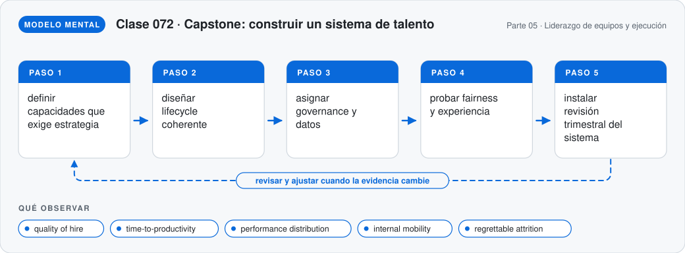

# Clase 072 — Capstone: construir un sistema de talento

<!-- nav:inicio -->
> **Parte 05 · Gestión de talento y personas** — clase 12 de 12 · [índice de la parte](../../README.md) · [temario](../../../../SYLLABUS.md)
<!-- nav:fin -->

**Parte:** 05 — Gestión de talento y personas  
**Nivel:** Etapa 2 — Líder → Jefe / Team Lead  
**Duración sugerida:** 150–180 minutos · **Estándar:** deep-class-v2

## 🎯 Propósito

Un sistema de talento es el conjunto de decisiones y prácticas con que una organización **atrae, selecciona, integra, evalúa, compensa, desarrolla y despide** a sus personas. Cada práctica por separado puede ser buena y el conjunto, incoherente: se selecciona con rigor y se evalúa por afinidad; se predica desarrollo y se premia solo el resultado inmediato; se habla de equidad y se negocia cada remuneración en privado. La incoherencia es el mayor enemigo del sistema, porque las personas aprenden de lo que se hace y no de lo que se declara.

Este capstone integra la parte 05: diseño de cargos (061), dotación (062), selección y entrevistas (063–064), onboarding (065), desempeño y mejora (066–067), compensación (068), aprendizaje (069), sucesión (070) y desvinculación (071). Se apoya en los marcos de cada clase y en una idea central: **el sistema se evalúa por la coherencia entre sus partes y por sus resultados en las personas y en el negocio**. Al terminar sabrás diagnosticar un sistema de talento, priorizar las mejoras y construir un plan con evidencia.

## 📚 Resultados de aprendizaje

Al finalizar podrás:

1. **Mapear** el sistema de talento de una organización de la entrada a la salida.
2. **Diagnosticar** su coherencia: qué se declara y qué se hace en cada práctica.
3. **Priorizar** mejoras por impacto, costo y riesgo, empezando por las que condicionan al resto.
4. **Diseñar** un sistema simple y proporcional al tamaño de la organización.
5. **Medir** su efecto con indicadores de personas y de negocio.

## 🧭 Agenda

| Tramo | Qué se hace |
|---|---|
| 0–20 min | Recuperación: describe con cinco frases cómo contratas, evalúas y desarrollas hoy. ¿Qué incoherencias ves? |
| 20–60 min | Marco del sistema y diagnóstico de coherencia. |
| 60–105 min | Ejemplo trabajado: el sistema de talento de una empresa de 120 personas. |
| 105–150 min | Caso ejecutivo integrado. |
| 150–170 min | Rúbrica, límites y entregable. |

## 🧩 Conceptos centrales

| Concepto | Definición | Cómo se reconoce |
|---|---|---|
| **Sistema de talento** | Conjunto de prácticas de entrada, permanencia, desarrollo y salida de las personas, coherentes con la estrategia. | Se puede describir de extremo a extremo. |
| **Coherencia** | Alineación entre lo que la organización declara, lo que premia y lo que hace en sus prácticas. | Las partes no se contradicen. |
| **Palanca de entrada** | Decisión que condiciona todo lo posterior: cargo y selección. | Una selección débil exige más desempeño y mejora. |
| **Indicador de personas** | Medida de resultados sobre las personas: rotación temprana, desempeño, clima, equidad. | Se calcula con regularidad. |
| **Proporcionalidad** | Ajuste del sistema al tamaño y al riesgo de la organización. | Procesos simples en una empresa pequeña. |
| **Revisión del sistema** | Evaluación periódica de la efectividad y la coherencia. | Hay una fecha y un responsable. |

## 🧠 Modelo mental

**Cómo leer el diagrama.** Cuatro tramos que recorre una persona: **entrada** (cargo, dotación, selección), **permanencia** (onboarding, desempeño, compensación), **desarrollo** (aprendizaje, sucesión) y **salida** (desvinculación y su documentación). Cada decisión afecta a las demás: una selección débil recarga la gestión del desempeño; una compensación incoherente daña el desarrollo. El sistema se evalúa mirando las uniones entre tramos.

## 📖 Desarrollo

### 1. Mirar el sistema completo

Casi todos los problemas de personas que se atribuyen a individuos tienen una causa en el sistema: personas que no rinden porque el cargo estaba mal definido, que se van porque no hubo onboarding, que no se desarrollan porque la evaluación es solo anual, que desconfían porque nadie sabe cómo se decide la remuneración. Mirar el sistema de extremo a extremo evita tratar síntomas. El punto de partida es describirlo: ¿cómo entra, permanece, se desarrolla y sale una persona aquí?

### 2. Diagnosticar la coherencia

Para cada práctica se compara lo **declarado** con lo **real**. Ejemplos de preguntas: ¿se dice que se valora la colaboración y se premia solo el resultado individual?, ¿se declara desarrollo interno y los cargos críticos se llenan siempre desde afuera?, ¿se dice que la evaluación es objetiva y no hay criterios escritos?, ¿se dice que se cuida a las personas y las desvinculaciones se hacen por correo? La incoherencia enseña más que el discurso. Se valida con datos y con la voz de las personas.

### 3. Empezar por lo que condiciona

Hay prácticas con efecto en cascada. **Cargo y selección** condicionan todo lo demás: una persona mal seleccionada exigirá más tiempo de feedback, planes de mejora y, quizá, desvinculación (clases 061 a 064). El **onboarding** condiciona la permanencia (065). El **desempeño** condiciona las decisiones de compensación, desarrollo y salida (066 a 068). Por eso, ante recursos limitados, se mejora primero la entrada y la claridad de expectativas.

### 4. Proporcionalidad

El sistema se ajusta al tamaño. Una empresa de 15 personas no necesita un comité de calibración ni un mapa de sucesión con 9 casillas; necesita cargos claros, un proceso de selección con criterios, un onboarding de dos semanas, conversaciones mensuales, una regla simple de compensación y asesoría laboral confiable. Una de 1.500 necesita sistemas, datos y gobierno. El error común es copiar el sistema de una gran empresa o no tener ninguno.

### 5. Datos y personas

Se mide con indicadores sencillos: **rotación temprana** (primeros 6 a 12 meses), **tiempo de contratación**, **desempeño de los contratados** a los 6 y 12 meses, **cumplimiento de conversaciones** de desempeño, **equidad de compensación** por grupos, **movilidad interna** y **clima** (por ejemplo, seguridad psicológica, clase 042). Se complementa con la voz de las personas: encuestas breves y conversaciones. Y se interpretan con cuidado: un indicador sin contexto engaña.

### 6. Equidad, ética y cumplimiento

Todo el sistema opera dentro de marcos legales y éticos: no discriminación en selección y compensación; protección de datos personales de candidatos y trabajadores; normas sobre jornada, contratos, evaluación y término de la relación de trabajo; y derechos colectivos. Estas normas **son específicas de cada jurisdicción y cambian**: se verifican con asesoría y en fuentes oficiales vigentes. El sistema debe poder defender cada decisión con evidencia y proceso.

### 7. Gobierno y mejora

Alguien debe ser dueño del sistema: una persona o función responsable de su coherencia y su revisión. Se revisa al menos una vez al año con datos: ¿qué funciona, qué no, qué cambió en la estrategia? Se priorizan unas pocas mejoras y se evalúan. Los jefes necesitan formación para ejecutar el sistema; si no, depende de la buena voluntad individual. Y la dirección debe ser coherente: no puede eximirse de las reglas que exige.

## 📚 Lectura comparada

| Obra | Qué aporta | Qué no resuelve | Pregunta para contrastar |
|---|---|---|---|
| Hackman y Oldham (1976) | Diseño del puesto como base de la motivación. | Es de los años setenta. | ¿Qué cargos del sistema están mal diseñados? |
| Schmidt y Hunter (1998) y Sackett et al. (2022) | Qué métodos de selección predicen el desempeño. | Son promedios. | ¿Qué métodos usas? |
| Bauer et al. (2007) | Ajuste del recién llegado. | No trata de la permanencia posterior. | ¿Cómo mides el ajuste? |
| Adams (1963) | Equidad percibida. | No define criterios de remuneración. | ¿Qué comparaciones hacen tus equipos? |
| Charan, Drotter y Noel (2001) | Pasajes de liderazgo para la sucesión. | Organizaciones grandes. | ¿Qué cargos críticos no tienen sucesor? |
| Ulrich (1997) | Roles de la función de personas: socio estratégico, experto administrativo, defensor de los empleados y agente de cambio. | Es un marco de los años noventa. | ¿Quién es el dueño de tu sistema? |
| Boudreau y Ramstad (2007) | Decisiones de talento basadas en evidencia sobre su efecto en el negocio. | Es un marco de consultoría. | ¿Qué decisión de talento medirías por su efecto en el negocio? |

## 🧮 Ejemplo trabajado

**Situación (hipotética).** Una empresa de servicios de 120 personas crece rápido. Rotación del 28 % anual, 40 % en el primer año; el área de personas hace «lo que se puede». Los jefes se quejan de que «no encontramos gente buena» y las personas, de que «no sabemos cómo nos evalúan».

| Tramo | Diagnóstico de coherencia | Mejora priorizada |
|---|---|---|
| **Cargo y selección** | Descripciones por tareas; entrevistas libres; decisión del jefe. | Scorecards con resultados; entrevista estructurada de dos evaluadores. |
| **Onboarding** | Un día de papeleo. | Plan de 30, 60 y 90 días y acompañante. |
| **Desempeño** | Evaluación anual de un formulario; sin criterios. | Expectativas escritas y uno a uno mensual; revisión semestral. |
| **Compensación** | Negociación individual al ingreso; brechas de hasta 20 % en el mismo cargo. | Bandas por cargo y revisión de equidad. |
| **Desarrollo y sucesión** | Sin plan; los cargos de jefatura se llenan por urgencia. | Mapa de cargos críticos y un programa de entrada a jefatura. |
| **Salida** | Términos por correo y sin documentación previa. | Protocolo con documentación, asesoría y conversación presencial. |

**Priorización.** Primero (trimestre 1): cargos, selección y onboarding, que condicionan la rotación temprana. Después (trimestre 2): desempeño y compensación. Luego (trimestre 3): desarrollo, sucesión y protocolo de salida.

**Indicadores.** Rotación temprana de 40 % a 20 % en 12 meses; tiempo de contratación de 60 a 40 días; porcentaje de personas que dice «sé cómo me evalúan» de 38 % a 75 %.

**Qué muestra.** (1) Se diagnosticó por tramo y por coherencia. (2) Se priorizó lo que condiciona. (3) Hay indicadores con metas.

## 🔀 Comparación y límites

**Sistema frente a procesos sueltos.** Un proceso suelto mejora una práctica; el sistema mejora las uniones entre ellas. Mejorar una parte sin mirar el sistema puede empeorar otra.

**Límites.** Los marcos de las clases provienen de investigación de calidad variable y de contextos específicos; su combinación en un sistema es una síntesis de la parte 05, no un modelo validado. Los indicadores de personas son sensibles a factores externos como el mercado de trabajo. Y las normas laborales, de protección de datos y de no discriminación deben verificarse en fuentes oficiales vigentes y con asesoría; esta clase no las sustituye.

## 🪜 De profesional a owner

| Nivel | Cómo participa en el sistema |
|---|---|
| **Profesional** | Conoce las reglas del sistema y señala incoherencias. |
| **Jefe / Team Lead** | Ejecuta con rigor las prácticas del sistema en su equipo. |
| **Gerente** | Es dueño de la coherencia del sistema en su área y revisa sus indicadores. |
| **CEO / Director** | Fija los principios, asigna un dueño y se somete a las mismas reglas. |
| **Founder / Owner** | Construye un sistema mínimo y deliberado antes de que el tamaño lo exija. |

## 🏢 Caso ejecutivo

Una empresa de tecnología de 300 personas tiene cinco años y creció desordenadamente. Hay cuatro formas distintas de contratar según el área, una evaluación anual que casi nadie respeta, bonos negociados caso a caso y desvinculaciones que a veces llegan «de sorpresa». Dos ejecutivos clave renunciaron por «falta de claridad». La directora de personas debe presentar al directorio un plan de 12 meses. El gerente general dice: «Necesitamos un sistema, pero sin burocracia».

Entrega un **plan integrado de sistema de talento** que contenga: (a) el mapa de extremo a extremo y el diagnóstico de coherencia; (b) las prioridades por trimestre con su justificación; (c) el diseño de cada práctica en versión proporcional; (d) los indicadores y sus metas; (e) las salvaguardas legales y éticas y a quién consultarás; (f) el gobierno del sistema y la formación de los jefes; (g) cómo evitarás la burocracia; (h) qué evidencia te haría cambiar el plan.

## 🧪 Práctica

1. Dibuja el sistema de talento de tu organización de la entrada a la salida.
2. Para tres prácticas, compara lo declarado con lo que realmente ocurre.
3. Elige la práctica que más condiciona a las demás y justifica.
4. Define cinco indicadores y cómo los calcularías.
5. Escribe qué verificarías con asesoría laboral antes de implementar tu plan.

## ⚠️ Errores frecuentes

| Error | Por qué ocurre | Cómo corregirlo |
|---|---|---|
| Mejorar una práctica aislada | Es lo visible | Mirar las uniones entre tramos. |
| Copiar el sistema de una gran empresa | Se busca un modelo | Ajustar al tamaño y riesgo. |
| Predicar y no practicar | Se declara cultura | Comparar lo declarado con lo real. |
| Empezar por la salida | Es el problema urgente | Empezar por cargo, selección y onboarding. |
| Medir sin contexto | Se usan números sueltos | Complementar con la voz de las personas. |
| Sistema sin dueño | Se supone que se sostiene solo | Asignar un responsable y una revisión anual. |

## ❓ Preguntas de comprobación

1. ¿Cuáles son los cuatro tramos de un sistema de talento?
2. ¿Qué es la coherencia y cómo se diagnostica?
3. ¿Por qué se empieza por el cargo y la selección?
4. ¿Qué significa proporcionalidad?
5. Nombra cuatro indicadores de personas.
6. ¿Qué marcos legales deben verificarse y con quién?
7. ¿Qué límite tiene esta síntesis?

Claves de respuesta

1. Entrada, permanencia, desarrollo y salida.
2. Alineación entre lo declarado, lo premiado y lo hecho; se diagnostica comparando lo declarado con lo real, con datos y la voz de las personas.
3. Porque condicionan todo lo posterior: una selección débil recarga el desempeño, el plan de mejora y la salida.
4. Ajustar el sistema al tamaño y al riesgo de la organización.
5. Por ejemplo rotación temprana, tiempo de contratación, desempeño a 6 y 12 meses y equidad de compensación.
6. No discriminación, protección de datos, normas sobre contratos, jornada, evaluación y término de la relación de trabajo; con asesoría laboral y en fuentes oficiales vigentes.
7. Es una síntesis docente de marcos de calidad variable, no un modelo validado.

## 📥 Entregable

Guarda en `portfolio/072-capstone-construir-un-sistema-de-talento/`:

- `people-decision-brief.md` (plantilla [People Decision Brief](../../../../templates/people-decision-brief.md)) con el plan integrado del caso ejecutivo;
- `role-scorecard.md` (plantilla [Role scorecard](../../../../templates/role-scorecard.md)) con un cargo y sus criterios de selección y evaluación;
- `reading-note.md` con una tensión entre dos fuentes de la parte;
- `decision-journal.md` con las prioridades, los indicadores y las verificaciones.

## 📗 Fuentes y verificación

- J. Richard Hackman & Greg R. Oldham — *Motivation through the design of work: test of a theory* (Organizational Behavior and Human Performance, 1976). **Uso en esta clase:** diseño del puesto como base de la motivación. Lectura selectiva sobre **capstone: construir un sistema de talento**. **Localizador:** [DOI 10.1016/0030-5073(76)90016-7](https://doi.org/10.1016/0030-5073(76)90016-7).
- Frank L. Schmidt & John E. Hunter — *The validity and utility of selection methods in personnel psychology: Practical and theoretical implications of 85 years of research findings* (Psychological Bulletin, 1998). **Uso en esta clase:** validez de los métodos de selección. Lectura selectiva sobre **capstone: construir un sistema de talento**. **Localizador:** [DOI 10.1037/0033-2909.124.2.262](https://doi.org/10.1037/0033-2909.124.2.262).
- Talya N. Bauer, Todd Bodner, Berrin Erdogan, Donald M. Truxillo & Jennifer S. Tucker — *Newcomer adjustment during organizational socialization: A meta-analytic review of antecedents, outcomes, and methods* (Journal of Applied Psychology, 2007). **Uso en esta clase:** ajuste del recién llegado. Lectura selectiva sobre **capstone: construir un sistema de talento**. **Localizador:** [DOI 10.1037/0021-9010.92.3.707](https://doi.org/10.1037/0021-9010.92.3.707).
- J. Stacy Adams — *Towards an understanding of inequity* (The Journal of Abnormal and Social Psychology, 1963). **Uso en esta clase:** equidad percibida en la compensación. Lectura selectiva sobre **capstone: construir un sistema de talento**. **Localizador:** [DOI 10.1037/h0040968](https://doi.org/10.1037/h0040968).
- Ram Charan, Stephen Drotter & James Noel — *The Leadership Pipeline* (Jossey-Bass, 2000). **Uso en esta clase:** pasajes de liderazgo para la sucesión. Lectura selectiva sobre **capstone: construir un sistema de talento**. **Localizador:** [ISBN-13 9780787951726](https://openlibrary.org/isbn/9780787951726).
- Dave Ulrich — *Human Resource Champions* (Harvard Business School Press, 1997). **Uso en esta clase:** roles de la función de personas en el gobierno del sistema. Lectura selectiva sobre **capstone: construir un sistema de talento**. **Localizador:** [ISBN-13 9780875847191](https://openlibrary.org/isbn/9780875847191).
- John Boudreau & Peter Ramstad — *Beyond HR* (Harvard Business School Press, 2007). **Uso en esta clase:** decisiones de talento basadas en evidencia sobre su efecto en el negocio. Lectura selectiva sobre **capstone: construir un sistema de talento**. **Localizador:** [ISBN-13 9781422104156](https://openlibrary.org/isbn/9781422104156).

> **Regla de fuentes para Capstone: construir un sistema de talento:** las obras anteriores estructuran las perspectivas de esta materia; cualquier norma, ley o estándar vivo mencionado —no discriminación, protección de datos, contratos, jornada, evaluación y término de la relación de trabajo— debe comprobarse nuevamente en su fuente primaria vigente y con asesoría. Los ejemplos y casos son hipotéticos y no describen a ninguna empresa real. El desarrollo es original y no reproduce capítulos protegidos.

<!-- pie:inicio -->
---

| Anterior | Índice | Siguiente |
|---|---|---|
| [← 071 · Desvinculación responsable y documentación](../071-desvinculacion-responsable-y-documentacion/README.md) | [Parte 05](../../README.md) · [Programa](../../../../SYLLABUS.md) | [073 · Proyecto, producto, operación y programa →](../../../06-projects-agile-delivery/classes/073-proyecto-producto-operacion-y-programa/README.md) |
<!-- pie:fin -->
