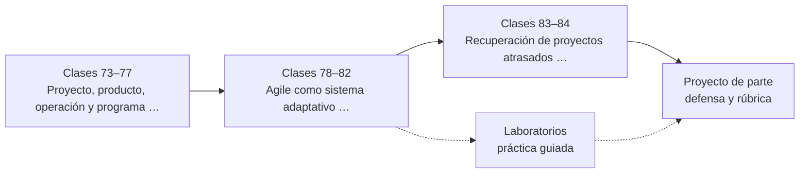

# Parte 06 — Proyectos, Agile y entrega

<!-- parte:inicio -->

> ← [Parte 05 — Gestión de talento y personas](../05-talent-people-management/README.md) · [Temario](../../SYLLABUS.md) · [Parte 07 — Operaciones, procesos y calidad](../07-operations-process-quality/README.md) →

*Convertir un objetivo ambiguo en entregables, fechas y responsables*

**Etapa:** 2 — Liderazgo de equipos y ejecución  
**Duración:** 12 clases · 30 horas  
**Resultado de salida:** Convertir objetivos ambiguos en entregables, fechas, responsables, riesgos y aprendizaje.

🔵 [Ver las 6 etapas](../../SYLLABUS.md) · 12 clases (073–084) · 4 laboratorios · [proyecto de parte](project.md)

## 🎯 De qué trata esta parte

La mayoría de los proyectos fracasa por alcance mal definido y riesgos no declarados, no por falta de esfuerzo. Esta parte da las herramientas para que una iniciativa sea ejecutable y recuperable.

El eje es **alcance, capacidad y riesgo explícitos**. Agile se trata como sistema adaptativo, no como ceremonia, y se enseña cuándo Scrum, Kanban o un plan clásico corresponden.

## 🧱 Con qué hay que llegar

| Parte | Qué aporta |
|---|---|
| [01 — Pensamiento crítico y toma de decisiones](../01-critical-thinking-and-decisions/README.md) | Decisiones con supuestos y trade-offs. |
| [04 — Liderazgo de equipos](../04-team-leadership/README.md) | Equipos y delegación. |

Cada clase supone la anterior: el orden importa, y saltarse una deja sin base a las que vienen después.

## 📚 Resultados de la parte

Al terminar esta parte podrás:

1. **Distinguir** proyecto, producto, operación y programa.
2. **Definir** alcance y éxito antes de planificar.
3. **Estimar** con capacidad real y gestionar riesgos y dependencias.
4. **Elegir** Scrum, Kanban o un enfoque clásico con criterio.
5. **Rescatar** un proyecto atrasado con un plan creíble.

## 🗺️ Mapa de la parte

## 🧭 Cómo se encadenan las 12 clases

Las clases **73 a 77** construyen la base: tipo de trabajo, alcance, descomposición, estimación y riesgos.

Las clases **78 a 82** cubren la ejecución: Agile, Scrum, Kanban, gobernanza y calidad.

Las clases **83 y 84** enseñan a recuperar: proyectos atrasados y el capstone de rescate de una iniciativa crítica.

## 📘 Las 12 clases

| # | Clase | Qué se trabaja | Entregable | Min |
|---:|---|---|---|---:|
| 073 | [Proyecto, producto, operación y programa](classes/073-proyecto-producto-operacion-y-programa/README.md) | Proyecto, Producto, Operación | [operating-improvement-brief](../../templates/operating-improvement-brief.md) | 150 |
| 074 | [Definición de alcance y éxito](classes/074-definicion-de-alcance-y-exito/README.md) | Alcance, Resultado de negocio, Criterio de éxito | [leadership-decision-brief](../../templates/leadership-decision-brief.md) | 150 |
| 075 | [Work breakdown y planificación](classes/075-work-breakdown-y-planificacion/README.md) | Estructura de desglose del trabajo (WBS), Regla del 100 %, Paquete de trabajo | [leadership-decision-brief](../../templates/leadership-decision-brief.md) | 150 |
| 076 | [Estimación y capacidad](classes/076-estimacion-y-capacidad/README.md) | Falacia de la planificación, Visión desde adentro, Visión desde afuera | [operating-improvement-brief](../../templates/operating-improvement-brief.md) | 150 |
| 077 | [Gestión de riesgos y dependencias](classes/077-gestion-de-riesgos-y-dependencias/README.md) | Riesgo, Problema, Supuesto | [risk-register](../../templates/risk-register.md) | 150 |
| 078 | [Agile como sistema adaptativo](classes/078-agile-como-sistema-adaptativo/README.md) | Manifiesto Ágil, Trabajo iterativo e incremental, Retroalimentación frecuente | [leadership-decision-brief](../../templates/leadership-decision-brief.md) | 150 |
| 079 | [Scrum con criterio](classes/079-scrum-con-criterio/README.md) | Scrum, Sprint, Backlog del producto | [leadership-decision-brief](../../templates/leadership-decision-brief.md) | 150 |
| 080 | [Kanban y flujo](classes/080-kanban-y-flujo/README.md) | Kanban (método), Trabajo en curso (WIP), Tiempo de ciclo | [modelo-financiero-y-memo-de-decision](../../templates/modelo-financiero-y-memo-de-decision.md) | 150 |
| 081 | [Stakeholders y gobernanza de proyecto](classes/081-stakeholders-y-gobernanza-de-proyecto/README.md) | Gobernanza de proyecto, Patrocinador, Comité de dirección | [leadership-decision-brief](../../templates/leadership-decision-brief.md) | 150 |
| 082 | [Calidad y Definition of Done](classes/082-calidad-y-definition-of-done/README.md) | Definición de hecho, Criterio de aceptación, Calidad integrada | [operating-improvement-brief](../../templates/operating-improvement-brief.md) | 150 |
| 083 | [Recuperación de proyectos atrasados](classes/083-recuperacion-de-proyectos-atrasados/README.md) | Atraso, Diagnóstico de causas, Triple restricción | [leadership-decision-brief](../../templates/leadership-decision-brief.md) | 150 |
| 084 | [Capstone: rescate de una iniciativa crítica](classes/084-capstone-rescate-de-una-iniciativa-critica/README.md) | Iniciativa crítica, Estabilización, Rescate | [risk-governance-brief](../../templates/risk-governance-brief.md) | 150 |

## ⚠️ Riesgos característicos

- Planificar antes de definir el éxito.
- Estimar sin considerar capacidad ni dependencias.
- Adoptar un marco por moda y no por el tipo de trabajo.
- Ocultar el atraso hasta que ya no tiene remedio.

## 🔤 Glosario de la parte

69 conceptos definidos en las clases, con la definición operacional que usa cada una.

| Concepto | Definición operacional |
|---|---|
| **Alcance** | Trabajo necesario para entregar el resultado con las características acordadas (PMI, PMBOK). |
| **Ampliación silenciosa del alcance** | Crecimiento del trabajo sin decisión formal sobre plazo y costo. |
| **Atraso** | Diferencia entre el avance real y el esperado según el plan vigente. |
| **Automatización** | Ejecución automática de verificaciones repetibles (Forsgren et al., 2018). |
| **Backlog del producto** | Lista ordenada de lo que se necesita para mejorar el producto (Schwaber y Sutherland, 2020). |
| **Beneficio** | Resultado de valor que justifica la inversión. |
| **Cadena crítica** | Ruta crítica que además considera la disponibilidad de recursos y protege el plazo con un margen agregado (Goldratt, 1997). |
| **Calidad integrada** | Prevención de defectos en el proceso en lugar de su inspección al final (Deming, 1986). |
| **Cierre ordenado** | Detener un proyecto de modo que se rescate valor y se aprenda. |
| **Clase de referencia** | Conjunto de proyectos comparables usados para estimar el nuevo. |
| **Cola** | Elementos que esperan para ser atendidos; la espera es parte del tiempo de ciclo (Reinertsen, 2009). |
| **Comité de dirección** | Foro de decisión sobre cambios que superan la autoridad del jefe de proyecto. |
| **Compromiso creciente (escalada)** | Tendencia a continuar con un proyecto fallido por lo ya invertido. |
| **Criterio de aceptación** | Condición que un elemento concreto debe cumplir para ser aceptado por quien lo pidió. |
| **Criterio de éxito** | Condición medible que permite decir que el proyecto sirvió. |
| **Definición de hecho** | Descripción formal del estado del incremento cuando cumple las medidas de calidad requeridas (Schwaber y Sutherland, 2020). |
| **Dependencia** | Relación por la cual una tarea no puede comenzar o terminar antes que otra. |
| **Desempeño de entrega** | Medidas como frecuencia de despliegue, tiempo de entrega, fallas y tiempo de recuperación (Forsgren et al., 2018). |
| **Deuda de calidad** | Costo futuro acumulado por haber diferido trabajo de calidad. |
| **Diagnóstico de causas** | Análisis de por qué ocurrió: estimación, alcance, capacidad, dependencias o decisiones. |
| **Equipo autoorganizado** | Equipo que decide cómo hacer su trabajo dentro de límites. |
| **Estabilización** | Conjunto de medidas iniciales para frenar el deterioro. |
| **Estimación en rango** | Estimación con un valor mínimo, uno probable y uno máximo. |
| **Estructura de desglose del trabajo (WBS)** | Descomposición jerárquica del alcance total en entregables y paquetes de trabajo (PMI, PMBOK). |
| **Exclusión** | Lo que, de manera explícita, no se hará. |
| **Falacia de la planificación** | Tendencia a subestimar el tiempo que tomará una tarea aun sabiendo que tareas similares tomaron más (Buehler et al., 1994). |
| **Gobernanza de proyecto** | Marco de roles, decisiones, foros e información con que se dirige y controla un proyecto (Kerzner, 2017). |
| **Incremento** | Paso concreto hacia el objetivo del producto, utilizable y que cumple la definición de hecho (Schwaber y Sutherland, 2020). |
| **Incremento valioso** | Entrega funcional que da valor al usuario antes de terminar todo. |
| **Iniciativa crítica** | Iniciativa cuyo éxito o fracaso afecta de manera material a la estrategia o a la continuidad. |
| **Interesado (stakeholder)** | Persona o grupo que puede afectar o ser afectado por el proyecto (PMI, PMBOK). |
| **Kanban (método)** | Método para gestionar el trabajo de conocimiento que visualiza el flujo, limita el trabajo en curso y mejora de manera evolutiva (Anderson, 2010). |
| **Ley de Little** | En un sistema estable, el trabajo en curso promedio es igual al rendimiento por el tiempo de ciclo promedio (Little, 1961). |
| **Lista de verificación** | Instrumento que recuerda los pasos esenciales a cumplir (Gawande, 2009). |
| **Línea base nueva** | Plan revisado, con una base realista, aprobado por quien decide. |
| **Manifiesto Ágil** | Declaración de valores y principios para el desarrollo de software, de 2001 (Beck et al.). |
| **Objetivo del Sprint** | Propósito único del Sprint que da coherencia al trabajo (Schwaber y Sutherland, 2020). |
| **Operación** | Trabajo continuo y repetitivo que sostiene el funcionamiento del negocio. |
| **Paquete de trabajo** | Unidad más pequeña de la descomposición, con responsable y criterio de aceptación. |
| **Patrocinador** | Quien justifica el proyecto, provee los recursos y decide sobre su continuidad. |
| **Portafolio** | Conjunto de proyectos, programas y operaciones que se gestionan para lograr objetivos estratégicos (PMI, PMBOK). |
| **Problema** | Riesgo que ya ocurrió. |
| **Producto** | Algo que se desarrolla, lanza y evoluciona mientras entregue valor; se orienta por un objetivo (Schwaber y Sutherland, 2020). |
| **Programa** | Conjunto de proyectos y actividades relacionados que se gestionan de manera coordinada para obtener beneficios que no lograrían por separado (PMI, PMBOK). |
| **Prominencia** | Grado de prioridad que los directivos dan a un interesado según su poder, legitimidad y urgencia (Mitchell et al., 1997). |
| **Proyecto** | Esfuerzo temporal emprendido para crear un producto, servicio o resultado único (PMI, PMBOK). |
| **Regla del 100 %** | La descomposición debe incluir todo el trabajo del alcance, y solo ese (PMI, PMBOK). |
| **Rendimiento (throughput)** | Cantidad de elementos terminados por unidad de tiempo. |
| **Requisito** | Condición o capacidad que debe cumplir el resultado. |
| **Rescate** | Intervención para devolver una iniciativa a una trayectoria viable o cerrarla de forma ordenada. |
| **Respuesta al riesgo** | Decisión sobre cómo tratarlo: evitar, mitigar, transferir o aceptar (ISO 31000; PMI, PMBOK). |
| **Resultado de negocio** | Cambio medible en el negocio que justifica el proyecto. |
| **Retroalimentación frecuente** | Información del cliente y del entorno obtenida pronto y de manera regular. |
| **Revalidación del caso de negocio** | Comprobación de que el beneficio sigue justificando el costo restante. |
| **Riesgo** | Efecto de la incertidumbre sobre los objetivos (ISO 31000). |
| **Ruta crítica** | Secuencia de tareas que determina el plazo mínimo del proyecto (PMI, PMBOK). |
| **Scrum** | Marco ligero que ayuda a las personas, equipos y organizaciones a generar valor mediante soluciones adaptativas a problemas complejos (Schwaber y Sutherland, 2020). |
| **Seguridad psicológica** | Creencia compartida de que el equipo es seguro para asumir riesgos interpersonales (Edmondson, 1999). |
| **Señal de alerta** | Indicio observable de que un riesgo se está materializando. |
| **Sprint** | Evento contenedor de duración fija, de un mes o menos, en el que se crea un incremento de valor (Schwaber y Sutherland, 2020). |
| **Supuesto** | Condición que se da por cierta al planificar y que, si falla, afecta al plan. |
| **Tiempo de ciclo** | Tiempo que tarda un elemento desde que comienza hasta que termina. |
| **Tolerancia** | Margen de plazo, costo o alcance dentro del cual el jefe de proyecto puede decidir sin escalar. |
| **Trabajo en curso (WIP)** | Cantidad de elementos que se han comenzado y aún no terminado. |
| **Trabajo iterativo e incremental** | Entregar en ciclos cortos versiones que funcionan y se mejoran. |
| **Triple restricción** | Relación entre alcance, plazo y costo: cambiar uno afecta a los otros (Kerzner, 2017). |
| **Velocidad / rendimiento** | Cantidad de trabajo que un equipo completa por período, medida en la práctica (Cohn, 2005). |
| **Visión desde adentro** | Estimar a partir de los detalles del caso y del plan propio. |
| **Visión desde afuera** | Estimar a partir de los resultados de proyectos similares (Flyvbjerg, 2006). |

## 📦 Qué queda como evidencia

- Una carta de proyecto con alcance y criterios de éxito.
- Un registro de riesgos y dependencias.
- Un plan de recuperación de un proyecto atrasado.
- El capstone: rescate de una iniciativa.

## 🔗 Cómo se conecta

Alimenta la parte 07 (operaciones), la 08 (gestión por indicadores) y la 19 (entrega tecnológica).

## 🧪 Cómo se trabaja

Son **12 clases de 150 minutos** —30 horas— con **4 laboratorios** y un proyecto integrador. Cada clase trae su propósito, sus conceptos, un caso, práctica, errores frecuentes, preguntas de comprobación, entregable y fuentes, y se evalúa con su `assessment.md`. Los laboratorios se resuelven con datos propios o sintéticos, nunca con datos reales de terceros, y la parte se cierra con el proyecto y su defensa. Las reglas de recorrido están en [la guía de navegación](../../docs/NAVIGATION.md).

<!-- parte:fin -->

## Laboratorios

- [Lab 01 — Project charter](labs/lab-01.md)
- [Lab 02 — Risk register](labs/lab-02.md)
- [Lab 03 — Kanban flow review](labs/lab-03.md)
- [Lab 04 — Project recovery plan](labs/lab-04.md)

## Proyecto de parte

Rescatar un proyecto estratégico atrasado, con sobrecosto y stakeholders enfrentados.

## Bibliografía rectora

- Project Management Institute — *A Guide to the Project Management Body of Knowledge (PMBOK Guide)* (Proyectos)
- Harold Kerzner — *Project Management* (Proyectos)
- Ken Schwaber & Jeff Sutherland — *The Scrum Guide* (Agile)
- David J. Anderson — *Kanban* (Flujo)
- Nicole Forsgren, Jez Humble & Gene Kim — *Accelerate* (Entrega tecnológica)

## Criterio de aprobación

80/100 y entrega del proyecto integrador.
