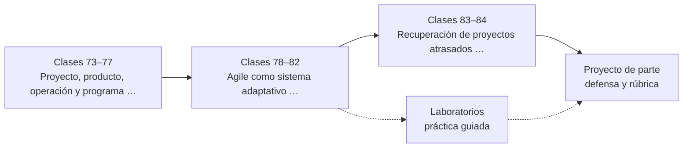

# Parte 06 — Proyectos, Agile y entrega

<!-- parte:inicio -->

> ← [Parte 05 — Gestión de talento y personas](../05-talent-people-management/README.md) · [Temario](../../SYLLABUS.md) · [Parte 07 — Operaciones, procesos y calidad](../07-operations-process-quality/README.md) →

*Convertir un objetivo ambiguo en entregables, fechas y responsables*

**Etapa:** 2 — Liderazgo de equipos y ejecución  
**Duración:** 12 clases · 30 horas  
**Resultado de salida:** Convertir objetivos ambiguos en entregables, fechas, responsables, riesgos y aprendizaje.

🔵 [Ver las 6 etapas](../../SYLLABUS.md) · 12 clases (073–084) · 4 laboratorios · [proyecto de parte](project.md)

## 🎯 De qué trata esta parte

La mayoría de los proyectos fracasa por alcance mal definido y riesgos no declarados, no por falta de esfuerzo. Esta parte da las herramientas para que una iniciativa sea ejecutable y recuperable.

El eje es **alcance, capacidad y riesgo explícitos**. Agile se trata como sistema adaptativo, no como ceremonia, y se enseña cuándo Scrum, Kanban o un plan clásico corresponden.

## 🧱 Con qué hay que llegar

| Parte | Qué aporta |
|---|---|
| [01 — Pensamiento crítico y toma de decisiones](../01-critical-thinking-and-decisions/README.md) | Decisiones con supuestos y trade-offs. |
| [04 — Liderazgo de equipos](../04-team-leadership/README.md) | Equipos y delegación. |

Cada clase supone la anterior: el orden importa, y saltarse una deja sin base a las que vienen después.

## 📚 Resultados de la parte

Al terminar esta parte podrás:

1. **Distinguir** proyecto, producto, operación y programa.
2. **Definir** alcance y éxito antes de planificar.
3. **Estimar** con capacidad real y gestionar riesgos y dependencias.
4. **Elegir** Scrum, Kanban o un enfoque clásico con criterio.
5. **Rescatar** un proyecto atrasado con un plan creíble.

## 🗺️ Mapa de la parte

## 🧭 Cómo se encadenan las 12 clases

Las clases **73 a 77** construyen la base: tipo de trabajo, alcance, descomposición, estimación y riesgos.

Las clases **78 a 82** cubren la ejecución: Agile, Scrum, Kanban, gobernanza y calidad.

Las clases **83 y 84** enseñan a recuperar: proyectos atrasados y el capstone de rescate de una iniciativa crítica.

## 📘 Las 12 clases

| # | Clase | Qué se trabaja | Entregable | Min |
|---:|---|---|---|---:|
| 073 | [Proyecto, producto, operación y programa](classes/073-proyecto-producto-operacion-y-programa/README.md) | proyecto, producto, operación | [operating-improvement-brief](../../templates/operating-improvement-brief.md) | 150 |
| 074 | [Definición de alcance y éxito](classes/074-definicion-de-alcance-y-exito/README.md) | scope, deliverable, outcome | [leadership-decision-brief](../../templates/leadership-decision-brief.md) | 150 |
| 075 | [Work breakdown y planificación](classes/075-work-breakdown-y-planificacion/README.md) | WBS, work package, dependency | [leadership-decision-brief](../../templates/leadership-decision-brief.md) | 150 |
| 076 | [Estimación y capacidad](classes/076-estimacion-y-capacidad/README.md) | effort, duration, capacity | [operating-improvement-brief](../../templates/operating-improvement-brief.md) | 150 |
| 077 | [Gestión de riesgos y dependencias](classes/077-gestion-de-riesgos-y-dependencias/README.md) | risk, issue, dependency | [risk-governance-brief](../../templates/risk-governance-brief.md) | 150 |
| 078 | [Agile como sistema adaptativo](classes/078-agile-como-sistema-adaptativo/README.md) | iteración, feedback loop, batch size | [leadership-decision-brief](../../templates/leadership-decision-brief.md) | 150 |
| 079 | [Scrum con criterio](classes/079-scrum-con-criterio/README.md) | Product Goal, Sprint Goal, Increment | [leadership-decision-brief](../../templates/leadership-decision-brief.md) | 150 |
| 080 | [Kanban y flujo](classes/080-kanban-y-flujo/README.md) | WIP, cycle time, lead time | [modelo-financiero-y-memo-de-decision](../../templates/modelo-financiero-y-memo-de-decision.md) | 150 |
| 081 | [Stakeholders y gobernanza de proyecto](classes/081-stakeholders-y-gobernanza-de-proyecto/README.md) | sponsor, steering committee, change authority | [leadership-decision-brief](../../templates/leadership-decision-brief.md) | 150 |
| 082 | [Calidad y Definition of Done](classes/082-calidad-y-definition-of-done/README.md) | quality, Definition of Done, acceptance criteria | [operating-improvement-brief](../../templates/operating-improvement-brief.md) | 150 |
| 083 | [Recuperación de proyectos atrasados](classes/083-recuperacion-de-proyectos-atrasados/README.md) | rebaseline, critical path, scope cut | [leadership-decision-brief](../../templates/leadership-decision-brief.md) | 150 |
| 084 | [Capstone: rescate de una iniciativa crítica](classes/084-capstone-rescate-de-una-iniciativa-critica/README.md) | recovery plan, minimum viable scope, decision gate | [risk-governance-brief](../../templates/risk-governance-brief.md) | 150 |

## ⚠️ Riesgos característicos

- Planificar antes de definir el éxito.
- Estimar sin considerar capacidad ni dependencias.
- Adoptar un marco por moda y no por el tipo de trabajo.
- Ocultar el atraso hasta que ya no tiene remedio.

## 🔤 Glosario de la parte

56 conceptos definidos en las clases, con la definición operacional que usa cada una.

| Concepto | Definición operacional |
|---|---|
| **acceptance criteria** | condiciones observables para aceptar un entregable. |
| **adaptación** | cambio de plan basado en evidencia. |
| **batch size** | cantidad de trabajo comprometido antes de obtener feedback. |
| **benefit** | valor realizado después de usar el resultado. |
| **capacity** | trabajo disponible de personas o sistemas por periodo. |
| **change authority** | rol autorizado para aceptar cambios. |
| **confidence level** | grado de confianza en fecha/costo basado en evidencia. |
| **contingency** | respuesta preparada si el evento ocurre. |
| **crashing** | aumento de recursos para reducir duración de actividades críticas. |
| **critical path** | secuencia cuya demora afecta fecha final. |
| **cycle time** | tiempo desde inicio hasta finalización. |
| **decision gate** | punto donde sponsor debe elegir entre opciones. |
| **defect** | desviación de requisito o expectativa verificable. |
| **Definition of Done** | criterios comunes que un incremento debe cumplir para considerarse terminado. |
| **deliverable** | producto verificable creado por el proyecto. |
| **dependency** | relación donde un trabajo condiciona otro. |
| **Developers** | personas responsables de crear Increment usable. |
| **duration** | tiempo calendario desde inicio a fin. |
| **effort** | trabajo necesario medido en unidades de esfuerzo. |
| **empiricism** | gestión mediante transparencia, inspección y adaptación. |
| **escalation path** | ruta predefinida para decisiones fuera de tolerancia. |
| **fast tracking** | solapar trabajo antes secuencial aumentando riesgo. |
| **feedback loop** | secuencia que convierte uso o revisión en adaptación. |
| **forecast** | proyección actualizada basada en datos y supuestos. |
| **Increment** | resultado usable que cumple Definition of Done. |
| **issue** | problema que ya ocurrió. |
| **iteración** | ciclo corto que produce una versión evaluable. |
| **lead time** | tiempo desde solicitud hasta entrega. |
| **milestone** | evento sin duración que marca un punto verificable. |
| **minimum viable scope** | alcance mínimo que conserva valor contractual o de negocio. |
| **mitigation** | acción que reduce probabilidad o impacto. |
| **operación** | trabajo recurrente que mantiene una capacidad. |
| **outcome** | cambio en desempeño o comportamiento habilitado por entregables. |
| **portfolio** | conjunto de inversiones priorizadas por estrategia y recursos. |
| **Product Goal** | estado futuro del producto que orienta backlog. |
| **Product Owner** | responsabilidad por maximizar valor y gestionar Product Backlog. |
| **producto** | activo o servicio gestionado durante un ciclo de valor. |
| **programa** | coordinación de proyectos y actividades relacionadas para beneficios conjuntos. |
| **proyecto** | esfuerzo temporal para crear un resultado definido. |
| **pull** | principio de iniciar trabajo cuando existe capacidad en la etapa siguiente. |
| **quality** | grado en que un resultado cumple requisitos y es apto para uso. |
| **quality debt** | trabajo futuro creado al aceptar calidad insuficiente. |
| **rebaseline** | establecimiento de un plan realista basado en estado actual. |
| **recovery plan** | plan explícito para estabilizar y volver a una trayectoria defendible. |
| **risk** | evento incierto que puede afectar objetivos. |
| **risk burn-down** | reducción de exposición a medida que se resuelven incertidumbres. |
| **scope** | frontera del trabajo incluido y excluido. |
| **scope cut** | eliminación deliberada de alcance para proteger outcome principal. |
| **sponsor** | ejecutivo accountable por propósito, apoyo y decisiones de alto nivel. |
| **Sprint Goal** | objetivo coherente que da flexibilidad al trabajo del sprint. |
| **stakeholder engagement** | participación proporcional a poder e impacto. |
| **steering committee** | foro de gobernanza para decisiones y excepciones. |
| **throughput** | unidades terminadas por periodo. |
| **WBS** | descomposición jerárquica orientada a entregables. |
| **WIP** | trabajo iniciado pero no terminado. |
| **work package** | unidad gestionable con resultado y estimación. |

## 📦 Qué queda como evidencia

- Una carta de proyecto con alcance y criterios de éxito.
- Un registro de riesgos y dependencias.
- Un plan de recuperación de un proyecto atrasado.
- El capstone: rescate de una iniciativa.

## 🔗 Cómo se conecta

Alimenta la parte 07 (operaciones), la 08 (gestión por indicadores) y la 19 (entrega tecnológica).

## 🧪 Cómo se trabaja

Son **12 clases de 150 minutos** —30 horas— con **4 laboratorios** y un proyecto integrador. Cada clase trae su propósito, sus conceptos, un caso, práctica, errores frecuentes, preguntas de comprobación, entregable y fuentes, y se evalúa con su `assessment.md`. Los laboratorios se resuelven con datos propios o sintéticos, nunca con datos reales de terceros, y la parte se cierra con el proyecto y su defensa. Las reglas de recorrido están en [la guía de navegación](../../docs/NAVIGATION.md).

<!-- parte:fin -->

## Laboratorios

- [Lab 01 — Project charter](labs/lab-01.md)
- [Lab 02 — Risk register](labs/lab-02.md)
- [Lab 03 — Kanban flow review](labs/lab-03.md)
- [Lab 04 — Project recovery plan](labs/lab-04.md)

## Proyecto de parte

Rescatar un proyecto estratégico atrasado, con sobrecosto y stakeholders enfrentados.

## Bibliografía rectora

- Project Management Institute — *A Guide to the Project Management Body of Knowledge (PMBOK Guide)* (Proyectos)
- Harold Kerzner — *Project Management* (Proyectos)
- Ken Schwaber & Jeff Sutherland — *The Scrum Guide* (Agile)
- David J. Anderson — *Kanban* (Flujo)
- Nicole Forsgren, Jez Humble & Gene Kim — *Accelerate* (Entrega tecnológica)

## Criterio de aprobación

80/100 y entrega del proyecto integrador.
