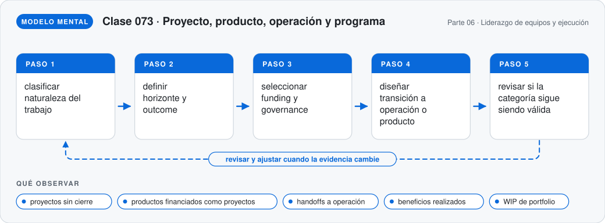

# Clase 073 — Proyecto, producto, operación y programa

<!-- nav:inicio -->
> **Parte 06 · Proyectos, Agile y entrega** — clase 1 de 12 · [índice de la parte](../../README.md) · [temario](../../../../SYLLABUS.md)
<!-- nav:fin -->

**Parte:** 06 — Proyectos, Agile y entrega  
**Nivel:** Etapa 2 — Líder → Jefe / Team Lead  
**Duración sugerida:** 150–180 minutos · **Estándar:** deep-class-v2

## 🎯 Propósito

Una de las causas más frecuentes de iniciativas que fracasan es empezar por el método y no por la naturaleza del trabajo: se gestiona con un plan de proyecto algo que debería evolucionar como producto, se trata como operación algo que necesita una fecha de término, o se lanzan cinco proyectos sueltos que juntos debían producir un beneficio que ninguno logra solo. Antes de planificar, conviene preguntar **qué tipo de trabajo es**.

La clase usa las definiciones del Project Management Institute (PMBOK) y la exposición de Harold Kerzner, junto con la noción de Scrum de un producto que evoluciona con un objetivo, y la evidencia de Flyvbjerg y Gardner sobre cómo los grandes proyectos fracasan. Al terminar sabrás distinguir proyecto, producto, operación y programa, y elegir el gobierno y la medida de éxito de cada uno.

## 📚 Resultados de aprendizaje

Al finalizar podrás:

1. **Definir** proyecto, producto, operación y programa con sus criterios.
2. **Clasificar** una iniciativa en uno de los tipos o en una combinación declarada.
3. **Elegir** el método, el gobierno y la medida de éxito según el tipo.
4. **Reconocer** los errores de gestión que nacen de una clasificación equivocada.
5. **Decidir** cuándo agrupar proyectos en un programa y cuándo no.

## 🧭 Agenda

| Tramo | Qué se hace |
|---|---|
| 0–20 min | Recuperación: lista cinco iniciativas de tu organización y clasifícalas por intuición. |
| 20–60 min | Definiciones, diferencias y consecuencias de gestión. |
| 60–105 min | Ejemplo trabajado: reclasificar tres iniciativas mal gestionadas. |
| 105–140 min | Caso ejecutivo: un «proyecto» que nunca termina. |
| 140–170 min | Límites y entregable. |

## 🧩 Conceptos centrales

| Concepto | Definición | Cómo se reconoce |
|---|---|---|
| **Proyecto** | Esfuerzo temporal emprendido para crear un producto, servicio o resultado único (PMI, PMBOK). | Tiene inicio, fin y entregables. |
| **Producto** | Algo que se desarrolla, lanza y evoluciona mientras entregue valor; se orienta por un objetivo (Schwaber y Sutherland, 2020). | Se mejora de manera continua. |
| **Operación** | Trabajo continuo y repetitivo que sostiene el funcionamiento del negocio. | No tiene fecha de término. |
| **Programa** | Conjunto de proyectos y actividades relacionados que se gestionan de manera coordinada para obtener beneficios que no lograrían por separado (PMI, PMBOK). | Los beneficios dependen de varios proyectos. |
| **Portafolio** | Conjunto de proyectos, programas y operaciones que se gestionan para lograr objetivos estratégicos (PMI, PMBOK). | Se prioriza y se asignan recursos entre ellos. |
| **Beneficio** | Resultado de valor que justifica la inversión. | Se mide después de entregar. |

## 🧠 Modelo mental

**Cómo leer el diagrama.** La columna «cuándo termina» es la más reveladora: el proyecto termina al entregar, la operación no termina, el producto termina cuando deja de dar valor, y el programa, cuando logra sus beneficios. La última columna explica por qué se gestionan distinto: lo que se mide para un proyecto (plazo, costo, alcance) no sirve para una operación (calidad, costo unitario).

## 📖 Desarrollo

### 1. Qué es un proyecto

El PMI define proyecto como un esfuerzo **temporal** para crear un resultado **único**. Dos rasgos lo distinguen: tiene un comienzo y un final definidos, y produce algo que no existía. Un proyecto no es todo lo que cuesta mucho o dura mucho: construir una planta es un proyecto; operarla, no. Cuando la fecha de término se desdibuja, probablemente el trabajo no es un proyecto.

### 2. Qué es un producto

Un producto se **desarrolla, se lanza y evoluciona**. Su éxito no es entregar una versión sino generar valor sostenido. El marco Scrum lo expresa con un **objetivo del producto**, un compromiso a largo plazo hacia el cual se ordena el trabajo. Gestionarlo como proyecto lo cierra cuando se termina el presupuesto, aunque siga necesitando mejoras; gestionarlo como producto exige un equipo estable y un dueño responsable de su valor (clase 079).

### 3. Qué es una operación

La operación es el trabajo **recurrente** que hace funcionar el negocio: atender clientes, facturar, mantener sistemas. Se gestiona por **calidad, costo unitario, tiempos de ciclo y continuidad** (parte 07). Un proyecto puede cambiar la operación (un sistema nuevo), pero cuando termina, la operación sigue y alguien debe hacerse cargo. Muchos proyectos fallan después de entregar porque nadie preparó la transición a la operación.

### 4. Qué es un programa

Un programa agrupa proyectos y actividades **relacionados** para lograr beneficios que no se obtendrían gestionándolos por separado. Un ejemplo: modernizar la atención al cliente exige un proyecto de plataforma, otro de procesos y otro de capacitación; solo juntos producen el beneficio. Un programa se gestiona por **beneficios** y dependencias entre proyectos. Si los proyectos son independientes, agruparlos solo añade burocracia: es un portafolio.

### 5. Por qué importa clasificar

La clasificación decide cuatro cosas: el **método** (plan por entregables, ciclos iterativos, flujo continuo), el **gobierno** (quién aprueba y con qué frecuencia), la **medida de éxito** y el **horizonte** (cuándo termina la responsabilidad del equipo). Un error típico: medir un producto por «entregado a tiempo y en presupuesto», que premia entregar algo que nadie usa. Otro: gestionar una operación con el calendario de un proyecto, lo que produce urgencias artificiales.

### 6. Combinaciones

La mayoría de las iniciativas reales **combinan** tipos: un proyecto para lanzar un producto, un producto que se apoya en una operación. Lo importante es **declararlo** y separar las responsabilidades. Una pregunta útil: ¿qué parte tiene fecha de término y qué parte continúa? Flyvbjerg y Gardner muestran, con datos de grandes proyectos, que muchos fracasos nacen de decidir y planificar con prisa sin entender qué se está construyendo: pensar despacio al inicio reduce los costos de corregir después.

### 7. Beneficios, no solo entregables

Un proyecto exitoso no es el que entrega el producto sino el que obtiene el **beneficio** que justificó la inversión. Para ello, se define el beneficio, su medida y un responsable, y se revisa **después** de la entrega. Un proyecto técnicamente perfecto, cuyo resultado nadie usa, fracasó. Esta mirada une las clases 074 (éxito) y 081 (gobierno).

## 📚 Lectura comparada

| Obra | Qué aporta | Qué no resuelve | Pregunta para contrastar |
|---|---|---|---|
| PMI, PMBOK | Definiciones de proyecto, programa y portafolio. | Es una guía con enfoque de proyectos. | ¿Tiene tu iniciativa un fin definido? |
| Kerzner (2017) | Gestión de proyectos, programas y portafolios. | Su enfoque es el de grandes organizaciones. | ¿Qué parte es operación? |
| Schwaber y Sutherland (2020) | El producto y su objetivo en un marco iterativo. | Es un marco, no una guía de portafolio. | ¿Cuál es el objetivo de tu producto? |
| Flyvbjerg y Gardner (2023) | Por qué fracasan los grandes proyectos y cómo planificar. | Se centra en proyectos de gran escala. | ¿Qué decisión se tomó con prisa? |
| Meadows (2009) | Ver el sistema del que forma parte la iniciativa. | No trata de gestión de proyectos. | ¿Qué parte del sistema cambia tu proyecto? |

## 🧮 Ejemplo trabajado

**Situación (hipotética).** Una empresa tiene tres iniciativas con problemas.

| Iniciativa | Cómo se gestiona | Clasificación correcta | Corrección |
|---|---|---|---|
| **Aplicación móvil de clientes** | Proyecto de 9 meses con fecha de cierre; después, sin equipo. | **Producto**: seguirá evolucionando. | Equipo estable, dueño del producto y objetivo; indicadores de uso y retención. |
| **Mantenimiento mensual de servidores** | Cada mes se abre un «proyecto» con acta y plan. | **Operación**: es recurrente. | Procedimiento estándar, calendario fijo y medidas de continuidad. |
| **Tres iniciativas de servicio al cliente separadas** | Gestionadas por tres jefes sin coordinación. | **Programa**: el beneficio (reducir tiempos de respuesta 30 %) depende de las tres. | Un responsable del programa, una meta común y un tablero de dependencias. |

**Qué cambia.** La aplicación se mide por uso y valor, no por «entregada»; el mantenimiento deja de consumir actas; el programa tiene una meta de beneficio.

**Qué muestra.** (1) La misma pregunta —cuándo termina— clasificó las tres. (2) La corrección fue de método y de gobierno. (3) La medida de éxito cambió.

## 🔀 Comparación y límites

**Proyecto frente a producto.** El proyecto se orienta a un resultado y termina; el producto se orienta a un valor y continúa. Una iniciativa puede empezar como proyecto y convertirse en producto.

**Límites.** Las definiciones del PMI son convenciones útiles, pero las fronteras en la práctica son borrosas y las organizaciones usan los términos de maneras distintas. La clasificación no reemplaza el juicio sobre el riesgo y el valor. Y los datos de Flyvbjerg y Gardner se refieren sobre todo a grandes proyectos de infraestructura y tecnología, con una relevancia desigual para iniciativas pequeñas.

## 🪜 De profesional a owner

| Nivel | Cómo clasifica el trabajo |
|---|---|
| **Profesional** | Pregunta cuándo termina su trabajo y cómo se medirá. |
| **Jefe / Team Lead** | Clasifica el trabajo de su equipo y elige el método. |
| **Gerente** | Separa proyectos de operación y agrupa programas. |
| **CEO / Director** | Gobierna un portafolio y decide qué iniciativas continuar o cerrar. |
| **Founder / Owner** | Trata su negocio como producto y operación, no como un proyecto con fecha de fin. |

## 🏢 Caso ejecutivo

Una empresa de servicios lanzó hace dos años el «proyecto de transformación digital» con 14 sub-iniciativas, un presupuesto de USD 3 millones y un director de proyecto. Nunca se cerró: cada trimestre se agregan nuevas iniciativas y el equipo se queja de estar «siempre en modo proyecto». El comité pregunta si «ya terminó» y nadie sabe qué beneficios se lograron. Algunas iniciativas ya operan; otras no se usan.

Entrega un **diagnóstico de clasificación** que contenga: (a) la clasificación de cada una de las 14 iniciativas con criterio; (b) qué agruparás en programas y con qué beneficio; (c) qué se cierra, qué pasa a operación y qué se convierte en producto; (d) el gobierno y la medida de éxito de cada grupo; (e) cómo medirás los beneficios; (f) cómo comunicarás el cambio al equipo.

## 🧪 Práctica

1. Clasifica cinco iniciativas de tu entorno y justifica con la pregunta «¿cuándo termina?».
2. Elige una que esté mal gestionada y escribe qué cambiarías.
3. Identifica un conjunto de proyectos que debería ser un programa y su beneficio común.
4. Define la medida de éxito de un producto y de una operación.
5. Escribe qué parte de un proyecto tuyo debe pasar a operación y quién se hará cargo.

## ⚠️ Errores frecuentes

| Error | Por qué ocurre | Cómo corregirlo |
|---|---|---|
| Producto gestionado como proyecto | Se asocia entregar con terminar | Equipo estable, dueño y objetivo. |
| Operación con actas de proyecto | Es lo que se sabe hacer | Procedimientos y calendario. |
| Proyectos sueltos que deberían ser un programa | No se ve el beneficio común | Definir el beneficio y su responsable. |
| «Proyecto» sin fin | Se agregan alcances | Cerrar y reclasificar. |
| Medir solo entregables | Es lo fácil | Medir beneficios después de entregar. |
| No preparar la transición a la operación | Se piensa que termina con la entrega | Plan de traspaso y dueño. |

## ❓ Preguntas de comprobación

1. ¿Qué dos rasgos definen un proyecto?
2. ¿Qué diferencia hay entre un proyecto y un producto?
3. ¿Por qué la operación no se gestiona con un plan de proyecto?
4. ¿Qué hace que un conjunto de proyectos sea un programa?
5. ¿Qué decisiones depende de la clasificación?
6. ¿Por qué medir beneficios y no solo entregables?
7. ¿Qué límite tienen las definiciones del PMI?

Claves de respuesta

1. Es temporal y produce un resultado único.
2. El proyecto termina al entregar; el producto continúa y evoluciona mientras entregue valor.
3. Porque es continua y se mide por calidad, costo unitario y continuidad, no por plazo de entrega.
4. Que los proyectos estén relacionados y se gestionen juntos para obtener beneficios que no lograrían por separado.
5. El método, el gobierno, la medida de éxito y el horizonte de responsabilidad.
6. Porque un proyecto exitoso es el que obtiene el beneficio que justificó la inversión, no solo el que entrega.
7. Son convenciones útiles, pero las fronteras en la práctica son borrosas y las organizaciones usan los términos de maneras distintas.

## 📥 Entregable

Guarda en `portfolio/073-proyecto-producto-operacion-y-programa/`:

- `operating-improvement-brief.md` (plantilla [Operating Improvement Brief](../../../../templates/operating-improvement-brief.md)) con el diagnóstico del caso ejecutivo;
- `reading-note.md` con una tensión entre el PMI y Schwaber y Sutherland;
- `decision-journal.md` con la clasificación y las decisiones de gobierno.

## 📗 Fuentes y verificación

- Project Management Institute — *A Guide to the Project Management Body of Knowledge (PMBOK Guide)* (1996). **Uso en esta clase:** definiciones de proyecto, programa y portafolio. Lectura selectiva sobre **proyecto, producto, operación y programa**. **Localizador:** [ISBN-13 9781880410127](https://openlibrary.org/isbn/9781880410127).
- Harold Kerzner — *Project Management* (John Wiley & Sons Inc, 2003). **Uso en esta clase:** gestión de proyectos, programas y portafolios. Lectura selectiva sobre **proyecto, producto, operación y programa**. **Localizador:** [ISBN-13 9780471281580](https://openlibrary.org/isbn/9780471281580).
- Ken Schwaber & Jeff Sutherland — *The Scrum Guide* (Scrum.org / Scrum Alliance). **Uso en esta clase:** el producto y su objetivo en un marco iterativo. **Fuente primaria:** <https://scrumguides.org/>.
- Bent Flyvbjerg & Dan Gardner — *How Big Things Get Done* (Currency, 2023). **Uso en esta clase:** por qué fracasan los grandes proyectos y cómo planificar. Lectura selectiva sobre **proyecto, producto, operación y programa**. **Localizador:** [ISBN-13 9780593239513](https://openlibrary.org/isbn/9780593239513).
- Donella H. Meadows — *Thinking in Systems* (Earthscan, 2009). **Uso en esta clase:** ver el sistema del que forma parte la iniciativa. Lectura selectiva sobre **proyecto, producto, operación y programa**. **Localizador:** [ISBN-13 9781849773386](https://openlibrary.org/isbn/9781849773386).

> **Regla de fuentes para Proyecto, producto, operación y programa:** las obras anteriores estructuran las perspectivas de esta materia; cualquier norma, ley o estándar vivo mencionado debe comprobarse nuevamente en su fuente primaria vigente. Los ejemplos y casos son hipotéticos. El desarrollo es original y no reproduce capítulos protegidos.

<!-- pie:inicio -->
---

| Anterior | Índice | Siguiente |
|---|---|---|
| [← 072 · Capstone: construir un sistema de talento](../../../05-talent-people-management/classes/072-capstone-construir-un-sistema-de-talento/README.md) | [Parte 06](../../README.md) · [Programa](../../../../SYLLABUS.md) | [074 · Definición de alcance y éxito →](../074-definicion-de-alcance-y-exito/README.md) |
<!-- pie:fin -->
