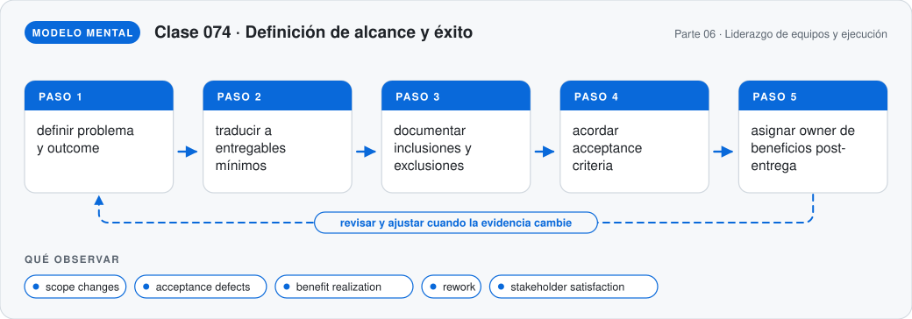

# Clase 074 — Definición de alcance y éxito

<!-- nav:inicio -->
> **Parte 06 · Proyectos, Agile y entrega** — clase 2 de 12 · [índice de la parte](../../README.md) · [temario](../../../../SYLLABUS.md)
<!-- nav:fin -->

**Parte:** 06 — Proyectos, Agile y entrega  
**Nivel:** Etapa 2 — Líder → Jefe / Team Lead  
**Duración sugerida:** 150–180 minutos · **Estándar:** deep-class-v2

## 🎯 Propósito

«Necesitamos un sistema nuevo», «hay que mejorar la experiencia del cliente», «lancemos la aplicación»: son deseos, no alcances. Un proyecto empieza mal cuando nadie sabe exactamente qué entregará, qué queda fuera ni cómo se sabrá que sirvió. Esa vaguedad se paga después con discusiones sobre qué se prometió, ampliaciones silenciosas del trabajo —el famoso *scope creep*— y entregas que cumplen la lista pero no resuelven el problema.

La clase usa la exposición del PMBOK y de Kerzner sobre el alcance y los requisitos, y la investigación de Locke y Latham sobre metas específicas. Al terminar sabrás pasar de un problema a un resultado de negocio, escribir criterios de éxito medibles, delimitar lo que está dentro y fuera del alcance y gobernar los cambios.

## 📚 Resultados de aprendizaje

Al finalizar podrás:

1. **Distinguir** problema, resultado de negocio, requisito y entregable.
2. **Redactar** criterios de éxito medibles con línea base y fecha.
3. **Delimitar** el alcance con inclusiones y exclusiones explícitas.
4. **Gobernar** los cambios con un proceso de aprobación y su efecto en plazo y costo.
5. **Detectar** y frenar la ampliación silenciosa del alcance.

## 🧭 Agenda

| Tramo | Qué se hace |
|---|---|
| 0–20 min | Recuperación: toma un proyecto reciente; ¿cómo se definió su éxito y quién lo aceptó? |
| 20–60 min | De la necesidad al alcance y el control de cambios. |
| 60–105 min | Ejemplo trabajado: acotar un proyecto de «mejorar la atención». |
| 105–140 min | Caso ejecutivo: un alcance que crece cada semana. |
| 140–170 min | Límites y entregable. |

## 🧩 Conceptos centrales

| Concepto | Definición | Cómo se reconoce |
|---|---|---|
| **Alcance** | Trabajo necesario para entregar el resultado con las características acordadas (PMI, PMBOK). | Está escrito y delimitado. |
| **Resultado de negocio** | Cambio medible en el negocio que justifica el proyecto. | «Reducir el tiempo de respuesta de 48 a 24 horas.» |
| **Criterio de éxito** | Condición medible que permite decir que el proyecto sirvió. | Tiene línea base, meta y fecha. |
| **Requisito** | Condición o capacidad que debe cumplir el resultado. | Se puede verificar. |
| **Exclusión** | Lo que, de manera explícita, no se hará. | Está escrita para evitar supuestos. |
| **Ampliación silenciosa del alcance** | Crecimiento del trabajo sin decisión formal sobre plazo y costo. | «Ya que estamos, agreguemos…» |

## 🧠 Modelo mental

**Cómo leer el diagrama.** Los cinco pasos van de lo general a lo concreto. Los dos primeros justifican el proyecto; el tercero define cómo se sabrá si sirvió; el cuarto delimita el trabajo; el quinto protege el acuerdo en el tiempo. Una lista de funcionalidades sin los tres primeros pasos define un trabajo, no un proyecto.

## 📖 Desarrollo

### 1. Empezar por el problema

Antes de definir qué construir, se define **qué problema se resuelve y para quién**, con hechos: cuántos clientes se pierden, cuánto cuesta, cuánto tarda. Un problema bien descrito permite considerar alternativas distintas de la solución que ya se tiene en mente. Si el proyecto se justifica con «necesitamos modernizarnos», aún no hay problema; hay una intención.

### 2. El resultado de negocio

El resultado de negocio es el **cambio** que se espera en el negocio: más ingresos, menos costos, menor riesgo, mejor servicio. Se expresa en una medida: «reducir de 48 a 24 horas el tiempo de respuesta». Es lo que justifica el costo (clase 073). Locke y Latham muestran que las metas **específicas y exigentes** orientan mejor que las vagas: un resultado medible permite decidir entre alternativas y comprobar al final si valió la pena.

### 3. Criterios de éxito

Un criterio de éxito responde: ¿cómo sabremos que funcionó? Tiene cuatro partes: la **medida**, la **línea base** actual, la **meta** y la **fecha** (por ejemplo, «a tres meses del lanzamiento»). Conviene definir pocos, de distinto tipo: uno de resultado (el tiempo de respuesta), uno de uso (adopción), uno de calidad (errores) y, si corresponde, uno de costo. Se acuerdan con quien recibirá el resultado antes de empezar, no al final.

### 4. Requisitos y entregables

Los **requisitos** son las condiciones que el resultado debe cumplir; se escriben de manera que se puedan verificar («el sistema permite que un cliente consulte el estado de su pedido sin llamar»). Los **entregables** son las cosas concretas que se producirán. El PMBOK recomienda recoger requisitos con quienes los usarán, documentarlos, priorizarlos y trazarlos hasta los entregables. Priorizar es indispensable: no todo es igual de importante, y la lista completa nunca cabe.

### 5. Dentro y fuera

El alcance se delimita en dos direcciones: lo que **está** (los entregables y sus características) y lo que **no está** (las exclusiones). Las exclusiones evitan supuestos: «no incluye migrar datos anteriores a 2020», «no incluye la versión en inglés». Un alcance sin exclusiones deja abierta la puerta a que cada interesado entienda lo que le conviene. Las exclusiones se firman igual que las inclusiones.

### 6. Control de cambios

Todo proyecto cambia: surge información nueva o una necesidad. El problema no es el cambio sino el cambio **sin decisión**. Un proceso simple: el cambio se registra; se evalúa su efecto en alcance, plazo, costo y riesgo; lo aprueba quien tiene la autoridad (clase 081); y se actualiza el plan. A veces la respuesta es «sí, con esta fecha y este costo»; a veces, «no ahora». En entornos ágiles, el alcance se gestiona con un backlog ordenado por valor, y los cambios entran por priorización, no por ampliación.

### 7. Aceptación

El éxito se verifica contra los criterios acordados, no contra la impresión. La **aceptación** es un acto: quien recibe confirma que el resultado cumple lo acordado. Conviene definir cómo y quién acepta antes de empezar. Y se mide el beneficio **después** de entregar, cuando el uso real muestra si el resultado de negocio se logró (clase 073). Un proyecto aceptado y sin beneficio es una advertencia sobre la definición del alcance.

## 📚 Lectura comparada

| Obra | Qué aporta | Qué no resuelve | Pregunta para contrastar |
|---|---|---|---|
| PMI, PMBOK | Procesos de recopilar requisitos, definir y controlar el alcance. | Su enfoque es el de proyectos planificados. | ¿Qué exclusiones tiene tu alcance? |
| Kerzner (2017) | Alcance, objetivos y control de cambios en la gestión de proyectos. | Escrita para grandes organizaciones. | ¿Quién aprueba los cambios? |
| Locke y Latham (2002) | Efecto de metas específicas y exigentes. | No trata del alcance técnico. | ¿Tu resultado es medible? |
| Schwaber y Sutherland (2020) | Backlog ordenado por valor y objetivo del producto. | No define el alcance de un proyecto con fecha. | ¿Qué entra a tu backlog y por qué? |
| Flyvbjerg y Gardner (2023) | Pensar despacio al inicio reduce costos posteriores. | Se centra en grandes proyectos. | ¿Cuánto tiempo dedicaste a definir? |

## 🧮 Ejemplo trabajado

**Situación (hipotética).** La directora de atención pide «un proyecto para mejorar la atención al cliente». Se reúne con tres personas para acotarlo.

| Paso | Resultado |
|---|---|
| **Problema** | El 22 % de los clientes espera más de 48 horas una respuesta; la satisfacción de atención es 3,4 sobre 5; se pierden unos 15 clientes por mes. |
| **Resultado de negocio** | Reducir la espera a menos de 24 horas para el 90 % de los casos y recuperar la retención. |
| **Criterios de éxito** | Respuesta < 24 h en el 90 % de los casos (línea base: 52 %), a 3 meses del lanzamiento; satisfacción ≥ 4,0; adopción: 80 % de los agentes usa el sistema. |
| **Dentro** | Sistema de gestión de casos con clasificación, plantillas de respuesta y tablero; capacitación de los 40 agentes. |
| **Fuera** | Atención por redes sociales; integración con el sistema de facturación; migración de casos anteriores a 2024. |
| **Cambios** | Los pedidos de cambio los evalúa el jefe del proyecto y los aprueba la directora si superan 5 días o USD 5.000. |

**Después.** Ventas pide incluir redes sociales. El jefe de proyecto registra el cambio, estima 6 semanas y USD 18.000 y lo presenta a la directora, que decide posponerlo a una segunda fase.

**Qué muestra.** (1) Del deseo se llegó a un resultado medible. (2) Las exclusiones frenaron una ampliación. (3) El cambio se decidió con su costo a la vista.

## 🔀 Comparación y límites

**Alcance fijo frente a alcance variable.** En proyectos con requisitos estables, se fija el alcance y se gestiona el plazo y el costo; en entornos inciertos, se fija el plazo y el costo y se gestiona el alcance por prioridad. Es una decisión de gestión.

**Límites.** Definir el alcance por completo al inicio es imposible cuando hay mucha incertidumbre; en esos casos se define por objetivos y se detalla por etapas. Los criterios de éxito pueden manipularse si se eligen después de ver los resultados. Y los requisitos recogidos son declaraciones de interesados, que pueden no reflejar lo que realmente necesitan (parte 12).

## 🪜 De profesional a owner

| Nivel | Cómo define el alcance |
|---|---|
| **Profesional** | Pregunta por el resultado esperado y el criterio de aceptación de lo que se le pide. |
| **Jefe / Team Lead** | Define el alcance de las iniciativas de su equipo y gobierna los cambios. |
| **Gerente** | Exige criterios de éxito antes de aprobar un proyecto. |
| **CEO / Director** | Decide qué problemas justifican inversión y revisa los beneficios. |
| **Founder / Owner** | Limita el alcance de un primer lanzamiento para aprender pronto. |

## 🏢 Caso ejecutivo

Una empresa de logística lanzó un proyecto para «renovar el portal de clientes». Cada semana, un área distinta pide algo adicional: reportes, un chat, integración con un nuevo transportista. El plazo original de cuatro meses ya llegó a ocho; el presupuesto subió 60 %; nadie recuerda qué se aprobó y qué no. El patrocinador dice que «el proyecto va bien, porque entrega mucho».

Entrega un **acta de alcance y éxito** que contenga: (a) el problema con hechos y el resultado de negocio; (b) los criterios de éxito con línea base, meta y fecha; (c) lo que está dentro y fuera del alcance; (d) el proceso de control de cambios con umbrales; (e) cómo reordenarás lo pedido hasta ahora; (f) cómo medirás el beneficio después de entregar.

## 🧪 Práctica

1. Convierte un deseo de tu trabajo en un resultado de negocio medible.
2. Escribe tres criterios de éxito con línea base, meta y fecha.
3. Redacta tres exclusiones que evitarían un malentendido.
4. Define quién aprueba un cambio y con qué umbral.
5. Identifica una ampliación silenciosa de un proyecto actual y cómo la regularizarías.

## ⚠️ Errores frecuentes

| Error | Por qué ocurre | Cómo corregirlo |
|---|---|---|
| Alcance como lista de funciones | Se parte de la solución | Empezar por problema y resultado. |
| Sin criterios de éxito | Es incómodo medir | Medida, línea base, meta y fecha. |
| Sin exclusiones | Se supone que se entiende | Escribirlas y firmarlas. |
| Cambios por pasillo | Se quiere complacer | Registro, evaluación y aprobación. |
| Éxito = entregar | Se mide lo fácil | Medir el beneficio después. |
| Alcance cerrado en alta incertidumbre | Se quiere certeza | Definir por objetivos y detallar por etapas. |

## ❓ Preguntas de comprobación

1. ¿Qué diferencia hay entre problema, resultado de negocio y requisito?
2. ¿Qué cuatro partes tiene un criterio de éxito?
3. ¿Por qué se escriben las exclusiones?
4. ¿Qué es la ampliación silenciosa del alcance y cómo se evita?
5. ¿Qué pasos tiene un control de cambios?
6. ¿Cuándo se mide el beneficio?
7. ¿Qué límite tiene definir el alcance al inicio?

Claves de respuesta

1. El problema es lo que se resuelve; el resultado de negocio, el cambio medible esperado; el requisito, una condición que el resultado debe cumplir.
2. La medida, la línea base, la meta y la fecha.
3. Para evitar supuestos distintos entre los interesados sobre lo que se entregará.
4. Es el crecimiento del trabajo sin decisión sobre plazo y costo; se evita con un proceso de cambios aprobado por quien tiene autoridad.
5. Registrar, evaluar el efecto en alcance, plazo, costo y riesgo, aprobar o rechazar y actualizar el plan.
6. Después de entregar, cuando el uso real muestra si se logró el resultado de negocio.
7. Con mucha incertidumbre es imposible definirlo por completo; se define por objetivos y se detalla por etapas.

## 📥 Entregable

Guarda en `portfolio/074-definicion-de-alcance-y-exito/`:

- `leadership-decision-brief.md` (plantilla [Leadership Decision Brief](../../../../templates/leadership-decision-brief.md)) con el acta del caso ejecutivo;
- `project-charter.md` (plantilla [Project charter](../../../../templates/project-charter.md)) con el alcance y los criterios de éxito;
- `decision-journal.md` con los cambios solicitados y las decisiones.

## 📗 Fuentes y verificación

- Project Management Institute — *A Guide to the Project Management Body of Knowledge (PMBOK Guide)* (1996). **Uso en esta clase:** procesos de recopilar requisitos, definir y controlar el alcance. Lectura selectiva sobre **definición de alcance y éxito**. **Localizador:** [ISBN-13 9781880410127](https://openlibrary.org/isbn/9781880410127).
- Harold Kerzner — *Project Management* (John Wiley & Sons Inc, 2003). **Uso en esta clase:** alcance, objetivos y control de cambios. Lectura selectiva sobre **definición de alcance y éxito**. **Localizador:** [ISBN-13 9780471281580](https://openlibrary.org/isbn/9780471281580).
- Edwin A. Locke & Gary P. Latham — *Building a Practically Useful Theory of Goal Setting and Task Motivation: A 35-Year Odyssey* (American Psychologist, 2002). **Uso en esta clase:** efecto de las metas específicas y exigentes. Lectura selectiva sobre **definición de alcance y éxito**. **Localizador:** [DOI 10.1037/0003-066X.57.9.705](https://doi.org/10.1037/0003-066X.57.9.705).
- Ken Schwaber & Jeff Sutherland — *The Scrum Guide* (Scrum.org / Scrum Alliance). **Uso en esta clase:** backlog ordenado por valor y objetivo del producto. **Fuente primaria:** <https://scrumguides.org/>.
- Bent Flyvbjerg & Dan Gardner — *How Big Things Get Done* (Currency, 2023). **Uso en esta clase:** pensar despacio al inicio reduce costos posteriores. Lectura selectiva sobre **definición de alcance y éxito**. **Localizador:** [ISBN-13 9780593239513](https://openlibrary.org/isbn/9780593239513).

> **Regla de fuentes para Definición de alcance y éxito:** las obras anteriores estructuran las perspectivas de esta materia; cualquier norma, ley o estándar vivo mencionado debe comprobarse nuevamente en su fuente primaria vigente. Los ejemplos y casos son hipotéticos, con cifras ilustrativas. El desarrollo es original y no reproduce capítulos protegidos.

<!-- pie:inicio -->
---

| Anterior | Índice | Siguiente |
|---|---|---|
| [← 073 · Proyecto, producto, operación y programa](../073-proyecto-producto-operacion-y-programa/README.md) | [Parte 06](../../README.md) · [Programa](../../../../SYLLABUS.md) | [075 · Work breakdown y planificación →](../075-work-breakdown-y-planificacion/README.md) |
<!-- pie:fin -->
