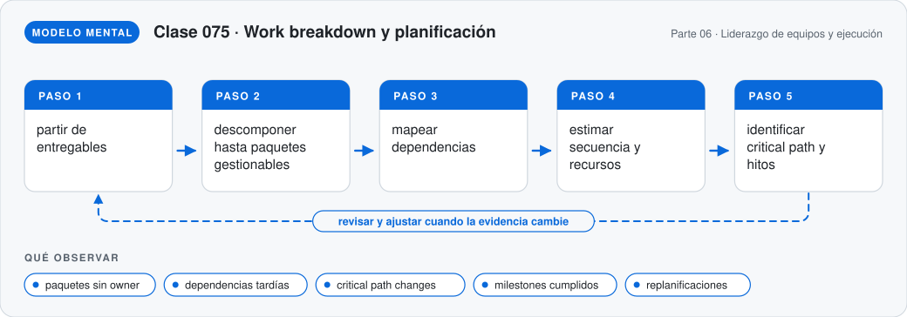

# Clase 075 — Work breakdown y planificación

<!-- nav:inicio -->
> **Parte 06 · Proyectos, Agile y entrega** — clase 3 de 12 · [índice de la parte](../../README.md) · [temario](../../../../SYLLABUS.md)
<!-- nav:fin -->

**Parte:** 06 — Proyectos, Agile y entrega  
**Nivel:** Etapa 2 — Líder → Jefe / Team Lead  
**Duración sugerida:** 150–180 minutos · **Estándar:** deep-class-v2

## 🎯 Propósito

Un plan de proyecto es una hipótesis sobre cómo se llegará de un resultado deseado a un resultado entregado. Casi todos los planes fallan por una de dos razones: **olvidan partes del trabajo** (lo que no estaba en la lista tarda en aparecer, y aparece tarde) o **ignoran cómo se encadenan las tareas** (el plazo no es la suma de las partes sino la secuencia de las que no pueden esperar). Dos herramientas corrigen ambos errores: la estructura de desglose del trabajo y la ruta crítica.

La clase usa el PMBOK para la descomposición y el cronograma, y las ideas de Eliyahu Goldratt sobre la **cadena crítica** y la protección del plazo del proyecto. Al terminar sabrás descomponer un resultado por entregables, definir paquetes de trabajo, identificar dependencias y construir un cronograma con la secuencia que fija el plazo.

## 📚 Resultados de aprendizaje

Al finalizar podrás:

1. **Descomponer** un resultado en entregables y paquetes de trabajo.
2. **Verificar** la completitud de la descomposición con la regla del cien por ciento.
3. **Identificar** dependencias entre tareas y entre equipos.
4. **Calcular** la ruta crítica y entender qué fija el plazo total.
5. **Proteger** el plazo con márgenes agregados y no con márgenes en cada tarea.

## 🧭 Agenda

| Tramo | Qué se hace |
|---|---|
| 0–20 min | Recuperación: toma un proyecto reciente; ¿qué tareas no estaban en el plan inicial? |
| 20–60 min | Descomposición, dependencias y ruta crítica. |
| 60–105 min | Ejemplo trabajado: un lanzamiento con seis entregables. |
| 105–140 min | Caso ejecutivo: un plan que olvidó la migración. |
| 140–170 min | Límites y entregable. |

## 🧩 Conceptos centrales

| Concepto | Definición | Cómo se reconoce |
|---|---|---|
| **Estructura de desglose del trabajo (WBS)** | Descomposición jerárquica del alcance total en entregables y paquetes de trabajo (PMI, PMBOK). | Cada nivel agrupa al inferior. |
| **Regla del 100 %** | La descomposición debe incluir todo el trabajo del alcance, y solo ese (PMI, PMBOK). | La suma de las partes es el todo. |
| **Paquete de trabajo** | Unidad más pequeña de la descomposición, con responsable y criterio de aceptación. | Se puede estimar y asignar. |
| **Dependencia** | Relación por la cual una tarea no puede comenzar o terminar antes que otra. | Hay un «antes de». |
| **Ruta crítica** | Secuencia de tareas que determina el plazo mínimo del proyecto (PMI, PMBOK). | Un retraso en ella retrasa todo. |
| **Cadena crítica** | Ruta crítica que además considera la disponibilidad de recursos y protege el plazo con un margen agregado (Goldratt, 1997). | Se gestiona el consumo del margen del proyecto. |

## 🧠 Modelo mental

**Cómo leer el diagrama.** Se parte del resultado, se descompone por **entregables** y no por actividades, se llega a paquetes de trabajo pequeños, se ordenan por dependencias y se obtiene el cronograma con la secuencia que fija el plazo. El retorno indica que el plan se rehace al saber más: no es un documento sino un proceso.

## 📖 Desarrollo

### 1. Descomponer por entregables

La descomposición parte del entregable final y lo divide en **entregables** más pequeños, hasta llegar a **paquetes de trabajo**. Se descompone por **cosas que existirán** (el manual, el sistema, la capacitación) y no por actividades (diseñar, programar, probar), porque las cosas son más fáciles de verificar y evitan olvidar partes. Un buen desglose tiene de tres a cuatro niveles; más detalle se deja para cuando el trabajo se acerque.

### 2. La regla del cien por ciento

El PMBOK propone que la WBS contenga el **100 % del trabajo** del alcance, y nada más: si se suman las partes, se obtiene el todo. Para verificarlo, se pregunta de cada nivel: «si se entregan estos subentregables, ¿está completo el padre?». También se verifica con el alcance: cada requisito debe aparecer en algún entregable. Las tareas olvidadas más frecuentes son las de **gestión**, **migración**, **capacitación**, **pruebas**, **documentación** y **cierre**.

### 3. Paquetes de trabajo

Un paquete de trabajo es lo bastante pequeño para **estimarse con confianza** y asignarse a **un responsable**, con un criterio de **aceptación**. Un tamaño razonable: entre uno y diez días de trabajo. Si es mucho más grande, se descompone; si es mucho más pequeño, se agrupa. Los paquetes pequeños permiten ver el avance con claridad y limitar el daño de una mala estimación (clase 076).

### 4. Dependencias

Las tareas se relacionan: una no puede empezar hasta que otra termina (la más común), o ambas deben terminar juntas. También hay dependencias **entre equipos** y con **terceros**: el proveedor que debe entregar, la aprobación de otra área. Se registran con un nombre y una fecha y se tratan como riesgos (clase 077). Muchas demoras no vienen del trabajo propio sino de lo que se esperaba de otros y no se pidió a tiempo.

### 5. La ruta crítica

La **ruta crítica** es la secuencia de tareas dependientes más larga: determina el plazo mínimo del proyecto. Un retraso en una tarea de la ruta crítica retrasa todo; en una tarea con **holgura**, no. Conocerla permite concentrar la atención donde importa. Se calcula sumando las duraciones a lo largo de cada secuencia: la mayor es la ruta crítica. Cambia a medida que el proyecto avanza.

### 6. Proteger el plazo

Goldratt observó que, cuando cada persona agrega un margen a su estimación, el margen se consume: se trabaja hasta el último momento (síndrome del estudiante) o el trabajo se expande para llenar el tiempo. Propone **estimar cada tarea sin margen oculto** y agregar un **margen único al final de la cadena crítica**, que se consume si las tareas se atrasan y se vigila como indicador de salud. Considerar la disponibilidad de **recursos** también cambia la cadena crítica: una persona no puede hacer dos tareas a la vez.

### 7. Planificar por olas

Planificar todo en detalle desde el inicio produce una ilusión de control, porque lo que está lejos se conoce poco. Una práctica sensata es la **planificación por olas**: detalle alto para el trabajo próximo (semanas), nivel medio para el siguiente y alto nivel para lo lejano, que se refina al acercarse. El plan se **revisa** a intervalos regulares y cuando cambian los supuestos. En entornos ágiles (clases 078 a 080), las olas son los ciclos cortos.

## 📚 Lectura comparada

| Obra | Qué aporta | Qué no resuelve | Pregunta para contrastar |
|---|---|---|---|
| PMI, PMBOK | WBS, dependencias, cronograma y ruta crítica. | Supone un alcance relativamente estable. | ¿Qué trabajo no está en tu WBS? |
| Goldratt (1997) | Cadena crítica y protección del plazo. | Su método ha sido discutido y requiere cambios de cultura. | ¿Dónde se esconden los márgenes de tu plan? |
| Kerzner (2017) | Planificación y control de proyectos. | Escrito para grandes organizaciones. | ¿Cómo se monitorea el avance? |
| Flyvbjerg y Gardner (2023) | Planificar con cuidado antes de ejecutar. | Se centra en grandes proyectos. | ¿Cuánto tiempo dedicaste a planificar? |
| Reinertsen (2009) | Cómo la cola y la variabilidad afectan el desarrollo. | Es un texto técnico. | ¿Qué esperas entre tareas? |

## 🧮 Ejemplo trabajado

**Situación (hipotética).** Un equipo planifica el lanzamiento de un servicio nuevo. El resultado: «servicio lanzado y operando con 50 clientes».

| Nivel | Entregable |
|---|---|
| 1 | Servicio lanzado y operando |
| 1.1 | Producto: plataforma configurada y probada |
| 1.2 | Operación: procedimientos, soporte y monitoreo |
| 1.3 | Comercial: oferta, precios, materiales |
| 1.4 | Personas: equipo capacitado |
| 1.5 | Clientes: 50 clientes incorporados y migrados |
| 1.6 | Gestión: plan, riesgos, informes y cierre |

**Dependencias y ruta crítica (en días hábiles).** Configuración (15) → pruebas (10) → capacitación (5) → incorporación de clientes (10) = 40 días. Procedimientos (12) y materiales (10) corren en paralelo y no son críticos. Pero la **dependencia externa**: la aprobación del proveedor de pagos tarda 25 días y debe estar antes de las pruebas: pasa a la ruta crítica (25 + 10 + 5 + 10 = 50 días).

**Decisión.** El equipo pide la aprobación del proveedor el primer día y agrega un margen de 8 días al final de la cadena crítica; la fecha comprometida es el día 58 y se monitorea el consumo del margen.

**Qué muestra.** (1) La WBS por entregables incluyó operación, personas y gestión. (2) La dependencia externa cambió la ruta crítica. (3) El margen es único y visible.

## 🔀 Comparación y límites

**Plan frente a calendario.** El calendario ordena fechas; el plan incluye el alcance, las dependencias, los recursos y los supuestos. Un calendario sin WBS es una promesa sin contenido.

**Límites.** La WBS y la ruta crítica suponen que el trabajo es descomponible y que las dependencias son conocidas; en trabajo de descubrimiento o muy incierto, funcionan peor y conviene un enfoque iterativo. El método de la cadena crítica ha tenido resultados variables y requiere que las personas acepten estimaciones sin margen. Y planificar con exceso de detalle consume tiempo que podría dedicarse a hacer.

## 🪜 De profesional a owner

| Nivel | Cómo planifica |
|---|---|
| **Profesional** | Descompone su tarea y avisa de dependencias. |
| **Jefe / Team Lead** | Construye la WBS y el cronograma con el equipo. |
| **Gerente** | Revisa planes de varios equipos y sus dependencias. |
| **CEO / Director** | Pide planes con ruta crítica y margen visible para las iniciativas clave. |
| **Founder / Owner** | Planifica por olas con recursos limitados y revisa con frecuencia. |

## 🏢 Caso ejecutivo

Una empresa planificó el cambio a un nuevo sistema de gestión en cuatro meses. El plan tenía 60 actividades, pero omitió la migración de datos históricos, la capacitación de 120 usuarios y las pruebas con clientes. A seis semanas del lanzamiento, se descubre que el proveedor necesita 8 semanas para preparar la migración. El gerente del proyecto dice que «la fecha no se puede mover».

Entrega un **plan reconstruido** que contenga: (a) una WBS por entregables que verifique la regla del cien por ciento; (b) los paquetes de trabajo con responsable y criterio de aceptación; (c) el mapa de dependencias internas y externas; (d) la ruta crítica con su duración; (e) el margen que proteges y cómo lo monitorearás; (f) las opciones ante la dependencia del proveedor y su efecto en plazo.

## 🧪 Práctica

1. Descompón un proyecto tuyo por entregables en tres niveles.
2. Verifica la regla del 100 % contra el alcance.
3. Lista las dependencias externas y su fecha límite para pedirlas.
4. Calcula la ruta crítica de tu proyecto.
5. Decide dónde pondrías el margen y cómo lo vigilarías.

## ⚠️ Errores frecuentes

| Error | Por qué ocurre | Cómo corregirlo |
|---|---|---|
| Descomponer por actividades | Es lo natural | Descomponer por entregables. |
| Olvidar migración, capacitación o cierre | Son poco visibles | Revisar con la regla del 100 %. |
| Ignorar dependencias externas | Se supone que llegarán | Pedirlas a tiempo y tratarlas como riesgos. |
| Márgenes ocultos en cada tarea | Cada uno se protege | Margen único en la cadena crítica. |
| Planificar todo al detalle | Se busca certeza | Planificar por olas. |
| No revisar el plan | Se archiva | Revisión regular. |

## ❓ Preguntas de comprobación

1. ¿Qué es una WBS y qué dice la regla del cien por ciento?
2. ¿Por qué se descompone por entregables y no por actividades?
3. ¿Qué es un paquete de trabajo?
4. ¿Qué es la ruta crítica y cómo se calcula?
5. ¿Qué propone Goldratt sobre los márgenes?
6. ¿Qué es la planificación por olas?
7. ¿Qué límite tienen la WBS y la ruta crítica?

Claves de respuesta

1. Una descomposición jerárquica del alcance; debe incluir todo el trabajo del alcance y solo ese.
2. Porque las cosas se verifican y evitan olvidar partes, mientras que las actividades pueden dejar huecos.
3. La unidad más pequeña de la descomposición, con responsable, estimación y criterio de aceptación.
4. La secuencia de tareas dependientes más larga, que fija el plazo mínimo; se calcula sumando las duraciones por cada secuencia.
5. Estimar sin margen oculto en cada tarea y agregar un margen único al final de la cadena crítica.
6. Planificar con detalle lo próximo y a alto nivel lo lejano, refinando al acercarse.
7. Suponen trabajo descomponible y dependencias conocidas; en trabajo muy incierto conviene un enfoque iterativo.

## 📥 Entregable

Guarda en `portfolio/075-work-breakdown-y-planificacion/`:

- `leadership-decision-brief.md` (plantilla [Leadership Decision Brief](../../../../templates/leadership-decision-brief.md)) con el plan del caso ejecutivo;
- `project-charter.md` (plantilla [Project charter](../../../../templates/project-charter.md)) con la WBS y el cronograma;
- `decision-journal.md` con la ruta crítica y el consumo del margen.

## 📗 Fuentes y verificación

- Project Management Institute — *A Guide to the Project Management Body of Knowledge (PMBOK Guide)* (1996). **Uso en esta clase:** WBS, dependencias, cronograma y ruta crítica. Lectura selectiva sobre **work breakdown y planificación**. **Localizador:** [ISBN-13 9781880410127](https://openlibrary.org/isbn/9781880410127).
- Eliyahu M. Goldratt — *Critical Chain* (North River Press, 1997). **Uso en esta clase:** cadena crítica y protección del plazo del proyecto. Lectura selectiva sobre **work breakdown y planificación**. **Localizador:** [ISBN-13 9780884271536](https://openlibrary.org/isbn/9780884271536).
- Harold Kerzner — *Project Management* (John Wiley & Sons Inc, 2003). **Uso en esta clase:** planificación y control de proyectos. Lectura selectiva sobre **work breakdown y planificación**. **Localizador:** [ISBN-13 9780471281580](https://openlibrary.org/isbn/9780471281580).
- Bent Flyvbjerg & Dan Gardner — *How Big Things Get Done* (Currency, 2023). **Uso en esta clase:** planificar con cuidado antes de ejecutar. Lectura selectiva sobre **work breakdown y planificación**. **Localizador:** [ISBN-13 9780593239513](https://openlibrary.org/isbn/9780593239513).
- Donald G. Reinertsen — *The Principles of Product Development Flow* (Celeritas Publishing, 2009). **Uso en esta clase:** cola y variabilidad en el desarrollo. Lectura selectiva sobre **work breakdown y planificación**. **Localizador:** [ISBN-13 9781935401001](https://openlibrary.org/isbn/9781935401001).

> **Regla de fuentes para Work breakdown y planificación:** las obras anteriores estructuran las perspectivas de esta materia; cualquier norma, ley o estándar vivo mencionado debe comprobarse nuevamente en su fuente primaria vigente. Los ejemplos y casos son hipotéticos, con duraciones ilustrativas. El desarrollo es original y no reproduce capítulos protegidos.

<!-- pie:inicio -->
---

| Anterior | Índice | Siguiente |
|---|---|---|
| [← 074 · Definición de alcance y éxito](../074-definicion-de-alcance-y-exito/README.md) | [Parte 06](../../README.md) · [Programa](../../../../SYLLABUS.md) | [076 · Estimación y capacidad →](../076-estimacion-y-capacidad/README.md) |
<!-- pie:fin -->
