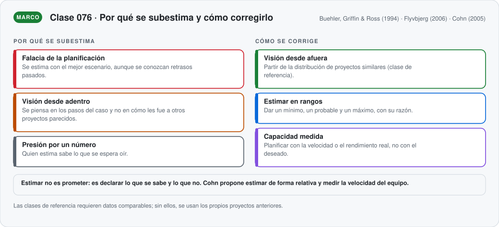

# Clase 076 — Estimación y capacidad

<!-- nav:inicio -->
> **Parte 06 · Proyectos, Agile y entrega** — clase 4 de 12 · [índice de la parte](../../README.md) · [temario](../../../../SYLLABUS.md)
<!-- nav:fin -->

**Parte:** 06 — Proyectos, Agile y entrega  
**Nivel:** Etapa 2 — Líder → Jefe / Team Lead  
**Duración sugerida:** 150–180 minutos · **Estándar:** deep-class-v2

## 🎯 Propósito

Las estimaciones de duración y costo fallan con una regularidad que no se explica por mala suerte: casi siempre son **demasiado optimistas**. La investigación psicológica llama a este fenómeno «falacia de la planificación», y los datos de proyectos grandes muestran que el exceso de costo y de plazo no es la excepción sino la regla. Quien estima con la mejor intención hará lo mismo mientras no cambie el método.

La clase usa el estudio de Buehler, Griffin y Ross sobre la falacia de la planificación, el trabajo de Flyvbjerg sobre cómo acertar con los riesgos mediante la visión desde afuera y las propuestas de Mike Cohn sobre estimar y planificar con velocidad en entornos ágiles. Al terminar sabrás estimar en rangos, usar datos de proyectos parecidos, medir la capacidad real de un equipo y comunicar incertidumbre sin que parezca falta de rigor.

## 📚 Resultados de aprendizaje

Al finalizar podrás:

1. **Explicar** la falacia de la planificación y por qué afecta a quienes estiman.
2. **Aplicar** la visión desde afuera con una clase de referencia.
3. **Estimar** en rangos con una razón explícita.
4. **Medir** la capacidad de un equipo y usarla para planificar.
5. **Comunicar** una estimación con su incertidumbre y sus supuestos.

## 🧭 Agenda

| Tramo | Qué se hace |
|---|---|
| 0–20 min | Recuperación: estima cuánto te tomará una tarea de la semana y compara luego con lo real. |
| 20–60 min | Falacia de la planificación, visión desde afuera y capacidad. |
| 60–105 min | Ejemplo trabajado: estimar un proyecto con tres métodos. |
| 105–140 min | Caso ejecutivo: una fecha comprometida antes de estimar. |
| 140–170 min | Límites y entregable. |

## 🧩 Conceptos centrales

| Concepto | Definición | Cómo se reconoce |
|---|---|---|
| **Falacia de la planificación** | Tendencia a subestimar el tiempo que tomará una tarea aun sabiendo que tareas similares tomaron más (Buehler et al., 1994). | Las estimaciones suponen que todo saldrá bien. |
| **Visión desde adentro** | Estimar a partir de los detalles del caso y del plan propio. | Se piensa en los pasos y no en los antecedentes. |
| **Visión desde afuera** | Estimar a partir de los resultados de proyectos similares (Flyvbjerg, 2006). | Se usa una distribución histórica. |
| **Clase de referencia** | Conjunto de proyectos comparables usados para estimar el nuevo. | Hay datos de costo y plazo. |
| **Estimación en rango** | Estimación con un valor mínimo, uno probable y uno máximo. | Expresa incertidumbre. |
| **Velocidad / rendimiento** | Cantidad de trabajo que un equipo completa por período, medida en la práctica (Cohn, 2005). | Se calcula con datos reales. |

## 🧠 Modelo mental

**Cómo leer el diagrama.** A la izquierda, las causas de la subestimación; a la derecha, las correcciones que se corresponden. La pareja principal: la **visión desde adentro** (pensar en los pasos del plan) se corrige con la **visión desde afuera** (mirar cómo les fue a otros). La presión por un número y el uso de capacidad deseada, no real, se corrigen con rangos y datos medidos.

## 📖 Desarrollo

### 1. La falacia de la planificación

Buehler, Griffin y Ross estudiaron por qué las personas subestiman cuánto les tomarán tareas, incluso las que ya han hecho. Hallaron que se centran en un **plan** que imaginan sin interrupciones, y que **descartan** la información de experiencias pasadas que contradice ese plan. El optimismo no es ignorancia: es un modo de razonar. Por eso pedir «más cuidado» no basta; se necesita un método distinto.

### 2. Visión desde adentro y desde afuera

Flyvbjerg recoge de Kahneman y Tversky la distinción entre dos vistas. La **visión desde adentro** estima a partir de los detalles del proyecto: sus tareas, su equipo, su plan. La **visión desde afuera** parte de una **clase de referencia**: proyectos similares ya terminados, con su distribución de costos y plazos, y ubica el proyecto nuevo en esa distribución. Flyvbjerg muestra que la segunda reduce el optimismo sistemático y propone ajustar con las características propias solo después.

### 3. Cómo usar una clase de referencia

Pasos: **1)** identificar proyectos comparables, de la propia organización o públicos; **2)** reunir sus datos de plazo y costo reales frente a lo estimado; **3)** calcular la distribución del sobrecosto o retraso; **4)** estimar el proyecto con el método habitual y **5)** ajustar con la distribución: si en proyectos parecidos el plazo real fue en mediana 1,4 veces el estimado, esa es una referencia. Si no hay datos externos, se usan los propios proyectos pasados.

### 4. Estimar en rangos

Un solo número da una falsa precisión. Una estimación en **rango** expresa tres valores: **mínimo** (si todo sale bien), **probable** y **máximo** (si ocurren los riesgos conocidos), con la razón de cada uno. Facilita la conversación: «lo más probable es seis semanas, con riesgo de diez si la integración con el proveedor se retrasa». Un **compromiso** es otra cosa: es la fecha que se promete, tomada con un margen, y requiere decidir cuánto riesgo se acepta.

### 5. Capacidad y velocidad

Cohn propone planificar con la **velocidad** del equipo, la cantidad de trabajo (medida en una unidad relativa) que completa por ciclo, **observada** en ciclos anteriores. Con ella se proyecta cuándo terminará el trabajo restante, usando rangos (la mejor y la peor velocidad reciente). La idea general vale más allá de Agile: planificar con el **rendimiento medido** y no con el deseado, y descontar interrupciones, reuniones, soporte y vacaciones.

### 6. Estimar de forma relativa

Para trabajo incierto, Cohn recomienda **estimaciones relativas**: comparar elementos entre sí («esto es el doble que aquello») en lugar de predecir horas. Las personas son mejores comparando que prediciendo valores absolutos. Se pueden usar categorías (pequeño, mediano, grande) o una escala de puntos. Las estimaciones las hacen **quienes harán el trabajo**, con discusión de los supuestos, y se calibran con la velocidad real.

### 7. Comunicar la estimación

Una estimación sin contexto se convierte en promesa. Al comunicarla, se dicen: el **rango**, los **supuestos** principales, los **riesgos** que podrían cambiarla y **cuándo se actualizará**. Quien decide puede elegir un **nivel de confianza**: «con 80 % de confianza, antes del 15 de octubre». Presionar para obtener un número menor transfiere el riesgo a los demás. Una cultura donde estimar con honestidad es seguro (clase 042) produce mejores planes.

## 📚 Lectura comparada

| Obra | Qué aporta | Qué no resuelve | Pregunta para contrastar |
|---|---|---|---|
| Buehler, Griffin y Ross (1994) | Por qué se subestima la duración de las tareas. | Son estudios de laboratorio y de campo con personas, no con equipos. | ¿Qué experiencias pasadas ignoras al estimar? |
| Flyvbjerg (2006) | Visión desde afuera y clases de referencia. | Requiere datos comparables. | ¿Qué proyectos parecidos hay para tu clase de referencia? |
| Cohn (2005) | Estimación relativa y planificación por velocidad. | Nace del desarrollo de software. | ¿Cuál es tu velocidad real? |
| Flyvbjerg y Gardner (2023) | Datos de grandes proyectos sobre sobrecostos. | Su enfoque es de gran escala. | ¿Qué parte de tu proyecto es de «cola larga»? |
| Kahneman, Sibony y Sunstein (2021) | Ruido y sesgo en los juicios de estimación. | No es un manual de gestión de proyectos. | ¿Cuánto varían las estimaciones de distintos miembros? |

## 🧮 Ejemplo trabajado

**Situación (hipotética).** Un equipo debe estimar un proyecto de migración de un sistema. Su estimación inicial, de tres personas, es de 12 semanas.

| Método | Resultado |
|---|---|
| **Visión desde adentro** | 12 semanas: suma de paquetes de trabajo con confianza. |
| **Visión desde afuera** | En los últimos seis proyectos de migración de la empresa, el plazo real fue en mediana 1,5 veces el estimado (rango de 1,1 a 2,4). Ajuste: 18 semanas (mediana); 13 a 29 semanas (rango). |
| **Capacidad medida** | El equipo suele dedicar el 60 % de su tiempo al proyecto, no el 100 % que se asumió. Con 60 %, 12 semanas de trabajo = 20 semanas de calendario. |

**Estimación comunicada.** «Más probable: 18 semanas. Con riesgo razonable: hasta 24. El rango depende de la calidad de los datos del sistema antiguo y de la disponibilidad del especialista; se actualizará al terminar las dos primeras semanas.» El patrocinador acepta 18 semanas con un margen y revisión a la semana 2.

**Qué muestra.** (1) La visión desde adentro fue la más optimista. (2) La clase de referencia y la capacidad real convergieron en un plazo más realista. (3) La comunicación incluyó rango, supuestos y actualización.

## 🔀 Comparación y límites

**Estimación frente a compromiso.** La estimación describe lo que se espera; el compromiso es una decisión sobre qué prometer. Mezclarlos produce promesas que nadie puede cumplir.

**Límites.** Las clases de referencia requieren proyectos comparables y datos fiables; si no existen, la visión desde afuera es débil. La estimación relativa y la velocidad dependen de equipos estables y de trabajo comparable, y se pueden manipular cuando se usan como meta. Los estudios sobre la falacia de la planificación describen una tendencia, no una ley. Y ninguna estimación elimina la incertidumbre.

## 🪜 De profesional a owner

| Nivel | Cómo estima |
|---|---|
| **Profesional** | Estima en rangos, con razón, y registra lo real. |
| **Jefe / Team Lead** | Usa la velocidad del equipo y comunica supuestos. |
| **Gerente** | Construye clases de referencia con los proyectos de su área. |
| **CEO / Director** | Pide la visión desde afuera ante inversiones grandes. |
| **Founder / Owner** | Multiplica sus estimaciones optimistas y protege la caja. |

## 🏢 Caso ejecutivo

El director comercial prometió a un cliente importante la entrega de una nueva funcionalidad para el 30 de junio, sin consultar al equipo técnico. El equipo la estima en cuatro meses, no en dos. El director dice que «es una fecha política» y que «ellos siempre exageran». En los últimos tres proyectos parecidos, el plazo real superó al estimado en un 40 a 80 %. Hoy es 15 de abril.

Entrega un **plan de estimación y respuesta** que contenga: (a) la estimación desde adentro, desde afuera y con capacidad real; (b) el rango con supuestos y riesgos; (c) las opciones (recortar alcance, mover fecha, aumentar recursos) con sus efectos; (d) cómo conversarás con el director y con el cliente; (e) qué compromiso tomarás con qué confianza; (f) cómo evitarás repetir el problema.

## 🧪 Práctica

1. Estima una tarea en rango y registra el resultado real.
2. Reúne datos de tres proyectos parecidos y calcula la razón plazo real a plazo estimado.
3. Calcula el porcentaje de tiempo real que tu equipo dedica al trabajo del proyecto.
4. Reescribe una estimación de un número como rango con razones.
5. Define cuándo y cómo actualizarás una estimación.

## ⚠️ Errores frecuentes

| Error | Por qué ocurre | Cómo corregirlo |
|---|---|---|
| Un solo número | Se busca precisión | Rango con razones. |
| Estimar solo desde adentro | Se conoce el plan | Añadir visión desde afuera. |
| Capacidad al 100 % | Se ignoran interrupciones | Medir la capacidad real. |
| Confundir estimación y compromiso | Se presiona por una fecha | Separar y decidir el riesgo aceptado. |
| Estimar sin quienes harán el trabajo | Se delega a un experto | Estimación hecha por el equipo. |
| No registrar lo real | No hay tiempo | Mantener datos para calibrar. |

## ❓ Preguntas de comprobación

1. ¿Qué es la falacia de la planificación?
2. ¿Qué diferencia hay entre la visión desde adentro y desde afuera?
3. ¿Qué es una clase de referencia?
4. ¿Qué tres valores tiene una estimación en rango?
5. ¿Qué es la velocidad de un equipo y cómo se usa?
6. ¿Qué diferencia hay entre estimación y compromiso?
7. ¿Qué límite tienen las clases de referencia?

Claves de respuesta

1. La tendencia a subestimar el tiempo de una tarea aun sabiendo que tareas similares tomaron más.
2. Desde adentro se estima con los detalles del proyecto; desde afuera, con los resultados de proyectos similares.
3. Un conjunto de proyectos comparables usados para estimar el nuevo.
4. Mínimo, probable y máximo.
5. La cantidad de trabajo que completa por ciclo, observada en ciclos anteriores; se usa para proyectar el trabajo restante.
6. La estimación describe lo esperado; el compromiso es una decisión sobre qué prometer, con un nivel de riesgo.
7. Requieren proyectos comparables y datos fiables; sin ellos la visión desde afuera es débil.

## 📥 Entregable

Guarda en `portfolio/076-estimacion-y-capacidad/`:

- `operating-improvement-brief.md` (plantilla [Operating Improvement Brief](../../../../templates/operating-improvement-brief.md)) con el plan del caso ejecutivo;
- `reading-note.md` con una tensión entre Buehler et al. y Flyvbjerg;
- `decision-journal.md` con las estimaciones, los supuestos y la comparación con lo real.

## 📗 Fuentes y verificación

- Roger Buehler, Dale Griffin & Michael Ross — *Exploring the "planning fallacy": Why people underestimate their task completion times* (Journal of Personality and Social Psychology, 1994). **Uso en esta clase:** por qué se subestima la duración de las tareas. Lectura selectiva sobre **estimación y capacidad**. **Localizador:** [DOI 10.1037/0022-3514.67.3.366](https://doi.org/10.1037/0022-3514.67.3.366).
- Bent Flyvbjerg — *From Nobel Prize to Project Management: Getting Risks Right* (Project Management Journal, 2006). **Uso en esta clase:** visión desde afuera y clases de referencia. Lectura selectiva sobre **estimación y capacidad**. **Localizador:** [DOI 10.1177/875697280603700302](https://doi.org/10.1177/875697280603700302).
- Mike Cohn — *Agile Estimating and Planning* (Prentice Hall, 2005). **Uso en esta clase:** estimación relativa y planificación por velocidad. Lectura selectiva sobre **estimación y capacidad**. **Localizador:** [ISBN-13 9780131479418](https://openlibrary.org/isbn/9780131479418).
- Bent Flyvbjerg & Dan Gardner — *How Big Things Get Done* (Currency, 2023). **Uso en esta clase:** datos de grandes proyectos sobre sobrecostos. Lectura selectiva sobre **estimación y capacidad**. **Localizador:** [ISBN-13 9780593239513](https://openlibrary.org/isbn/9780593239513).
- Daniel Kahneman, Olivier Sibony & Cass R. Sunstein — *Noise* (Little, Brown Spark, 2021). **Uso en esta clase:** ruido y sesgo en los juicios de estimación. Lectura selectiva sobre **estimación y capacidad**. **Localizador:** [ISBN-13 9780316451383](https://openlibrary.org/isbn/9780316451383).

> **Regla de fuentes para Estimación y capacidad:** las obras anteriores estructuran las perspectivas de esta materia; cualquier norma, ley o estándar vivo mencionado debe comprobarse nuevamente en su fuente primaria vigente. Los ejemplos y casos son hipotéticos, con cifras ilustrativas. El desarrollo es original y no reproduce capítulos protegidos.

<!-- pie:inicio -->
---

| Anterior | Índice | Siguiente |
|---|---|---|
| [← 075 · Work breakdown y planificación](../075-work-breakdown-y-planificacion/README.md) | [Parte 06](../../README.md) · [Programa](../../../../SYLLABUS.md) | [077 · Gestión de riesgos y dependencias →](../077-gestion-de-riesgos-y-dependencias/README.md) |
<!-- pie:fin -->
