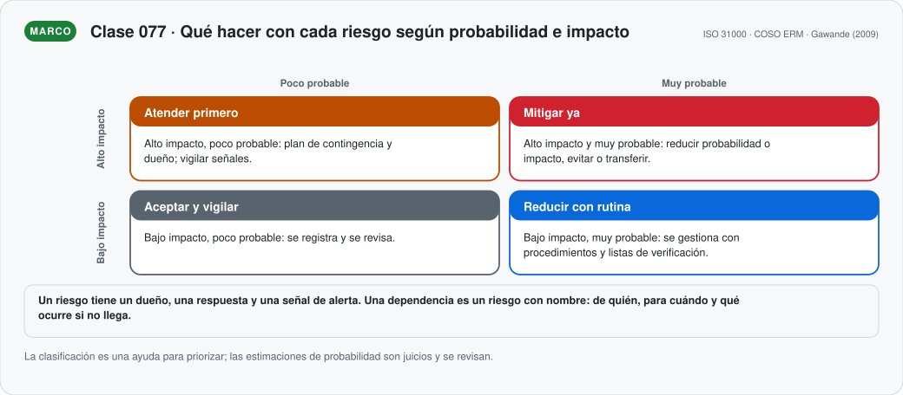

# Clase 077 — Gestión de riesgos y dependencias

<!-- nav:inicio -->
> **Parte 06 · Proyectos, Agile y entrega** — clase 5 de 12 · [índice de la parte](../../README.md) · [temario](../../../../SYLLABUS.md)
<!-- nav:fin -->

**Parte:** 06 — Proyectos, Agile y entrega  
**Nivel:** Etapa 2 — Líder → Jefe / Team Lead  
**Duración sugerida:** 150–180 minutos · **Estándar:** deep-class-v2

## 🎯 Propósito

Casi todos los proyectos tienen un registro de riesgos. Muy pocos lo usan. Se llena al inicio, con riesgos genéricos («falta de recursos», «cambios de alcance»), se archiva y nadie lo vuelve a mirar hasta que ocurre el problema. Un riesgo gestionado es otra cosa: tiene un **dueño**, una **respuesta** acordada, una **señal de alerta** y una fecha de revisión. Y una parte importante de los riesgos de un proyecto son **dependencias**: algo que necesita de otro y que no controla.

La clase usa el proceso de gestión de riesgos de la norma ISO 31000 y el marco de COSO para la gestión de riesgos empresariales, el análisis del PMBOK y la defensa de las listas de verificación de Atul Gawande, que mostró su valor en entornos de alta complejidad. Al terminar sabrás identificar riesgos y dependencias, priorizarlos, definir respuestas y mantenerlos vivos durante el proyecto.

## 📚 Resultados de aprendizaje

Al finalizar podrás:

1. **Distinguir** riesgo, problema, supuesto y dependencia.
2. **Identificar** riesgos con técnicas simples y en grupo.
3. **Priorizar** por probabilidad e impacto y elegir una respuesta.
4. **Gestionar** dependencias como riesgos con dueño, fecha y consecuencia.
5. **Mantener** el registro vivo con señales de alerta y revisiones.

## 🧭 Agenda

| Tramo | Qué se hace |
|---|---|
| 0–20 min | Recuperación: recuerda un problema de un proyecto que alguien «había advertido»; ¿qué ocurrió con la advertencia? |
| 20–60 min | Proceso de riesgos, priorización y respuestas. |
| 60–105 min | Ejemplo trabajado: el registro de riesgos de un lanzamiento. |
| 105–140 min | Caso ejecutivo: una dependencia externa que nadie vigiló. |
| 140–170 min | Límites y entregable. |

## 🧩 Conceptos centrales

| Concepto | Definición | Cómo se reconoce |
|---|---|---|
| **Riesgo** | Efecto de la incertidumbre sobre los objetivos (ISO 31000). | Es un evento posible, no ocurrido. |
| **Problema** | Riesgo que ya ocurrió. | Hay que resolverlo, no gestionarlo. |
| **Supuesto** | Condición que se da por cierta al planificar y que, si falla, afecta al plan. | Se puede verificar. |
| **Dependencia** | Necesidad de que algo o alguien externo al control del equipo entregue algo a tiempo. | Tiene un proveedor y una fecha. |
| **Respuesta al riesgo** | Decisión sobre cómo tratarlo: evitar, mitigar, transferir o aceptar (ISO 31000; PMI, PMBOK). | Está acordada y asignada. |
| **Señal de alerta** | Indicio observable de que un riesgo se está materializando. | Se vigila con una medida. |

## 🧠 Modelo mental

**Cómo leer el diagrama.** El cuadrante ordena el esfuerzo: arriba a la derecha (muy probable y de alto impacto) se **mitiga ya**. Arriba a la izquierda (poco probable pero grave) requiere un **plan de contingencia** y un dueño. Abajo, lo de bajo impacto se acepta, se vigila o se reduce con rutina y listas de verificación. El orden nunca es perfecto: es un criterio para decidir dónde mirar.

## 📖 Desarrollo

### 1. Qué es un riesgo

La norma ISO 31000 define riesgo como el **efecto de la incertidumbre sobre los objetivos**: puede ser negativo (amenaza) o positivo (oportunidad). Un riesgo no es un problema: es algo que **podría** ocurrir. Si ya ocurrió, es un problema, y se gestiona como tal. Un buen enunciado tiene la forma «si [causa], entonces [evento], con efecto en [objetivo]»: «si el proveedor retrasa la entrega, el lanzamiento se atrasaría tres semanas».

### 2. El proceso

ISO 31000 describe un proceso general: establecer el **alcance, el contexto y los criterios**; **evaluar el riesgo** (identificar, analizar y valorar); **tratar el riesgo**; y **monitorear y revisar**, con **comunicación y consulta** en todo el ciclo y **registro e informe**. COSO propone integrar la gestión de riesgos con la estrategia y el desempeño de la organización. Para un proyecto, el proceso se simplifica: identificar, priorizar, responder, vigilar.

### 3. Identificar

Se identifican riesgos con quienes conocen el trabajo: una reunión con el equipo y los interesados, revisión de **proyectos anteriores** (qué falló antes), listas de verificación, análisis de supuestos y de dependencias. Una técnica útil: el *pre-mortem* (clase 018): imaginar que el proyecto fracasó y escribir las causas. Gawande defiende las **listas de verificación** para riesgos conocidos y repetitivos: no sustituyen el juicio, pero evitan olvidar pasos esenciales cuando la complejidad es alta.

### 4. Priorizar

Se estima para cada riesgo la **probabilidad** (baja, media, alta) y el **impacto** (en plazo, costo, calidad y reputación), y se ubica en el cuadrante. Se priorizan los de mayor combinación y los de impacto muy alto aunque sean improbables. Las estimaciones son juicios: se explicitan los criterios y se revisan. Flyvbjerg y Gardner advierten que, en proyectos grandes, los resultados tienen «colas largas»: unos pocos eventos extremos explican gran parte del exceso de costo, de modo que los riesgos improbables y graves merecen atención.

### 5. Responder

Cuatro respuestas clásicas ante una amenaza: **evitar** (cambiar el plan para eliminarla), **mitigar** (reducir probabilidad o impacto), **transferir** (pasar el riesgo a otro: seguro, contrato) y **aceptar** (con o sin plan de contingencia). Para cada riesgo importante se acuerda una respuesta, un **dueño**, una **acción** con fecha y, si corresponde, una **reserva** de tiempo o dinero. Un riesgo sin dueño no se gestiona.

### 6. Dependencias

Una dependencia es un riesgo con nombre: **de quién**, **qué**, **para cuándo** y **qué pasa si no llega**. Se gestionan con: un **pedido formal** con fecha límite, confirmación de la contraparte, **seguimiento** periódico, una **fecha de decisión** para activar un plan B y escalamiento acordado. Muchas demoras de proyectos vienen de dependencias que se supusieron. Y el equipo que depende de otro debe decir con claridad qué necesita y para cuándo (clase 075).

### 7. Mantenerlo vivo

El registro se **revisa** en cada reunión de seguimiento: ¿cambió la probabilidad?, ¿apareció un riesgo nuevo?, ¿se activó una señal de alerta?, ¿se cumplieron las acciones? Los riesgos que ocurren pasan a problemas; los que pasaron se cierran. Se comunica a los interesados los riesgos principales y las decisiones que necesitan. Y se evita un registro enorme: es mejor diez riesgos bien gestionados que cien en una planilla.

## 📚 Lectura comparada

| Obra | Qué aporta | Qué no resuelve | Pregunta para contrastar |
|---|---|---|---|
| ISO 31000 | Proceso general de gestión de riesgos. | Es general, no específico de proyectos. | ¿Qué criterios usas para valorar? |
| COSO ERM | Integración del riesgo con la estrategia. | Su enfoque es empresarial. | ¿Cómo se relaciona tu riesgo con un objetivo? |
| PMI, PMBOK | Identificación, análisis cualitativo y respuestas en proyectos. | Supone un plan estable. | ¿Quién es dueño de cada riesgo? |
| Gawande (2009) | Listas de verificación para riesgos conocidos. | No trata de riesgos nuevos. | ¿Qué pasos esenciales no deberías olvidar? |
| Flyvbjerg y Gardner (2023) | Colas largas y eventos extremos en proyectos. | Se centra en gran escala. | ¿Qué riesgo improbable y grave no estás mirando? |

## 🧮 Ejemplo trabajado

**Situación (hipotética).** Un equipo prepara el lanzamiento de un servicio. Reúne a ocho personas para identificar riesgos y obtiene este registro resumido.

| Riesgo | Prob. | Impacto | Respuesta | Dueño | Señal de alerta |
|---|---|---|---|---|---|
| Si el proveedor de pagos retrasa la aprobación, el lanzamiento se atrasa 3 semanas. | Media | Alto | Mitigar: pedir la aprobación el día 1, con seguimiento semanal; plan B: pasarela alternativa. | Jefa de proyecto | Sin confirmación al día 15. |
| Si el especialista clave renuncia, se pierde el conocimiento del sistema. | Baja | Alto | Mitigar: documentar y capacitar a un segundo; contingencia: contrato con consultor. | Gerente técnico | Cambios en su desempeño o clima. |
| Si la carga inicial supera lo previsto, el servicio se degrada. | Alta | Medio | Mitigar: pruebas de carga y escalamiento automático. | Líder de plataforma | Pruebas con latencia > 2 s. |
| Si los usuarios no adoptan el servicio, el beneficio no se logra. | Media | Alto | Mitigar: piloto con cinco clientes y capacitación. | Producto | Menos del 50 % de uso en 30 días. |

**Dependencias registradas.** Aprobación del proveedor de pagos (pedida el 3 de marzo, confirmada el 14); revisión legal de términos (fecha límite 20 de marzo; escala al director si no hay respuesta).

**Revisión.** Cada semana, 15 minutos: señales, acciones y riesgos nuevos. A los 15 días, la señal del proveedor se activó y el equipo pasó al plan B.

**Qué muestra.** (1) Los riesgos se enunciaron con causa, evento y efecto. (2) Cada uno tiene respuesta, dueño y señal. (3) La revisión semanal permitió reaccionar a tiempo.

## 🔀 Comparación y límites

**Riesgo frente a incertidumbre.** Un riesgo supone que se pueden estimar probabilidades; la incertidumbre profunda, no. Ante esta, conviene reducir la exposición y mantener opciones (clase 044).

**Límites.** Las probabilidades de un registro son juicios y a menudo infravaloran los eventos extremos. Un registro puede crear una falsa sensación de control. Los marcos como ISO 31000 y COSO son generales y requieren adaptación. Y la gestión de riesgos tiene costo: gestionar de más consume el tiempo que debería dedicarse a trabajar.

## 🪜 De profesional a owner

| Nivel | Cómo gestiona el riesgo |
|---|---|
| **Profesional** | Señala riesgos y dependencias de su trabajo a tiempo. |
| **Jefe / Team Lead** | Mantiene el registro vivo y asigna dueños. |
| **Gerente** | Escala los riesgos que superan su autoridad y vigila las dependencias entre proyectos. |
| **CEO / Director** | Define el apetito de riesgo y revisa los riesgos principales del portafolio. |
| **Founder / Owner** | Decide qué riesgo asumir con su patrimonio y qué transferir. |

## 🏢 Caso ejecutivo

Una empresa de servicios lanza una plataforma nueva en seis semanas. El equipo depende de tres terceros: un proveedor de identificación de clientes, un banco para pagos y una consultora de integración. Nadie tiene confirmaciones por escrito; el registro de riesgos fue elaborado hace tres meses y no se ha tocado. A cuatro semanas del lanzamiento, el banco informa que su proceso de certificación tarda ocho semanas. El patrocinador pregunta: «¿por qué no se avisó?».

Entrega un **plan de gestión de riesgos y dependencias** que contenga: (a) el inventario de dependencias con fecha límite y estado; (b) el registro de los diez riesgos principales con respuesta, dueño y señal; (c) la respuesta al problema del banco con opciones y costos; (d) el ritmo de revisión; (e) qué comunicarás al patrocinador; (f) cómo evitarás que se repita.

## 🧪 Práctica

1. Redacta cinco riesgos de un proyecto tuyo con la forma «si… entonces… con efecto en…».
2. Ubícalos en el cuadrante y elige una respuesta para los tres principales.
3. Lista tus dependencias externas con fecha límite y quién las confirma.
4. Define una señal de alerta medible para dos riesgos.
5. Haz un *pre-mortem* de 15 minutos con tu equipo y registra tres hallazgos.

## ⚠️ Errores frecuentes

| Error | Por qué ocurre | Cómo corregirlo |
|---|---|---|
| Riesgos genéricos | Se llena por cumplir | Causa, evento y efecto específicos. |
| Sin dueño | Se supone que lo vigila todos | Un responsable por riesgo. |
| Registro que no se revisa | Se archiva | Revisión en cada reunión. |
| Dependencias supuestas | Se confía | Pedido formal, confirmación y seguimiento. |
| Ignorar lo improbable y grave | Son poco probables | Plan de contingencia y vigilancia de señales. |
| Cien riesgos | Se quiere ser exhaustivo | Diez bien gestionados. |

## ❓ Preguntas de comprobación

1. ¿Qué diferencia hay entre riesgo y problema?
2. ¿Qué cuatro respuestas hay ante una amenaza?
3. ¿Cómo se enuncia bien un riesgo?
4. ¿Por qué una dependencia es un riesgo?
5. ¿Qué es una señal de alerta?
6. ¿Para qué sirven las listas de verificación según Gawande?
7. ¿Qué límite tiene un registro de riesgos?

Claves de respuesta

1. El riesgo es un evento posible; el problema, un riesgo que ya ocurrió.
2. Evitar, mitigar, transferir y aceptar.
3. Con causa, evento y efecto: «si… entonces… con efecto en…».
4. Porque el equipo necesita algo que no controla y puede no llegar a tiempo.
5. Un indicio observable de que el riesgo se está materializando.
6. Para evitar olvidar pasos esenciales en riesgos conocidos y repetitivos cuando la complejidad es alta.
7. Las probabilidades son juicios que infravaloran extremos, puede dar falsa sensación de control y gestionar de más consume tiempo.

## 📥 Entregable

Guarda en `portfolio/077-gestion-de-riesgos-y-dependencias/`:

- `risk-register.md` (plantilla [Risk register](../../../../templates/risk-register.md)) con el registro del caso ejecutivo;
- `risk-governance-brief.md` (plantilla [Risk & Governance Brief](../../../../templates/risk-governance-brief.md)) con la respuesta al problema del banco;
- `decision-journal.md` con las revisiones y las señales activadas.

## 📗 Fuentes y verificación

- ISO — *ISO 31000 Risk management*. **Uso en esta clase:** proceso general de gestión de riesgos. **Localizador pendiente:** ver [el registro de fuentes](../../../../docs/FUENTES.md).
- COSO — *Enterprise Risk Management—Integrating with Strategy and Performance*. **Uso en esta clase:** integración de la gestión de riesgos con la estrategia. **Fuente primaria:** <https://www.coso.org/>.
- Project Management Institute — *A Guide to the Project Management Body of Knowledge (PMBOK Guide)* (1996). **Uso en esta clase:** identificación, análisis y respuestas a riesgos en proyectos. Lectura selectiva sobre **gestión de riesgos y dependencias**. **Localizador:** [ISBN-13 9781880410127](https://openlibrary.org/isbn/9781880410127).
- Atul Gawande — *The Checklist Manifesto* (Penguin Random House, 2014). **Uso en esta clase:** listas de verificación para riesgos conocidos. Lectura selectiva sobre **gestión de riesgos y dependencias**. **Localizador:** [ISBN-13 9780143423225](https://openlibrary.org/isbn/9780143423225).
- Bent Flyvbjerg & Dan Gardner — *How Big Things Get Done* (Currency, 2023). **Uso en esta clase:** colas largas y eventos extremos en proyectos. Lectura selectiva sobre **gestión de riesgos y dependencias**. **Localizador:** [ISBN-13 9780593239513](https://openlibrary.org/isbn/9780593239513).

> **Regla de fuentes para Gestión de riesgos y dependencias:** las obras anteriores estructuran las perspectivas de esta materia; cualquier norma, ley o estándar vivo mencionado debe comprobarse nuevamente en su fuente primaria vigente. Los ejemplos y casos son hipotéticos. El desarrollo es original y no reproduce capítulos protegidos.

<!-- pie:inicio -->
---

| Anterior | Índice | Siguiente |
|---|---|---|
| [← 076 · Estimación y capacidad](../076-estimacion-y-capacidad/README.md) | [Parte 06](../../README.md) · [Programa](../../../../SYLLABUS.md) | [078 · Agile como sistema adaptativo →](../078-agile-como-sistema-adaptativo/README.md) |
<!-- pie:fin -->
