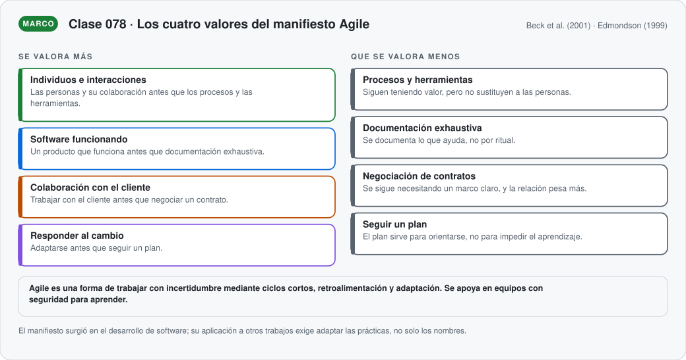

# Clase 078 — Agile como sistema adaptativo

<!-- nav:inicio -->
> **Parte 06 · Proyectos, Agile y entrega** — clase 6 de 12 · [índice de la parte](../../README.md) · [temario](../../../../SYLLABUS.md)
<!-- nav:fin -->

**Parte:** 06 — Proyectos, Agile y entrega  
**Nivel:** Etapa 2 — Líder → Jefe / Team Lead  
**Duración sugerida:** 150–180 minutos · **Estándar:** deep-class-v2

## 🎯 Propósito

«Agile» se ha vuelto una palabra que significa cualquier cosa: un conjunto de ceremonias, una herramienta de tableros, una promesa de ir más rápido, una etiqueta para reuniones diarias. Esa confusión hace que muchas organizaciones adopten los rituales y no el fondo, y obtengan los costos —reuniones, cambios de organigrama— sin los beneficios. El fondo es una idea simple: **cuando no se sabe de antemano qué hay que hacer, conviene trabajar en ciclos cortos, mostrar resultados reales, aprender de ellos y ajustar**.

La clase parte del Manifiesto Ágil y sus cuatro valores, apoya la idea de un equipo que aprende en la investigación de Edmondson y revisa la evidencia sobre qué prácticas se asocian con un buen desempeño de entrega, de Forsgren, Humble y Kim. Al terminar sabrás explicar qué es y qué no es Agile, cuándo conviene y cuándo no, y qué condiciones lo hacen funcionar.

## 📚 Resultados de aprendizaje

Al finalizar podrás:

1. **Explicar** los cuatro valores del Manifiesto Ágil y su sentido.
2. **Distinguir** Agile como forma de trabajar de las ceremonias y las herramientas.
3. **Decidir** cuándo un enfoque iterativo conviene y cuándo no.
4. **Identificar** las condiciones que lo hacen funcionar: equipo, cliente, seguridad y entrega frecuente.
5. **Reconocer** los síntomas de una adopción vacía.

## 🧭 Agenda

| Tramo | Qué se hace |
|---|---|
| 0–20 min | Recuperación: ¿qué significa «ser ágil» en tu organización? Escribe tres características observables. |
| 20–60 min | Valores del manifiesto, condiciones y evidencia. |
| 60–105 min | Ejemplo trabajado: una adopción «ágil» sin cambios de fondo. |
| 105–140 min | Caso ejecutivo: ¿conviene Agile en un proyecto regulado? |
| 140–170 min | Límites y entregable. |

## 🧩 Conceptos centrales

| Concepto | Definición | Cómo se reconoce |
|---|---|---|
| **Manifiesto Ágil** | Declaración de valores y principios para el desarrollo de software, de 2001 (Beck et al.). | Cuatro valores y doce principios. |
| **Trabajo iterativo e incremental** | Entregar en ciclos cortos versiones que funcionan y se mejoran. | Hay resultados reales al final de cada ciclo. |
| **Retroalimentación frecuente** | Información del cliente y del entorno obtenida pronto y de manera regular. | Se ajusta el rumbo con datos. |
| **Equipo autoorganizado** | Equipo que decide cómo hacer su trabajo dentro de límites. | Sus decisiones técnicas son suyas. |
| **Seguridad psicológica** | Creencia compartida de que el equipo es seguro para asumir riesgos interpersonales (Edmondson, 1999). | Se puede hablar de errores. |
| **Desempeño de entrega** | Medidas como frecuencia de despliegue, tiempo de entrega, fallas y tiempo de recuperación (Forsgren et al., 2018). | Se miden con datos. |

## 🧠 Modelo mental

**Cómo leer el diagrama.** Cada fila une un valor con su contraparte: el manifiesto dice «aunque hay valor en los elementos de la derecha, valoramos más los de la izquierda». No elimina procesos, documentación, contratos ni planes: cambia la **prioridad** cuando hay conflicto. Quien lee que Agile «no documenta» o «no planifica» lee mal.

## 📖 Desarrollo

### 1. De dónde viene

El Manifiesto Ágil fue firmado en 2001 por un grupo de profesionales del software insatisfechos con los métodos pesados y centrados en planes extensos y documentos. Propone cuatro **valores**: individuos e interacciones sobre procesos y herramientas; software funcionando sobre documentación exhaustiva; colaboración con el cliente sobre negociación contractual; y respuesta al cambio sobre seguir un plan. Está acompañado de doce principios, entre ellos entregar valor con frecuencia, aceptar cambios aun tarde y mantener un ritmo sostenible.

### 2. Una respuesta a la incertidumbre

Agile es útil porque muchos trabajos —desarrollo de productos, servicios nuevos, cambios organizacionales— tienen una **incertidumbre** alta: no se sabe del todo qué quiere el cliente ni qué funcionará. Planificar todo de antemano en ese contexto produce un plan preciso y equivocado. La alternativa es trabajar en **ciclos cortos**: se decide lo próximo, se entrega algo real, se observa la reacción y se ajusta. El aprendizaje pasa a ser el producto principal de cada ciclo (clase 044).

### 3. Qué no es

Agile **no** es ausencia de planificación, ni de documentación, ni de disciplina; no es «ir más rápido»; no es una herramienta ni un conjunto de reuniones. Un equipo puede tener tableros, reuniones diarias y «sprints» y no ser ágil si entrega lo mismo que antes, con el mismo control y sin aprender de los clientes. Y puede ser ágil sin usar la etiqueta. La prueba está en la conducta: ¿entregan valor pronto?, ¿cambian de rumbo con datos?, ¿el equipo decide cómo trabaja?

### 4. Cuándo conviene

Conviene cuando hay **alta incertidumbre**, requisitos que cambian, un cliente accesible y la posibilidad de entregar partes **útiles** de manera frecuente. Conviene menos cuando el trabajo es **bien conocido y repetitivo** (operación), cuando existen requisitos fijos y regulaciones que exigen documentación y aprobaciones antes de cada paso, o cuando no se puede entregar por partes (una obra civil). En muchos casos, un enfoque **híbrido** combina un plan global con ciclos iterativos en el trabajo incierto.

### 5. Condiciones para que funcione

Agile se apoya en condiciones que no son solo técnicas. **Equipos estables y multifuncionales**, con las habilidades para entregar. Un **cliente o dueño del producto** disponible que decide prioridades. **Seguridad psicológica** (clase 042): Edmondson muestra que sin ella el equipo no aprende de sus errores. **Autonomía**: si cada decisión pasa por un comité, los ciclos cortos son una ficción. Y **prácticas técnicas** y de entrega que permitan cambiar con seguridad.

### 6. Qué dice la evidencia

Forsgren, Humble y Kim estudiaron miles de organizaciones y hallaron que un conjunto de prácticas técnicas y culturales —entrega continua, automatización de pruebas, arquitectura que permite cambios, colaboración y cultura de aprendizaje— se asocia con un mejor **desempeño de entrega** (frecuencia, rapidez, estabilidad) y con mejores resultados del negocio. No concluyen que una etiqueta sea mejor, sino que ciertas **capacidades** importan. Los resultados provienen de encuestas y deben interpretarse como asociaciones.

### 7. Síntomas de una adopción vacía

Señales de que se adoptaron rituales sin fondo: los «sprints» son mini cascadas con requisitos cerrados; el equipo no puede cambiar el alcance; el dueño del producto no decide; las retrospectivas no cambian nada; se miden «puntos» como meta de productividad; el avance se juzga por cumplimiento del plan y no por valor entregado; y hay una burocracia de reportes que ocupa más tiempo que el trabajo. Corregirlo exige cambiar decisiones, no el vocabulario.

## 📚 Lectura comparada

| Obra | Qué aporta | Qué no resuelve | Pregunta para contrastar |
|---|---|---|---|
| Beck et al. (2001) | Valores y principios del manifiesto. | Fue escrito para el software y es breve. | ¿Qué valor practica tu equipo y cuál no? |
| Schwaber y Sutherland (2020) | Un marco concreto que aplica estos valores. | Es un marco entre varios. | ¿Qué parte del marco usas y para qué? |
| Edmondson (1999) | Seguridad psicológica y aprendizaje del equipo. | No trata de Agile. | ¿Puede tu equipo discutir un error? |
| Forsgren, Humble y Kim (2018) | Capacidades asociadas con mejor desempeño de entrega. | Estudios por encuesta; son asociaciones. | ¿Qué capacidades tiene tu equipo? |
| Reinertsen (2009) | Flujo, colas y tamaños de lote en el desarrollo. | Es un tratado técnico. | ¿Qué tamaño tienen tus entregas? |

## 🧮 Ejemplo trabajado

**Situación (hipotética).** Una empresa «adoptó Agile»: contrató coaches, creó equipos con nombres como «squads», usa tableros y reuniones diarias. Seis meses después, el director comercial pregunta: «¿Por qué entregamos igual de tarde?».

| Elemento observado | Diagnóstico |
|---|---|
| Los requisitos de cada ciclo los define un comité al inicio del trimestre. | No hay respuesta al cambio: el plan sigue siendo fijo. |
| El dueño del producto es una persona con 30 % de su tiempo, que debe consultar con tres directores. | No hay decisión rápida sobre prioridades. |
| Las pruebas se hacen al final, en un equipo aparte. | No hay entrega de software funcionando en cada ciclo. |
| Las retrospectivas terminan con «mejorar la comunicación». | No hay aprendizaje accionable. |
| Se mide la «velocidad» y se compara entre equipos. | La métrica se usa como meta y se manipula. |

**Intervención.** (1) Un dueño de producto con decisión y dedicación. (2) Pruebas automáticas dentro del equipo. (3) Entregar a un grupo de clientes cada dos semanas y ajustar con su feedback. (4) Retrospectivas con una mejora concreta por ciclo. (5) Dejar de comparar velocidades y medir tiempo de entrega y satisfacción.

**Resultado.** En seis meses, el tiempo desde la idea hasta el cliente baja de 14 a 6 semanas y el 70 % de las funcionalidades se modifica según el feedback.

**Qué muestra.** (1) Los rituales no bastaban. (2) El cambio fue de decisiones y prácticas. (3) Las métricas cambiaron para medir valor, no actividad.

## 🔀 Comparación y límites

**Agile frente a cascada.** La cascada planifica y ejecuta por fases; Agile itera y adapta. No son opuestos absolutos: muchos proyectos combinan una planificación general con ejecución iterativa.

**Límites.** El manifiesto surgió en el software y su traslado a otros ámbitos requiere adaptar los principios, no solo los nombres. La evidencia de Forsgren et al. se basa en encuestas y mide asociaciones. Hay contextos regulados en que las aprobaciones por fase son obligatorias y deben respetarse. Y Agile puede usarse mal como excusa para no planificar o para presionar al equipo con ciclos cortos sin recursos.

## 🪜 De profesional a owner

| Nivel | Cómo practica Agile |
|---|---|
| **Profesional** | Entrega partes útiles pronto y pide feedback. |
| **Jefe / Team Lead** | Protege al equipo, facilita sus decisiones y elimina obstáculos. |
| **Gerente** | Da autonomía real y cambia los controles que la impiden. |
| **CEO / Director** | Fija la dirección y cambia la gobernanza para sostener ciclos cortos. |
| **Founder / Owner** | Aprende con clientes de forma temprana y limita las apuestas largas. |

## 🏢 Caso ejecutivo

Una aseguradora debe construir una plataforma de reclamos en un entorno regulado: la autoridad exige documentación y aprobaciones antes de cambiar procesos que afecten a clientes. El equipo de tecnología propone «hacerlo ágil»; el área de cumplimiento teme que se salten controles. El gerente general quiere resultados en nueve meses. Hay incertidumbre sobre qué quieren los clientes y certeza sobre qué exige la norma.

Entrega un **plan de enfoque de trabajo** que contenga: (a) el análisis de qué parte del trabajo es incierta y cuál es fija; (b) qué se hará con planificación global y qué en ciclos cortos; (c) cómo se integrarán los controles regulatorios sin frenar el aprendizaje; (d) las condiciones que necesita el equipo —dueño del producto, autonomía, seguridad—; (e) cómo medirás el desempeño de entrega y el valor; (f) las señales de adopción vacía que vigilarás.

## 🧪 Práctica

1. Escribe tres señales observables de que tu equipo trabaja con ciclos cortos y aprende.
2. Evalúa tu trabajo actual: ¿incertidumbre alta o baja?, ¿cliente accesible?, ¿entrega por partes?
3. Identifica una ceremonia que existe sin cambiar ninguna decisión.
4. Define dos medidas de valor y dos de desempeño de entrega.
5. Escribe qué decisión te gustaría delegar al equipo para que el ciclo corto tenga sentido.

## ⚠️ Errores frecuentes

| Error | Por qué ocurre | Cómo corregirlo |
|---|---|---|
| Adoptar rituales sin cambiar decisiones | Es visible y rápido | Cambiar autonomía, prioridades y entrega. |
| Creer que «ágil» es no planificar | Se lee mal el manifiesto | Planificar lo necesario y adaptar. |
| Usar la velocidad como meta | Se mide actividad | Medir valor y tiempo de entrega. |
| Dueño de producto sin autoridad | Se nombra sin poder | Decisión y dedicación reales. |
| Ciclos cortos sin seguridad | Se castiga el error | Cultura de aprendizaje. |
| Agile en trabajo repetitivo | Se aplica a todo | Elegir el enfoque según el trabajo. |

## ❓ Preguntas de comprobación

1. ¿Cuáles son los cuatro valores del Manifiesto Ágil?
2. ¿Qué significa «valoramos más» y qué no significa?
3. ¿Cuándo conviene un enfoque iterativo?
4. ¿Qué condiciones necesita para funcionar?
5. ¿Qué capacidades asocian Forsgren et al. con mejor desempeño de entrega?
6. Nombra tres síntomas de una adopción vacía.
7. ¿Qué límite tiene la evidencia disponible?

Claves de respuesta

1. Individuos e interacciones, software funcionando, colaboración con el cliente y respuesta al cambio, valorados más que sus contrapartes.
2. Cambia la prioridad cuando hay conflicto; no elimina procesos, documentación, contratos ni planes.
3. Con alta incertidumbre, requisitos cambiantes, cliente accesible y posibilidad de entregar partes útiles con frecuencia.
4. Equipos estables y multifuncionales, dueño del producto con decisión, seguridad psicológica, autonomía y prácticas técnicas.
5. Entrega continua, automatización de pruebas, arquitectura que permite cambios, colaboración y cultura de aprendizaje.
6. Por ejemplo: requisitos cerrados por ciclo, dueño del producto sin decisión, retrospectivas sin cambios o velocidad como meta.
7. Proviene de encuestas y muestra asociaciones, no causas.

## 📥 Entregable

Guarda en `portfolio/078-agile-como-sistema-adaptativo/`:

- `leadership-decision-brief.md` (plantilla [Leadership Decision Brief](../../../../templates/leadership-decision-brief.md)) con el plan del caso ejecutivo;
- `reading-note.md` con una tensión entre el manifiesto y la evidencia de Forsgren et al.;
- `decision-journal.md` con las señales de adopción vacía y las medidas de valor.

## 📗 Fuentes y verificación

- Kent Beck et al. — *Manifesto for Agile Software Development* (agilemanifesto.org). **Uso en esta clase:** valores y principios del manifiesto ágil. **Fuente primaria:** <https://agilemanifesto.org/>.
- Ken Schwaber & Jeff Sutherland — *The Scrum Guide* (Scrum.org / Scrum Alliance). **Uso en esta clase:** un marco concreto que aplica los valores del manifiesto. **Fuente primaria:** <https://scrumguides.org/>.
- Amy C. Edmondson — *Psychological Safety and Learning Behavior in Work Teams* (Administrative Science Quarterly, 1999). **Uso en esta clase:** seguridad psicológica y aprendizaje del equipo. Lectura selectiva sobre **agile como sistema adaptativo**. **Localizador:** [DOI 10.2307/2666999](https://doi.org/10.2307/2666999).
- Nicole Forsgren, Jez Humble & Gene Kim — *Accelerate* (IT Revolution Press, 2018). **Uso en esta clase:** capacidades asociadas con mejor desempeño de entrega. Lectura selectiva sobre **agile como sistema adaptativo**. **Localizador:** [ISBN-13 9781942788379](https://openlibrary.org/isbn/9781942788379).
- Donald G. Reinertsen — *The Principles of Product Development Flow* (Celeritas Publishing, 2009). **Uso en esta clase:** flujo, colas y tamaños de lote. Lectura selectiva sobre **agile como sistema adaptativo**. **Localizador:** [ISBN-13 9781935401001](https://openlibrary.org/isbn/9781935401001).

> **Regla de fuentes para Agile como sistema adaptativo:** las obras anteriores estructuran las perspectivas de esta materia; cualquier norma, ley o estándar vivo mencionado debe comprobarse nuevamente en su fuente primaria vigente, incluidas las exigencias regulatorias de documentación y aprobación. Los ejemplos y casos son hipotéticos. El desarrollo es original y no reproduce capítulos protegidos.

<!-- pie:inicio -->
---

| Anterior | Índice | Siguiente |
|---|---|---|
| [← 077 · Gestión de riesgos y dependencias](../077-gestion-de-riesgos-y-dependencias/README.md) | [Parte 06](../../README.md) · [Programa](../../../../SYLLABUS.md) | [079 · Scrum con criterio →](../079-scrum-con-criterio/README.md) |
<!-- pie:fin -->
