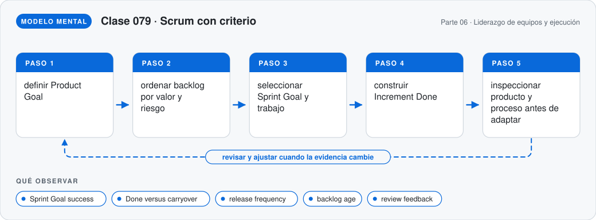

# Clase 079 — Scrum con criterio

<!-- nav:inicio -->
> **Parte 06 · Proyectos, Agile y entrega** — clase 7 de 12 · [índice de la parte](../../README.md) · [temario](../../../../SYLLABUS.md)
<!-- nav:fin -->

**Parte:** 06 — Proyectos, Agile y entrega  
**Nivel:** Etapa 2 — Líder → Jefe / Team Lead  
**Duración sugerida:** 150–180 minutos · **Estándar:** deep-class-v2

## 🎯 Propósito

Scrum es el marco ágil más extendido y también el más mal usado. Se adopta por moda, se aplica por completo a trabajos que no lo necesitan, o se aplica a medias dejando fuera lo que lo hace funcionar. La Guía de Scrum lo describe como un marco **deliberadamente incompleto**: define unos pocos roles, eventos y artefactos, y deja a cada equipo decidir el resto. Usarlo con criterio significa entender para qué sirve cada pieza y cuándo conviene.

La clase se basa en la Guía de Scrum de Schwaber y Sutherland (versión de 2020), en el Manifiesto Ágil y en la noción de ciclos cortos de aprendizaje. Al terminar sabrás describir los roles, eventos y artefactos de Scrum, distinguir sus compromisos, evaluar si Scrum conviene a un trabajo y reconocer cuándo se está aplicando solo en su forma.

## 📚 Resultados de aprendizaje

Al finalizar podrás:

1. **Describir** los tres roles, los cinco eventos y los tres artefactos de Scrum con su propósito.
2. **Explicar** los compromisos: objetivo del producto, objetivo del Sprint y definición de hecho.
3. **Conducir** una planificación de Sprint orientada a un objetivo.
4. **Decidir** si Scrum conviene a un trabajo y qué adaptar.
5. **Detectar** malos usos frecuentes: «Scrum de papel», mini cascada, comités disfrazados.

## 🧭 Agenda

| Tramo | Qué se hace |
|---|---|
| 0–20 min | Recuperación: si usas Scrum, describe tu último Sprint con tus palabras; si no, describe cómo organizas ciclos de trabajo. |
| 20–60 min | Roles, eventos, artefactos y compromisos. |
| 60–105 min | Ejemplo trabajado: un Sprint de dos semanas con objetivo. |
| 105–140 min | Caso ejecutivo: un equipo con Scrum «de papel». |
| 140–170 min | Límites y entregable. |

## 🧩 Conceptos centrales

| Concepto | Definición | Cómo se reconoce |
|---|---|---|
| **Scrum** | Marco ligero que ayuda a las personas, equipos y organizaciones a generar valor mediante soluciones adaptativas a problemas complejos (Schwaber y Sutherland, 2020). | Empírico: se basa en transparencia, inspección y adaptación. |
| **Sprint** | Evento contenedor de duración fija, de un mes o menos, en el que se crea un incremento de valor (Schwaber y Sutherland, 2020). | Hay un comienzo y un fin fijos. |
| **Backlog del producto** | Lista ordenada de lo que se necesita para mejorar el producto (Schwaber y Sutherland, 2020). | Una sola lista, ordenada por valor. |
| **Objetivo del Sprint** | Propósito único del Sprint que da coherencia al trabajo (Schwaber y Sutherland, 2020). | Explica por qué el Sprint vale la pena. |
| **Incremento** | Paso concreto hacia el objetivo del producto, utilizable y que cumple la definición de hecho (Schwaber y Sutherland, 2020). | Funciona y se puede entregar. |
| **Definición de hecho** | Descripción formal del estado del incremento cuando cumple las medidas de calidad requeridas (Schwaber y Sutherland, 2020). | Es un compromiso compartido. |

## 🧠 Modelo mental

**Cómo leer el diagrama.** Cuatro eventos dentro de cada Sprint: se planifica, se inspecciona el avance cada día, se revisa el incremento con los interesados y se mejora la forma de trabajar. Al terminar empieza otro Sprint. La nota inferior resume lo que sostiene el ciclo: tres roles y tres artefactos, cada uno con un compromiso (objetivo del producto, objetivo del Sprint y definición de hecho).

## 📖 Desarrollo

### 1. Qué es y qué supone

La Guía de Scrum define Scrum como un marco ligero para generar valor mediante soluciones adaptativas a problemas complejos. Se funda en el **empirismo**: se aprende de la experiencia y se toman decisiones con lo observado, según tres pilares: **transparencia** (lo importante es visible), **inspección** (se revisa con frecuencia) y **adaptación** (se ajusta cuando algo se desvía). Y en valores como el compromiso, el enfoque, la apertura, el respeto y el coraje. No es un método de gestión de proyectos ni una receta: es un marco que exige completar lo que deja abierto.

### 2. El equipo y sus roles

El **equipo Scrum** es pequeño y reúne todas las habilidades para crear valor en cada Sprint, con tres responsabilidades. El **dueño del producto** maximiza el valor del producto y gestiona el backlog; es una persona, no un comité. Los **desarrolladores** crean cualquier aspecto de un incremento utilizable en cada Sprint. El **Scrum Master** es responsable de que Scrum se entienda y se aplique, y de la eficacia del equipo; es un líder servidor, no un jefe. Todos responden por el producto y por mejorar su forma de trabajar.

### 3. Los eventos

El **Sprint** contiene los demás eventos y dura un mes o menos; tiene un objetivo, no cambia en su duración y sirve para crear un incremento. La **planificación del Sprint** responde tres preguntas: *por qué* es valioso este Sprint, *qué* se puede hacer y *cómo* se hará. El **Scrum diario** es un evento breve, de unos quince minutos, para que los desarrolladores inspeccionen el avance hacia el objetivo y ajusten el plan. La **revisión del Sprint** inspecciona el resultado con los interesados y adapta el backlog. La **retrospectiva** inspecciona cómo trabajó el equipo y acuerda mejoras.

### 4. Los artefactos y sus compromisos

Cada artefacto tiene un compromiso que da foco. El **backlog del producto**, una lista ordenada de lo que se necesita, se vincula con el **objetivo del producto**. El **backlog del Sprint**, que reúne lo seleccionado y un plan, se vincula con el **objetivo del Sprint**. El **incremento**, un paso concreto hacia el objetivo del producto, se vincula con la **definición de hecho** (clase 082). Los compromisos protegen la transparencia: si todos saben qué se persigue y qué significa «terminado», el trabajo se puede inspeccionar.

### 5. Un Sprint con criterio

El error más frecuente es llenar el Sprint con una lista de tareas sin objetivo. Un buen Sprint tiene **un objetivo** que une el trabajo: «permitir que un cliente nuevo complete su registro sin ayuda». El equipo selecciona lo que cree que puede terminar, según su capacidad medida (clase 076). Durante el Sprint no se agregan cambios que pongan en riesgo el objetivo; el dueño del producto puede negociar el alcance con los desarrolladores, y si el objetivo deja de tener sentido, puede cancelarse el Sprint. Al final hay un incremento utilizable.

### 6. Cuándo conviene y cuándo no

Scrum conviene a **trabajo complejo**, donde no se sabe de antemano qué funcionará, hay un cliente o usuario al que se le puede mostrar avance y el equipo puede entregar un incremento utilizable en pocas semanas. Conviene menos a trabajo **repetitivo** o de flujo continuo (clase 080), a equipos que no pueden dedicarse a un producto o a contextos donde nadie puede decidir sobre prioridades. A veces conviene tomar partes de Scrum (por ejemplo, la revisión y la retrospectiva) sin adoptar todo el marco; si se adopta, se hace de manera completa, porque las partes se sostienen entre sí.

### 7. Malos usos frecuentes

**Scrum de papel**: se usan los nombres sin cambiar decisiones. **Mini cascada**: dentro del Sprint se hace análisis, desarrollo y pruebas por separado, y el incremento no está listo. **Comité del producto**: no hay una persona con autoridad que decida. **Scrum Master como jefe de proyecto** que asigna tareas. **Retrospectivas sin cambios**. **Sprint como contrato**: el equipo es presionado a comprometerse con un alcance fijo y se castiga la desviación. Todos ellos vacían el aprendizaje, que es lo que el marco busca.

## 📚 Lectura comparada

| Obra | Qué aporta | Qué no resuelve | Pregunta para contrastar |
|---|---|---|---|
| Schwaber y Sutherland (2020) | Definición oficial de roles, eventos y artefactos. | Es deliberadamente incompleta. | ¿Qué decide tu equipo donde la guía no dice? |
| Beck et al. (2001) | Valores y principios que sustentan el marco. | No define prácticas. | ¿Qué valor sostiene cada evento? |
| Cohn (2005) | Estimación y planificación en equipos ágiles. | No es el marco oficial. | ¿Cómo estima tu equipo? |
| Forsgren, Humble y Kim (2018) | Capacidades técnicas que facilitan entregar incrementos. | No se centra en Scrum. | ¿Puede tu equipo entregar un incremento utilizable? |
| Edmondson (2018) | Seguridad psicológica, necesaria para las retrospectivas. | No trata del marco. | ¿Qué se dice realmente en tu retrospectiva? |

## 🧮 Ejemplo trabajado

**Situación (hipotética).** Un equipo de seis personas trabaja en la aplicación de una cadena de tiendas. Sprints de dos semanas. Objetivo del producto: «que los clientes recurrentes reordenen en menos de un minuto».

| Evento | Qué ocurre |
|---|---|
| **Planificación** | Por qué: reducir pasos para reordenar es el mayor freno a la recompra. Objetivo del Sprint: «un cliente puede reordenar su último pedido con dos toques». Qué: el equipo selecciona cuatro elementos y descarta dos por capacidad. Cómo: define un plan técnico y de pruebas. |
| **Scrum diario** | Quince minutos cada mañana: avance hacia el objetivo, obstáculos y ajustes. Un obstáculo: la API de pagos devuelve errores intermitentes; se decide probar con una alternativa. |
| **Revisión** | Se muestra la función a dos tiendas piloto; el feedback revela que quieren cambiar la dirección de entrega antes de confirmar. El dueño del producto ajusta el backlog. |
| **Retrospectiva** | Se identifica que las pruebas manuales retrasan la integración; se acuerda automatizar las tres pruebas más repetidas. |

**Resultado.** El incremento cumple la definición de hecho (revisado, probado, desplegable). El tiempo de reordenamiento baja de 90 a 40 segundos.

**Qué muestra.** (1) Hubo un objetivo, no una lista de tareas. (2) La revisión cambió el backlog. (3) La retrospectiva produjo una mejora concreta.

## 🔀 Comparación y límites

**Scrum frente a Kanban.** Scrum trabaja con ciclos de duración fija; Kanban, con flujo continuo y límites de trabajo en curso. Pueden combinarse.

**Límites.** Scrum es un marco para trabajo complejo; no resuelve por sí solo problemas de estrategia, de calidad técnica o de cultura. La Guía misma reconoce que es incompleta. Su evidencia de eficacia es heterogénea y depende de cómo se aplique. Y su adopción en toda una organización requiere cambios en presupuestos, contratos y gobernanza que exceden al equipo.

## 🪜 De profesional a owner

| Nivel | Cómo trabaja con Scrum |
|---|---|
| **Profesional** | Participa con transparencia y respeta el objetivo del Sprint. |
| **Jefe / Team Lead** | Actúa como líder servidor o protege el espacio del equipo. |
| **Gerente** | Provee dueños de producto con autoridad y evita interferir en los Sprints. |
| **CEO / Director** | Gobierna por objetivos de producto y no por lista de tareas. |
| **Founder / Owner** | Es el dueño de producto inicial y entrega para aprender. |

## 🏢 Caso ejecutivo

Una empresa de servicios financieros «implementó Scrum» hace un año. El dueño del producto es un comité de cinco directores que se reúne mensualmente; los Sprints se llenan con tareas asignadas por el jefe; las pruebas se hacen en un equipo separado al final; las retrospectivas «no sirven porque nada cambia»; el equipo está desmotivado. La dirección dice que «Scrum no funciona acá».

Entrega un **diagnóstico y plan de ajuste** que contenga: (a) la comparación entre lo que hace el equipo y lo que dice la Guía de Scrum; (b) qué es Scrum de papel y qué es adaptación legítima; (c) qué cambios de decisión se necesitan: dueño, objetivo, capacidad, definición de hecho; (d) qué partes conservarías y cuáles dejarías; (e) cómo medirás el efecto; (f) cuándo concluirías que Scrum no conviene a este trabajo.

## 🧪 Práctica

1. Escribe un objetivo de Sprint para tu trabajo actual en una frase.
2. Describe a tu equipo con los tres roles de Scrum y qué falta.
3. Identifica un mal uso en tu entorno y qué decisión lo causa.
4. Define una definición de hecho de tres criterios para tu incremento.
5. Escribe cómo decidirías si Scrum conviene o no a un trabajo.

## ⚠️ Errores frecuentes

| Error | Por qué ocurre | Cómo corregirlo |
|---|---|---|
| Sprint sin objetivo | Se llena de tareas | Un objetivo que dé coherencia. |
| Dueño del producto colegiado | Se quiere compartir la decisión | Una persona con autoridad. |
| Mini cascada | Se separa por especialidad | Equipo multifuncional que entrega un incremento. |
| Retrospectiva sin cambios | No hay seguridad | Una mejora acordada por ciclo. |
| Scrum Master como jefe | Se asignan tareas | Líder servidor. |
| Aplicarlo a todo | Es la moda | Elegir según la naturaleza del trabajo. |

## ❓ Preguntas de comprobación

1. ¿Cuáles son los tres roles de Scrum?
2. ¿Cuáles son los cinco eventos?
3. ¿Qué tres preguntas responde la planificación del Sprint?
4. ¿Qué compromiso se asocia a cada artefacto?
5. ¿Cuándo conviene Scrum?
6. Nombra tres malos usos.
7. ¿Qué límite reconoce la Guía sobre sí misma?

Claves de respuesta

1. Dueño del producto, desarrolladores y Scrum Master.
2. El Sprint, la planificación, el Scrum diario, la revisión y la retrospectiva.
3. Por qué es valioso el Sprint, qué se puede hacer y cómo se hará.
4. Backlog del producto con el objetivo del producto, backlog del Sprint con el objetivo del Sprint e incremento con la definición de hecho.
5. En trabajo complejo, con un usuario al que mostrar avances y un equipo que pueda entregar un incremento utilizable en pocas semanas.
6. Por ejemplo: Scrum de papel, mini cascada, dueño del producto colegiado, retrospectivas sin cambios.
7. Que es deliberadamente incompleto: cada equipo debe decidir el resto.

## 📥 Entregable

Guarda en `portfolio/079-scrum-con-criterio/`:

- `leadership-decision-brief.md` (plantilla [Leadership Decision Brief](../../../../templates/leadership-decision-brief.md)) con el plan del caso ejecutivo;
- `reading-note.md` con una tensión entre la Guía de Scrum y el Manifiesto Ágil;
- `decision-journal.md` con el objetivo del Sprint, la definición de hecho y la mejora acordada.

## 📗 Fuentes y verificación

- Ken Schwaber & Jeff Sutherland — *The Scrum Guide* (Scrum.org / Scrum Alliance). **Uso en esta clase:** roles, eventos, artefactos y compromisos de Scrum. **Fuente primaria:** <https://scrumguides.org/>.
- Kent Beck et al. — *Manifesto for Agile Software Development* (agilemanifesto.org). **Uso en esta clase:** valores y principios que sustentan el marco. **Fuente primaria:** <https://agilemanifesto.org/>.
- Mike Cohn — *Agile Estimating and Planning* (Prentice Hall, 2005). **Uso en esta clase:** estimación y planificación en equipos ágiles. Lectura selectiva sobre **scrum con criterio**. **Localizador:** [ISBN-13 9780131479418](https://openlibrary.org/isbn/9780131479418).
- Nicole Forsgren, Jez Humble & Gene Kim — *Accelerate* (IT Revolution Press, 2018). **Uso en esta clase:** capacidades técnicas que facilitan entregar incrementos. Lectura selectiva sobre **scrum con criterio**. **Localizador:** [ISBN-13 9781942788379](https://openlibrary.org/isbn/9781942788379).
- Amy C. Edmondson — *The Fearless Organization* (Wiley, 2018). **Uso en esta clase:** seguridad psicológica para las retrospectivas. Lectura selectiva sobre **scrum con criterio**. **Localizador:** [ISBN-13 9781119477242](https://openlibrary.org/isbn/9781119477242).

> **Regla de fuentes para Scrum con criterio:** las obras anteriores estructuran las perspectivas de esta materia; cualquier norma, ley o estándar vivo mencionado debe comprobarse nuevamente en su fuente primaria vigente; en particular, la Guía de Scrum se revisa en su versión vigente. Los ejemplos y casos son hipotéticos. El desarrollo es original y no reproduce capítulos protegidos.

<!-- pie:inicio -->
---

| Anterior | Índice | Siguiente |
|---|---|---|
| [← 078 · Agile como sistema adaptativo](../078-agile-como-sistema-adaptativo/README.md) | [Parte 06](../../README.md) · [Programa](../../../../SYLLABUS.md) | [080 · Kanban y flujo →](../080-kanban-y-flujo/README.md) |
<!-- pie:fin -->
