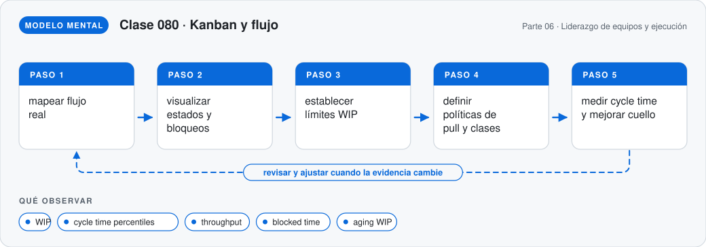

# Clase 080 — Kanban y flujo

<!-- nav:inicio -->
> **Parte 06 · Proyectos, Agile y entrega** — clase 8 de 12 · [índice de la parte](../../README.md) · [temario](../../../../SYLLABUS.md)
<!-- nav:fin -->

**Parte:** 06 — Proyectos, Agile y entrega  
**Nivel:** Etapa 2 — Líder → Jefe / Team Lead  
**Duración sugerida:** 150–180 minutos · **Estándar:** deep-class-v2

## 🎯 Propósito

Un equipo con diez cosas en curso y ninguna terminada está ocupado, no es productivo. Cada elemento que empieza y espera consume atención, genera cambios de contexto y alarga el tiempo que tarda el cliente en recibir algo. Kanban parte de una observación simple: el **flujo** de trabajo importa más que la actividad. Se mejora haciendo visible lo que está en curso, limitando cuánto se empieza y gestionando por dónde y a qué ritmo avanza el trabajo.

La clase usa el método Kanban de David Anderson, la ley de Little —una relación matemática entre trabajo en curso, rendimiento y tiempo de ciclo— y el análisis de Donald Reinertsen sobre colas y variabilidad en el desarrollo. Al terminar sabrás construir un tablero con las etapas reales, definir límites de trabajo en curso, medir el flujo y mejorar con datos.

## 📚 Resultados de aprendizaje

Al finalizar podrás:

1. **Explicar** las prácticas centrales del método Kanban.
2. **Construir** un tablero que refleje el flujo real y sus políticas.
3. **Definir** límites de trabajo en curso y justificar su efecto con la ley de Little.
4. **Medir** tiempo de ciclo, rendimiento y trabajo en curso.
5. **Decidir** cuándo conviene Kanban y cuándo Scrum o ambos.

## 🧭 Agenda

| Tramo | Qué se hace |
|---|---|
| 0–20 min | Recuperación: cuenta cuántas cosas tienes «en curso» hoy y cuánto tarda en terminar la última. |
| 20–60 min | Prácticas, ley de Little y colas. |
| 60–105 min | Ejemplo trabajado: reducir el tiempo de ciclo de un equipo de soporte. |
| 105–140 min | Caso ejecutivo: un equipo sobrecargado de trabajo urgente. |
| 140–170 min | Límites y entregable. |

## 🧩 Conceptos centrales

| Concepto | Definición | Cómo se reconoce |
|---|---|---|
| **Kanban (método)** | Método para gestionar el trabajo de conocimiento que visualiza el flujo, limita el trabajo en curso y mejora de manera evolutiva (Anderson, 2010). | Hay un tablero, límites y medidas de flujo. |
| **Trabajo en curso (WIP)** | Cantidad de elementos que se han comenzado y aún no terminado. | Se cuenta en el tablero. |
| **Tiempo de ciclo** | Tiempo que tarda un elemento desde que comienza hasta que termina. | Se mide por elemento. |
| **Rendimiento (throughput)** | Cantidad de elementos terminados por unidad de tiempo. | Se mide por período. |
| **Ley de Little** | En un sistema estable, el trabajo en curso promedio es igual al rendimiento por el tiempo de ciclo promedio (Little, 1961). | Relaciona las tres medidas. |
| **Cola** | Elementos que esperan para ser atendidos; la espera es parte del tiempo de ciclo (Reinertsen, 2009). | Hay elementos detenidos esperando. |

## 🧠 Modelo mental

**Cómo leer el diagrama.** Tres columnas: se **visualiza** para saber qué hay; se **limita** para terminar antes de empezar; se **gestiona el flujo** con medidas y políticas explícitas. La nota inferior muestra por qué limitar sirve: con un rendimiento dado, **menos trabajo en curso significa menor tiempo de ciclo**. La relación no es una opinión: es una ley matemática para sistemas estables.

## 📖 Desarrollo

### 1. Qué propone Kanban

Anderson presenta el método Kanban como una forma de introducir **mejoras evolutivas** en el trabajo de conocimiento, partiendo del proceso actual y sin imponer roles ni ceremonias nuevas. Sus prácticas generales: **visualizar** el flujo de trabajo, **limitar** el trabajo en curso, **gestionar** el flujo, hacer **explícitas** las políticas, implementar **ciclos de retroalimentación** y **mejorar** de manera colaborativa y con experimentos. Empieza donde se está y cambia poco a poco.

### 2. Visualizar

El primer paso es un **tablero** que muestre cada elemento de trabajo y las **etapas reales** por las que pasa (no las ideales): por ejemplo, «por hacer, en análisis, en desarrollo, en pruebas, listo». Se hacen visibles los **bloqueos** y las **esperas**. Un tablero honesto suele sorprender: se ve que la mayor parte del tiempo los elementos están esperando, no siendo trabajados. La visualización es la base para decidir.

### 3. Limitar el trabajo en curso

Se fija un **límite** de elementos por etapa o en total: «máximo tres en desarrollo». Cuando se alcanza, no se empieza otro: se ayuda a terminar. Limitar el WIP obliga a ver los cuellos de botella (clase 089), reduce los cambios de contexto y acorta el tiempo de ciclo. Es incómodo al principio, porque obliga a decir que no y a enfrentar los bloqueos en vez de «avanzar» en otra cosa. El límite se ajusta con datos.

### 4. La ley de Little

John Little demostró que, en un sistema estable, **WIP = rendimiento × tiempo de ciclo**. Con un ejemplo: si un equipo termina cinco elementos por semana y tiene veinte en curso, el tiempo promedio de ciclo es de cuatro semanas. Si reduce el WIP a diez, manteniendo el rendimiento, el tiempo promedio baja a dos semanas. La implicancia: **para entregar más rápido, empezar menos**. La ley es una relación entre promedios y exige que el sistema sea aproximadamente estable.

### 5. Colas y variabilidad

Reinertsen observa que, en el desarrollo de productos, la mayor parte del tiempo de ciclo es **espera** en colas, y que las colas crecen de manera no lineal cuando la utilización de un recurso se acerca al máximo. Un equipo al 100 % de utilización tiene colas enormes y poca capacidad de reaccionar. Una implicancia práctica: dejar **holgura** en los recursos críticos y trabajar con lotes pequeños reduce las esperas y aumenta la rapidez.

### 6. Gestionar el flujo

Se miden el **tiempo de ciclo**, el **rendimiento** y el **WIP**, y se usan para tomar decisiones: ¿dónde se acumula el trabajo?, ¿qué elementos llevan mucho tiempo bloqueados?, ¿qué porcentaje cumple el plazo prometido? Con la distribución del tiempo de ciclo se pueden dar **compromisos probabilísticos** («el 85 % de los casos se resuelve en seis días o menos»). Se hacen **explícitas las políticas**: qué significa «listo», cómo se priorizan los urgentes, cuántos expeditos se admiten.

### 7. Kanban y Scrum

No son excluyentes. Scrum organiza el trabajo en ciclos de duración fija con un objetivo; Kanban, en un flujo continuo con límites. Kanban conviene al trabajo **continuo e impredecible**, como soporte, operaciones o mantenimiento, donde las prioridades cambian a diario; Scrum, al trabajo de producto con objetivos por ciclo. Muchos equipos combinan: ciclos con un tablero con límites de WIP. Se elige por la naturaleza del trabajo y se mide el flujo en ambos.

## 📚 Lectura comparada

| Obra | Qué aporta | Qué no resuelve | Pregunta para contrastar |
|---|---|---|---|
| Anderson (2010) | El método Kanban y sus prácticas. | Un texto de práctica profesional. | ¿Qué política de tu equipo no es explícita? |
| Little (1961) | La relación entre WIP, rendimiento y tiempo de ciclo. | Requiere sistemas estables y es sobre promedios. | ¿Cuál es tu WIP y tu tiempo de ciclo? |
| Reinertsen (2009) | Colas, variabilidad y tamaños de lote. | Es un tratado técnico. | ¿Dónde esperan tus elementos? |
| Goldratt y Cox (2014) | Cuellos de botella y flujo. | Es una novela de gestión. | ¿Dónde está tu restricción? |
| Schwaber y Sutherland (2020) | Un marco alternativo de ciclos fijos. | No se centra en flujo continuo. | ¿Qué parte de tu trabajo es flujo continuo? |

## 🧮 Ejemplo trabajado

**Situación (hipotética).** Un equipo de soporte de seis personas atiende solicitudes de clientes. Tiene unas 60 solicitudes abiertas, termina 20 por semana y tarda en promedio tres semanas en resolver cada una. Los clientes se quejan, y los agentes dicen que «están desbordados».

| Medida | Antes | Después |
|---|---|---|
| **WIP** | 60 | 24 (límite de 4 por persona) |
| **Rendimiento** | 20 por semana | 20 por semana (sin cambio) |
| **Tiempo de ciclo promedio (WIP ÷ rendimiento)** | 3 semanas | 1,2 semanas |

**Acciones.** (1) Tablero con etapas reales: nueva, en análisis, esperando al cliente, en solución, en prueba, cerrada. (2) Límite de WIP por persona y por etapa. (3) Política: no se acepta una nueva si se alcanzó el límite; se prioriza terminar. (4) Una vía rápida para urgentes, limitada a dos a la vez. (5) Revisión semanal del tablero: tiempo de ciclo, bloqueos y elementos de más de cinco días.

**Resultado.** El tiempo de ciclo promedio baja a 1,3 semanas, el 85 % de las solicitudes se resuelve en tres semanas o menos y la satisfacción sube.

**Qué muestra.** (1) Sin cambiar el rendimiento, el tiempo de ciclo cayó al reducir el WIP. (2) El tablero reveló que la espera al cliente era el mayor bloqueo. (3) Las políticas se hicieron explícitas.

## 🔀 Comparación y límites

**Kanban método frente a tablero.** Un tablero de tareas no es Kanban: sin límites de WIP ni gestión del flujo, es una lista visual.

**Límites.** La ley de Little describe promedios en sistemas estables y puede distorsionarse con cambios fuertes de demanda. Limitar el WIP sin atender las causas de los bloqueos solo los hace visibles. Kanban no define un rol de dueño de producto ni cadencia de aprendizaje con interesados: si hace falta, hay que agregarlos. Y el método se ha desarrollado sobre todo en trabajo de conocimiento, con evidencia de casos más que de estudios controlados.

## 🪜 De profesional a owner

| Nivel | Cómo practica el flujo |
|---|---|
| **Profesional** | Termina antes de empezar y hace visibles sus bloqueos. |
| **Jefe / Team Lead** | Facilita el tablero, los límites y la revisión del flujo. |
| **Gerente** | Protege al equipo de pedidos que rompen el límite y gestiona las colas entre áreas. |
| **CEO / Director** | Pide menos iniciativas en paralelo y mide el flujo del portafolio. |
| **Founder / Owner** | Limita lo que empieza a la capacidad real del equipo. |

## 🏢 Caso ejecutivo

Un equipo de ocho personas de operaciones recibe pedidos de seis directores, todos «urgentes». Tiene 45 elementos en curso, ninguno terminado a tiempo; cada director llama para preguntar por el suyo. Los agentes cambian de tarea varias veces al día. El gerente de operaciones dice que «el problema es la falta de gente»; el equipo, que «no se puede priorizar porque todo es de alguien importante».

Entrega un **plan de flujo** que contenga: (a) el tablero con las etapas reales y qué se verá en él; (b) los límites de trabajo en curso y su justificación con la ley de Little; (c) las políticas de priorización y de urgentes; (d) las medidas de flujo que seguirás; (e) cómo negociarás con los seis directores; (f) qué evidencia te haría concluir que sí hace falta más gente.

## 🧪 Práctica

1. Dibuja el tablero de tu equipo con las etapas reales y cuenta el WIP.
2. Calcula tu rendimiento semanal y tu tiempo de ciclo y verifica la ley de Little.
3. Propón un límite de WIP y qué harás al alcanzarlo.
4. Escribe tres políticas explícitas que hoy no están escritas.
5. Identifica dónde esperan más tus elementos y qué harías.

## ⚠️ Errores frecuentes

| Error | Por qué ocurre | Cómo corregirlo |
|---|---|---|
| Tablero sin límites | Es lo fácil | Fijar límites de WIP. |
| Empezar todo | Se quiere ser receptivo | Terminar antes de empezar. |
| Tablero con etapas ideales | No se mira el proceso real | Reflejar el flujo actual. |
| Utilización al 100 % | Se busca eficiencia | Dejar holgura para reducir colas. |
| Medir actividad | Es lo visible | Medir tiempo de ciclo y rendimiento. |
| Políticas implícitas | Se supone que todos saben | Hacerlas explícitas. |

## ❓ Preguntas de comprobación

1. ¿Cuáles son las prácticas generales del método Kanban?
2. ¿Qué es el trabajo en curso y por qué se limita?
3. ¿Qué dice la ley de Little?
4. Con rendimiento de 10 por semana y WIP de 30, ¿cuál es el tiempo de ciclo promedio?
5. ¿Por qué las colas crecen cuando la utilización se acerca al 100 %?
6. ¿Cuándo conviene Kanban frente a Scrum?
7. ¿Qué límite tiene la ley de Little?

Claves de respuesta

1. Visualizar el flujo, limitar el trabajo en curso, gestionar el flujo, hacer explícitas las políticas, implementar ciclos de retroalimentación y mejorar de manera colaborativa.
2. La cantidad de elementos comenzados y no terminados; se limita para terminar antes de empezar y reducir el tiempo de ciclo.
3. En un sistema estable, WIP promedio = rendimiento × tiempo de ciclo promedio.
4. Tres semanas (30 ÷ 10).
5. Porque cualquier variación genera esperas que no se pueden absorber sin holgura.
6. Cuando el trabajo es continuo e impredecible, como soporte u operaciones; Scrum, cuando hay objetivos por ciclo de producto.
7. Describe promedios en sistemas aproximadamente estables y se distorsiona con cambios fuertes de demanda.

## 📥 Entregable

Guarda en `portfolio/080-kanban-y-flujo/`:

- `modelo-financiero-y-memo-de-decision.md` (plantilla [Modelo financiero y memo de decisión](../../../../templates/modelo-financiero-y-memo-de-decision.md)) con el costo de las esperas y el efecto de limitar el WIP del caso ejecutivo;
- `operating-improvement-brief.md` (plantilla [Operating Improvement Brief](../../../../templates/operating-improvement-brief.md)) con el plan de flujo;
- `decision-journal.md` con las medidas antes y después.

## 📗 Fuentes y verificación

- David J. Anderson — *Kanban* (Blue hole press, 2010). **Uso en esta clase:** el método Kanban y sus prácticas. Lectura selectiva sobre **kanban y flujo**. **Localizador:** [ISBN-13 9780984521401](https://openlibrary.org/isbn/9780984521401).
- John D. C. Little — *A Proof for the Queuing Formula: L = λW* (Operations Research, 1961). **Uso en esta clase:** la relación entre trabajo en curso, rendimiento y tiempo de ciclo. Lectura selectiva sobre **kanban y flujo**. **Localizador:** [DOI 10.1287/opre.9.3.383](https://doi.org/10.1287/opre.9.3.383).
- Donald G. Reinertsen — *The Principles of Product Development Flow* (Celeritas Publishing, 2009). **Uso en esta clase:** colas, variabilidad y tamaños de lote. Lectura selectiva sobre **kanban y flujo**. **Localizador:** [ISBN-13 9781935401001](https://openlibrary.org/isbn/9781935401001).
- Eliyahu M. Goldratt & Jeff Cox — *The Goal* (HighBridge Audio, 2014). **Uso en esta clase:** cuellos de botella y flujo. Lectura selectiva sobre **kanban y flujo**. **Localizador:** [ISBN-13 9781622313945](https://openlibrary.org/isbn/9781622313945).
- Ken Schwaber & Jeff Sutherland — *The Scrum Guide* (Scrum.org / Scrum Alliance). **Uso en esta clase:** un marco alternativo de ciclos fijos. **Fuente primaria:** <https://scrumguides.org/>.

> **Regla de fuentes para Kanban y flujo:** las obras anteriores estructuran las perspectivas de esta materia; cualquier norma, ley o estándar vivo mencionado debe comprobarse nuevamente en su fuente primaria vigente. Los ejemplos y casos son hipotéticos, con cifras ilustrativas. El desarrollo es original y no reproduce capítulos protegidos.

<!-- pie:inicio -->
---

| Anterior | Índice | Siguiente |
|---|---|---|
| [← 079 · Scrum con criterio](../079-scrum-con-criterio/README.md) | [Parte 06](../../README.md) · [Programa](../../../../SYLLABUS.md) | [081 · Stakeholders y gobernanza de proyecto →](../081-stakeholders-y-gobernanza-de-proyecto/README.md) |
<!-- pie:fin -->
