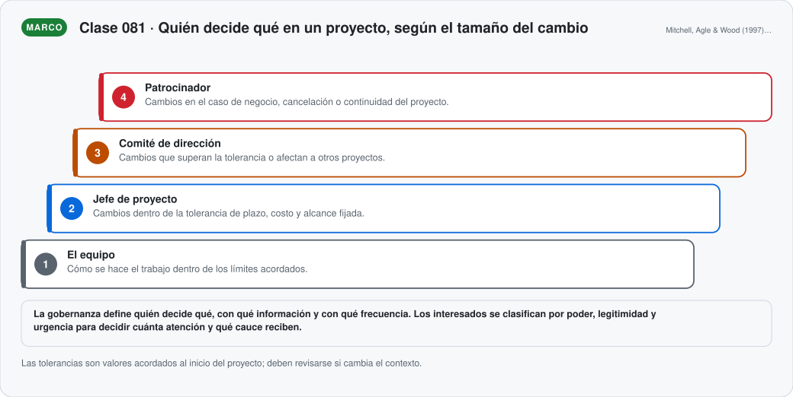

# Clase 081 — Stakeholders y gobernanza de proyecto

<!-- nav:inicio -->
> **Parte 06 · Proyectos, Agile y entrega** — clase 9 de 12 · [índice de la parte](../../README.md) · [temario](../../../../SYLLABUS.md)
<!-- nav:fin -->

**Parte:** 06 — Proyectos, Agile y entrega  
**Nivel:** Etapa 2 — Líder → Jefe / Team Lead  
**Duración sugerida:** 150–180 minutos · **Estándar:** deep-class-v2

## 🎯 Propósito

Un proyecto técnicamente bien ejecutado puede fracasar por razones que no están en el cronograma: un interesado influyente que no fue consultado, una decisión que nadie sabía a quién correspondía, un comité que se reúne cuando el problema ya es irreversible. **Gobernar un proyecto** es decidir quién decide qué, con qué información, con qué frecuencia y con qué límites; y **gestionar a los interesados** es entender quiénes pueden afectar o ser afectados y relacionarse con ellos según su poder, legitimidad y urgencia.

La clase integra el mapa de interesados de la clase 034 (Mitchell, Agle y Wood) con los procesos del PMBOK sobre interesados y la exposición de Kerzner sobre gobernanza. Al terminar sabrás diseñar la estructura de decisión de un proyecto, definir tolerancias que determinen cuándo escalar, planificar el compromiso con los interesados y mantener informados a quienes deciden.

## 📚 Resultados de aprendizaje

Al finalizar podrás:

1. **Identificar** y clasificar a los interesados de un proyecto con poder, legitimidad y urgencia.
2. **Diseñar** una estructura de gobernanza con roles, foros y frecuencias.
3. **Definir** tolerancias de plazo, costo y alcance que determinen cuándo se escala.
4. **Planificar** el compromiso y la comunicación con cada interesado.
5. **Preparar** informes que permitan decidir y no solo informar.

## 🧭 Agenda

| Tramo | Qué se hace |
|---|---|
| 0–20 min | Recuperación: recuerda una decisión de un proyecto que se demoró porque «no se sabía a quién le tocaba». |
| 20–60 min | Gobernanza, tolerancias, interesados e informes. |
| 60–105 min | Ejemplo trabajado: la estructura de decisión de un proyecto de 12 meses. |
| 105–140 min | Caso ejecutivo: un comité que bloquea. |
| 140–170 min | Límites y entregable. |

## 🧩 Conceptos centrales

| Concepto | Definición | Cómo se reconoce |
|---|---|---|
| **Gobernanza de proyecto** | Marco de roles, decisiones, foros e información con que se dirige y controla un proyecto (Kerzner, 2017). | Se sabe quién decide qué. |
| **Patrocinador** | Quien justifica el proyecto, provee los recursos y decide sobre su continuidad. | Tiene autoridad sobre el caso de negocio. |
| **Comité de dirección** | Foro de decisión sobre cambios que superan la autoridad del jefe de proyecto. | Se reúne con frecuencia definida y decide. |
| **Tolerancia** | Margen de plazo, costo o alcance dentro del cual el jefe de proyecto puede decidir sin escalar. | Está escrita al inicio. |
| **Interesado (stakeholder)** | Persona o grupo que puede afectar o ser afectado por el proyecto (PMI, PMBOK). | Se puede nombrar qué le ocurre o qué puede hacer. |
| **Prominencia** | Grado de prioridad que los directivos dan a un interesado según su poder, legitimidad y urgencia (Mitchell et al., 1997). | Determina la atención. |

## 🧠 Modelo mental

**Cómo leer el diagrama.** Cuatro niveles de decisión, de abajo hacia arriba. Cada uno decide lo que cabe en su **tolerancia** y escala lo que la excede: el equipo decide el cómo; el jefe de proyecto, los cambios menores; el comité, los que afectan a otros proyectos o superan las tolerancias; el patrocinador, el caso de negocio y la continuidad. Sin tolerancias escritas, todo se escala o nada se escala.

## 📖 Desarrollo

### 1. Gobernanza: quién decide qué

La gobernanza no es burocracia: es la respuesta a la pregunta «¿quién decide esto?». Un proyecto sin gobernanza clara decide lento, por los pasillos o por quien presiona más. Una estructura mínima: un **patrocinador** que responde por el beneficio; un **comité de dirección** de pocas personas con autoridad; un **jefe de proyecto** responsable de la ejecución; y el **equipo**. Se define por escrito qué decide cada uno y con qué información. Kerzner subraya que la gobernanza efectiva requiere roles claros, criterios de decisión y revisiones regulares.

### 2. Tolerancias y escalamiento

Una **tolerancia** es el margen dentro del cual un nivel puede decidir sin consultar: «el jefe de proyecto puede aprobar cambios de hasta 5 días o USD 5.000; más allá, lo decide el comité». Con tolerancias, el escalamiento es predecible: no se consulta por todo, y lo grave llega a quien corresponde. Se definen al inicio, con el patrocinador, para plazo, costo, alcance, calidad y riesgo. Si el proyecto cambia de contexto, se renegocian.

### 3. Foros y frecuencia

La frecuencia se ajusta al ritmo del proyecto: el **equipo** se coordina a diario o semanalmente; el **jefe de proyecto** informa al patrocinador cada dos semanas; el **comité** se reúne mensualmente o en hitos. Las reuniones de gobierno deben ser **reuniones de decisión** (clase 056): con una agenda de decisiones, materiales previos y registro. Un comité que solo escucha informes de avance no gobierna.

### 4. Identificar interesados

El PMBOK propone identificar a todas las personas y grupos que pueden afectar o ser afectados por el proyecto: patrocinador, usuarios, áreas que dependen del resultado, proveedores, reguladores, equipos que prestan recursos, y quienes serán afectados negativamente. Una técnica: preguntar a cada persona «¿a quién más deberíamos considerar?». Se registran con su interés, su influencia y su posición actual frente al proyecto (apoyo, neutralidad, resistencia).

### 5. Clasificar y relacionarse

Mitchell, Agle y Wood (clase 034) ofrecen un criterio para clasificar: **poder**, **legitimidad** y **urgencia**. Un interesado definitivo (los tres atributos) exige atención inmediata; uno dominante, un cauce regular; uno dependiente necesita que se proteja su voz. Para cada interesado importante se planifica el **compromiso**: qué necesita saber, qué se necesita de él, quién se relaciona, con qué frecuencia y por qué canal. La relación con las autoridades y reguladores sigue la regla de coherencia entre lo que se les dice y lo que se dice a los demás.

### 6. Informar para decidir

Un informe de gobierno útil responde cuatro preguntas: **¿dónde estamos?** (avance contra plan y resultados), **¿qué cambió?** (riesgos, cambios, supuestos), **¿qué decisión se necesita y de quién?** y **¿qué ocurrirá si no se decide?** Se usan pocos indicadores con semáforos con **criterio** definido (verde dentro de tolerancia, ámbar en riesgo, rojo fuera). Los informes ocultan la verdad cuando todo es verde hasta que de pronto es rojo: se premia la transparencia temprana (clase 042).

### 7. Cambios de patrocinador y cierre

Los proyectos largos enfrentan cambios de patrocinador, de prioridades o de contexto. La gobernanza debe prever cómo se **revalida el caso de negocio**: periódicamente se pregunta si el beneficio sigue justificando el costo, y se está dispuesto a detenerlo si no (clase 083). Al cierre, se verifica la **aceptación**, se transfiere a la operación, se libera al equipo y se hace una revisión sin culpas. Un cierre formal evita proyectos zombi que consumen recursos sin decisión.

## 📚 Lectura comparada

| Obra | Qué aporta | Qué no resuelve | Pregunta para contrastar |
|---|---|---|---|
| Kerzner (2017) | Gobernanza, roles y control de proyectos. | Escrita para grandes organizaciones. | ¿Quién decide cada cosa en tu proyecto? |
| PMI, PMBOK | Procesos de identificar y gestionar a los interesados. | Su enfoque es de proyectos planificados. | ¿Qué interesados faltan en tu registro? |
| Mitchell, Agle y Wood (1997) | Clasificación por poder, legitimidad y urgencia. | No dice qué decir a cada uno. | ¿Quién es dependiente y puede quedar sin voz? |
| Edmondson (2018) | Seguridad para reportar problemas a tiempo. | No trata de estructuras de decisión. | ¿Qué cuesta reportar un riesgo? |
| Flyvbjerg y Gardner (2023) | Fallas de gobernanza en grandes proyectos. | Se centra en gran escala. | ¿Se revalida el caso de negocio? |

## 🧮 Ejemplo trabajado

**Situación (hipotética).** Un proyecto de implantación de un sistema, de 12 meses y USD 1,2 millones.

| Nivel | Decide | Tolerancia / foro |
|---|---|---|
| **Patrocinador** (director general) | Continuidad, cambios en el caso de negocio, recursos adicionales. | Reunión trimestral de revalidación. |
| **Comité de dirección** (cuatro directores) | Cambios que superan las tolerancias o afectan a otras áreas. | Mensual, reunión de decisión con agenda y registro. |
| **Jefa de proyecto** | Cambios hasta 5 días o USD 15.000, sin afectar el alcance acordado. | Informe quincenal con semáforos. |
| **Equipo** | Cómo se hace el trabajo. | Coordinación semanal. |

**Interesados.** Patrocinador (definitivo); directores de áreas usuarias (dominantes: tienen poder y legitimidad); el regulador (dominante); los usuarios finales (dependientes: legitimidad y urgencia, sin poder, por lo que se prevé un grupo de usuarios con voz); el proveedor (dominante sobre los plazos).

**Informe quincenal.** Avance 38 % (plan 40 %, ámbar), riesgos nuevos (retraso del proveedor), una decisión pedida al comité (aprobar 8 días más para la integración) y qué ocurre si no se decide (impacto en la fecha de capacitación).

**Qué muestra.** (1) La estructura distingue niveles y tolerancias. (2) Los interesados se clasificaron y se previó la voz de los dependientes. (3) El informe pide una decisión.

## 🔀 Comparación y límites

**Gobernanza frente a control.** La gobernanza distribuye decisiones; el control las concentra. Un exceso de comités ralentiza y desmotiva.

**Límites.** Las estructuras formales no reemplazan las relaciones con los interesados: se necesita confianza y comunicación informal. La clasificación de interesados es una percepción de quien la hace (clase 034). Un exceso de gobernanza en proyectos pequeños o ágiles es costoso. Y las obligaciones de gobierno de proyectos públicos o regulados pueden estar fijadas por norma, que debe verificarse.

## 🪜 De profesional a owner

| Nivel | Cómo participa en la gobernanza |
|---|---|
| **Profesional** | Reporta riesgos y pide decisiones a quien corresponde. |
| **Jefe / Team Lead** | Conoce sus tolerancias y escala a tiempo. |
| **Gerente** | Define estructuras de decisión y evita comités sin autoridad. |
| **CEO / Director** | Patrocina con criterio y revalida el caso de negocio. |
| **Founder / Owner** | Decide con pocos foros y deja claro quién decide qué entre socios. |

## 🏢 Caso ejecutivo

Un proyecto de reestructuración de procesos tiene un comité de 11 personas que se reúne cada dos semanas. Las decisiones se posponen porque «falta alguien»; cada director vota según su área; se reabren decisiones anteriores. El jefe de proyecto no sabe qué puede decidir solo y consulta todo, con lo que el equipo espera. Un regulador pidió información que nadie sabe a quién corresponde responder. El patrocinador está de viaje frecuente.

Entrega un **diseño de gobernanza** que contenga: (a) la estructura de decisión con roles y tolerancias; (b) la composición y el reglamento del comité; (c) el mapa de interesados con su clasificación y el plan de compromiso; (d) el formato del informe de gobierno; (e) cómo atenderás al regulador y quién responde; (f) cómo revalidarás el caso de negocio.

## 🧪 Práctica

1. Escribe tres decisiones de tu proyecto y quién las toma.
2. Define las tolerancias de plazo y costo para el jefe de proyecto.
3. Lista tus interesados y clasifícalos con poder, legitimidad y urgencia.
4. Redacta un informe de una página con las cuatro preguntas.
5. Define qué evidencia te haría pedir detener el proyecto.

## ⚠️ Errores frecuentes

| Error | Por qué ocurre | Cómo corregirlo |
|---|---|---|
| Comité grande sin autoridad | Se quiere incluir a todos | Pocas personas con poder de decisión. |
| Sin tolerancias | No se negocian al inicio | Escribirlas con el patrocinador. |
| Informes que no piden decisiones | Se informa por costumbre | Pedir una decisión y su consecuencia. |
| Semáforo siempre verde | Se teme reportar | Criterios claros y cultura de transparencia. |
| Olvidar a los dependientes | No tienen poder | Dar voz a quienes tienen legitimidad y urgencia. |
| No revalidar el caso | Se sigue por inercia | Revisión periódica del beneficio. |

## ❓ Preguntas de comprobación

1. ¿Qué responde la gobernanza de un proyecto?
2. ¿Qué es una tolerancia y para qué sirve?
3. ¿Qué cuatro niveles de decisión describe la clase?
4. ¿Cómo se clasifica a un interesado?
5. ¿Qué cuatro preguntas responde un informe de gobierno?
6. ¿Por qué se revalida el caso de negocio?
7. ¿Qué límite tiene la gobernanza formal?

Claves de respuesta

1. Quién decide qué, con qué información, con qué frecuencia y con qué límites.
2. Un margen de plazo, costo o alcance dentro del cual un nivel decide sin escalar; hace predecible el escalamiento.
3. El equipo, el jefe de proyecto, el comité de dirección y el patrocinador.
4. Por poder, legitimidad y urgencia.
5. Dónde estamos, qué cambió, qué decisión se necesita y qué ocurre si no se decide.
6. Para comprobar que el beneficio sigue justificando el costo y detener el proyecto si no.
7. No reemplaza la confianza y las relaciones, y en exceso ralentiza.

## 📥 Entregable

Guarda en `portfolio/081-stakeholders-y-gobernanza-de-proyecto/`:

- `leadership-decision-brief.md` (plantilla [Leadership Decision Brief](../../../../templates/leadership-decision-brief.md)) con el diseño del caso ejecutivo;
- `stakeholder-legitimacy-map.md` (plantilla [mapa de interesados y legitimidad](../../../../templates/stakeholder-legitimacy-map.md)) con los interesados del proyecto;
- `decision-journal.md` con las tolerancias y las decisiones escaladas.

## 📗 Fuentes y verificación

- Harold Kerzner — *Project Management* (John Wiley & Sons Inc, 2003). **Uso en esta clase:** gobernanza, roles y control de proyectos. Lectura selectiva sobre **stakeholders y gobernanza de proyecto**. **Localizador:** [ISBN-13 9780471281580](https://openlibrary.org/isbn/9780471281580).
- Project Management Institute — *A Guide to the Project Management Body of Knowledge (PMBOK Guide)* (1996). **Uso en esta clase:** procesos de identificar y gestionar a los interesados. Lectura selectiva sobre **stakeholders y gobernanza de proyecto**. **Localizador:** [ISBN-13 9781880410127](https://openlibrary.org/isbn/9781880410127).
- Ronald K. Mitchell, Bradley R. Agle & Donna J. Wood — *Toward a Theory of Stakeholder Identification and Salience: Defining the Principle of Who and What Really Counts* (Academy of Management Review, 1997). **Uso en esta clase:** clasificación de interesados por poder, legitimidad y urgencia. Lectura selectiva sobre **stakeholders y gobernanza de proyecto**. **Localizador:** [DOI 10.2307/259247](https://doi.org/10.2307/259247).
- Amy C. Edmondson — *The Fearless Organization* (Wiley, 2018). **Uso en esta clase:** seguridad para reportar problemas a tiempo. Lectura selectiva sobre **stakeholders y gobernanza de proyecto**. **Localizador:** [ISBN-13 9781119477242](https://openlibrary.org/isbn/9781119477242).
- Bent Flyvbjerg & Dan Gardner — *How Big Things Get Done* (Currency, 2023). **Uso en esta clase:** fallas de gobernanza en grandes proyectos. Lectura selectiva sobre **stakeholders y gobernanza de proyecto**. **Localizador:** [ISBN-13 9780593239513](https://openlibrary.org/isbn/9780593239513).

> **Regla de fuentes para Stakeholders y gobernanza de proyecto:** las obras anteriores estructuran las perspectivas de esta materia; cualquier norma, ley o estándar vivo mencionado debe comprobarse nuevamente en su fuente primaria vigente, incluidas las exigencias de gobierno de proyectos públicos o regulados. Los ejemplos y casos son hipotéticos. El desarrollo es original y no reproduce capítulos protegidos.

<!-- pie:inicio -->
---

| Anterior | Índice | Siguiente |
|---|---|---|
| [← 080 · Kanban y flujo](../080-kanban-y-flujo/README.md) | [Parte 06](../../README.md) · [Programa](../../../../SYLLABUS.md) | [082 · Calidad y Definition of Done →](../082-calidad-y-definition-of-done/README.md) |
<!-- pie:fin -->
