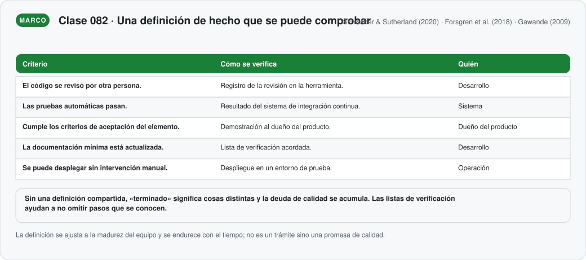

# Clase 082 — Calidad y Definition of Done

<!-- nav:inicio -->
> **Parte 06 · Proyectos, Agile y entrega** — clase 10 de 12 · [índice de la parte](../../README.md) · [temario](../../../../SYLLABUS.md)
<!-- nav:fin -->

**Parte:** 06 — Proyectos, Agile y entrega  
**Nivel:** Etapa 2 — Líder → Jefe / Team Lead  
**Duración sugerida:** 150–180 minutos · **Estándar:** deep-class-v2

## 🎯 Propósito

«Terminado» es la palabra más ambigua de un proyecto. Para el desarrollador, significa que escribió el código; para quien prueba, que ya lo revisó; para el usuario, que le sirve; para el director, que está en producción. Cuando no hay una definición compartida, el trabajo se declara terminado sin estarlo, la calidad se difiere al final y la **deuda** se acumula hasta que el producto es lento de cambiar y caro de mantener. La **definición de hecho** convierte «terminado» en una lista de criterios comprobables que todos acuerdan.

La clase usa la Guía de Scrum, que define la definición de hecho como un compromiso del incremento, la investigación de Forsgren, Humble y Kim sobre las prácticas asociadas con entrega de alta calidad y la defensa de las listas de verificación de Atul Gawande. También conecta con los enfoques de calidad de Deming y con la norma ISO 9001. Al terminar sabrás redactar una definición de hecho, distinguirla de los criterios de aceptación y construir un sistema que prevenga defectos en lugar de buscarlos al final.

## 📚 Resultados de aprendizaje

Al finalizar podrás:

1. **Distinguir** criterios de aceptación, definición de hecho y definición de listo.
2. **Redactar** una definición de hecho verificable.
3. **Explicar** por qué la calidad se construye en el proceso y no se inspecciona al final.
4. **Reconocer** la deuda de calidad y sus costos.
5. **Usar** listas de verificación y automatización para sostener la calidad.

## 🧭 Agenda

| Tramo | Qué se hace |
|---|---|
| 0–20 min | Recuperación: pregunta a tres colegas qué significa «terminado» en tu proyecto y compara. |
| 20–60 min | Definición de hecho, criterios de aceptación y calidad en el proceso. |
| 60–105 min | Ejemplo trabajado: construir la definición de hecho de un equipo. |
| 105–140 min | Caso ejecutivo: entregas «terminadas» con defectos. |
| 140–170 min | Límites y entregable. |

## 🧩 Conceptos centrales

| Concepto | Definición | Cómo se reconoce |
|---|---|---|
| **Definición de hecho** | Descripción formal del estado del incremento cuando cumple las medidas de calidad requeridas (Schwaber y Sutherland, 2020). | Es una lista compartida y verificable. |
| **Criterio de aceptación** | Condición que un elemento concreto debe cumplir para ser aceptado por quien lo pidió. | Es específico de cada elemento. |
| **Calidad integrada** | Prevención de defectos en el proceso en lugar de su inspección al final (Deming, 1986). | Las pruebas y revisiones ocurren durante el trabajo. |
| **Deuda de calidad** | Costo futuro acumulado por haber diferido trabajo de calidad. | Cada cambio cuesta más que el anterior. |
| **Lista de verificación** | Instrumento que recuerda los pasos esenciales a cumplir (Gawande, 2009). | Se usa en cada entrega. |
| **Automatización** | Ejecución automática de verificaciones repetibles (Forsgren et al., 2018). | Las pruebas corren sin intervención manual. |

## 🧠 Modelo mental

**Cómo leer el diagrama.** Cada fila de la definición de hecho tiene tres partes: el **criterio** (qué debe cumplirse), **cómo se verifica** (con qué evidencia) y **quién** lo verifica. Una definición sin forma de verificación es una intención; con ella, es un compromiso que se puede comprobar. Los criterios de aceptación de cada elemento se suman a esta definición, que es común a todos.

## 📖 Desarrollo

### 1. Tres definiciones distintas

Tres conceptos se confunden. Los **criterios de aceptación** son específicos de un elemento («el cliente puede reordenar con dos toques»). La **definición de hecho** es común a todos los elementos y describe la calidad mínima («revisado, probado, documentado, desplegable»). La **definición de listo** (más usada en la práctica que en la Guía de Scrum) indica cuándo un elemento está suficientemente claro para empezar. Un elemento está terminado cuando cumple **ambos**: los criterios de aceptación y la definición de hecho.

### 2. Qué dice la Guía de Scrum

La Guía de Scrum 2020 define el **incremento** como un paso concreto hacia el objetivo del producto y exige que cumpla la **definición de hecho**. Si el trabajo no cumple, no puede lanzarse ni presentarse en la revisión: vuelve al backlog. Si hay una definición de hecho organizacional, todos los equipos la siguen como mínimo; si no, el equipo crea la propia. El compromiso da transparencia: todos saben qué significa terminado y la calidad se puede inspeccionar.

### 3. Construir la calidad en el proceso

Deming sostuvo que no se puede inspeccionar la calidad en un producto: hay que **construirla** en el proceso, y que depender de la inspección masiva al final es ineficiente porque llega tarde. Para el trabajo de proyectos, esto significa integrar revisiones, pruebas y verificaciones **durante** el trabajo, no en una fase final. Las defectos detectados cerca de su origen cuestan menos que los detectados tarde. Una definición de hecho que incluya estas verificaciones desplaza la calidad hacia el inicio.

### 4. La deuda de calidad

Diferir pruebas, documentación o limpieza para «cumplir la fecha» es tomar un préstamo: el costo reaparece con intereses. Cada cambio posterior es más lento y riesgoso, y los defectos se acumulan. Forsgren, Humble y Kim encuentran que los equipos con alto desempeño de entrega combinan **rapidez y estabilidad** y no las intercambian: invierten en automatización de pruebas, integración continua y arquitectura que permite cambiar con seguridad, y obtienen entregas más frecuentes y menos fallas. La deuda se paga o se vive con ella, pero se hace visible.

### 5. Listas de verificación

Gawande documentó cómo las listas de verificación reducen errores en cirugía y aviación, no porque los profesionales no sepan, sino porque en entornos complejos se olvidan pasos simples. Una buena lista es **breve**, **concreta**, usa el lenguaje de quien la usa y se prueba en la práctica. Se aplica en puntos de pausa definidos. Para la definición de hecho, una lista de cinco a diez ítems verificables es más útil que un documento largo que nadie lee.

### 6. Automatizar lo repetible

Las verificaciones repetibles —pruebas, análisis de código, controles de seguridad, validaciones de formato— se **automatizan**: corren siempre, con el mismo criterio, sin depender de la memoria. Forsgren et al. asocian la automatización de pruebas y de despliegues con mejor desempeño de entrega. Lo que no es automatizable —juicio de usabilidad, revisión de un diseño, aceptación por el usuario— se mantiene como paso humano explícito. Y se vigila que los controles no se vuelvan un ritual sin sentido.

### 7. Gestionar la definición

La definición de hecho **evoluciona**: se empieza con lo que el equipo puede cumplir y se endurece con la madurez; se revisa en las retrospectivas (clase 079) y cuando falla algo en producción («¿qué criterio nos habría protegido?»). Se publica, se aplica a todo y no admite excepciones silenciosas: si se hace una excepción, se registra como deuda con responsable y fecha. En entornos regulados, algunos criterios —de seguridad, trazabilidad, documentación— son obligatorios y están en la norma, que se verifica.

## 📚 Lectura comparada

| Obra | Qué aporta | Qué no resuelve | Pregunta para contrastar |
|---|---|---|---|
| Schwaber y Sutherland (2020) | La definición de hecho como compromiso del incremento. | No dice qué incluir. | ¿Qué incluye la definición de tu equipo? |
| Forsgren, Humble y Kim (2018) | Prácticas de calidad y entrega que van juntas. | Estudios por encuesta. | ¿Qué verificaciones están automatizadas? |
| Gawande (2009) | Listas de verificación para evitar omisiones. | No trata de proyectos. | ¿Qué pasos esenciales olvidas? |
| Deming (1986) | Construir la calidad en el proceso y no inspeccionarla al final. | Es un tratado de gestión general. | ¿Dónde se detectan tus defectos? |
| ISO 9001 | Requisitos de un sistema de gestión de la calidad. | Es una norma general. | ¿Cómo se demuestra la conformidad? |

## 🧮 Ejemplo trabajado

**Situación (hipotética).** Un equipo de seis personas desarrolla una aplicación. Cada Sprint, los elementos se declaran «terminados» pero aparecen defectos en producción y la prueba final lleva dos semanas.

| Criterio de la definición de hecho | Verificación | Quién |
|---|---|---|
| El código se revisó por otra persona. | Registro de la revisión en la herramienta. | Desarrolladores |
| Las pruebas automáticas pasan. | Resultado de la integración continua. | Sistema |
| Cumple los criterios de aceptación del elemento. | Demostración al dueño del producto. | Dueño del producto |
| La documentación mínima está actualizada. | Lista de verificación de cinco puntos. | Desarrolladores |
| Se puede desplegar sin intervención manual. | Despliegue en un entorno de prueba. | Operación |

**Efecto.** En dos Sprints, el trabajo «terminado» disminuye (porque ya no se declara hasta cumplir todo), pero los defectos en producción bajan de 14 a 4 por mes y el tiempo de prueba final se reduce de dos semanas a tres días. Se registra una excepción: un elemento se entrega sin documentación por urgencia, con fecha de pago de la deuda.

**Qué muestra.** (1) La definición hizo explícita la calidad. (2) Pareció más lenta al inicio y fue más rápida después. (3) Las excepciones se registraron como deuda.

## 🔀 Comparación y límites

**Calidad frente a velocidad.** No se intercambian a mediano plazo: la calidad baja ralentiza. A corto plazo puede haber compromisos conscientes que se registran.

**Límites.** Una definición de hecho no garantiza calidad si los criterios son superficiales o si se cumplen de manera formal. Las listas de verificación en contextos de baja complejidad pueden ser un ritual. La investigación de Forsgren et al. se basa en encuestas y muestra asociaciones. Y en trabajo que no es de software, los criterios cambian: la lógica de un incremento verificable vale igual, pero sus contenidos se adaptan.

## 🪜 De profesional a owner

| Nivel | Cómo trabaja la calidad |
|---|---|
| **Profesional** | No declara terminado lo que no cumple los criterios. |
| **Jefe / Team Lead** | Facilita la definición y protege su cumplimiento. |
| **Gerente** | Evita presionar para cumplir fechas a costa de la calidad. |
| **CEO / Director** | Entiende que la deuda de calidad es un pasivo del negocio. |
| **Founder / Owner** | Equilibra rapidez y calidad según su etapa y paga su deuda de manera deliberada. |

## 🏢 Caso ejecutivo

Una empresa de servicios financieros entrega un módulo de pagos «terminado» a fin de mes para cumplir una fecha del directorio. Dos semanas después aparecen errores de cálculo en el 2 % de las transacciones, y el área de cumplimiento halla que faltan registros de auditoría. El equipo dice que «no había tiempo»; el director técnico, que «la fecha era inamovible»; el cliente interno, que «nos entregaron algo que no funciona». Hay cinco entregas más programadas.

Entrega un **plan de calidad** que contenga: (a) la definición de hecho con criterios, verificación y responsable; (b) cómo la distinguirás de los criterios de aceptación; (c) la política de excepciones y deuda; (d) qué automatizarás y qué lista de verificación usarás; (e) cómo corregirás el módulo entregado y comunicarás al cliente; (f) cómo evitarás que una fecha vuelva a primar sobre la calidad.

## 🧪 Práctica

1. Escribe una definición de hecho de cinco criterios para tu trabajo.
2. Agrega para cada criterio cómo se verifica y quién.
3. Identifica una deuda de calidad en tu entorno y su costo.
4. Diseña una lista de verificación de diez pasos esenciales.
5. Define qué verificación automatizarías primero y por qué.

## ⚠️ Errores frecuentes

| Error | Por qué ocurre | Cómo corregirlo |
|---|---|---|
| «Terminado» sin definición | Cada uno entiende algo | Definición compartida y verificable. |
| Calidad al final | Se hace al terminar | Verificaciones durante el trabajo. |
| Excepciones silenciosas | Se cede ante la fecha | Registrarlas como deuda con fecha. |
| Lista larga que nadie usa | Se quiere cubrirlo todo | Breve y probada. |
| Todo manual | No se invierte | Automatizar lo repetible. |
| Confundir aceptación con hecho | Se usa un solo concepto | Cumplir ambos. |

## ❓ Preguntas de comprobación

1. ¿Qué diferencia hay entre criterios de aceptación y definición de hecho?
2. ¿Qué dice la Guía de Scrum cuando un elemento no cumple la definición de hecho?
3. ¿Por qué Deming recomienda construir la calidad en el proceso?
4. ¿Qué es la deuda de calidad?
5. ¿Para qué sirven las listas de verificación según Gawande?
6. ¿Qué conviene automatizar?
7. ¿Qué límite tiene la definición de hecho?

Claves de respuesta

1. Los criterios de aceptación son específicos de un elemento; la definición de hecho es común y describe la calidad mínima de todo incremento.
2. No puede lanzarse ni presentarse en la revisión: vuelve al backlog.
3. Porque la inspección al final llega tarde y es ineficiente; los defectos cuestan menos cerca de su origen.
4. El costo futuro acumulado por haber diferido trabajo de calidad.
5. Para evitar olvidar pasos esenciales en entornos complejos.
6. Las verificaciones repetibles, como pruebas, análisis de código y controles.
7. No garantiza calidad si los criterios son superficiales o se cumplen de manera formal.

## 📥 Entregable

Guarda en `portfolio/082-calidad-y-definition-of-done/`:

- `operating-improvement-brief.md` (plantilla [Operating Improvement Brief](../../../../templates/operating-improvement-brief.md)) con el plan del caso ejecutivo;
- `decision-journal.md` con la definición de hecho, las excepciones y la deuda registrada;
- `reading-note.md` con una tensión entre Deming y Forsgren et al.

## 📗 Fuentes y verificación

- Ken Schwaber & Jeff Sutherland — *The Scrum Guide* (Scrum.org / Scrum Alliance). **Uso en esta clase:** la definición de hecho como compromiso del incremento. **Fuente primaria:** <https://scrumguides.org/>.
- Nicole Forsgren, Jez Humble & Gene Kim — *Accelerate* (IT Revolution Press, 2018). **Uso en esta clase:** prácticas de calidad y entrega asociadas con mejor desempeño. Lectura selectiva sobre **calidad y definition of done**. **Localizador:** [ISBN-13 9781942788379](https://openlibrary.org/isbn/9781942788379).
- Atul Gawande — *The Checklist Manifesto* (Penguin Random House, 2014). **Uso en esta clase:** listas de verificación para evitar omisiones. Lectura selectiva sobre **calidad y definition of done**. **Localizador:** [ISBN-13 9780143423225](https://openlibrary.org/isbn/9780143423225).
- W. Edwards Deming — *Out of the Crisis* (The MIT Press, 2000). **Uso en esta clase:** construir la calidad en el proceso. Lectura selectiva sobre **calidad y definition of done**. **Localizador:** [ISBN-13 9780262541152](https://openlibrary.org/isbn/9780262541152).
- ISO — *ISO 9001 Quality management systems*. **Uso en esta clase:** requisitos de un sistema de gestión de la calidad. **Localizador pendiente:** ver [el registro de fuentes](../../../../docs/FUENTES.md).

> **Regla de fuentes para Calidad y Definition of Done:** las obras anteriores estructuran las perspectivas de esta materia; cualquier norma, ley o estándar vivo mencionado debe comprobarse nuevamente en su fuente primaria vigente, incluidos los requisitos de calidad, seguridad y auditoría de entornos regulados. Los ejemplos y casos son hipotéticos, con cifras ilustrativas. El desarrollo es original y no reproduce capítulos protegidos.

<!-- pie:inicio -->
---

| Anterior | Índice | Siguiente |
|---|---|---|
| [← 081 · Stakeholders y gobernanza de proyecto](../081-stakeholders-y-gobernanza-de-proyecto/README.md) | [Parte 06](../../README.md) · [Programa](../../../../SYLLABUS.md) | [083 · Recuperación de proyectos atrasados →](../083-recuperacion-de-proyectos-atrasados/README.md) |
<!-- pie:fin -->
