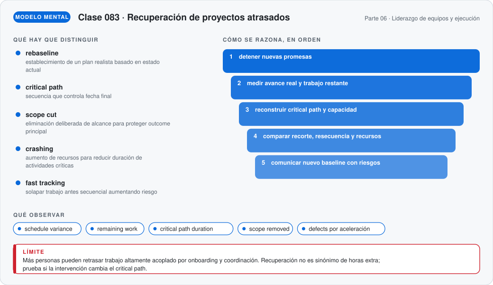

# Clase 083 — Recuperación de proyectos atrasados

<!-- nav:inicio -->
> **Parte 06 · Proyectos, Agile y entrega** — clase 11 de 12 · [índice de la parte](../../README.md) · [temario](../../../../SYLLABUS.md)
<!-- nav:fin -->

**Parte:** 06 — Proyectos, Agile y entrega  
**Nivel:** Etapa 2 — Líder → Jefe / Team Lead  
**Duración sugerida:** 150–180 minutos · **Estándar:** deep-class-v2

## 🎯 Propósito

Un proyecto atrasado despierta dos reflejos opuestos y casi siempre equivocados: **más presión** («trabajen horas extra») y **más gente** («sumemos personas»). Ambos tratan el atraso como un problema de esfuerzo cuando suele ser un problema de **información, de decisiones y de alcance**: se sabe tarde cuánto falta, se decide sin datos y se pretende entregar todo lo prometido con menos tiempo del necesario. Recuperar un proyecto exige cambiar el orden de las decisiones.

La clase usa los datos de Flyvbjerg y Gardner sobre cómo los grandes proyectos se desvían, la exposición de Kerzner sobre control y recuperación de proyectos y las herramientas de estimación, riesgo y gobernanza de las clases anteriores. Al terminar sabrás **diagnosticar** el estado real de un proyecto, **replanificar con una base honesta**, decidir entre recortar alcance, mover la fecha o agregar recursos y comunicarlo sin perder la confianza de los interesados.

## 📚 Resultados de aprendizaje

Al finalizar podrás:

1. **Diagnosticar** el estado real de un proyecto: avance, capacidad, causas del atraso.
2. **Detener** el deterioro: congelar alcance y frenar lo no esencial.
3. **Replanificar** con estimaciones en rango y capacidad medida.
4. **Decidir** entre recortar alcance, mover fecha o agregar recursos, con sus efectos.
5. **Decidir** cuándo conviene detener el proyecto y cerrarlo de forma ordenada.

## 🧭 Agenda

| Tramo | Qué se hace |
|---|---|
| 0–20 min | Recuperación: recuerda un proyecto que se atrasó; ¿cuándo supo realmente quien decidía que estaba atrasado? |
| 20–60 min | Diagnóstico, replanificación y decisión. |
| 60–105 min | Ejemplo trabajado: un proyecto atrasado cuatro meses. |
| 105–140 min | Caso ejecutivo: «sumemos gente». |
| 140–170 min | Límites y entregable. |

## 🧩 Conceptos centrales

| Concepto | Definición | Cómo se reconoce |
|---|---|---|
| **Atraso** | Diferencia entre el avance real y el esperado según el plan vigente. | Se mide con hechos. |
| **Diagnóstico de causas** | Análisis de por qué ocurrió: estimación, alcance, capacidad, dependencias o decisiones. | Se separan los síntomas de las causas. |
| **Triple restricción** | Relación entre alcance, plazo y costo: cambiar uno afecta a los otros (Kerzner, 2017). | Se ve el efecto de cada decisión. |
| **Línea base nueva** | Plan revisado, con una base realista, aprobado por quien decide. | Reemplaza a la anterior. |
| **Compromiso creciente (escalada)** | Tendencia a continuar con un proyecto fallido por lo ya invertido. | Se invoca «lo que ya gastamos». |
| **Cierre ordenado** | Detener un proyecto de modo que se rescate valor y se aprenda. | Hay decisión, registro y traspaso. |

## 🧠 Modelo mental

**Cómo leer el diagrama.** Cinco pasos con orden deliberado. Primero, **detener** lo que empeora el atraso (el alcance que sigue creciendo). Luego, **diagnosticar** con hechos y capacidad medida. Después, **replanificar** con base realista. Solo entonces se **decide** qué mover: alcance, fecha o recursos. Por último, **comunicar** con honestidad y dar seguimiento frecuente. La decisión llega tras el diagnóstico, no antes.

## 📖 Desarrollo

### 1. Por qué se atrasan los proyectos

Flyvbjerg y Gardner reúnen una base de datos de miles de proyectos y concluyen que los excesos de costo y de plazo son frecuentes, y que muchos nacen **antes** de la ejecución: estimaciones optimistas, decisiones apresuradas y planificación insuficiente. Entre las causas en la ejecución: cambios de alcance sin decisión, dependencias que se retrasan, capacidad menor a la supuesta y problemas conocidos que nadie reportó a tiempo. Reconocerlo ayuda a recuperar sin buscar culpables.

### 2. Detener la hemorragia

El primer paso es evitar que el atraso crezca: **congelar** el alcance y los cambios no esenciales, detener iniciativas paralelas que consumen al equipo y fijar un **responsable único** de la recuperación. También se suspende, por unos días, la presión por fechas que ya no son realistas, para obtener información veraz. Una persona que teme represalias oculta lo que pasa (clase 042).

### 3. Diagnosticar con hechos

El diagnóstico responde: **¿cuánto trabajo queda realmente?** (se descompone lo que falta, clase 075); **¿cuál es la capacidad real?** (el rendimiento medido de las últimas semanas, clase 076); **¿qué dependencias están en riesgo?** (clase 077); **¿qué decisiones se postergaron?** y **¿qué causas se repiten?** Se evita el diagnóstico por opinión: se usan datos del avance, del rendimiento y de los defectos. El resultado es un cuadro honesto: «faltan 14 semanas con la capacidad actual».

### 4. Replanificar

Con el diagnóstico, se construye un nuevo plan: **estimaciones en rangos**, con la visión desde afuera (clase 076); **ruta crítica** y dependencias; **márgenes** visibles; y **hitos cortos** que permitan comprobar el avance cada una o dos semanas. El plan anterior se archiva: seguir con el original es mantener una ficción. Se evita comprometer una fecha única; se informa el rango y se actualiza con frecuencia.

### 5. Decidir sobre el triple vínculo

Con el plan realista, se decide qué mover, y siempre hay un costo. **Recortar alcance**: entregar lo esencial primero y diferir lo demás; suele ser la mejor palanca. **Mover la fecha**: aceptar el plazo real, con sus consecuencias. **Agregar recursos**: puede ayudar si el trabajo es separable y los recursos llegan pronto, pero **suma costos de coordinación y de aprendizaje** y a menudo no recupera plazo; se usa con cautela. **Reducir calidad** es una opción disfrazada que genera deuda (clase 082). La decisión corresponde a quien tiene autoridad (clase 081), con las consecuencias a la vista.

### 6. Comunicar y sostener

Se comunica con **honestidad** a patrocinador y interesados: dónde está el proyecto, qué se hizo para entender el atraso, el nuevo plan con sus rangos, las decisiones tomadas y los riesgos. Se evita culpar y se evita ocultar. Después, se da **seguimiento frecuente**: avance contra el nuevo plan cada semana, señales de alerta y revisión de supuestos. Una recuperación sin transparencia pierde la confianza, que es más difícil de recuperar que el plazo.

### 7. Cuándo detener el proyecto

No todo proyecto debe recuperarse. Pregunta: si empezáramos hoy, sabiendo lo que sabemos, ¿lo aprobaríamos? Los **costos hundidos** no deben pesar: lo ya gastado no se recupera continuando. Se compara el **costo y el beneficio futuros**. Si el beneficio ya no justifica el costo restante, se **cierra de forma ordenada**: se rescata lo reutilizable, se comunica con claridad y se hace una revisión sin culpas. La tendencia a continuar por inercia, la **escalada del compromiso**, es una de las causas de los proyectos zombi.

## 📚 Lectura comparada

| Obra | Qué aporta | Qué no resuelve | Pregunta para contrastar |
|---|---|---|---|
| Flyvbjerg y Gardner (2023) | Datos y causas de los excesos de costo y plazo. | Se centra en grandes proyectos. | ¿Qué decisión previa a la ejecución causó el atraso? |
| Kerzner (2017) | Control de proyectos y triple restricción. | Escrita para organizaciones grandes. | ¿Qué efecto tiene cada palanca? |
| Buehler, Griffin y Ross (1994) | Por qué se subestima y se mantiene el optimismo. | Es sobre estimación, no sobre recuperación. | ¿Qué optimismo mantienes? |
| Edmondson (1999) | Seguridad para reportar problemas. | No trata de recuperación. | ¿Se reportó a tiempo? |
| Goldratt (1997) | Protección del plazo y consumo del margen. | Requiere cambios de cultura. | ¿Cuánto margen queda? |

## 🧮 Ejemplo trabajado

**Situación (hipotética).** Un proyecto de implantación de un sistema, de 10 meses y USD 800.000, lleva 12 meses y ha consumido USD 950.000. El equipo dice que «falta poco»; el patrocinador exige fecha; el director sugiere sumar cinco consultores.

| Paso | Qué ocurre |
|---|---|
| **Detener** | Se congela el alcance; se suspende una funcionalidad secundaria; el jefe de proyecto es la persona responsable. |
| **Diagnóstico** | Se descompone lo que falta: 46 paquetes de trabajo; rendimiento medido: 3 por semana; tiempo restante estimado con esa capacidad: 15 semanas (rango 12 a 22). Causas: 30 % de los cambios no pasaron por aprobación; la integración con el sistema de facturación se subestimó; dos dependencias externas sin confirmar. |
| **Replanificación** | Nueva línea base: 16 semanas con margen de 4; hitos cada dos semanas. |
| **Decisión** | Opciones: (a) recortar tres funciones no esenciales (ahorra 5 semanas); (b) agregar cinco consultores (el equipo estima que solo recortaría 2 semanas por el aprendizaje necesario y costaría USD 120.000); (c) mover la fecha 15 semanas. El patrocinador decide (a) más 2 consultores para la integración, con fecha en 11 semanas. |
| **Comunicación** | Informe con diagnóstico, rango, decisiones y riesgos; seguimiento semanal. |

**Revalidación del caso.** Se comprueba que el beneficio previsto (USD 1,5 millones en tres años) sigue justificando el costo restante estimado (USD 260.000).

**Qué muestra.** (1) Primero se detuvo y se diagnosticó. (2) La opción de agregar gente se evaluó con su efecto real. (3) Se revalidó el beneficio antes de seguir.

## 🔀 Comparación y límites

**Recuperar frente a reiniciar.** Reiniciar descarta lo hecho y puede ser más rápido si el trabajo es de poco valor reutilizable. Se decide con datos, no con frustración.

**Límites.** Los datos de Flyvbjerg y Gardner son de grandes proyectos y su traducción a iniciativas pequeñas es parcial. La recuperación depende de la autoridad de quien decide y de la honestidad de la información; sin ellas, el plan es otra ficción. No hay un método que garantice el éxito, y algunas decisiones —cerrar un proyecto— tienen costos de reputación y de personas. Y los contratos con proveedores pueden condicionar las opciones.

## 🪜 De profesional a owner

| Nivel | Cómo participa en una recuperación |
|---|---|
| **Profesional** | Dice con honestidad cuánto falta y qué le impide avanzar. |
| **Jefe / Team Lead** | Lidera el diagnóstico y la replanificación de su equipo. |
| **Gerente** | Respalda decisiones de alcance y protege al equipo de la presión. |
| **CEO / Director** | Decide con el costo futuro, no con el costo hundido, y acepta cerrar. |
| **Founder / Owner** | Corta pronto una apuesta que no funciona antes de agotar su caja. |

## 🏢 Caso ejecutivo

Una empresa lleva 18 meses con un proyecto de modernización que debía durar 9. Los informes semanales siempre dicen «en ámbar»; el 80 % del presupuesto está gastado y se estima que falta el 50 % del trabajo. El director de tecnología propone «sumar un equipo externo de diez personas»; el gerente financiero, «cancelar»; el patrocinador, «terminarlo porque ya gastamos mucho». Hay dos clientes importantes esperando una funcionalidad parcial.

Entrega un **plan de recuperación o cierre** que contenga: (a) el diagnóstico con hechos y las causas; (b) la replanificación con rangos; (c) las opciones —recortar, mover, agregar, cerrar— con costo, plazo y riesgo; (d) la revalidación del beneficio con el costo futuro y no el pasado; (e) la comunicación al patrocinador y a los clientes; (f) el seguimiento y qué señales activarían un cierre.

## 🧪 Práctica

1. Calcula el rendimiento real de tu equipo en las últimas semanas y lo que falta.
2. Lista las causas del atraso de un proyecto y clasifícalas: estimación, alcance, capacidad, dependencias, decisiones.
3. Compara tres opciones para un proyecto atrasado con sus costos.
4. Responde: «si empezáramos hoy, ¿aprobaríamos este proyecto?».
5. Redacta el mensaje al patrocinador con diagnóstico, rango y decisión.

## ⚠️ Errores frecuentes

| Error | Por qué ocurre | Cómo corregirlo |
|---|---|---|
| Presionar al equipo | Se quiere acelerar | Diagnosticar y recortar alcance. |
| Sumar gente tarde | Parece la solución rápida | Evaluar el efecto de coordinación y aprendizaje. |
| Mantener el plan original | Se teme admitir el atraso | Nueva línea base realista. |
| Decidir por costo hundido | Se quiere justificar lo gastado | Mirar el costo y el beneficio futuros. |
| Ocultar la verdad | Se teme la reacción | Transparencia y seguimiento. |
| No cerrar un proyecto fallido | Escalada del compromiso | Cierre ordenado. |

## ❓ Preguntas de comprobación

1. ¿Cuál es el primer paso para recuperar un proyecto?
2. ¿Qué se diagnostica?
3. ¿Qué efecto tiene agregar recursos a un proyecto atrasado?
4. ¿Por qué suele ser mejor recortar alcance?
5. ¿Qué es el costo hundido y por qué no debe pesar?
6. ¿Qué es la escalada del compromiso?
7. ¿Qué límite tienen los datos de Flyvbjerg y Gardner?

Claves de respuesta

1. Detener la hemorragia: congelar el alcance, frenar lo no esencial y nombrar un responsable único.
2. Cuánto trabajo queda, la capacidad real, las dependencias en riesgo, las decisiones postergadas y las causas.
3. Puede ayudar si el trabajo es separable, pero suma costos de coordinación y aprendizaje y a menudo no recupera plazo.
4. Porque entrega lo esencial pronto y evita los costos de coordinación y de deuda de calidad.
5. Lo ya gastado y no recuperable; no debe pesar porque no se recupera continuando.
6. La tendencia a continuar con un proyecto fallido por lo ya invertido.
7. Son de grandes proyectos; su traslado a iniciativas pequeñas es parcial.

## 📥 Entregable

Guarda en `portfolio/083-recuperacion-de-proyectos-atrasados/`:

- `leadership-decision-brief.md` (plantilla [Leadership Decision Brief](../../../../templates/leadership-decision-brief.md)) con el plan del caso ejecutivo;
- `risk-governance-brief.md` (plantilla [Risk & Governance Brief](../../../../templates/risk-governance-brief.md)) con las opciones y la revalidación;
- `decision-journal.md` con el diagnóstico, la decisión y el seguimiento.

## 📗 Fuentes y verificación

- Bent Flyvbjerg & Dan Gardner — *How Big Things Get Done* (Currency, 2023). **Uso en esta clase:** datos y causas de los excesos de costo y de plazo. Lectura selectiva sobre **recuperación de proyectos atrasados**. **Localizador:** [ISBN-13 9780593239513](https://openlibrary.org/isbn/9780593239513).
- Harold Kerzner — *Project Management* (John Wiley & Sons Inc, 2003). **Uso en esta clase:** control de proyectos y triple restricción. Lectura selectiva sobre **recuperación de proyectos atrasados**. **Localizador:** [ISBN-13 9780471281580](https://openlibrary.org/isbn/9780471281580).
- Roger Buehler, Dale Griffin & Michael Ross — *Exploring the "planning fallacy": Why people underestimate their task completion times* (Journal of Personality and Social Psychology, 1994). **Uso en esta clase:** por qué se subestima y se mantiene el optimismo. Lectura selectiva sobre **recuperación de proyectos atrasados**. **Localizador:** [DOI 10.1037/0022-3514.67.3.366](https://doi.org/10.1037/0022-3514.67.3.366).
- Amy C. Edmondson — *Psychological Safety and Learning Behavior in Work Teams* (Administrative Science Quarterly, 1999). **Uso en esta clase:** seguridad para reportar problemas. Lectura selectiva sobre **recuperación de proyectos atrasados**. **Localizador:** [DOI 10.2307/2666999](https://doi.org/10.2307/2666999).
- Eliyahu M. Goldratt — *Critical Chain* (North River Press, 1997). **Uso en esta clase:** protección del plazo y consumo del margen. Lectura selectiva sobre **recuperación de proyectos atrasados**. **Localizador:** [ISBN-13 9780884271536](https://openlibrary.org/isbn/9780884271536).

> **Regla de fuentes para Recuperación de proyectos atrasados:** las obras anteriores estructuran las perspectivas de esta materia; cualquier norma, ley o estándar vivo mencionado debe comprobarse nuevamente en su fuente primaria vigente, incluidas las cláusulas contractuales aplicables. Los ejemplos y casos son hipotéticos, con cifras ilustrativas. El desarrollo es original y no reproduce capítulos protegidos.

<!-- pie:inicio -->
---

| Anterior | Índice | Siguiente |
|---|---|---|
| [← 082 · Calidad y Definition of Done](../082-calidad-y-definition-of-done/README.md) | [Parte 06](../../README.md) · [Programa](../../../../SYLLABUS.md) | [084 · Capstone: rescate de una iniciativa crítica →](../084-capstone-rescate-de-una-iniciativa-critica/README.md) |
<!-- pie:fin -->
