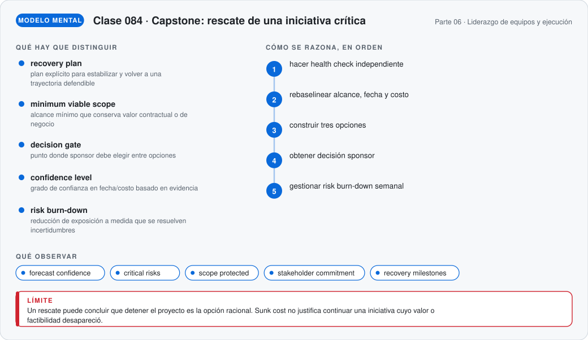

# Clase 084 — Capstone: rescate de una iniciativa crítica

<!-- nav:inicio -->
> **Parte 06 · Proyectos, Agile y entrega** — clase 12 de 12 · [índice de la parte](../../README.md) · [temario](../../../../SYLLABUS.md)
<!-- nav:fin -->

**Parte:** 06 — Proyectos, Agile y entrega  
**Nivel:** Etapa 2 — Líder → Jefe / Team Lead  
**Duración sugerida:** 150–180 minutos · **Estándar:** deep-class-v2

## 🎯 Propósito

Una iniciativa crítica atrasada, sobrecargada y con interesados impacientes es la prueba más exigente de la gestión de proyectos, porque reúne todos los problemas a la vez: alcance difuso, estimaciones optimistas, dependencias en riesgo, equipo agotado, gobernanza confusa y calidad cuestionable. El rescate no se resuelve con una herramienta: exige **ordenar las decisiones**, **decir la verdad** y **entregar valor pronto**.

Este capstone integra la parte 06: tipo de trabajo (073), alcance y éxito (074), descomposición y plan (075), estimación y capacidad (076), riesgos y dependencias (077), enfoque ágil (078), Scrum (079), Kanban y flujo (080), gobernanza (081), calidad (082) y recuperación (083). Se apoya en Flyvbjerg y Gardner, Kerzner, la Guía de Scrum y en los marcos de cada clase. Al terminar sabrás construir un plan de rescate de 90 días con decisiones, gobierno, ciclos de entrega y criterios de cierre.

## 📚 Resultados de aprendizaje

Al finalizar podrás:

1. **Diagnosticar** una iniciativa crítica con los marcos de la parte.
2. **Secuenciar** un rescate en estabilización, replanificación y entrega.
3. **Elegir** el enfoque de trabajo —plan, ciclos o flujo— según la naturaleza del trabajo.
4. **Diseñar** la gobernanza, la comunicación y los criterios de calidad del rescate.
5. **Decidir** con el patrocinador entre continuar, redefinir o cerrar, con evidencia.

## 🧭 Agenda

| Tramo | Qué se hace |
|---|---|
| 0–20 min | Recuperación: ordena las diez primeras preguntas que harías al asumir una iniciativa atrasada. |
| 20–60 min | Secuencia del rescate y selección de enfoque. |
| 60–105 min | Ejemplo trabajado: un rescate de 90 días. |
| 105–150 min | Caso ejecutivo integrado. |
| 150–170 min | Rúbrica, límites y entregable. |

## 🧩 Conceptos centrales

| Concepto | Definición | Cómo se reconoce |
|---|---|---|
| **Iniciativa crítica** | Iniciativa cuyo éxito o fracaso afecta de manera material a la estrategia o a la continuidad. | Tiene patrocinio alto y consecuencias grandes. |
| **Estabilización** | Conjunto de medidas iniciales para frenar el deterioro. | Se congela alcance y se nombra un responsable. |
| **Rescate** | Intervención para devolver una iniciativa a una trayectoria viable o cerrarla de forma ordenada. | Hay diagnóstico, plan y decisión. |
| **Incremento valioso** | Entrega funcional que da valor al usuario antes de terminar todo. | Se puede usar. |
| **Revalidación del caso de negocio** | Comprobación de que el beneficio sigue justificando el costo restante. | Se hace con costos futuros. |
| **Cierre ordenado** | Detención planificada que rescata valor y aprendizaje. | Hay decisión, registro y traspaso. |

## 🧠 Modelo mental

**Cómo leer el diagrama.** Tres tramos con acciones distintas. En los **primeros siete días** se detiene el deterioro y se reúnen hechos. Durante el **primer mes** se descompone lo que falta, se estima con rangos y se acuerda con el patrocinador la decisión de alcance y fecha. Hasta los **noventa días** se entrega en ciclos cortos con un gobierno ligero y frecuente. La nota recuerda qué clases aporta cada paso.

## 📖 Desarrollo

### 1. Los primeros siete días: estabilizar

Se **congela** el alcance y los cambios; se **nombra** un responsable único con autoridad delegada; se **reúnen hechos**: avance real, backlog restante, riesgos y dependencias, gasto, estado de la calidad, estado del equipo; y se **escucha** a las personas con seguridad (clase 042). Se evita anunciar una fecha. Se informa al patrocinador, con franqueza: «estamos reuniendo los hechos y en dos semanas presentaremos un plan». El objetivo de la primera semana es la **claridad**, no el avance.

### 2. Días 8 a 30: replanificar

Con los hechos, se **clasifica** el trabajo (clase 073): qué es proyecto, qué producto, qué operación. Se **redefine el alcance** con el resultado de negocio y los criterios de éxito (074) y se descompone lo que falta (075). Se **estima** con rangos, visión desde afuera y capacidad medida (076) y se registran los riesgos y dependencias (077). Se elige el **enfoque**: ciclos cortos para lo incierto (078–079), flujo para lo continuo (080), plan para lo cierto. Se acuerda con el patrocinador la **decisión**: recortar, mover fecha o cerrar.

### 3. Días 31 a 90: entregar y sostener

Se trabaja en **ciclos cortos** que producen **incrementos valiosos**, con una definición de hecho exigente (082). El gobierno es **ligero y frecuente**: una revisión semanal con el patrocinador, un comité mensual de decisiones, tolerancias claras (081). Se mide el avance con **entregas funcionales**, no con porcentajes. Se vigilan señales de alerta y se actualiza la estimación. Se protege al equipo de la presión y se reconoce el avance (clase 057). Las ganancias tempranas restauran la confianza.

### 4. Decidir con el patrocinador

La decisión más importante es entre **continuar**, **redefinir** o **cerrar**. Se usa el costo y el beneficio **futuros**, no los pasados: si hoy no se aprobaría el proyecto, se cierra. Para **continuar**, el plan debe ser creíble, con una fecha en rango y un alcance priorizado. Para **redefinir**, se cambia el problema o la solución. Para **cerrar**, se rescata lo reutilizable. Cualquier decisión se registra con su razón; ocultar la decisión es lo único que no se admite.

### 5. Comunicación y liderazgo

El líder del rescate comunica **hacia arriba** con franqueza y con decisiones pedidas (clase 081), **hacia el equipo** con claridad, reconocimiento y protección (clases 025 y 036), y **hacia los clientes y usuarios** con honestidad sobre qué recibirán y cuándo. Se evita prometer lo que no se controla. Se cuida la sostenibilidad del equipo (clase 047): un rescate con horas extra permanentes fracasa. Y se conduce con autoridad pero sin culpas: el objetivo es recuperar, no juzgar.

### 6. Calidad y deuda

La tentación en un rescate es sacrificar la calidad para llegar. Se acuerda una definición de hecho **mínima pero firme**, y toda excepción se registra como deuda con fecha de pago. Las verificaciones repetibles se automatizan donde sea posible. Un rescate que entrega a tiempo un producto con defectos crea el próximo rescate. La calidad también es un criterio de decisión: «mover la fecha» puede ser mejor que «entregar algo roto».

### 7. Cierre y aprendizaje

Al final de los noventa días, se evalúa: ¿se logró el resultado de negocio definido?, ¿el plan fue creíble?, ¿qué decisiones previas causaron el atraso?, ¿qué aprendió la organización? Se realiza una **revisión sin culpas** con hechos y se documentan las lecciones. Se traspasa a la operación o al equipo de producto, se libera al equipo y se reconoce el trabajo. Y se revisa el sistema que permitió el problema: criterios de aprobación de proyectos, estimación, gobernanza y cultura de reporte.

## 📚 Lectura comparada

| Obra | Qué aporta | Qué no resuelve | Pregunta para contrastar |
|---|---|---|---|
| Flyvbjerg y Gardner (2023) | Causas de las desviaciones y principios de planificación. | Se centra en grandes proyectos. | ¿Qué decisión previa causó el atraso? |
| Kerzner (2017) | Control, gobernanza y triple restricción. | Escrita para grandes organizaciones. | ¿Qué palanca moverás? |
| Schwaber y Sutherland (2020) | Ciclos con objetivo e incremento verificable. | No trata de rescate. | ¿Cuál es el objetivo del primer ciclo? |
| Anderson (2010) | Flujo y límites de trabajo en curso. | No es un marco de proyecto. | ¿Qué parte del trabajo es flujo continuo? |
| Edmondson (1999) | Seguridad para decir la verdad. | No cubre planificación. | ¿Pueden las personas decir que estamos atrasados? |

## 🧮 Ejemplo trabajado

**Situación (hipotética).** Una empresa de servicios tiene un proyecto de plataforma de clientes atrasado 7 meses, con USD 1,8 millones gastados de USD 2 millones. Un nuevo líder, Camila, asume el rescate.

| Tramo | Acciones | Resultado |
|---|---|---|
| **Días 1–7** | Congela el alcance; nombra a un arquitecto responsable de las decisiones técnicas; entrevista a todas las personas; reúne datos: 112 elementos pendientes; rendimiento real de 4 por semana; 9 defectos graves abiertos. | Cuadro claro: con la capacidad actual faltan 28 semanas. |
| **Días 8–30** | Revalida el beneficio con el patrocinador (USD 3 millones en tres años, necesita USD 700.000 más); redefine el alcance: 5 funciones esenciales de 14; estima en rango (12 a 18 semanas); riesgos: dos dependencias externas; elige Scrum con ciclos de dos semanas para lo incierto y un tablero de flujo para soporte. | Decisión: continuar con alcance recortado y fecha en rango; se difieren 9 funciones. |
| **Días 31–90** | Seis ciclos de dos semanas con objetivo e incremento funcional; definición de hecho con pruebas automáticas; reunión semanal con el patrocinador y comité mensual; tolerancias definidas; reconocimiento del avance. | Tres incrementos entregados a usuarios piloto; 9 defectos graves cerrados; satisfacción de piloto 4,1/5. |
| **Cierre del tramo** | Revisión sin culpas: las estimaciones iniciales no usaron datos de proyectos similares y el comité no tenía tolerancias. | Se ajustan los criterios de aprobación de proyectos. |

**Qué muestra.** (1) Se estabilizó y se diagnosticó antes de decidir. (2) Se revalidó el beneficio con costos futuros. (3) Se entregaron incrementos con calidad. (4) Se corrigió el sistema que permitió el atraso.

## 🔀 Comparación y límites

**Rescate frente a gestión normal.** El rescate concentra decisiones, información y autoridad en un lapso corto. Cuando se estabiliza, se vuelve a una gestión normal con mejores condiciones.

**Límites.** El plan de noventa días es una guía; el tiempo real depende del tamaño y de la complejidad. Un rescate no compensa un proyecto sin beneficio o un equipo agotado. Los datos de grandes proyectos orientan, pero cada caso tiene su contexto. Y las decisiones de cierre, de contratos con proveedores y de personas se verifican con asesoría y con las cláusulas aplicables.

## 🪜 De profesional a owner

| Nivel | Cómo participa en un rescate |
|---|---|
| **Profesional** | Dice la verdad sobre su avance y colabora con el nuevo plan. |
| **Jefe / Team Lead** | Conduce a su equipo en ciclos cortos con calidad. |
| **Gerente** | Lidera el rescate, decide con el patrocinador y protege al equipo. |
| **CEO / Director** | Revalida el beneficio, acepta cerrar y corrige el sistema. |
| **Founder / Owner** | Decide con su caja y no sigue invirtiendo en lo que ya no justifica el costo. |

## 🏢 Caso ejecutivo

Una aseguradora lleva 20 meses en un proyecto para renovar su plataforma de reclamos. Debía durar 12 meses; el presupuesto de USD 5 millones está gastado al 90 % y se estima que falta casi la mitad del alcance. El equipo de 25 personas está agotado y ha perdido a tres personas clave. La autoridad reguladora espera un cambio en seis meses. Dos proveedores se retrasaron; el comité de 9 personas se reúne cada dos semanas y reabre decisiones. Un cliente importante amenaza con salir. Tú eres la nueva líder del rescate. El patrocinador te da 90 días.

Entrega un **plan integrado de rescate** que contenga: (a) el diagnóstico con los marcos de la parte y los hechos que reunirás; (b) la secuencia de 90 días con acciones por tramo; (c) la clasificación del trabajo y el enfoque elegido; (d) el alcance redefinido, los criterios de éxito y la estimación en rangos; (e) la gobernanza con tolerancias y la comunicación a cada interesado; (f) la definición de hecho y la política de deuda; (g) la decisión continuar, redefinir o cerrar con sus criterios; (h) cómo cuidarás al equipo y qué aprenderá la organización.

## 🧪 Práctica

1. Elige una iniciativa atrasada real o simulada y escribe sus hechos en una página.
2. Define las tres decisiones que tomarías en la primera semana.
3. Redefine su alcance con resultado, criterios de éxito y exclusiones.
4. Diseña la gobernanza con una tolerancia de plazo y de costo.
5. Define el criterio con que decidirías cerrarla.

## ⚠️ Errores frecuentes

| Error | Por qué ocurre | Cómo corregirlo |
|---|---|---|
| Decidir antes de diagnosticar | Presión por actuar | Estabilizar y reunir hechos. |
| Prometer una fecha en la primera semana | Se quiere calmar | Dar un rango tras el diagnóstico. |
| Entregar «todo» | No se prioriza | Alcance esencial primero. |
| Gobierno pesado | Se busca control | Ligero y frecuente, con tolerancias. |
| Sacrificar calidad | Se quiere llegar | Definición de hecho firme y deuda registrada. |
| No cerrar a tiempo | Escalada del compromiso | Revalidar con costos futuros. |

## ❓ Preguntas de comprobación

1. ¿Cuáles son los tres tramos del rescate de 90 días?
2. ¿Qué se hace en los primeros siete días?
3. ¿Por qué no se promete una fecha en la primera semana?
4. ¿Qué criterio se usa para continuar o cerrar?
5. ¿Por qué se entregan incrementos en ciclos cortos?
6. ¿Qué hace un cierre ordenado?
7. ¿Qué límite tiene el plan de 90 días?

Claves de respuesta

1. Estabilizar (días 1–7), replanificar (8–30), entregar y sostener (31–90).
2. Congelar el alcance, nombrar un responsable único, reunir hechos y escuchar al equipo.
3. Porque aún no hay un diagnóstico honesto; una fecha prematura repite el error original.
4. El costo y el beneficio futuros, no el gasto pasado: si hoy no se aprobaría, se cierra.
5. Porque producen valor y evidencia de avance real, restauran la confianza y permiten ajustar.
6. Rescata lo reutilizable, registra la decisión, traspasa y aprende.
7. Es una guía; el tiempo real depende del tamaño y la complejidad de la iniciativa.

## 📥 Entregable

Guarda en `portfolio/084-capstone-rescate-de-una-iniciativa-critica/`:

- `risk-governance-brief.md` (plantilla [Risk & Governance Brief](../../../../templates/risk-governance-brief.md)) con el plan integrado del caso ejecutivo;
- `project-charter.md` (plantilla [Project charter](../../../../templates/project-charter.md)) con el alcance redefinido y la gobernanza;
- `risk-register.md` (plantilla [Risk register](../../../../templates/risk-register.md)) con los riesgos y dependencias;
- `decision-journal.md` con las decisiones, el seguimiento y la revisión sin culpas.

## 📗 Fuentes y verificación

- Bent Flyvbjerg & Dan Gardner — *How Big Things Get Done* (Currency, 2023). **Uso en esta clase:** causas de las desviaciones y principios de planificación. Lectura selectiva sobre **capstone: rescate de una iniciativa crítica**. **Localizador:** [ISBN-13 9780593239513](https://openlibrary.org/isbn/9780593239513).
- Harold Kerzner — *Project Management* (John Wiley & Sons Inc, 2003). **Uso en esta clase:** control, gobernanza y triple restricción. Lectura selectiva sobre **capstone: rescate de una iniciativa crítica**. **Localizador:** [ISBN-13 9780471281580](https://openlibrary.org/isbn/9780471281580).
- Ken Schwaber & Jeff Sutherland — *The Scrum Guide* (Scrum.org / Scrum Alliance). **Uso en esta clase:** ciclos con objetivo e incremento verificable. **Fuente primaria:** <https://scrumguides.org/>.
- David J. Anderson — *Kanban* (Blue hole press, 2010). **Uso en esta clase:** flujo y límites de trabajo en curso. Lectura selectiva sobre **capstone: rescate de una iniciativa crítica**. **Localizador:** [ISBN-13 9780984521401](https://openlibrary.org/isbn/9780984521401).
- Amy C. Edmondson — *Psychological Safety and Learning Behavior in Work Teams* (Administrative Science Quarterly, 1999). **Uso en esta clase:** seguridad para decir la verdad. Lectura selectiva sobre **capstone: rescate de una iniciativa crítica**. **Localizador:** [DOI 10.2307/2666999](https://doi.org/10.2307/2666999).

> **Regla de fuentes para Capstone: rescate de una iniciativa crítica:** las obras anteriores estructuran las perspectivas de esta materia; cualquier norma, ley o estándar vivo mencionado debe comprobarse nuevamente en su fuente primaria vigente, incluidas las cláusulas contractuales y las exigencias regulatorias aplicables. Los ejemplos y casos son hipotéticos y no describen a ninguna empresa real. El desarrollo es original y no reproduce capítulos protegidos.

<!-- pie:inicio -->
---

| Anterior | Índice | Siguiente |
|---|---|---|
| [← 083 · Recuperación de proyectos atrasados](../083-recuperacion-de-proyectos-atrasados/README.md) | [Parte 06](../../README.md) · [Programa](../../../../SYLLABUS.md) | [085 · Pensar la empresa como sistema operativo →](../../../07-operations-process-quality/classes/085-pensar-la-empresa-como-sistema-operativo/README.md) |
<!-- pie:fin -->
