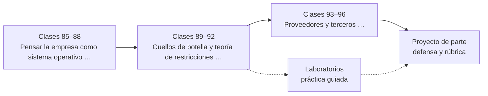

# Parte 07 — Operaciones, procesos y calidad

<!-- parte:inicio -->

> ← [Parte 06 — Proyectos, Agile y entrega](../06-projects-agile-delivery/README.md) · [Temario](../../SYLLABUS.md) · [Parte 08 — Sistemas de gestión, KPI y OKR](../08-management-systems-kpis-okrs/README.md) →

*Diseñar una operación repetible, medible y resistente a fallas*

**Etapa:** 2 — Liderazgo de equipos y ejecución  
**Duración:** 12 clases · 30 horas  
**Resultado de salida:** Diseñar una operación repetible, medible y resistente a fallas.

🔵 [Ver las 6 etapas](../../SYLLABUS.md) · 12 clases (085–096) · 4 laboratorios · [proyecto de parte](project.md)

## 🎯 De qué trata esta parte

Una empresa es un conjunto de procesos que entregan algo a alguien. Cuando dependen de héroes, fallan en cuanto el héroe falta. Esta parte enseña a verlos como sistema.

El eje es **flujo, capacidad y variabilidad**: dónde está el cuello de botella, qué se estandariza, qué nivel de servicio se promete y qué pasa cuando algo se interrumpe.

## 🧱 Con qué hay que llegar

| Parte | Qué aporta |
|---|---|
| [06 — Proyectos, Agile y entrega](../06-projects-agile-delivery/README.md) | Planificación, riesgos y entrega. |
| [01 — Pensamiento crítico y toma de decisiones](../01-critical-thinking-and-decisions/README.md) | Pensamiento sistémico y causa raíz. |

Cada clase supone la anterior: el orden importa, y saltarse una deja sin base a las que vienen después.

## 📚 Resultados de la parte

Al terminar esta parte podrás:

1. **Mapear** un proceso de extremo a extremo.
2. **Estandarizar** trabajo con SOP sin rigidizar.
3. **Hallar** cuellos de botella y reducir desperdicio.
4. **Definir** SLA y niveles de servicio realistas.
5. **Planificar** continuidad y gestión de proveedores.

## 🗺️ Mapa de la parte

## 🧭 Cómo se encadenan las 12 clases

Las clases **85 a 88** describen la operación: sistema, mapa, estándar y capacidad.

Las clases **89 a 92** la mejoran: restricciones, Lean, calidad y niveles de servicio.

Las clases **93 a 96** la protegen y la rediseñan: terceros, continuidad, automatización y el capstone de rediseño.

## 📘 Las 12 clases

| # | Clase | Qué se trabaja | Entregable | Min |
|---:|---|---|---|---:|
| 085 | [Pensar la empresa como sistema operativo](classes/085-pensar-la-empresa-como-sistema-operativo/README.md) | Sistema operativo de la empresa, Proceso, Procesos centrales, de apoyo y de gestión | [leadership-decision-brief](../../templates/leadership-decision-brief.md) | 150 |
| 086 | [Mapeo de procesos end-to-end](classes/086-mapeo-de-procesos-end-to-end/README.md) | Proceso de punta a punta, Traspaso (handoff), Tiempo activo | [process-map](../../templates/process-map.md) | 150 |
| 087 | [SOP y trabajo estandarizado](classes/087-sop-y-trabajo-estandarizado/README.md) | SOP, Trabajo estandarizado, Punto de control | [leadership-decision-brief](../../templates/leadership-decision-brief.md) | 150 |
| 088 | [Capacidad y demanda](classes/088-capacidad-y-demanda/README.md) | Capacidad nominal, Capacidad útil, Demanda | [operating-improvement-brief](../../templates/operating-improvement-brief.md) | 150 |
| 089 | [Cuellos de botella y teoría de restricciones](classes/089-cuellos-de-botella-y-teoria-de-restricciones/README.md) | Restricción, Cuello de botella, Rendimiento del sistema (throughput) | [risk-governance-brief](../../templates/risk-governance-brief.md) | 150 |
| 090 | [Lean y eliminación de desperdicio](classes/090-lean-y-eliminacion-de-desperdicio/README.md) | Valor, Desperdicio (muda), Mapa de flujo de valor | [leadership-decision-brief](../../templates/leadership-decision-brief.md) | 150 |
| 091 | [Calidad y variabilidad](classes/091-calidad-y-variabilidad/README.md) | Calidad, Variación, Causas comunes | [operating-improvement-brief](../../templates/operating-improvement-brief.md) | 150 |
| 092 | [SLA, SLO y niveles de servicio](classes/092-sla-slo-y-niveles-de-servicio/README.md) | SLI (indicador de nivel de servicio), SLO (objetivo de nivel de servicio), SLA (acuerdo de nivel de servicio) | [operating-improvement-brief](../../templates/operating-improvement-brief.md) | 150 |
| 093 | [Proveedores y terceros](classes/093-proveedores-y-terceros/README.md) | Hacer o comprar, Proveedor crítico, Costo de transacción | [leadership-decision-brief](../../templates/leadership-decision-brief.md) | 150 |
| 094 | [Continuidad operacional](classes/094-continuidad-operacional/README.md) | Continuidad del negocio, Análisis de impacto (BIA), Tiempo objetivo de recuperación (RTO) | [operating-improvement-brief](../../templates/operating-improvement-brief.md) | 150 |
| 095 | [Automatización de procesos](classes/095-automatizacion-de-procesos/README.md) | Automatización, Excepción, Supervisión humana | [operating-improvement-brief](../../templates/operating-improvement-brief.md) | 150 |
| 096 | [Capstone: rediseñar una operación](classes/096-capstone-redisenar-una-operacion/README.md) | Rediseño de operación, Línea base, Piloto | [operating-improvement-brief](../../templates/operating-improvement-brief.md) | 150 |

## ⚠️ Riesgos característicos

- Optimizar un tramo que no es el cuello de botella.
- Estandarizar un proceso que no se entiende.
- Prometer un nivel de servicio sin capacidad.
- Depender de un proveedor sin plan alternativo.

## 🔤 Glosario de la parte

70 conceptos definidos en las clases, con la definición operacional que usa cada una.

| Concepto | Definición operacional |
|---|---|
| **Activo específico** | Inversión que vale mucho en una relación y poco fuera de ella. |
| **Análisis de impacto (BIA)** | Estudio de los efectos de detener cada proceso a lo largo del tiempo. |
| **Auditoría en el puesto** | Observación del trabajo real contra el estándar. |
| **Automatización** | Uso de sistemas para ejecutar tareas con poca o ninguna intervención humana. |
| **Brecha** | Diferencia entre capacidad y demanda proyectada. |
| **Calidad** | Grado en que el resultado cumple lo que el cliente necesita y espera. |
| **Capacidad del proceso** | Relación entre la variación del proceso y la tolerancia exigida. |
| **Capacidad nominal** | Máximo teórico que produce el sistema en condiciones ideales. |
| **Capacidad útil** | Capacidad real tras paradas, defectos, ausencias y variabilidad. |
| **Causas comunes** | Fuentes de variación propias del sistema, siempre presentes. |
| **Causas especiales** | Fuentes de variación ajenas al funcionamiento normal. |
| **Concentración** | Dependencia de un solo proveedor, región o tecnología. |
| **Confianza calibrada** | Nivel de confianza en el sistema que corresponde a su fiabilidad real. |
| **Continuidad del negocio** | Capacidad de seguir entregando productos o servicios, a un nivel aceptable, tras una interrupción. |
| **Control documental** | Gestión de versiones, responsables y vigencia de los documentos. |
| **Costo de transacción** | Costo de buscar, negociar, vigilar y hacer cumplir un acuerdo. |
| **Costo total** | Costo de construir, operar, mantener y corregir la automatización. |
| **Cuello de botella** | Recurso cuya capacidad es menor o igual a la demanda que recibe. |
| **Demanda** | Trabajo que llega al sistema por unidad de tiempo. |
| **Desperdicio (muda)** | Actividad que consume recursos sin agregar valor para el cliente. |
| **Deuda operativa** | Atajos o parches que acumulan costo futuro. |
| **Dueño de proceso** | Persona responsable del resultado de punta a punta, no de una función. |
| **Ejercicio** | Simulación o prueba del plan. |
| **Excepción** | Caso que no sigue el flujo normal y requiere juicio. |
| **Exclusión** | Condición que no cuenta contra el nivel (mantenimiento acordado, fuerza mayor). |
| **Explotar** | Sacar el máximo de la restricción con lo que ya existe. |
| **Gráfico de control** | Gráfico en el tiempo con límites calculados desde el propio proceso. |
| **Hacer o comprar** | Decisión de producir internamente o adquirir a un tercero. |
| **Holgura** | Capacidad deliberada para absorber variación. |
| **Ironías de la automatización** | Efectos paradójicos: lo automatizado deja a las personas las tareas más difíciles con menos práctica. |
| **Línea base** | Medición del desempeño antes del cambio. |
| **Mapa de flujo de valor** | Representación del flujo de materiales o información con tiempos y esperas (Rother y Shook). |
| **Mejora continua (kaizen)** | Cambios pequeños y constantes hechos por quienes trabajan en el proceso. |
| **Optimización local** | Mejora de una medida de un área que no mejora —o empeora— el resultado del conjunto. |
| **Piloto** | Prueba acotada del cambio antes de generalizarlo. |
| **Plan de continuidad** | Instrucciones para operar y recuperar durante una interrupción. |
| **Plan de salida** | Preparación para terminar la relación o cambiar de proveedor. |
| **Presupuesto de error** | Diferencia entre 100 % y el SLO: falla tolerable en el período. |
| **Proceso** | Secuencia de actividades que transforma entradas en una salida de valor para un cliente interno o externo. |
| **Proceso de punta a punta** | Flujo completo que produce un resultado para un cliente interno o externo. |
| **Procesos centrales, de apoyo y de gestión** | Los centrales entregan valor al cliente; los de apoyo los sostienen; los de gestión los dirigen y corrigen. |
| **Proveedor crítico** | Tercero cuya falla detiene o degrada una operación esencial. |
| **Punto de control** | Momento en que se verifica algo antes de continuar. |
| **Punto objetivo de recuperación (RPO)** | Cantidad máxima de información que se tolera perder, medida en tiempo. |
| **Rediseño de operación** | Cambio planificado del flujo, las reglas y los recursos para mejorar el servicio al cliente. |
| **Rendimiento a la primera (first-pass yield)** | Proporción de unidades que salen bien sin retrabajo. |
| **Rendimiento del sistema (throughput)** | Ritmo al que el sistema genera valor, en general ventas, no producción. |
| **Restricción** | Elemento que limita el rendimiento del sistema. |
| **Restricción de política** | Regla o práctica que limita el sistema, no un recurso físico. |
| **Retroalimentación** | Información del resultado que vuelve para corregir entradas o proceso. |
| **Rutina de revisión** | Reunión periódica para revisar indicadores y decidir acciones. |
| **Sistema operativo de la empresa** | Conjunto de procesos, decisiones, información y roles que convierten demanda en entregas repetibles. |
| **SLA (acuerdo de nivel de servicio)** | Compromiso con el cliente, con consecuencias si no se cumple. |
| **SLI (indicador de nivel de servicio)** | Medida cuantitativa de un aspecto del servicio que importa al usuario. |
| **SLO (objetivo de nivel de servicio)** | Valor o rango que se busca lograr para un SLI en un período. |
| **SOP** | Documento breve que describe cómo ejecutar una tarea de forma repetible. |
| **Subordinar** | Ajustar el resto del sistema al ritmo de la restricción. |
| **Supervisión humana** | Persona que vigila, interviene y decide cuando el sistema falla o duda. |
| **Tiempo activo** | Tiempo en que alguien trabaja sobre el caso. |
| **Tiempo de espera** | Tiempo en que el caso no avanza. |
| **Tiempo objetivo de recuperación (RTO)** | Tiempo máximo tolerable para restablecer un proceso. |
| **Tiempo total (lead time)** | Duración entre el disparador y la entrega. |
| **Trabajo estandarizado** | Mejor secuencia conocida de tareas, con tiempos y puntos de control. |
| **Tracción (pull)** | Se produce lo que el siguiente paso o el cliente pide. |
| **Traspaso (handoff)** | Transferencia de trabajo entre personas, áreas o sistemas. |
| **Utilización** | Proporción de la capacidad usada: demanda dividida por capacidad. |
| **Valor** | Lo que el cliente reconocería y pagaría. |
| **Variación** | Diferencia entre resultados del mismo proceso. |
| **Variación entre ejecutores** | Diferencia de resultado según quién hace la tarea. |
| **Ventana de medición** | Período sobre el que se calcula el indicador. |

## 📦 Qué queda como evidencia

- Un mapa de proceso con cuellos de botella.
- Un SOP y un acuerdo de nivel de servicio.
- Un plan de continuidad operacional.
- El capstone: rediseño de una operación.

## 🔗 Cómo se conecta

La parte 08 mide estos procesos; la 15 gobierna su riesgo y continuidad; la 22 los convierte en sistemas que funcionan sin el fundador.

## 🧪 Cómo se trabaja

Son **12 clases de 150 minutos** —30 horas— con **4 laboratorios** y un proyecto integrador. Cada clase trae su propósito, sus conceptos, un caso, práctica, errores frecuentes, preguntas de comprobación, entregable y fuentes, y se evalúa con su `assessment.md`. Los laboratorios se resuelven con datos propios o sintéticos, nunca con datos reales de terceros, y la parte se cierra con el proyecto y su defensa. Las reglas de recorrido están en [la guía de navegación](../../docs/NAVIGATION.md).

<!-- parte:fin -->

## Laboratorios

- [Lab 01 — Process map](labs/lab-01.md)
- [Lab 02 — Bottleneck hunt](labs/lab-02.md)
- [Lab 03 — SLA design](labs/lab-03.md)
- [Lab 04 — Continuity tabletop](labs/lab-04.md)

## Proyecto de parte

Rediseñar una operación con atrasos, retrabajo y dependencia de una persona clave.

## Bibliografía rectora

- Nigel Slack & Alistair Brandon-Jones — *Operations Management* (Operaciones)
- Eliyahu M. Goldratt & Jeff Cox — *The Goal* (Restricciones)
- James P. Womack & Daniel T. Jones — *Lean Thinking* (Lean)
- W. Edwards Deming — *Out of the Crisis* (Calidad)
- Geary A. Rummler & Alan P. Brache — *Improving Performance* (Procesos)

## Criterio de aprobación

80/100 y entrega del proyecto integrador.
