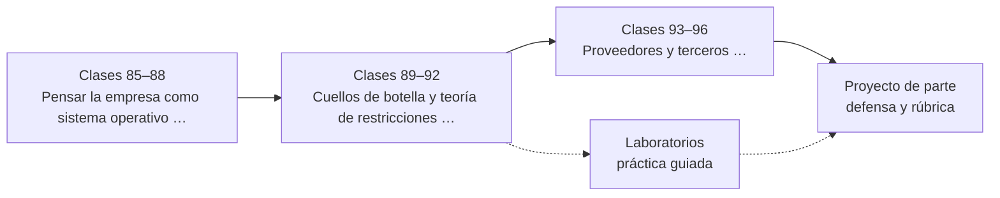

# Parte 07 — Operaciones, procesos y calidad

<!-- parte:inicio -->

> ← [Parte 06 — Proyectos, Agile y entrega](../06-projects-agile-delivery/README.md) · [Temario](../../SYLLABUS.md) · [Parte 08 — Sistemas de gestión, KPI y OKR](../08-management-systems-kpis-okrs/README.md) →

*Diseñar una operación repetible, medible y resistente a fallas*

**Etapa:** 2 — Liderazgo de equipos y ejecución  
**Duración:** 12 clases · 30 horas  
**Resultado de salida:** Diseñar una operación repetible, medible y resistente a fallas.

🔵 [Ver las 6 etapas](../../SYLLABUS.md) · 12 clases (085–096) · 4 laboratorios · [proyecto de parte](project.md)

## 🎯 De qué trata esta parte

Una empresa es un conjunto de procesos que entregan algo a alguien. Cuando dependen de héroes, fallan en cuanto el héroe falta. Esta parte enseña a verlos como sistema.

El eje es **flujo, capacidad y variabilidad**: dónde está el cuello de botella, qué se estandariza, qué nivel de servicio se promete y qué pasa cuando algo se interrumpe.

## 🧱 Con qué hay que llegar

| Parte | Qué aporta |
|---|---|
| [06 — Proyectos, Agile y entrega](../06-projects-agile-delivery/README.md) | Planificación, riesgos y entrega. |
| [01 — Pensamiento crítico y toma de decisiones](../01-critical-thinking-and-decisions/README.md) | Pensamiento sistémico y causa raíz. |

Cada clase supone la anterior: el orden importa, y saltarse una deja sin base a las que vienen después.

## 📚 Resultados de la parte

Al terminar esta parte podrás:

1. **Mapear** un proceso de extremo a extremo.
2. **Estandarizar** trabajo con SOP sin rigidizar.
3. **Hallar** cuellos de botella y reducir desperdicio.
4. **Definir** SLA y niveles de servicio realistas.
5. **Planificar** continuidad y gestión de proveedores.

## 🗺️ Mapa de la parte

## 🧭 Cómo se encadenan las 12 clases

Las clases **85 a 88** describen la operación: sistema, mapa, estándar y capacidad.

Las clases **89 a 92** la mejoran: restricciones, Lean, calidad y niveles de servicio.

Las clases **93 a 96** la protegen y la rediseñan: terceros, continuidad, automatización y el capstone de rediseño.

## 📘 Las 12 clases

| # | Clase | Qué se trabaja | Entregable | Min |
|---:|---|---|---|---:|
| 085 | [Pensar la empresa como sistema operativo](classes/085-pensar-la-empresa-como-sistema-operativo/README.md) | operating system, flow, capacity | [leadership-decision-brief](../../templates/leadership-decision-brief.md) | 150 |
| 086 | [Mapeo de procesos end-to-end](classes/086-mapeo-de-procesos-end-to-end/README.md) | end-to-end process, handoff, touch time | [operating-improvement-brief](../../templates/operating-improvement-brief.md) | 150 |
| 087 | [SOP y trabajo estandarizado](classes/087-sop-y-trabajo-estandarizado/README.md) | SOP, standard work, control point | [leadership-decision-brief](../../templates/leadership-decision-brief.md) | 150 |
| 088 | [Capacidad y demanda](classes/088-capacidad-y-demanda/README.md) | demand rate, capacity rate, utilization | [operating-improvement-brief](../../templates/operating-improvement-brief.md) | 150 |
| 089 | [Cuellos de botella y teoría de restricciones](classes/089-cuellos-de-botella-y-teoria-de-restricciones/README.md) | constraint, bottleneck, throughput | [risk-governance-brief](../../templates/risk-governance-brief.md) | 150 |
| 090 | [Lean y eliminación de desperdicio](classes/090-lean-y-eliminacion-de-desperdicio/README.md) | valor, waste, flow | [leadership-decision-brief](../../templates/leadership-decision-brief.md) | 150 |
| 091 | [Calidad y variabilidad](classes/091-calidad-y-variabilidad/README.md) | quality, variation, common cause | [operating-improvement-brief](../../templates/operating-improvement-brief.md) | 150 |
| 092 | [SLA, SLO y niveles de servicio](classes/092-sla-slo-y-niveles-de-servicio/README.md) | SLI, SLO, SLA | [operating-improvement-brief](../../templates/operating-improvement-brief.md) | 150 |
| 093 | [Proveedores y terceros](classes/093-proveedores-y-terceros/README.md) | third-party risk, criticality, concentration risk | [leadership-decision-brief](../../templates/leadership-decision-brief.md) | 150 |
| 094 | [Continuidad operacional](classes/094-continuidad-operacional/README.md) | BIA, RTO, RPO | [operating-improvement-brief](../../templates/operating-improvement-brief.md) | 150 |
| 095 | [Automatización de procesos](classes/095-automatizacion-de-procesos/README.md) | automation, straight-through processing, exception | [operating-improvement-brief](../../templates/operating-improvement-brief.md) | 150 |
| 096 | [Capstone: rediseñar una operación](classes/096-capstone-redisenar-una-operacion/README.md) | target operating model, baseline, future state | [operating-improvement-brief](../../templates/operating-improvement-brief.md) | 150 |

## ⚠️ Riesgos característicos

- Optimizar un tramo que no es el cuello de botella.
- Estandarizar un proceso que no se entiende.
- Prometer un nivel de servicio sin capacidad.
- Depender de un proveedor sin plan alternativo.

## 🔤 Glosario de la parte

57 conceptos definidos en las clases, con la definición operacional que usa cada una.

| Concepto | Definición operacional |
|---|---|
| **automation** | ejecución de tareas por sistema con menor intervención humana. |
| **availability** | proporción de tiempo o solicitudes en que el servicio está utilizable. |
| **baseline** | medición del sistema antes de intervenir. |
| **BCP** | plan de continuidad de negocio. |
| **benefit case** | valor esperado versus costo y riesgo. |
| **BIA** | análisis de impacto que prioriza procesos y tiempos críticos. |
| **bottleneck** | etapa cuya capacidad efectiva restringe el flujo. |
| **buffer** | reserva de capacidad, inventario o tiempo para absorber variabilidad. |
| **capacity** | ritmo sostenible de producción. |
| **capacity rate** | ritmo máximo sostenible de procesamiento. |
| **common cause** | variación inherente al sistema actual. |
| **concentration risk** | dependencia excesiva de un proveedor, región o tecnología. |
| **constraint** | recurso o política que limita throughput global. |
| **control** | verificación diseñada para prevenir o detectar error. |
| **control loop** | mecanismo que compara resultado con estándar y corrige. |
| **control point** | paso donde se verifica condición crítica. |
| **criticality** | impacto si el tercero falla. |
| **demand rate** | ritmo de llegada de trabajo. |
| **DR** | recuperación de tecnología e infraestructura después de incidente. |
| **end-to-end process** | flujo completo que produce un outcome para un cliente interno o externo. |
| **error budget** | margen de incumplimiento tolerado respecto del SLO. |
| **exception** | caso que sale de reglas y requiere ruta distinta. |
| **exception path** | ruta para casos fuera del estándar. |
| **exit plan** | capacidad práctica de terminar o migrar la relación. |
| **first-pass yield** | porcentaje que cumple sin rework. |
| **flow** | movimiento de trabajo o valor a través del sistema. |
| **future state** | flujo objetivo con hipótesis de mejora. |
| **handoff** | transferencia entre roles o sistemas. |
| **human-in-the-loop** | intervención humana intencional en decisiones o excepciones. |
| **kaizen** | mejora continua mediante cambios pequeños basados en observación. |
| **operating rhythm** | cadencia de coordinación y revisión. |
| **operating system** | conjunto de procesos, cadencias, roles y controles que ejecutan la estrategia. |
| **pull** | producción disparada por demanda real. |
| **quality** | grado de conformidad con requisitos y aptitud para uso. |
| **queue** | trabajo esperando servicio. |
| **rework** | trabajo repetido por error, cambio o criterio incumplido. |
| **RPO** | pérdida máxima de datos tolerada medida en tiempo. |
| **RTO** | tiempo objetivo para restaurar una capacidad. |
| **SLA** | acuerdo externo que especifica nivel y consecuencia. |
| **SLI** | indicador medido de un aspecto del servicio. |
| **SLO** | objetivo de confiabilidad o desempeño para un SLI. |
| **SOP** | procedimiento operativo estándar para trabajo repetible. |
| **special cause** | evento identificable fuera del patrón estable. |
| **standard work** | secuencia acordada que representa la mejor práctica actual. |
| **straight-through processing** | flujo automatizado de extremo a extremo para casos estándar. |
| **subordination** | alinear otras etapas para no sobrecargar ni dejar ociosa la restricción. |
| **target operating model** | diseño futuro de procesos, roles, tecnología y controles. |
| **third-party risk** | riesgo introducido por dependencia de un proveedor o socio. |
| **throughput** | ritmo al que el sistema genera unidades de valor. |
| **touch time** | tiempo de trabajo activo. |
| **transition plan** | secuencia para migrar sin interrumpir servicio. |
| **utilization** | porcentaje de capacidad ocupado. |
| **valor** | resultado por el que el cliente reconoce utilidad. |
| **variation** | diferencia natural o especial entre resultados del proceso. |
| **version control** | gestión de cambios y vigencia documental. |
| **wait time** | tiempo sin procesamiento. |
| **waste** | actividad que consume recursos sin crear valor necesario. |

## 📦 Qué queda como evidencia

- Un mapa de proceso con cuellos de botella.
- Un SOP y un acuerdo de nivel de servicio.
- Un plan de continuidad operacional.
- El capstone: rediseño de una operación.

## 🔗 Cómo se conecta

La parte 08 mide estos procesos; la 15 gobierna su riesgo y continuidad; la 22 los convierte en sistemas que funcionan sin el fundador.

## 🧪 Cómo se trabaja

Son **12 clases de 150 minutos** —30 horas— con **4 laboratorios** y un proyecto integrador. Cada clase trae su propósito, sus conceptos, un caso, práctica, errores frecuentes, preguntas de comprobación, entregable y fuentes, y se evalúa con su `assessment.md`. Los laboratorios se resuelven con datos propios o sintéticos, nunca con datos reales de terceros, y la parte se cierra con el proyecto y su defensa. Las reglas de recorrido están en [la guía de navegación](../../docs/NAVIGATION.md).

<!-- parte:fin -->

## Laboratorios

- [Lab 01 — Process map](labs/lab-01.md)
- [Lab 02 — Bottleneck hunt](labs/lab-02.md)
- [Lab 03 — SLA design](labs/lab-03.md)
- [Lab 04 — Continuity tabletop](labs/lab-04.md)

## Proyecto de parte

Rediseñar una operación con atrasos, retrabajo y dependencia de una persona clave.

## Bibliografía rectora

- Nigel Slack & Alistair Brandon-Jones — *Operations Management* (Operaciones)
- Eliyahu M. Goldratt & Jeff Cox — *The Goal* (Restricciones)
- James P. Womack & Daniel T. Jones — *Lean Thinking* (Lean)
- W. Edwards Deming — *Out of the Crisis* (Calidad)
- Geary A. Rummler & Alan P. Brache — *Improving Performance* (Procesos)

## Criterio de aprobación

80/100 y entrega del proyecto integrador.
