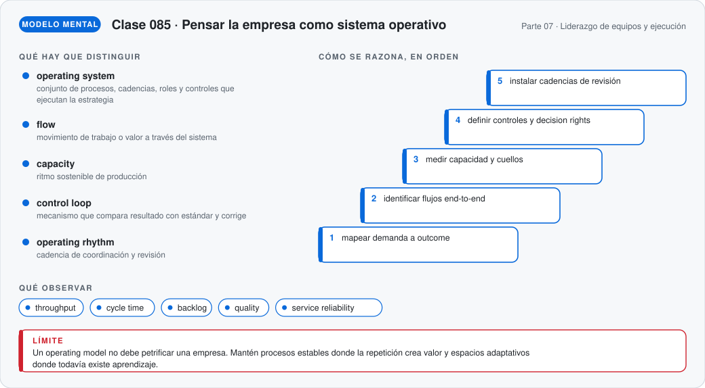

# Clase 085 — Pensar la empresa como sistema operativo

<!-- nav:inicio -->
> **Parte 07 · Operaciones, procesos y calidad** — clase 1 de 12 · [índice de la parte](../../README.md) · [temario](../../../../SYLLABUS.md)
<!-- nav:fin -->

**Parte:** 07 — Operaciones, procesos y calidad  
**Nivel:** Etapa 2 — Jefe → Manager  
**Duración sugerida:** 150–180 minutos · **Estándar:** deep-class-v2

## 🎯 Propósito

Una estrategia sin operación es una aspiración: lo que la empresa promete depende de que demanda, capacidad, procesos, información y personas se coordinen para entregar lo mismo, a tiempo y con la calidad prometida, una y otra vez. Pensar la empresa como **sistema operativo** significa dejar de ver áreas aisladas (ventas, producción, soporte, finanzas) y mirar cómo el trabajo fluye de la necesidad del cliente hasta su resolución, dónde se decide, dónde espera y dónde se pierde.

La clase se apoya en la dirección de operaciones (Slack y Brandon-Jones), en la visión de flujo de valor de Womack y Jones y en la crítica de Hammer y Champy a organizar el trabajo por funciones. Al terminar sabrás describir una empresa como un sistema de entradas, transformación, salidas y retroalimentación, ubicar sus puntos de decisión y reconocer por qué mejorar un área aislada puede empeorar el conjunto.

## 📚 Resultados de aprendizaje

Al finalizar podrás:

1. **Describir** un negocio como sistema: entradas, transformación, salidas, cliente y retroalimentación.
2. **Distinguir** procesos centrales, de apoyo y de gestión, y su dueño.
3. **Detectar** una optimización local que perjudica el resultado global.
4. **Identificar** dónde se decide, dónde se espera y dónde se corrige el trabajo.
5. **Formular** una pregunta de diagnóstico operativo antes de proponer una solución.

## 🧭 Agenda

| Tramo | Qué se hace |
|---|---|
| 0–20 min | Recuperación: sigue un pedido, una solicitud o un caso real desde que llega hasta que se cierra y anota cuántas áreas toca. |
| 20–60 min | Sistema, procesos, flujo y retroalimentación. |
| 60–105 min | Ejemplo trabajado: una empresa de servicios con cuatro áreas que mejoran por separado. |
| 105–150 min | Caso ejecutivo y rediseño de un flujo. |
| 150–175 min | Límites y entregable. |

## 🧩 Conceptos centrales

| Concepto | Definición | Cómo se reconoce |
|---|---|---|
| **Sistema operativo de la empresa** | Conjunto de procesos, decisiones, información y roles que convierten demanda en entregas repetibles. | Se puede dibujar el camino de un cliente y quién decide en cada paso. |
| **Proceso** | Secuencia de actividades que transforma entradas en una salida de valor para un cliente interno o externo. | Tiene inicio, fin, dueño y medida. |
| **Procesos centrales, de apoyo y de gestión** | Los centrales entregan valor al cliente; los de apoyo los sostienen; los de gestión los dirigen y corrigen. | La clasificación decide dónde se prioriza la mejora. |
| **Optimización local** | Mejora de una medida de un área que no mejora —o empeora— el resultado del conjunto. | Un área cumple su meta mientras el cliente espera más. |
| **Retroalimentación** | Información del resultado que vuelve para corregir entradas o proceso. | Existe un canal por el que el error llega a quien puede corregirlo. |
| **Dueño de proceso** | Persona responsable del resultado de punta a punta, no de una función. | Alguien responde por el tiempo total y la calidad final. |

## 🧠 Modelo mental

**Cómo leer el diagrama.** Cinco elementos encadenados. Las **entradas** (recursos, información, demanda) ingresan a la **transformación**, donde los procesos las convierten en **salidas**; el **cliente** juzga si eso fue valor, y su respuesta vuelve como **retroalimentación** para corregir entradas y proceso. La flecha de retorno es lo que distingue un sistema que aprende de una cadena de áreas que solo se pasan trabajo.

## 📖 Desarrollo

### 1. La empresa como sistema

Slack y Brandon-Jones describen toda operación como un modelo de **entradas, transformación y salidas**: se transforman recursos (materiales, información, personas, instalaciones) en bienes o servicios. La utilidad del modelo no es su sofisticación, sino que obliga a preguntar qué entra, qué se transforma, qué sale y quién lo recibe. En servicios, el propio cliente suele ser parte de la entrada: su información, su tiempo y su paciencia son recursos que el proceso consume.

### 2. Procesos centrales, de apoyo y de gestión

Una empresa tiene pocos procesos que entregan valor directamente (captar un pedido, producir o prestar el servicio, cobrar, atender el postventa), varios que los sostienen (compras, personas, tecnología, finanzas) y otros que dirigen y corrigen (planificación, control, mejora). La distinción ayuda a decidir dónde invertir atención: mejorar un proceso de apoyo que no toca al cliente rara vez mueve el resultado, mientras que un proceso central lento afecta todo lo demás. También ayuda a asignar **dueño**: sin alguien responsable del proceso completo, cada área protege su parte.

### 3. El valor lo define el cliente

Womack y Jones proponen partir de una pregunta incómoda: ¿qué valor reconocería el cliente? Todo lo demás, desde su punto de vista, es costo. Esta pregunta reorganiza el análisis: en lugar de preguntar qué hace cada área, se pregunta qué pasos agregan algo que el cliente notaría y cuáles son espera, revisión o traspaso. Sirve para orientar la mejora hacia el flujo completo, no hacia la actividad de cada función.

### 4. Optimización local y resultado global

Hammer y Champy sostuvieron que muchas organizaciones fragmentan procesos que atraviesan varias funciones, con traspasos, controles duplicados y medidas contradictorias. Un ejemplo habitual: ventas cierra rápido con promesas que operaciones no puede cumplir; operaciones minimiza su costo por lote y retrasa pedidos urgentes; finanzas exige aprobaciones que alargan el tiempo total. Cada área cumple su meta y el cliente espera más. La lección no es eliminar las áreas, sino **medir el proceso de punta a punta** y alinear las metas con ese resultado.

### 5. Retroalimentación y puntos de decisión

Un sistema que no recibe información de su resultado repite sus errores. Conviene mapear tres cosas: **dónde se decide** (quién autoriza, prioriza o excepciona), **dónde se espera** (colas, aprobaciones, información que falta) y **dónde se corrige** (qué señal llega a quién y cuánto tarda). Muchas empresas descubren que la decisión que más retrasa el proceso es una aprobación que casi siempre se concede, o que el error se detecta tres pasos después de producirse, cuando corregirlo cuesta diez veces más.

### 6. Variabilidad, demanda y capacidad como condiciones del sistema

Un sistema operativo debe funcionar con demanda que sube y baja, personas que se ausentan y pedidos que no son estándar. La dirección de operaciones trata la **variabilidad** como una condición permanente: se diseñan colchones, reglas de prioridad y mecanismos de ajuste. Ignorarla produce planes que funcionan solo en el día promedio, que casi nunca ocurre. Las clases siguientes desarrollan capacidad, restricciones, calidad y continuidad; esta ofrece el marco para ubicarlas.

### 7. Diagnóstico antes de solución

Ante un problema operativo, el reflejo es proponer una herramienta o una reorganización. El diagnóstico sistémico exige antes tres preguntas: ¿qué ve el cliente?, ¿qué dicen los datos de tiempo, defectos y espera?, ¿qué medida local está incentivando el comportamiento? Con esas respuestas se decide si la causa está en la demanda, en el diseño del proceso, en la capacidad, en la información o en los incentivos. Mejorar sin diagnosticar suele trasladar el problema a otra área.

## 📚 Lectura comparada

| Obra | Qué aporta | Qué no resuelve | Pregunta para contrastar |
|---|---|---|---|
| Slack y Brandon-Jones | Modelo de entradas, transformación y salidas y su aplicación a la dirección de operaciones. | Es general; requiere adaptarse a cada sector. | ¿Qué entra y qué sale en tu operación? |
| Womack y Jones | Valor definido por el cliente y flujo de valor. | Su origen es manufacturero; en servicios exige traducción. | ¿Qué pasos reconocería el cliente? |
| Hammer y Champy | Crítica a la fragmentación funcional y rediseño de procesos. | La reingeniería radical tiene costos humanos altos. | ¿Qué traspasos añaden tiempo sin valor? |
| Goldratt y Cox | Mirar el sistema por su restricción. | Se verá en la clase 089. | ¿Qué parte limita el resultado total? |
| Deming | El sistema explica la mayor parte de la variación del resultado. | No entrega un método único. | ¿Qué parte del problema es del sistema y no de las personas? |

## 🧮 Ejemplo trabajado

**Situación (hipotética).** Una empresa de instalación de equipos tiene cuatro áreas con metas propias. Ventas se mide por contratos cerrados; programación, por ocupación de técnicos; instalación, por visitas por día; cobranza, por días de pago. Los clientes reclaman que la instalación tarda 41 días desde la firma, cuando se prometieron 20.

| Paso | Qué se observa |
|---|---|
| **Seguir un caso** | Se sigue un pedido: 2 días en ventas, 12 esperando programación, 3 de instalación activa, 9 esperando documentos para cobranza, 15 en espera de una segunda visita. |
| **Medir el proceso** | De 41 días, solo 5 agregan valor visible al cliente: 12 % del tiempo. |
| **Descubrir incentivos** | Programación agrupa pedidos por zona para maximizar ocupación, lo que retrasa a los de otras zonas; ventas promete 20 días sin consultar. |
| **Diagnóstico** | Cada área cumple su meta; el problema vive en los traspasos y en la meta de ocupación. |
| **Rediseño inicial** | Un dueño de proceso con una medida común (días de firma a instalación terminada); ventas consulta disponibilidad real antes de prometer; programación prioriza por antigüedad con límite de agrupación. |

**Revalidación.** Tras un mes de prueba piloto en una zona, el tiempo baja de 41 a 29 días y la ocupación cae 6 puntos. La dirección decide si ese costo de ocupación compensa el beneficio al cliente; no se asume que sea así.

**Qué muestra.** (1) Cada área optimizaba su medida y el cliente pagaba el costo. (2) Seguir un caso reveló más que preguntar a las áreas. (3) La mejora tuvo un costo local que debe decidirse con datos.

## 🔀 Comparación y límites

**Sistema frente a organigrama.** El organigrama muestra quién manda; el sistema muestra cómo fluye el trabajo. Ambos importan, pero los problemas operativos suelen vivir en las líneas que el organigrama no dibuja.

**Límites.** El modelo de entradas y salidas simplifica: deja fuera poder, cultura, incentivos y emociones, que afectan el funcionamiento real. El pensamiento en procesos puede volverse burocrático si se mapea sin decidir. La reingeniería radical descrita por Hammer y Champy tuvo resultados desiguales y costos humanos grandes; la mejora gradual suele ser más sostenible. Y los datos del ejemplo son ilustrativos: cada empresa debe medir los suyos.

## 🪜 De profesional a owner

| Nivel | Cómo piensa el sistema |
|---|---|
| **Profesional** | Entiende a quién entrega su trabajo y qué necesita esa persona. |
| **Jefe / Team Lead** | Mide el flujo de su equipo y los traspasos que lo afectan. |
| **Gerente** | Alinea metas entre áreas con una medida de proceso. |
| **CEO / Director** | Decide la estructura y los incentivos según el flujo de valor. |
| **Founder / Owner** | Diseña desde el inicio un sistema que pueda crecer sin depender de su presencia. |

## 🏢 Caso ejecutivo

Una distribuidora de insumos médicos recibe pedidos por tres canales. Los clientes se quejan de plazos inconsistentes: unos reciben en dos días y otros en doce. Comercial exige que no se rechace ningún pedido; logística minimiza el costo por ruta; compras negocia por volumen y mantiene stock alto de algunos productos y quiebres en otros; finanzas bloquea despachos a clientes con facturas vencidas, sin avisar a ventas. La dirección quiere «mejorar la operación» y pide soluciones a cada gerente.

Entrega un **diagnóstico sistémico** con: (a) el mapa de punta a punta de un pedido; (b) las medidas locales de cada área y cómo se contradicen; (c) los puntos de decisión, espera y corrección; (d) una medida común de proceso; (e) un rediseño con su costo local y la forma de decidir si compensa; (f) las preguntas que harías antes de proponer una herramienta.

## 🧪 Práctica

1. Sigue un caso real de tu empresa de inicio a fin y anota los traspasos y las esperas.
2. Clasifica cinco procesos en centrales, de apoyo y de gestión.
3. Identifica una meta local que perjudica el resultado del conjunto.
4. Define una medida de proceso de punta a punta y su dueño.
5. Redacta tres preguntas de diagnóstico para un problema operativo que conozcas.

## ⚠️ Errores frecuentes

| Error | Por qué ocurre | Cómo corregirlo |
|---|---|---|
| Mejorar áreas por separado | Cada una responde por su meta | Medir de punta a punta con dueño de proceso. |
| Preguntar a las áreas, no seguir el caso | Es más cómodo | Seguir un caso real. |
| Proponer herramientas antes de diagnosticar | Presión por actuar | Responder primero tres preguntas de diagnóstico. |
| Culpar a las personas | Se ve el error, no el sistema | Preguntar qué en el sistema lo hizo probable. |
| Rediseñar de golpe | Se busca un cambio rápido | Pilotos acotados con medición. |
| Ignorar la variabilidad | Se planifica con el promedio | Diseñar colchones y reglas de prioridad. |

## ❓ Preguntas de comprobación

1. ¿Qué elementos componen el modelo de sistema operativo de la empresa?
2. ¿Qué diferencia hay entre procesos centrales, de apoyo y de gestión?
3. ¿Qué es una optimización local? Da un ejemplo.
4. ¿Por qué se sigue un caso real en lugar de preguntar a cada área?
5. ¿Qué tres cosas conviene mapear: decisión, espera y corrección?
6. ¿Qué papel cumple el dueño de proceso?
7. ¿Qué límite tiene el modelo de entradas y salidas?

Claves de respuesta

1. Entradas, transformación, salidas, cliente y retroalimentación.
2. Los centrales entregan valor al cliente, los de apoyo los sostienen y los de gestión los dirigen y corrigen.
3. Mejorar una medida de un área que no mejora el conjunto; por ejemplo, maximizar la ocupación de técnicos y retrasar pedidos de otras zonas.
4. Porque el caso muestra traspasos y esperas que las áreas no ven o no declaran.
5. Dónde se decide, dónde se espera y dónde se corrige el trabajo.
6. Responde por el resultado de punta a punta, con una medida común.
7. Simplifica: deja fuera poder, cultura, incentivos y emociones, que afectan el funcionamiento real.

## 📥 Entregable

Guarda en `portfolio/085-pensar-la-empresa-como-sistema-operativo/`:

- `leadership-decision-brief.md` (plantilla [Leadership Decision Brief](../../../../templates/leadership-decision-brief.md)) con el diagnóstico sistémico del caso ejecutivo;
- `process-map.md` (plantilla [Process map](../../../../templates/process-map.md)) con el mapa de punta a punta;
- `decision-journal.md` con la medida común elegida y el criterio para decidir si compensa su costo local.

## 📗 Fuentes y verificación

- Nigel Slack & Alistair Brandon-Jones — *Operations Management* (Pearson Education, Limited, 2019). **Uso en esta clase:** modelo de entradas, transformación y salidas y dirección de operaciones. Lectura selectiva sobre **pensar la empresa como sistema operativo**. **Localizador:** [ISBN-13 9781292254036](https://openlibrary.org/isbn/9781292254036).
- James P. Womack & Daniel T. Jones — *Lean Thinking* (Free Press, 2003). **Uso en esta clase:** valor definido por el cliente y flujo de valor. Lectura selectiva sobre **pensar la empresa como sistema operativo**. **Localizador:** [ISBN-13 9780743231640](https://openlibrary.org/isbn/9780743231640).
- Michael Hammer & James Champy — *Reengineering the Corporation* (HarperBusiness, 2001). **Uso en esta clase:** crítica a la fragmentación funcional y rediseño de procesos. Lectura selectiva sobre **pensar la empresa como sistema operativo**. **Localizador:** [ISBN-13 9780066621128](https://openlibrary.org/isbn/9780066621128).
- Eliyahu M. Goldratt & Jeff Cox — *The Goal* (HighBridge Audio, 2014). **Uso en esta clase:** mirar el sistema por su restricción. Lectura selectiva sobre **pensar la empresa como sistema operativo**. **Localizador:** [ISBN-13 9781622313945](https://openlibrary.org/isbn/9781622313945).
- W. Edwards Deming — *Out of the Crisis* (The MIT Press, 2000). **Uso en esta clase:** el sistema explica la mayor parte de la variación. Lectura selectiva sobre **pensar la empresa como sistema operativo**. **Localizador:** [ISBN-13 9780262541152](https://openlibrary.org/isbn/9780262541152).

> **Regla de fuentes para Pensar la empresa como sistema operativo:** las obras anteriores estructuran las perspectivas de esta materia; cualquier norma, ley o estándar vivo mencionado debe comprobarse nuevamente en su fuente primaria vigente. Los ejemplos y casos son hipotéticos, con cifras ilustrativas. El desarrollo es original y no reproduce capítulos protegidos.

<!-- pie:inicio -->
---

| Anterior | Índice | Siguiente |
|---|---|---|
| [← 084 · Capstone: rescate de una iniciativa crítica](../../../06-projects-agile-delivery/classes/084-capstone-rescate-de-una-iniciativa-critica/README.md) | [Parte 07](../../README.md) · [Programa](../../../../SYLLABUS.md) | [086 · Mapeo de procesos end-to-end →](../086-mapeo-de-procesos-end-to-end/README.md) |
<!-- pie:fin -->
