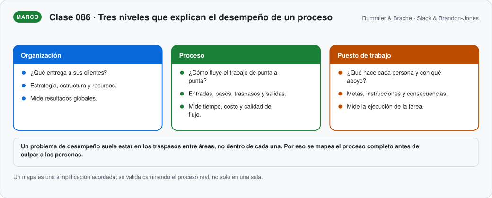

# Clase 086 — Mapeo de procesos end-to-end

<!-- nav:inicio -->
> **Parte 07 · Operaciones, procesos y calidad** — clase 2 de 12 · [índice de la parte](../../README.md) · [temario](../../../../SYLLABUS.md)
<!-- nav:fin -->

**Parte:** 07 — Operaciones, procesos y calidad  
**Nivel:** Etapa 2 — Jefe → Manager  
**Duración sugerida:** 150–180 minutos · **Estándar:** deep-class-v2

## 🎯 Propósito

Un mapa de proceso es útil solo si se parece a lo que realmente ocurre. Los mapas hechos en una sala, con la versión oficial de cómo «debería» fluir el trabajo, esconden justo lo que importa: los rodeos, las esperas, los traspasos informales y las excepciones. Mapear de punta a punta significa seguir un caso real desde el disparador hasta la entrega al cliente, con tiempos medidos, y distinguir el trabajo activo del tiempo de espera.

La clase usa los tres niveles de desempeño de Rummler y Brache, la distinción entre tiempo de trabajo y tiempo de espera de la dirección de operaciones y la técnica de mapeo de flujo de valor de Rother y Shook. Al terminar sabrás construir un mapa verificado en el lugar de trabajo, calcular qué proporción del tiempo agrega valor y señalar los traspasos que concentran la espera.

## 📚 Resultados de aprendizaje

Al finalizar podrás:

1. **Delimitar** un proceso con disparador, salida, cliente y dueño.
2. **Construir** un mapa con pasos, responsables, traspasos y tiempos.
3. **Distinguir** tiempo activo, tiempo de espera y tiempo total del proceso.
4. **Validar** el mapa observando el trabajo real y no solo la versión oficial.
5. **Priorizar** oportunidades de mejora a partir del mapa.

## 🧭 Agenda

| Tramo | Qué se hace |
|---|---|
| 0–20 min | Recuperación: ¿qué paso de tu proceso principal sabes que ocurre «de otra manera» a lo documentado? |
| 20–60 min | Niveles, delimitación, tiempos y traspasos. |
| 60–105 min | Ejemplo trabajado: mapa de una solicitud de crédito interno de 18 días. |
| 105–150 min | Caso ejecutivo y práctica de mapeo. |
| 150–175 min | Límites y entregable. |

## 🧩 Conceptos centrales

| Concepto | Definición | Cómo se reconoce |
|---|---|---|
| **Proceso de punta a punta** | Flujo completo que produce un resultado para un cliente interno o externo. | Va del disparador a la entrega, atravesando áreas. |
| **Traspaso (handoff)** | Transferencia de trabajo entre personas, áreas o sistemas. | Cada traspaso añade espera y riesgo de pérdida de información. |
| **Tiempo activo** | Tiempo en que alguien trabaja sobre el caso. | Se cuenta sin esperas. |
| **Tiempo de espera** | Tiempo en que el caso no avanza. | Cola, falta de información, aprobación pendiente. |
| **Tiempo total (lead time)** | Duración entre el disparador y la entrega. | Es lo que percibe el cliente. |
| **Mapa de flujo de valor** | Representación del flujo de materiales o información con tiempos y esperas (Rother y Shook). | Muestra dónde se acumula el trabajo. |

## 🧠 Modelo mental

**Cómo leer el diagrama.** Rummler y Brache distinguen tres niveles. Una **organización** entrega algo a sus clientes; un **proceso** es cómo fluye el trabajo de punta a punta; un **puesto** es lo que hace cada persona con sus metas y apoyos. Un mapa de proceso se ubica en el nivel central y conecta los otros dos: muestra cómo el diseño del flujo condiciona lo que cada persona puede lograr.

## 📖 Desarrollo

### 1. Delimitar antes de dibujar

Un mapa útil parte de cuatro definiciones: el **disparador** (qué hecho inicia el proceso), la **salida** (qué se entrega y a quién), el **cliente** (interno o externo) y el **dueño**. Sin ellos, el mapa crece sin límite o se corta donde le conviene al área que lo dibuja. También se acuerda qué variante se mapea: el caso típico, el caso con excepción y el caso urgente suelen seguir caminos distintos.

### 2. Seguir un caso real

La técnica más confiable es **seguir casos reales**: tomar tres a cinco solicitudes ya cerradas y reconstruir sus pasos con fechas y horas desde los registros, y después observar uno en curso. Los registros revelan los tiempos; la observación revela lo que no queda escrito: llamadas, mensajes por canales informales, hojas de cálculo paralelas. La versión oficial del proceso y la real casi nunca coinciden, y la diferencia es información, no un error de nadie.

### 3. Tiempo activo, espera y total

En muchos procesos administrativos el tiempo activo es una fracción pequeña del total, a menudo menos del 20 %. El resto es **espera**: el caso está en una cola, aguarda una aprobación o falta un dato. Medir ambos tiempos cambia el diagnóstico: acelerar a las personas mejora el tiempo activo, pero el cliente percibe el total, que casi siempre se reduce eliminando esperas y traspasos. La relación entre trabajo en curso, rendimiento y tiempo total (ley de Little, clase 080) explica por qué las colas alargan los plazos.

### 4. Traspasos y pérdida de información

Cada traspaso introduce tres riesgos: **espera** (la cola del siguiente), **pérdida** (información que no se transmite) y **ambigüedad** (nadie responde del resultado completo). Rummler y Brache sostienen que gran parte de los problemas de desempeño se esconde en los «espacios en blanco» entre cuadros del organigrama. Por eso el mapa debe mostrar quién entrega a quién y qué información viaja, no solo qué hace cada área.

### 5. Niveles de detalle

Se mapea en capas: primero un nivel alto (cinco a nueve pasos) para acordar el alcance; luego un nivel medio de la parte que concentra la espera; y solo si hace falta, un detalle de tareas para estandarizar (clase 087). Mapear todo al máximo detalle consume tiempo y esconde lo importante. Rother y Shook usan el mapa de flujo de valor para ver el conjunto antes de tocar una parte, y recomiendan dibujarlo a mano en el lugar de trabajo.

### 6. De mapa a oportunidades

Con el mapa se buscan señales: **colas largas**, **retrabajos** (flechas que vuelven), **aprobaciones que casi siempre se conceden**, **información que se pide dos veces**, **pasos que solo existen por un control antiguo**. Las oportunidades se priorizan por efecto en el tiempo total y en la calidad percibida, y por facilidad de cambio. No todo lo detectado se corrige: algunas esperas protegen contra riesgos reales y se conservan con conciencia de su costo.

### 7. Mantener el mapa vivo

Un mapa que nadie actualiza se vuelve ficción. Se asigna un dueño, se revisa cuando cambia el proceso o se detectan desvíos, y se usa como base para el entrenamiento y las auditorías. El mapa no es un entregable de una sola vez: es un instrumento de gestión que acompaña la mejora.

## 📚 Lectura comparada

| Obra | Qué aporta | Qué no resuelve | Pregunta para contrastar |
|---|---|---|---|
| Rummler y Brache | Tres niveles de desempeño y análisis de traspasos. | Es una guía general; su aplicación exige juicio. | ¿Dónde están los espacios en blanco de tu organigrama? |
| Rother y Shook | Mapeo de flujo de valor con tiempos y esperas. | Pensado para manufactura; en servicios se adapta. | ¿Qué fracción del tiempo es espera? |
| Slack y Brandon-Jones | Medidas de proceso y diseño de operaciones. | No da una técnica de mapeo única. | ¿Qué medida usarás de punta a punta? |
| Womack y Jones | Valor desde el cliente. | No indica cómo medir en cada sector. | ¿Qué pasos reconocería el cliente? |
| ISO 9001 | Enfoque de procesos en un sistema de gestión de calidad. | Es un requisito de sistema, no una técnica. | ¿Qué exige documentar y qué no? |

## 🧮 Ejemplo trabajado

**Situación (hipotética).** En una empresa de 300 personas, una solicitud de crédito interno para capital de trabajo de una unidad demora 18 días hábiles. Finanzas dice que «su parte tarda dos días».

| Paso | Quién | Tiempo activo | Espera previa |
|---|---|---|---|
| Solicitud con formulario | Unidad solicitante | 1 h | 0 |
| Revisión de completitud | Asistente de finanzas | 30 min | 3 días |
| Análisis financiero | Analista | 4 h | 4 días |
| Visto bueno del gerente de área | Gerente | 15 min | 5 días |
| Aprobación del comité | Comité | 45 min | 4 días |
| Desembolso | Tesorería | 20 min | 2 días |

**Cálculo.** Tiempo activo total: aproximadamente 7 horas y 20 minutos, es decir, menos de un día hábil; espera: 18 días. El 95 % del tiempo es espera. Además, en 4 de 5 casos revisados, el formulario volvió a la unidad una vez por datos faltantes.

**Oportunidades.** (1) El comité se reúne cada 14 días y aprueba el 98 % de las solicitudes: se propone un umbral por monto bajo el cual no se requiere. (2) Un formulario con campos obligatorios evita el retorno. (3) El visto bueno del gerente se hace en paralelo con el análisis.

**Qué muestra.** (1) «Mi parte tarda dos días» era cierto y no explicaba nada. (2) La espera, no el trabajo, dominaba el plazo. (3) Cada mejora debe revisarse en su riesgo: el umbral requiere acordar con control interno.

## 🔀 Comparación y límites

**Mapa de proceso frente a procedimiento.** El mapa muestra el flujo y sus esperas; el procedimiento detalla cómo hacer cada tarea (clase 087). Se necesita primero entender el flujo y luego estandarizar su mejor versión.

**Límites.** Un mapa fija el proceso en un momento y puede quedar obsoleto. Los tiempos de pocos casos pueden no representar la variación real; con pocos datos se declara la incertidumbre. En trabajo creativo o de alta variabilidad un único mapa no basta; se mapean familias de casos. Y los umbrales de aprobación o los controles pueden tener razones legales o de auditoría que deben conocerse antes de eliminarlos.

## 🪜 De profesional a owner

| Nivel | Cómo participa en el mapeo |
|---|---|
| **Profesional** | Describe cómo hace realmente su trabajo y qué le llega incompleto. |
| **Jefe / Team Lead** | Mapea el flujo de su equipo y sus traspasos. |
| **Gerente** | Convoca el mapeo entre áreas y prioriza mejoras. |
| **CEO / Director** | Pide mapas de los procesos centrales y decide dónde invertir. |
| **Founder / Owner** | Mapea su proceso clave antes de que el crecimiento lo vuelva ingobernable. |

## 🏢 Caso ejecutivo

Una empresa de telecomunicaciones tarda en promedio 27 días en dar de alta un servicio para clientes corporativos, frente a 12 que prometió su competidor. El proceso atraviesa ventas, factibilidad técnica, contratos, instalación y facturación. Cada área informa un buen tiempo propio, y la dirección piensa en contratar más gente. El gerente de operaciones propone mapear el proceso antes de decidir.

Entrega un **mapa verificado y un plan de mejora** que incluya: (a) delimitación con disparador, salida, cliente y dueño; (b) un mapa de nivel alto y uno de la parte con más espera; (c) tiempos activos, de espera y total con la fuente de cada dato; (d) los traspasos críticos y la información que se pierde; (e) tres oportunidades priorizadas con efecto esperado y riesgo; (f) cómo validarás el mapa en el lugar de trabajo y quién lo mantendrá.

## 🧪 Práctica

1. Elige un proceso y define su disparador, salida, cliente y dueño.
2. Reconstruye tres casos cerrados con fechas y calcula su tiempo total.
3. Separa tiempo activo y de espera, y calcula qué porcentaje es espera.
4. Marca los traspasos y anota qué información se pierde en cada uno.
5. Valida el mapa con quienes hacen el trabajo y corrige lo que difiera.

## ⚠️ Errores frecuentes

| Error | Por qué ocurre | Cómo corregirlo |
|---|---|---|
| Mapear la versión oficial | Se parte del manual | Seguir casos reales. |
| Medir solo tiempo activo | Es lo que cada área controla | Medir también la espera y el total. |
| Mapa sin dueño ni límites | Se quiere abarcar todo | Delimitar con disparador y salida. |
| Detalle excesivo | Se cree que más es mejor | Capas: alto nivel y luego detalle donde duele. |
| Eliminar controles sin entenderlos | Se ven como burocracia | Verificar su razón antes de quitarlos. |
| Mapa que envejece | Nadie lo actualiza | Dueño y revisión periódica. |

## ❓ Preguntas de comprobación

1. ¿Qué cuatro definiciones se acuerdan antes de dibujar un mapa?
2. ¿Por qué se siguen casos reales en vez de usar el procedimiento escrito?
3. ¿Qué diferencia hay entre tiempo activo, espera y tiempo total?
4. ¿Qué tres riesgos introduce cada traspaso?
5. ¿Qué niveles de detalle conviene usar y por qué?
6. ¿Qué señales de oportunidad se buscan en un mapa?
7. ¿Qué cuidado se tiene antes de eliminar un control?

Claves de respuesta

1. Disparador, salida, cliente y dueño.
2. Porque la versión oficial y la real casi nunca coinciden, y los casos revelan rodeos y esperas.
3. Activo es el tiempo en que alguien trabaja el caso; espera es el tiempo en que no avanza; total es lo que percibe el cliente.
4. Espera, pérdida de información y ambigüedad de responsabilidad.
5. Alto nivel para acordar alcance, medio donde hay espera y detalle solo para estandarizar, porque más detalle esconde lo importante.
6. Colas largas, retrabajos, aprobaciones casi siempre concedidas, información pedida dos veces y controles antiguos.
7. Verificar su razón legal, de auditoría o de riesgo antes de quitarlo.

## 📥 Entregable

Guarda en `portfolio/086-mapeo-de-procesos-end-to-end/`:

- `process-map.md` (plantilla [Process map](../../../../templates/process-map.md)) con el mapa del caso ejecutivo;
- `operating-improvement-brief.md` (plantilla [Operating Improvement Brief](../../../../templates/operating-improvement-brief.md)) con las tres oportunidades priorizadas;
- `decision-journal.md` con los casos usados, los tiempos y las validaciones en terreno.

## 📗 Fuentes y verificación

- Geary A. Rummler & Alan P. Brache — *Improving Performance* (Jossey-Bass, 1995). **Uso en esta clase:** tres niveles de desempeño y análisis de traspasos. Lectura selectiva sobre **mapeo de procesos end-to-end**. **Localizador:** [ISBN-13 9780787900908](https://openlibrary.org/isbn/9780787900908).
- Mike Rother & John Shook — *Learning to See* (Lean Enterprise Institute, 1999). **Uso en esta clase:** mapeo de flujo de valor con tiempos y esperas. Lectura selectiva sobre **mapeo de procesos end-to-end**. **Localizador:** [ISBN-13 9780966784305](https://openlibrary.org/isbn/9780966784305).
- Nigel Slack & Alistair Brandon-Jones — *Operations Management* (Pearson Education, Limited, 2019). **Uso en esta clase:** medidas de proceso y diseño de operaciones. Lectura selectiva sobre **mapeo de procesos end-to-end**. **Localizador:** [ISBN-13 9781292254036](https://openlibrary.org/isbn/9781292254036).
- James P. Womack & Daniel T. Jones — *Lean Thinking* (Free Press, 2003). **Uso en esta clase:** valor definido desde el cliente. Lectura selectiva sobre **mapeo de procesos end-to-end**. **Localizador:** [ISBN-13 9780743231640](https://openlibrary.org/isbn/9780743231640).
- ISO — *ISO 9001 Quality management systems*. **Uso en esta clase:** enfoque de procesos en un sistema de gestión de calidad. **Localizador pendiente:** ver [el registro de fuentes](../../../../docs/FUENTES.md).

> **Regla de fuentes para Mapeo de procesos end-to-end:** las obras anteriores estructuran las perspectivas de esta materia; cualquier norma, ley o estándar vivo mencionado debe comprobarse nuevamente en su fuente primaria vigente. Los ejemplos y casos son hipotéticos, con cifras ilustrativas. El desarrollo es original y no reproduce capítulos protegidos.

<!-- pie:inicio -->
---

| Anterior | Índice | Siguiente |
|---|---|---|
| [← 085 · Pensar la empresa como sistema operativo](../085-pensar-la-empresa-como-sistema-operativo/README.md) | [Parte 07](../../README.md) · [Programa](../../../../SYLLABUS.md) | [087 · SOP y trabajo estandarizado →](../087-sop-y-trabajo-estandarizado/README.md) |
<!-- pie:fin -->
