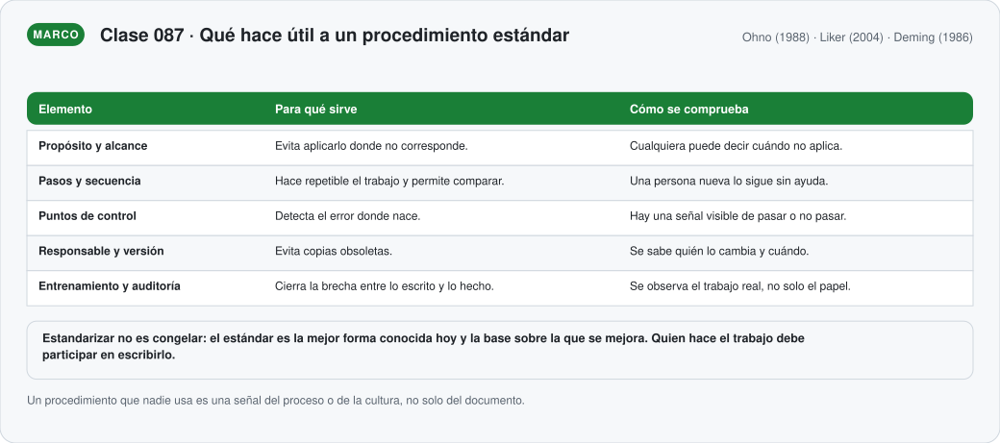

# Clase 087 — SOP y trabajo estandarizado

<!-- nav:inicio -->
> **Parte 07 · Operaciones, procesos y calidad** — clase 3 de 12 · [índice de la parte](../../README.md) · [temario](../../../../SYLLABUS.md)
<!-- nav:fin -->

**Parte:** 07 — Operaciones, procesos y calidad  
**Nivel:** Etapa 2 — Jefe → Manager  
**Duración sugerida:** 150–180 minutos · **Estándar:** deep-class-v2

## 🎯 Propósito

Estandarizar tiene mala fama porque se asocia con manuales gruesos que nadie lee. Bien entendido, un **procedimiento operativo estándar (SOP)** es la mejor forma conocida hoy de hacer una tarea, escrita por quienes la hacen, con puntos de control visibles y abierta a mejora. Sin estándar no hay forma de saber si un cambio mejoró algo, de entrenar a una persona nueva en poco tiempo ni de distinguir una falla del proceso de una falla de ejecución.

La clase integra la visión de Ohno y de Liker sobre el trabajo estandarizado como base de la mejora continua, la insistencia de Deming en que la calidad se construye en el sistema y la exigencia de documentar de los sistemas de gestión. Al terminar sabrás decidir qué conviene estandarizar, redactar un SOP breve y usable, entrenar con él y auditarlo observando el trabajo real.

## 📚 Resultados de aprendizaje

Al finalizar podrás:

1. **Decidir** qué tareas merecen estándar y cuáles no.
2. **Redactar** un procedimiento breve con propósito, pasos, puntos de control y responsable.
3. **Involucrar** a quienes hacen el trabajo en escribirlo y mejorarlo.
4. **Entrenar y auditar** observando el trabajo real, no solo el documento.
5. **Distinguir** estándar que ayuda de burocracia que estorba.

## 🧭 Agenda

| Tramo | Qué se hace |
|---|---|
| 0–20 min | Recuperación: describe una tarea que dos personas de tu equipo hacen de forma distinta y el efecto que tiene. |
| 20–60 min | Qué estandarizar, cómo escribirlo y cómo usarlo. |
| 60–105 min | Ejemplo trabajado: estandarizar el cierre de una cuenta de cliente. |
| 105–150 min | Caso ejecutivo y práctica de redacción. |
| 150–175 min | Límites y entregable. |

## 🧩 Conceptos centrales

| Concepto | Definición | Cómo se reconoce |
|---|---|---|
| **SOP** | Documento breve que describe cómo ejecutar una tarea de forma repetible. | Una persona entrenada puede seguirlo sin ayuda. |
| **Trabajo estandarizado** | Mejor secuencia conocida de tareas, con tiempos y puntos de control. | Es la base para comparar y mejorar. |
| **Punto de control** | Momento en que se verifica algo antes de continuar. | Hay una señal visible de pasar o no pasar. |
| **Variación entre ejecutores** | Diferencia de resultado según quién hace la tarea. | Dos personas producen resultados distintos con el mismo insumo. |
| **Control documental** | Gestión de versiones, responsables y vigencia de los documentos. | Se sabe cuál es la versión vigente y quién la aprobó. |
| **Auditoría en el puesto** | Observación del trabajo real contra el estándar. | Se compara lo escrito con lo hecho. |

## 🧠 Modelo mental

**Cómo leer el diagrama.** Cada fila es un elemento de un SOP útil, con la razón por la que existe y la prueba de que funciona. La columna de la derecha es la clave: un elemento sin prueba observable queda como adorno. La última fila recuerda que un documento sin entrenamiento ni auditoría solo describe un deseo.

## 📖 Desarrollo

### 1. Para qué sirve estandarizar

Estandarizar cumple cuatro funciones. **Repetibilidad**: el resultado no depende de quién lo haga. **Entrenamiento**: la persona nueva aprende más rápido. **Comparación**: un cambio solo se puede evaluar si hay una base contra la cual medir. **Detección**: cuando algo falla, se puede ver si se siguió el estándar o si el estándar es insuficiente. Ohno concibió el trabajo estandarizado como punto de partida de la mejora, no como destino: lo estándar de hoy es la base sobre la que se mejora mañana.

### 2. Qué estandarizar y qué no

No todo merece estándar. Se estandarizan tareas **frecuentes**, **críticas para la calidad o la seguridad**, **sensibles a errores** y **traspasadas entre personas**. Se evita estandarizar al detalle trabajo de alta variabilidad que exige juicio experto, como una negociación o un diagnóstico complejo; allí se estandarizan los criterios, las listas de verificación y los puntos de decisión, no cada movimiento. Un criterio práctico: si un error cuesta mucho y se repite, se estandariza; si el juicio es el valor, se orienta.

### 3. Escribirlo con quienes lo hacen

Liker destaca que, en la tradición de Toyota, los estándares los escriben y revisan quienes ejecutan la tarea, porque conocen los detalles que un observador externo no ve. Un estándar impuesto desde arriba produce cumplimiento aparente y rodeos informales. El proceso sugerido: observar a las personas con mejor resultado, comparar con otras, acordar la mejor secuencia, probarla y recién entonces escribirla con un formato breve, con fotos o diagramas cuando ayuden.

### 4. Estructura de un SOP útil

Un SOP breve tiene: **propósito y alcance** (cuándo aplica y cuándo no), **pasos numerados y verificables**, **puntos de control** con su criterio de pasar o no pasar, **responsable**, **versión y fecha**, y **qué hacer ante una excepción**. Se evita el lenguaje abstracto («asegurar calidad») y se prefiere lo observable («comparar el monto con la orden y registrar la diferencia»). Una página que se lee en dos minutos se usa; un manual de veinte no.

### 5. Entrenar y auditar en el puesto

El documento no basta. El entrenamiento combina explicación, demostración, práctica supervisada y verificación. La **auditoría en el puesto** consiste en observar a la persona haciendo la tarea y comparar con el estándar; sus resultados se tratan como información del sistema: si muchas personas se desvían en el mismo paso, el problema probablemente es del estándar o de las condiciones. Deming advirtió contra evaluar a las personas por variaciones que provienen del sistema.

### 6. Control documental

Los sistemas de gestión de calidad (ISO 9001) exigen controlar la información documentada: que la versión vigente esté disponible donde se necesita, que se retiren las obsoletas y que se sepa quién aprobó los cambios. En la práctica esto significa un repositorio único, un responsable, un historial de cambios y la costumbre de actualizar el estándar cuando alguien descubre una mejor forma. Un estándar en tres versiones circulando por correo es peor que no tener ninguno.

### 7. Estándar y mejora continua

El estándar es la base del ciclo de mejora: se mide el desempeño, se propone un cambio, se prueba, y si mejora, el nuevo método se vuelve el estándar. Sin estándar, cada mejora depende de la memoria de alguien. Con un estándar rígido que nadie puede cuestionar, la mejora se detiene. El equilibrio es un estándar claro con un camino simple para proponer cambios y una revisión periódica.

## 📚 Lectura comparada

| Obra | Qué aporta | Qué no resuelve | Pregunta para contrastar |
|---|---|---|---|
| Ohno (1988) | Trabajo estandarizado como base de la mejora. | Contexto de manufactura; su traslado a servicios se adapta. | ¿Qué estándar de hoy mejorarás mañana? |
| Liker (2004) | Participación de quien ejecuta en el estándar. | Describe una cultura; copiarla sin ella suele fallar. | ¿Quién escribe tus estándares? |
| Deming (1986) | Calidad desde el sistema; crítica a las metas numéricas sin método. | No ofrece un formato de SOP. | ¿Qué variación se debe al sistema y no a las personas? |
| ISO 9001 | Requisitos de información documentada y control. | Pide documentar, no dice qué conviene. | ¿Qué debes documentar y qué no? |
| Slack y Brandon-Jones | Diseño del trabajo y medida del desempeño. | Es general. | ¿Cómo mides la adherencia? |

## 🧮 Ejemplo trabajado

**Situación (hipotética).** Una empresa de software por suscripción cierra cuentas de clientes que se dan de baja. Tres personas lo hacen de maneras distintas: una exporta los datos y los envía, otra no, y una tercera olvida cancelar el cobro recurrente. En el último trimestre hubo 14 reclamos por cobros posteriores a la baja y dos por datos no entregados.

| Paso | Qué se hace |
|---|---|
| **Observar** | Se observa a las tres personas y se anotan las diferencias. |
| **Acordar** | Con ellas se define la mejor secuencia: confirmar identidad, cancelar cobro, exportar datos si el cliente lo pide, revocar accesos, enviar confirmación, registrar cierre. |
| **Puntos de control** | Después de cancelar el cobro, verificar en el sistema de pagos que el estado sea «cancelado»; antes de cerrar, confirmar con el cliente. |
| **Escribir** | Una página con seis pasos, dos puntos de control y qué hacer si el cliente tiene deuda. |
| **Entrenar y auditar** | Cada persona hace dos cierres supervisados; luego se audita una muestra de cinco por mes. |

**Resultado del piloto.** En tres meses, los reclamos por cobros posteriores bajan de 14 a 2 y los de datos a cero. La auditoría detecta que el paso 3 se salta cuando el cliente no responde; se agrega una regla de espera de cinco días y se actualiza la versión.

**Qué muestra.** (1) El estándar nació de observar, no de un manual. (2) Los puntos de control atacaron el error costoso. (3) La auditoría llevó a mejorar el estándar.

## 🔀 Comparación y límites

**Estándar frente a lista de verificación.** La lista verifica que no se omitan pasos conocidos y se usa en el momento; el SOP describe cómo hacer la tarea. Ambos se complementan, sobre todo en tareas críticas.

**Límites.** Estandarizar en exceso mata la iniciativa y el juicio; estandarizar pocas cosas deja errores costosos sin control. Los estándares envejecen si no se actualizan. En trabajo creativo o con alta variabilidad se estandarizan criterios y puntos de decisión. Y los requisitos de documentación de una norma o regulación deben comprobarse en su fuente vigente, no suponerse desde esta clase.

## 🪜 De profesional a owner

| Nivel | Cómo participa en la estandarización |
|---|---|
| **Profesional** | Sigue el estándar y propone cambios cuando encuentra una forma mejor. |
| **Jefe / Team Lead** | Observa, acuerda y entrena el estándar de su equipo. |
| **Gerente** | Decide qué procesos se estandarizan y revisa las auditorías. |
| **CEO / Director** | Fomenta un sistema donde el estándar es base de mejora, no de castigo. |
| **Founder / Owner** | Documenta lo crítico antes de que dependa solo de su memoria. |

## 🏢 Caso ejecutivo

Una cadena de clínicas dentales tiene doce sedes. El proceso de esterilización de instrumental se hace con variaciones entre sedes; en una auditoría interna se hallaron tres sedes con registros incompletos y una con un paso omitido. La directora clínica quiere un «manual único» redactado por la oficina central y exigir su cumplimiento. Los técnicos advierten que algunas sedes tienen equipos distintos y que el manual propuesto es de 40 páginas.

Entrega un **plan de estandarización** que incluya: (a) qué se estandariza y qué se deja a criterio, con su razón; (b) cómo involucrarás a los técnicos en escribirlo; (c) el SOP resumido en una página con puntos de control; (d) el plan de entrenamiento y la auditoría en el puesto; (e) el control de versiones y el camino para proponer cambios; (f) cómo tratarás las diferencias de equipos y qué normas sanitarias vigentes deberás comprobar en su fuente.

## 🧪 Práctica

1. Elige una tarea frecuente y observa cómo la hacen dos personas distintas.
2. Acuerda la mejor secuencia y escríbela en una página con puntos de control.
3. Define cómo entrenarás a una persona nueva y cómo comprobarás que aprendió.
4. Diseña una auditoría en el puesto de cinco minutos.
5. Define quién aprueba cambios y cómo se retiran las versiones antiguas.

## ⚠️ Errores frecuentes

| Error | Por qué ocurre | Cómo corregirlo |
|---|---|---|
| Manual impuesto desde arriba | Se busca control | Escribirlo con quienes hacen el trabajo. |
| Documento largo que nadie usa | Se quiere cubrir todo | Una página con pasos y puntos de control. |
| Estandarizar el juicio experto | Se confunde estándar con rigidez | Estandarizar criterios y decisiones. |
| Sin entrenamiento ni auditoría | Se cree que escribir basta | Entrenar y auditar en el puesto. |
| Versiones múltiples | No hay control documental | Repositorio único y responsable. |
| Culpar al ejecutor por fallas del estándar | Se ve el error, no el sistema | Revisar el estándar si muchos se desvían. |

## ❓ Preguntas de comprobación

1. ¿Qué cuatro funciones cumple estandarizar?
2. ¿Qué criterios indican que una tarea merece estándar?
3. ¿Por qué deben escribirlo quienes hacen el trabajo?
4. ¿Qué elementos tiene un SOP útil?
5. ¿Qué es una auditoría en el puesto y qué se hace con sus resultados?
6. ¿Qué exige el control documental?
7. ¿Qué riesgo tiene estandarizar en exceso?

Claves de respuesta

1. Repetibilidad, entrenamiento, comparación y detección de fallas.
2. Frecuente, crítica para calidad o seguridad, sensible a errores y traspasada entre personas.
3. Conocen detalles que un observador externo no ve y adoptan el estándar en lugar de rodearlo.
4. Propósito y alcance, pasos verificables, puntos de control, responsable, versión y manejo de excepciones.
5. Observar a la persona haciendo la tarea contra el estándar; los resultados se usan como información del sistema.
6. Versión vigente disponible, obsoletas retiradas, aprobación y registro de cambios.
7. Mata la iniciativa y el juicio, y el estándar envejece sin camino de mejora.

## 📥 Entregable

Guarda en `portfolio/087-sop-y-trabajo-estandarizado/`:

- `leadership-decision-brief.md` (plantilla [Leadership Decision Brief](../../../../templates/leadership-decision-brief.md)) con el plan de estandarización del caso ejecutivo;
- `process-map.md` (plantilla [Process map](../../../../templates/process-map.md)) con el SOP de una página y sus puntos de control;
- `decision-journal.md` con las observaciones, los acuerdos y la primera auditoría.

## 📗 Fuentes y verificación

- Taiichi Ohno — *Toyota Production System* (Productivity Press, 1988). **Uso en esta clase:** trabajo estandarizado como base de la mejora. Lectura selectiva sobre **sop y trabajo estandarizado**. **Localizador:** [ISBN-13 9780915299140](https://openlibrary.org/isbn/9780915299140).
- Jeffrey K. Liker — *The Toyota Way* (American Media International, 2005). **Uso en esta clase:** participación de quien ejecuta en el estándar. Lectura selectiva sobre **sop y trabajo estandarizado**. **Localizador:** [ISBN-13 9781932378702](https://openlibrary.org/isbn/9781932378702).
- W. Edwards Deming — *Out of the Crisis* (The MIT Press, 2000). **Uso en esta clase:** calidad desde el sistema y crítica a las metas sin método. Lectura selectiva sobre **sop y trabajo estandarizado**. **Localizador:** [ISBN-13 9780262541152](https://openlibrary.org/isbn/9780262541152).
- ISO — *ISO 9001 Quality management systems*. **Uso en esta clase:** información documentada y control de documentos. **Localizador pendiente:** ver [el registro de fuentes](../../../../docs/FUENTES.md).
- Nigel Slack & Alistair Brandon-Jones — *Operations Management* (Pearson Education, Limited, 2019). **Uso en esta clase:** diseño del trabajo y medida del desempeño. Lectura selectiva sobre **sop y trabajo estandarizado**. **Localizador:** [ISBN-13 9781292254036](https://openlibrary.org/isbn/9781292254036).

> **Regla de fuentes para SOP y trabajo estandarizado:** las obras anteriores estructuran las perspectivas de esta materia; cualquier norma, ley o estándar vivo mencionado debe comprobarse nuevamente en su fuente primaria vigente, incluidas las normas sanitarias o sectoriales aplicables. Los ejemplos y casos son hipotéticos, con cifras ilustrativas. El desarrollo es original y no reproduce capítulos protegidos.

<!-- pie:inicio -->
---

| Anterior | Índice | Siguiente |
|---|---|---|
| [← 086 · Mapeo de procesos end-to-end](../086-mapeo-de-procesos-end-to-end/README.md) | [Parte 07](../../README.md) · [Programa](../../../../SYLLABUS.md) | [088 · Capacidad y demanda →](../088-capacidad-y-demanda/README.md) |
<!-- pie:fin -->
