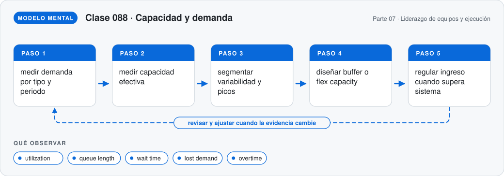

# Clase 088 — Capacidad y demanda

<!-- nav:inicio -->
> **Parte 07 · Operaciones, procesos y calidad** — clase 4 de 12 · [índice de la parte](../../README.md) · [temario](../../../../SYLLABUS.md)
<!-- nav:fin -->

**Parte:** 07 — Operaciones, procesos y calidad  
**Nivel:** Etapa 2 — Jefe → Manager  
**Duración sugerida:** 150–180 minutos · **Estándar:** deep-class-v2

## 🎯 Propósito

Casi todo problema de plazos, esperas y sobrecarga se reduce a una pregunta: ¿cuánto trabajo llega y cuánto puede hacer el sistema? Cuando la demanda supera la capacidad, se forman colas, suben los plazos y la calidad cae; cuando la capacidad excede la demanda, se paga por recursos ociosos. Gestionar capacidad y demanda no es «tener más gente», sino conocer ambas con datos, decidir cuánta holgura conviene y elegir cómo ajustar cuando varían.

La clase se apoya en la dirección de operaciones de Slack y Brandon-Jones, en la ley de Little ya vista y en la observación de Womack y Jones sobre los costos de los lotes y las esperas. Al terminar sabrás calcular la capacidad útil de un proceso, estimar la demanda con escenarios, calcular la brecha y comparar estrategias de ajuste con su costo y su efecto en el cliente.

## 📚 Resultados de aprendizaje

Al finalizar podrás:

1. **Calcular** la capacidad nominal y la capacidad útil de un proceso.
2. **Estimar** la demanda con un patrón base y escenarios.
3. **Calcular** la utilización y entender su efecto en las esperas.
4. **Comparar** estrategias de ajuste: perseguir, nivelar y gestionar la demanda.
5. **Decidir** cuánta holgura mantener según el costo de esperar frente al costo de capacidad ociosa.

## 🧭 Agenda

| Tramo | Qué se hace |
|---|---|
| 0–20 min | Recuperación: ¿en qué semana o mes tu equipo se desborda y qué se hace entonces? |
| 20–60 min | Capacidad, demanda, utilización y estrategias. |
| 60–105 min | Ejemplo trabajado: un centro de atención con picos. |
| 105–150 min | Caso ejecutivo y práctica de cálculo. |
| 150–175 min | Límites y entregable. |

## 🧩 Conceptos centrales

| Concepto | Definición | Cómo se reconoce |
|---|---|---|
| **Capacidad nominal** | Máximo teórico que produce el sistema en condiciones ideales. | Es la cifra de diseño. |
| **Capacidad útil** | Capacidad real tras paradas, defectos, ausencias y variabilidad. | Es menor que la nominal. |
| **Demanda** | Trabajo que llega al sistema por unidad de tiempo. | Se mide con datos de llegada, no con intuición. |
| **Utilización** | Proporción de la capacidad usada: demanda dividida por capacidad. | A alta utilización, las esperas crecen mucho. |
| **Brecha** | Diferencia entre capacidad y demanda proyectada. | Positiva sobra; negativa genera cola. |
| **Holgura** | Capacidad deliberada para absorber variación. | Se decide, no se descubre. |

## 🧠 Modelo mental

**Cómo leer el diagrama.** Tres columnas, tres formas de enfrentar una demanda que varía. En **perseguir**, la capacidad sube y baja con la demanda; en **nivelar**, la capacidad es estable y la espera o el inventario absorben la variación; en **gestionar la demanda**, se desplaza la demanda hacia donde sobra capacidad. Cada columna muestra su beneficio y su costo: ninguna es gratis, y la elección depende de cuánto tolera esperar el cliente.

## 📖 Desarrollo

### 1. Capacidad nominal y útil

La capacidad nominal es una cifra de ficha técnica: cuántas llamadas por hora atiende un agente, cuántas unidades produce una máquina. La **capacidad útil** descuenta lo que ocurre en la vida real: pausas, ausencias, mantenimiento, tiempo de preparación, defectos que se rehacen y trabajo que no es de la tarea principal. Planificar con la nominal es una fuente típica de incumplimientos. Se mide con datos de un período representativo: unidades efectivamente terminadas por persona o por máquina, no las que «deberían» terminar.

### 2. Medir la demanda

La demanda no es un número, es un patrón: varía por hora, día, semana y estación, y tiene eventos extraordinarios (campañas, cierres de mes, crisis). Se parte de datos históricos de **llegadas** —no de ventas ni de pedidos atendidos, que ya están limitados por la capacidad— y se identifica un patrón base, la variabilidad y los picos. Para el futuro se usan **escenarios** (bajo, esperado, alto) con sus supuestos, no un único pronóstico. Una demanda que se pierde porque nadie pudo atenderla no aparece en las cifras de ventas y subestima la real.

### 3. Utilización y esperas

Una intuición equivocada es que usar el 100 % de la capacidad es lo ideal. En sistemas con llegadas variables, **las esperas crecen de forma no lineal al acercarse al 100 % de utilización**: a 70 % la cola es manejable, a 90 % se alarga mucho y a 95 % se vuelve inestable. Por eso las operaciones con tiempos de respuesta críticos (urgencias, soporte, mantenimiento) planifican con holgura deliberada. La ley de Little (clase 080) relaciona el trabajo en curso con el tiempo en el sistema: más cola implica más espera.

### 4. Calcular la brecha

Con capacidad útil y demanda proyectada se calcula la brecha por período: capacidad menos demanda. Se hace por escenario y por tipo de trabajo, porque promediar oculta los picos, y los picos son los que producen incumplimientos. También se distingue **capacidad por tipo de habilidad**: tener horas de sobra en un perfil no resuelve la falta en otro. El resultado es un mapa de períodos y habilidades con sobrecarga o con holgura.

### 5. Estrategias de ajuste

Slack y Brandon-Jones describen tres: **perseguir la demanda** (ajustar capacidad con horas extra, turnos, personal temporal), **nivelar la capacidad** (capacidad estable, con inventario o esperas que absorben la variación) y **gestionar la demanda** (precios, reservas, promociones, horarios para desplazar la demanda). En servicios no se puede almacenar, por lo que la nivelación se traduce en esperas, y gestionar la demanda gana peso. Las estrategias se combinan, y cada una tiene un costo: el de contratar, el de esperar o el de no vender.

### 6. Costo de esperar frente a costo de capacidad

La decisión de holgura es económica. Si esperar cuesta poco (el cliente tolera días), se puede operar con alta utilización. Si esperar es muy costoso (pérdida de clientes, riesgos de seguridad), conviene capacidad ociosa. Se compara el **costo de la capacidad adicional** con el **costo esperado de la espera y de las ventas perdidas**. Este cálculo, aunque aproximado, ordena la conversación: en lugar de discutir si «sobra o falta gente», se discute cuánto vale evitar la espera.

### 7. Capacidad, calidad y personas

Operar al límite de la capacidad durante mucho tiempo degrada la calidad, aumenta los errores y desgasta a las personas, lo que reduce la capacidad útil futura. La sobrecarga sostenida es una deuda que se paga con rotación y retrabajo. Womack y Jones advierten sobre los lotes grandes y las esperas que ocultan problemas; la capacidad aparente puede esconder trabajo inútil. Antes de ampliar, conviene revisar cuánta capacidad se pierde en defectos, esperas y tareas que no agregan valor (clase 090).

## 📚 Lectura comparada

| Obra | Qué aporta | Qué no resuelve | Pregunta para contrastar |
|---|---|---|---|
| Slack y Brandon-Jones | Planificación de capacidad y estrategias de ajuste. | Es general; los costos son propios de cada caso. | ¿Qué estrategia usas hoy? |
| Womack y Jones | Esperas, lotes y flujo continuo. | Pensado para manufactura. | ¿Cuánta capacidad se pierde en esperas? |
| Hammer y Champy | Eliminar traspasos que consumen capacidad. | Su alcance radical tiene costos. | ¿Qué traspasos puedes eliminar? |
| Goldratt y Cox | La capacidad que importa es la del cuello de botella. | Se verá en la clase 089. | ¿Dónde está la capacidad que limita? |
| Little (1961) | Relación entre trabajo en curso, rendimiento y tiempo. | Supone sistema estable. | ¿Cuánto trabajo tienes en curso? |

## 🧮 Ejemplo trabajado

**Situación (hipotética).** Un centro de atención a clientes tiene 20 agentes. Cada uno atiende, en promedio, 9 contactos por hora mientras está disponible. La jornada es de 8 horas; las pausas, la capacitación y el trabajo administrativo reducen la disponibilidad a 6 horas efectivas. Llegan 1.200 contactos por día en un día normal y hasta 1.800 en días de facturación.

| Cálculo | Valor |
|---|---|
| Capacidad nominal | 20 × 8 × 9 = 1.440 contactos por día |
| Capacidad útil | 20 × 6 × 9 = 1.080 contactos por día |
| Demanda día normal | 1.200 |
| Brecha día normal | 1.080 − 1.200 = −120 |
| Demanda día alto | 1.800; brecha −720 |
| Utilización en día normal | 1.200 / 1.080 = 111 % |

**Lectura.** La cifra de capacidad nominal sugería que sobraba gente (1.440 frente a 1.200). La capacidad útil muestra que el centro ya está sobrecargado: la cola crece cada día y el tiempo de espera promedio sube. Los reclamos suben, lo que genera más contactos de seguimiento.

**Opciones.** (a) **Perseguir**: contratar temporales en días de facturación (costo variable, curva de aprendizaje). (b) **Gestionar la demanda**: enviar la factura de forma escalonada durante el mes, con lo que el pico baja de 1.800 a 1.350. (c) **Reducir contactos evitables**: 22 % de los contactos preguntan por un estado que podría mostrarse en la página; resolver eso baja la demanda en 264 por día. La opción (c) más (b) cierra casi toda la brecha con costo menor que contratar; se prueba en piloto antes de reducir dotación o contratar.

**Qué muestra.** (1) La capacidad nominal engañaba. (2) La brecha por escenario reveló el pico. (3) Reducir demanda evitable fue más barato que sumar capacidad.

## 🔀 Comparación y límites

**Capacidad frente a productividad.** La capacidad es cuánto se puede producir; la productividad, cuánto se produce por recurso usado. Aumentar horas aumenta capacidad pero puede bajar productividad si crece la fatiga y el retrabajo.

**Límites.** Las cifras de capacidad útil dependen del período medido y de la mezcla de trabajo. Los pronósticos de demanda fallan ante cambios del mercado; por eso se usan escenarios y señales de revisión. El modelo simple de utilización y espera supone llegadas aleatorias estables, y en la práctica existen picos y correlaciones. Y los ajustes de personal (horas extra, contrataciones, cambios de jornada) tienen condiciones legales y contractuales que se comprueban con asesoría laboral.

## 🪜 De profesional a owner

| Nivel | Cómo participa en capacidad y demanda |
|---|---|
| **Profesional** | Señala sobrecarga con datos y propone qué se puede postergar. |
| **Jefe / Team Lead** | Mide la capacidad útil de su equipo y la demanda que recibe. |
| **Gerente** | Planifica con escenarios y decide la estrategia de ajuste. |
| **CEO / Director** | Decide la holgura según el valor de no hacer esperar al cliente. |
| **Founder / Owner** | Evita crecer ventas más rápido de lo que la operación puede entregar. |

## 🏢 Caso ejecutivo

Una empresa de reparto de comida a domicilio crece 15 % mensual. En horas pico (almuerzo y cena) los repartidores no alcanzan; el tiempo de entrega pasa de 30 a 55 minutos y los pedidos cancelados suben. En horas valle hay repartidores ociosos. Operaciones propone contratar el doble; finanzas, no contratar y subir precios; marketing quiere lanzar promociones para llenar los valles. Los repartidores piden turnos más estables.

Entrega un **plan de capacidad y demanda** que incluya: (a) la capacidad útil y la demanda por franja con escenarios; (b) la brecha en cada franja; (c) las estrategias de ajuste evaluadas con su costo y su efecto en el tiempo de entrega; (d) cómo se decide la holgura según el costo de una entrega tardía; (e) el efecto en las personas y las condiciones legales a verificar; (f) las señales que dispararían una revisión.

## 🧪 Práctica

1. Calcula la capacidad nominal y la útil de tu equipo para una semana.
2. Reúne la demanda por día de las últimas ocho semanas y dibuja el patrón.
3. Calcula la brecha para un escenario esperado y uno alto.
4. Compara dos estrategias de ajuste con su costo estimado.
5. Define un umbral de utilización a partir del cual activas un ajuste.

## ⚠️ Errores frecuentes

| Error | Por qué ocurre | Cómo corregirlo |
|---|---|---|
| Planificar con capacidad nominal | Es la cifra disponible | Medir capacidad útil. |
| Usar ventas como demanda | Es lo que se ve | Medir llegadas, incluida la demanda perdida. |
| Buscar 100 % de utilización | Se cree que es eficiencia | Mantener holgura deliberada. |
| Promediar la demanda | Es más simple | Planificar por franja y por escenario. |
| Contratar sin revisar desperdicio | Se cree que falta gente | Revisar defectos, esperas y demanda evitable. |
| Sobrecarga sostenida | Se tolera por urgencia | Reconocerla como deuda y corregirla. |

## ❓ Preguntas de comprobación

1. ¿Qué diferencia hay entre capacidad nominal y útil?
2. ¿Por qué se mide la demanda con llegadas y no con ventas?
3. ¿Qué ocurre con las esperas cuando la utilización se acerca al 100 %?
4. ¿Qué tres estrategias de ajuste existen?
5. ¿Por qué se calcula la brecha por escenario y por habilidad?
6. ¿Cómo se decide cuánta holgura mantener?
7. ¿Qué límite tiene el pronóstico de demanda?

Claves de respuesta

1. La nominal es el máximo teórico; la útil descuenta pausas, ausencias, defectos y variabilidad.
2. Porque las ventas ya están limitadas por la capacidad y subestiman la demanda real.
3. Crecen de forma no lineal: a utilización muy alta las colas se alargan mucho y se vuelven inestables.
4. Perseguir la demanda, nivelar la capacidad y gestionar la demanda.
5. Porque el promedio oculta los picos y la holgura en una habilidad no cubre la falta en otra.
6. Comparando el costo de la capacidad adicional con el costo esperado de la espera y de las ventas perdidas.
7. Falla ante cambios del mercado; por eso se usan escenarios y señales de revisión.

## 📥 Entregable

Guarda en `portfolio/088-capacidad-y-demanda/`:

- `operating-improvement-brief.md` (plantilla [Operating Improvement Brief](../../../../templates/operating-improvement-brief.md)) con el plan de capacidad y demanda del caso ejecutivo;
- `process-map.md` (plantilla [Process map](../../../../templates/process-map.md)) con el cálculo de brecha por franja y escenario;
- `decision-journal.md` con la estrategia elegida, la holgura decidida y las señales de revisión.

## 📗 Fuentes y verificación

- Nigel Slack & Alistair Brandon-Jones — *Operations Management* (Pearson Education, Limited, 2019). **Uso en esta clase:** planificación de capacidad y estrategias de ajuste. Lectura selectiva sobre **capacidad y demanda**. **Localizador:** [ISBN-13 9781292254036](https://openlibrary.org/isbn/9781292254036).
- James P. Womack & Daniel T. Jones — *Lean Thinking* (Free Press, 2003). **Uso en esta clase:** esperas, lotes y flujo continuo. Lectura selectiva sobre **capacidad y demanda**. **Localizador:** [ISBN-13 9780743231640](https://openlibrary.org/isbn/9780743231640).
- Michael Hammer & James Champy — *Reengineering the Corporation* (HarperBusiness, 2001). **Uso en esta clase:** eliminar traspasos que consumen capacidad. Lectura selectiva sobre **capacidad y demanda**. **Localizador:** [ISBN-13 9780066621128](https://openlibrary.org/isbn/9780066621128).
- Eliyahu M. Goldratt & Jeff Cox — *The Goal* (HighBridge Audio, 2014). **Uso en esta clase:** la capacidad que importa es la del cuello de botella. Lectura selectiva sobre **capacidad y demanda**. **Localizador:** [ISBN-13 9781622313945](https://openlibrary.org/isbn/9781622313945).
- John D. C. Little — *A Proof for the Queuing Formula: L = λW* (Operations Research, 1961). **Uso en esta clase:** relación entre trabajo en curso, rendimiento y tiempo de ciclo. Lectura selectiva sobre **capacidad y demanda**. **Localizador:** [DOI 10.1287/opre.9.3.383](https://doi.org/10.1287/opre.9.3.383).

> **Regla de fuentes para Capacidad y demanda:** las obras anteriores estructuran las perspectivas de esta materia; cualquier norma, ley o estándar vivo mencionado debe comprobarse nuevamente en su fuente primaria vigente, incluidas las condiciones laborales aplicables a los ajustes de personal. Los ejemplos y casos son hipotéticos, con cifras ilustrativas. El desarrollo es original y no reproduce capítulos protegidos.

<!-- pie:inicio -->
---

| Anterior | Índice | Siguiente |
|---|---|---|
| [← 087 · SOP y trabajo estandarizado](../087-sop-y-trabajo-estandarizado/README.md) | [Parte 07](../../README.md) · [Programa](../../../../SYLLABUS.md) | [089 · Cuellos de botella y teoría de restricciones →](../089-cuellos-de-botella-y-teoria-de-restricciones/README.md) |
<!-- pie:fin -->
