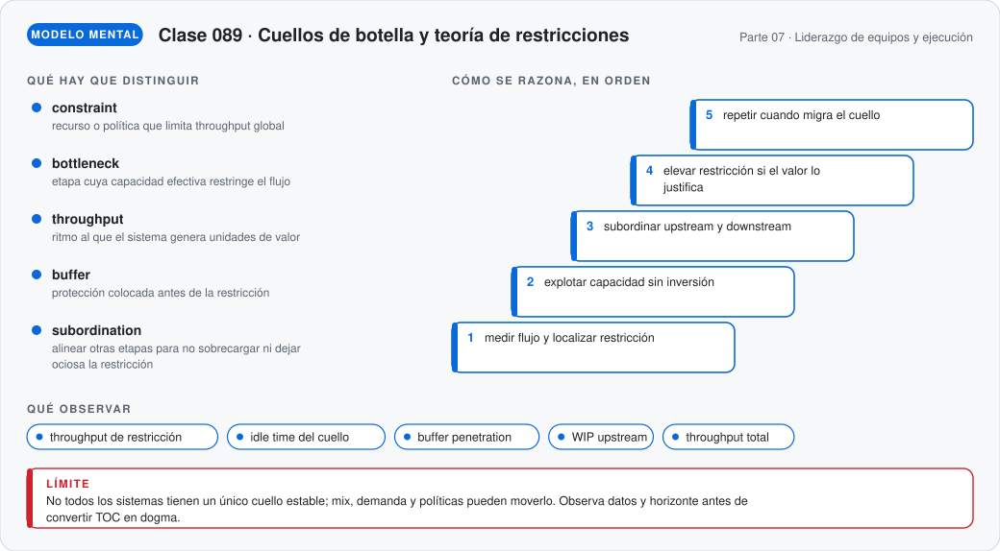

# Clase 089 — Cuellos de botella y teoría de restricciones

<!-- nav:inicio -->
> **Parte 07 · Operaciones, procesos y calidad** — clase 5 de 12 · [índice de la parte](../../README.md) · [temario](../../../../SYLLABUS.md)
<!-- nav:fin -->

**Parte:** 07 — Operaciones, procesos y calidad  
**Nivel:** Etapa 2 — Jefe → Manager  
**Duración sugerida:** 150–180 minutos · **Estándar:** deep-class-v2

## 🎯 Propósito

En cualquier proceso hay una parte que limita lo que el conjunto puede entregar. Mejorar cualquier otra parte no aumenta el resultado; solo acumula trabajo frente a la que limita. La **teoría de las restricciones** de Goldratt ordena esta intuición en un método: identificar la restricción, sacarle todo el partido, subordinar el resto a su ritmo, ampliarla si hace falta y volver a empezar. Es una de las ideas más prácticas para decidir dónde mejorar con recursos escasos.

La clase se apoya en *La meta* (Goldratt y Cox), en los cinco pasos de enfoque, en la ley de Little y en la visión de calidad de Deming. Al terminar sabrás encontrar el cuello de botella con datos, distinguirlo de un simple punto con mucho trabajo, aplicar los cinco pasos y evitar los errores que impiden que la mejora llegue al resultado.

## 📚 Resultados de aprendizaje

Al finalizar podrás:

1. **Identificar** la restricción de un proceso con datos de cola, utilización y flujo.
2. **Explicar** por qué mejorar un recurso que no es restricción no mejora el resultado.
3. **Aplicar** los cinco pasos de enfoque a un caso.
4. **Distinguir** una restricción física de una de política o de mercado.
5. **Decidir** cuándo conviene elevar la restricción y cuándo explotarla mejor.

## 🧭 Agenda

| Tramo | Qué se hace |
|---|---|
| 0–20 min | Recuperación: ¿dónde se acumula trabajo esperando en tu proceso? |
| 20–60 min | Restricción, cinco pasos y tipos de restricción. |
| 60–105 min | Ejemplo trabajado: un taller con una máquina que limita. |
| 105–150 min | Caso ejecutivo y práctica. |
| 150–175 min | Límites y entregable. |

## 🧩 Conceptos centrales

| Concepto | Definición | Cómo se reconoce |
|---|---|---|
| **Restricción** | Elemento que limita el rendimiento del sistema. | Una hora perdida aquí es una hora perdida en todo el sistema. |
| **Cuello de botella** | Recurso cuya capacidad es menor o igual a la demanda que recibe. | Se acumula cola antes de él. |
| **Rendimiento del sistema (throughput)** | Ritmo al que el sistema genera valor, en general ventas, no producción. | Se mide en lo que sale y se cobra. |
| **Explotar** | Sacar el máximo de la restricción con lo que ya existe. | Que no pare, no espere y no trabaje en lo inútil. |
| **Subordinar** | Ajustar el resto del sistema al ritmo de la restricción. | Los demás no producen más de lo que la restricción absorbe. |
| **Restricción de política** | Regla o práctica que limita el sistema, no un recurso físico. | Se trata de una norma que ya nadie recuerda por qué existe. |

## 🧠 Modelo mental

**Cómo leer el diagrama.** Cinco pasos en orden con una flecha de retorno. Primero se **identifica** la restricción y luego se **explota** sin invertir. Después se **subordina** el resto del sistema a su ritmo. Solo si sigue limitando se **eleva** su capacidad con inversión. Al romperla, la restricción se mueve y se **vuelve a empezar**. El orden evita el error más común: invertir en ampliar algo que aún no se aprovechó.

## 📖 Desarrollo

### 1. Una cadena es tan fuerte como su eslabón más débil

Goldratt y Cox enseñan en forma de novela que el resultado de un sistema lo fija su restricción. En una línea de producción en serie, la salida no puede superar la del paso más lento; en un proceso administrativo, tampoco. Mejorar otros pasos aumenta la actividad y el inventario en curso, pero no el rendimiento. Esta idea desafía la práctica de medir y premiar la eficiencia de cada recurso por separado: un recurso que no es restricción y produce al máximo solo acumula trabajo en cola.

### 2. Identificar la restricción

Se busca con tres señales: **dónde se acumula la cola**, **qué recurso trabaja a plena utilización** mientras otros esperan y **dónde el tiempo perdido se traslada directo a la entrega**. Se confirma con datos de flujo (llegadas, salidas, tiempos de espera por etapa) y no solo por opinión. Una restricción puede ser un recurso (una máquina, un especialista, una aprobación), una política (una regla de lotes mínimos, un horario de comité) o el mercado (falta de demanda). Muchas veces, la restricción real no es donde la gente cree.

### 3. Explotar y subordinar

Antes de invertir, se explota: asegurar que la restricción **nunca espere** (siempre tiene trabajo listo), **no trabaje en lo que no hace falta** (defectos, pedidos de baja prioridad) y **no pare** (mantenimiento y turnos escalonados para cubrir pausas). Luego se subordina: el resto del sistema libera trabajo al ritmo que la restricción puede procesar, ni más (se acumula inventario) ni menos (se detiene). Esto choca con la costumbre de «mantener ocupados a todos», que genera colas y tiempos largos.

### 4. Elevar y volver a empezar

Si, tras explotar y subordinar, la restricción sigue limitando, se **eleva**: se compra capacidad, se contrata, se tercerizan partes del trabajo, se rediseña. Esta es la inversión, y es la última porque las anteriores suelen liberar capacidad sin costo. Al elevar, la restricción se desplaza a otro punto, y se vuelve al primer paso. Goldratt advierte contra la **inercia**: seguir aplicando las reglas diseñadas para la restricción anterior cuando ya está en otra parte.

### 5. Restricciones de política y de mercado

Muchas restricciones no son máquinas. Una regla de aprobación que solo se hace los jueves, un tamaño mínimo de lote por costumbre, una medida de eficiencia que premia producir de más o una norma interna obsoleta pueden limitar el sistema. Identificarlas exige preguntar «¿por qué lo hacemos así?» y «¿qué pasaría si cambiara?». Cuando la restricción es el mercado (la demanda es menor que la capacidad), el foco cambia a vender, no a producir más.

### 6. Medir con rendimiento, costo e inventario

Goldratt propone tres medidas globales: **rendimiento** (el dinero que entra por ventas menos lo que se paga a proveedores), **inventario** (dinero atrapado en lo que se compró para vender) y **gasto operativo** (lo que cuesta convertir inventario en rendimiento). Mejorar es aumentar el rendimiento, reducir el inventario y reducir el gasto, con ese orden de importancia. Esta forma de medir evita decisiones que reducen costos unitarios locales pero aumentan el inventario o reducen las ventas.

### 7. Trabajo del conocimiento y servicios

En servicios y trabajo del conocimiento la restricción es menos visible: puede ser una persona experta que revisa todo, un comité o un sistema de información. Las colas están en bandejas, tableros o correos. La aplicación es válida, pero exige medir con cuidado: el tiempo del especialista que atiende demasiadas interrupciones es capacidad perdida. Estandarizar su trabajo (clase 087), derivarle solo lo que requiere su juicio y eliminar el retrabajo antes de él suele liberar rendimiento sin contratar.

## 📚 Lectura comparada

| Obra | Qué aporta | Qué no resuelve | Pregunta para contrastar |
|---|---|---|---|
| Goldratt y Cox | Cinco pasos de enfoque y mirada de sistema. | Formato de novela; simplifica el cálculo. | ¿Dónde está tu restricción? |
| Little (1961) | Relación entre trabajo en curso, rendimiento y tiempo. | Sistema estable. | ¿Cuánto trabajo acumulas antes de la restricción? |
| Womack y Jones | Flujo continuo y eliminación de esperas. | Es una filosofía distinta a la de restricción. | ¿Qué espera podrías eliminar? |
| Slack y Brandon-Jones | Capacidad y balance de línea. | Es general. | ¿Qué recurso tiene mayor utilización? |
| Deming | Mejora del sistema completo y no de partes. | No entrega método de identificación. | ¿Qué medida local perjudica al conjunto? |

## 🧮 Ejemplo trabajado

**Situación (hipotética).** Un taller de carpintería metálica produce estructuras en cuatro etapas: corte, soldadura, pintura y despacho. Capacidad por día: corte 40 piezas, soldadura 22, pintura 30, despacho 50. Llegan pedidos por 35 piezas por día. La gerencia propone comprar una cortadora nueva porque «corte siempre está ocupado».

| Etapa | Capacidad/día | Utilización con 35 de demanda | Cola |
|---|---|---|---|
| Corte | 40 | 88 % | Moderada |
| Soldadura | 22 | 159 % (no alcanza) | Creciente, 2 semanas |
| Pintura | 30 | 117 % de lo que le llega, limitada a 22 | Escasa, espera trabajo |
| Despacho | 50 | 44 % | Nula |

**Diagnóstico.** La restricción es **soldadura**: con 22 piezas por día, el resto del sistema no puede superar ese ritmo. La cortadora nueva aumentaría el inventario frente a soldadura sin subir lo despachado.

**Cinco pasos.** (1) **Identificar**: soldadura. (2) **Explotar**: evitar que soldadura espere material (corte alimenta con anticipación), cubrir pausas con turnos escalonados, no soldar piezas de baja prioridad ni con defectos de corte (verificar antes). Resultado: de 22 a 26 por día. (3) **Subordinar**: corte libera material al ritmo de 26 por día, y no al de los 35 pedidos que llegan, lo que evita seguir apilando piezas cortadas frente a soldadura (hoy se acumulan 13 por día). (4) **Elevar**: si 26 sigue por debajo de 35, evaluar un segundo soldador o un equipo de soldadura semiautomática, comparando su costo con el margen de las piezas adicionales. (5) **Volver a empezar**: con 35 de capacidad en soldadura, la restricción pasa a pintura (30).

**Qué muestra.** (1) La gerencia iba a invertir donde no limitaba. (2) Explotar fue casi gratis y aumentó 18 % el rendimiento. (3) Elevar solo se decide después, con números.

## 🔀 Comparación y límites

**Restricción frente a eficiencia local.** La eficiencia local mide qué tan ocupado está cada recurso; la restricción mide qué limita el resultado. Un recurso puede estar al 100 % y no ser la restricción si trabaja en lo que no se necesita.

**Límites.** La teoría supone que el resultado depende de un punto dominante; con muchas restricciones interactuando o con variabilidad extrema, el análisis es más complejo. En trabajo del conocimiento medir cola y capacidad es difícil. Un enfoque excesivo en la restricción puede descuidar la calidad y la seguridad de las demás etapas. Y los números del ejemplo son ilustrativos: cada operación debe medir los suyos antes de decidir inversiones.

## 🪜 De profesional a owner

| Nivel | Cómo aplica la restricción |
|---|---|
| **Profesional** | Avisa dónde se acumula el trabajo y qué le impide avanzar. |
| **Jefe / Team Lead** | Protege el tiempo del recurso que limita a su equipo. |
| **Gerente** | Decide inversiones según la restricción, no la queja más fuerte. |
| **CEO / Director** | Revisa que las medidas de cada área no empeoren el sistema. |
| **Founder / Owner** | Reconoce que él mismo suele ser la restricción y trabaja para dejar de serlo. |

## 🏢 Caso ejecutivo

Una agencia de diseño tiene cuatro etapas: ventas, diseño, revisión del director creativo y entrega al cliente. Los diseñadores trabajan sobrecargados; el director creativo revisa todo y tiene la agenda llena; los proyectos esperan entre tres y diez días su visto bueno. La gerencia piensa contratar más diseñadores. El director creativo dice que no puede delegar la revisión porque «la calidad depende de él».

Entrega un **análisis de restricción** que incluya: (a) los datos para localizar la restricción (colas, utilización, tiempos de espera); (b) la aplicación de los cinco pasos; (c) qué se explotaría sin invertir (criterios previos de revisión, lotes, bloques de agenda); (d) cuándo y cómo elevar la capacidad de revisión; (e) la medida global (rendimiento, inventario, gasto) que reemplazará a las medidas locales; (f) los riesgos de calidad y las señales de que la restricción se movió.

## 🧪 Práctica

1. Dibuja las etapas de un proceso con su capacidad y su cola.
2. Identifica la restricción y dos recursos que no lo son.
3. Propón tres acciones de explotar sin invertir.
4. Define cómo subordinarás la liberación de trabajo al ritmo de la restricción.
5. Calcula el efecto de elevar la restricción antes y después.

## ⚠️ Errores frecuentes

| Error | Por qué ocurre | Cómo corregirlo |
|---|---|---|
| Mejorar donde no limita | La queja más fuerte manda | Medir flujo y cola. |
| Mantener ocupados a todos | Se premia la eficiencia local | Subordinar al ritmo de la restricción. |
| Invertir antes de explotar | Parece más rápido | Explotar primero. |
| No ver la restricción de política | Nadie cuestiona la regla | Preguntar por qué se hace así. |
| Olvidar que se mueve | Inercia | Volver al paso 1 tras cada mejora. |
| Sobrecargar al recurso restricción con interrupciones | Es el más valioso | Protegerlo de lo que no le corresponde. |

## ❓ Preguntas de comprobación

1. ¿Qué es una restricción y cómo se reconoce?
2. ¿Por qué mejorar un recurso que no es restricción no aumenta el resultado?
3. ¿Cuáles son los cinco pasos de enfoque?
4. ¿Qué significa subordinar?
5. ¿Qué tipos de restricción existen más allá de una máquina?
6. ¿Por qué se explota antes de elevar?
7. ¿Qué advertencia hace Goldratt sobre la inercia?

Claves de respuesta

1. Elemento que limita el rendimiento del sistema; se reconoce por la cola previa y porque su tiempo perdido se traslada a la entrega.
2. Porque el rendimiento lo fija la restricción; mejorar otros recursos solo acumula trabajo en cola.
3. Identificar, explotar, subordinar, elevar y volver a empezar.
4. Ajustar el resto del sistema al ritmo de la restricción, sin liberar más trabajo del que puede absorber.
5. De política (reglas, medidas, horarios) y de mercado (demanda insuficiente).
6. Porque explotar suele liberar capacidad sin costo y evita invertir donde no hace falta.
7. Cuando la restricción se mueve, se siguen aplicando las reglas pensadas para la anterior.

## 📥 Entregable

Guarda en `portfolio/089-cuellos-de-botella-y-teoria-de-restricciones/`:

- `risk-governance-brief.md` (plantilla [Risk & Governance Brief](../../../../templates/risk-governance-brief.md)) con el análisis de restricción y los riesgos de calidad del caso ejecutivo;
- `operating-improvement-brief.md` (plantilla [Operating Improvement Brief](../../../../templates/operating-improvement-brief.md)) con los cinco pasos aplicados;
- `decision-journal.md` con los datos usados, la restricción elegida y las señales de que se movió.

## 📗 Fuentes y verificación

- Eliyahu M. Goldratt & Jeff Cox — *The Goal* (HighBridge Audio, 2014). **Uso en esta clase:** cinco pasos de enfoque y mirada de sistema. Lectura selectiva sobre **cuellos de botella y teoría de restricciones**. **Localizador:** [ISBN-13 9781622313945](https://openlibrary.org/isbn/9781622313945).
- John D. C. Little — *A Proof for the Queuing Formula: L = λW* (Operations Research, 1961). **Uso en esta clase:** relación entre trabajo en curso, rendimiento y tiempo. Lectura selectiva sobre **cuellos de botella y teoría de restricciones**. **Localizador:** [DOI 10.1287/opre.9.3.383](https://doi.org/10.1287/opre.9.3.383).
- James P. Womack & Daniel T. Jones — *Lean Thinking* (Free Press, 2003). **Uso en esta clase:** flujo continuo y eliminación de esperas. Lectura selectiva sobre **cuellos de botella y teoría de restricciones**. **Localizador:** [ISBN-13 9780743231640](https://openlibrary.org/isbn/9780743231640).
- Nigel Slack & Alistair Brandon-Jones — *Operations Management* (Pearson Education, Limited, 2019). **Uso en esta clase:** capacidad y balance de línea. Lectura selectiva sobre **cuellos de botella y teoría de restricciones**. **Localizador:** [ISBN-13 9781292254036](https://openlibrary.org/isbn/9781292254036).
- W. Edwards Deming — *Out of the Crisis* (The MIT Press, 2000). **Uso en esta clase:** mejora del sistema completo y no de partes. Lectura selectiva sobre **cuellos de botella y teoría de restricciones**. **Localizador:** [ISBN-13 9780262541152](https://openlibrary.org/isbn/9780262541152).

> **Regla de fuentes para Cuellos de botella y teoría de restricciones:** las obras anteriores estructuran las perspectivas de esta materia; cualquier norma, ley o estándar vivo mencionado debe comprobarse nuevamente en su fuente primaria vigente. Los ejemplos y casos son hipotéticos, con cifras ilustrativas. El desarrollo es original y no reproduce capítulos protegidos.

<!-- pie:inicio -->
---

| Anterior | Índice | Siguiente |
|---|---|---|
| [← 088 · Capacidad y demanda](../088-capacidad-y-demanda/README.md) | [Parte 07](../../README.md) · [Programa](../../../../SYLLABUS.md) | [090 · Lean y eliminación de desperdicio →](../090-lean-y-eliminacion-de-desperdicio/README.md) |
<!-- pie:fin -->
