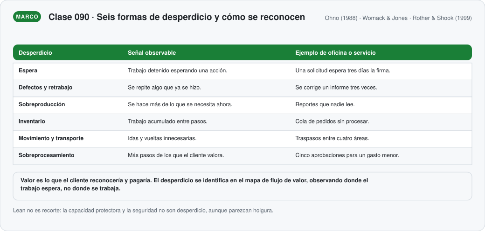

# Clase 090 — Lean y eliminación de desperdicio

<!-- nav:inicio -->
> **Parte 07 · Operaciones, procesos y calidad** — clase 6 de 12 · [índice de la parte](../../README.md) · [temario](../../../../SYLLABUS.md)
<!-- nav:fin -->

**Parte:** 07 — Operaciones, procesos y calidad  
**Nivel:** Etapa 2 — Jefe → Manager  
**Duración sugerida:** 150–180 minutos · **Estándar:** deep-class-v2

## 🎯 Propósito

Lean suele resumirse como «eliminar desperdicio», y esa frase ha servido tanto para mejorar operaciones como para justificar recortes ciegos. Su idea original es más exigente: **definir valor desde el cliente, ver el flujo completo que lo produce, hacer que el trabajo fluya sin interrupciones, producir solo lo que se necesita cuando se necesita y mejorar de forma continua**. El desperdicio es todo lo que consume recursos sin agregar algo que el cliente valore, y casi siempre vive en la espera y los traspasos más que en el esfuerzo de las personas.

La clase se apoya en *Lean Thinking* de Womack y Jones, en el sistema de producción de Toyota descrito por Ohno, en la guía de mapeo de flujo de valor de Rother y Shook y en la lectura crítica de Liker. Al terminar sabrás identificar formas de desperdicio con señales observables, construir un mapa de flujo de valor simple, proponer mejoras que no dañen calidad ni seguridad y distinguir lean de austeridad.

## 📚 Resultados de aprendizaje

Al finalizar podrás:

1. **Distinguir** valor, trabajo necesario sin valor y desperdicio según el cliente.
2. **Reconocer** las formas de desperdicio con señales observables.
3. **Aplicar** la secuencia: valor, flujo de valor, flujo, tracción y mejora continua.
4. **Interpretar** tiempo de entrega, rendimiento a la primera y trabajo en curso sin atribuir causalidad automática.
5. **Diferenciar** lean de recorte de costos y evitar eliminar capacidad protectora.

## 🧭 Agenda

| Tramo | Qué se hace |
|---|---|
| 0–20 min | Recuperación: ¿qué paso de tu proceso haces solo porque «siempre se ha hecho»? |
| 20–60 min | Valor, desperdicios, flujo y tracción. |
| 60–105 min | Ejemplo trabajado: un proceso de aprobación de facturas. |
| 105–150 min | Caso ejecutivo y práctica. |
| 150–175 min | Límites y entregable. |

## 🧩 Conceptos centrales

| Concepto | Definición | Cómo se reconoce |
|---|---|---|
| **Valor** | Lo que el cliente reconocería y pagaría. | Se define desde afuera del proceso. |
| **Desperdicio (muda)** | Actividad que consume recursos sin agregar valor para el cliente. | Espera, retrabajo, exceso, traspasos. |
| **Mapa de flujo de valor** | Diagrama del flujo con tiempos de trabajo y de espera. | Muestra la proporción de tiempo con valor. |
| **Tracción (pull)** | Se produce lo que el siguiente paso o el cliente pide. | Se evita producir por pronóstico. |
| **Rendimiento a la primera (first-pass yield)** | Proporción de unidades que salen bien sin retrabajo. | Se mide por etapa. |
| **Mejora continua (kaizen)** | Cambios pequeños y constantes hechos por quienes trabajan en el proceso. | Hay un ritmo regular de propuestas probadas. |

## 🧠 Modelo mental

**Cómo leer el diagrama.** Cada fila es una forma de desperdicio con la señal que permite verla y un ejemplo de servicio u oficina, donde casi todo el desperdicio está en el papeleo, las colas y las revisiones. El diagrama no sirve para repartir culpas, sino para entrenar la mirada: se busca dónde espera el trabajo, no dónde trabaja la gente.

## 📖 Desarrollo

### 1. Valor desde el cliente

Womack y Jones proponen cinco principios: especificar el **valor** desde el cliente, identificar el **flujo de valor**, hacer que el trabajo **fluya**, dejar que el cliente **tire** del producto y buscar la **perfección** mediante mejora continua. El primer principio es el más difícil: exige distinguir lo que el cliente valora de lo que la organización necesita para operar. Hay tres categorías: actividades que agregan valor, actividades que no agregan valor pero son necesarias hoy (por regulación o por limitaciones del proceso) y actividades que son puro desperdicio.

### 2. Formas de desperdicio

Ohno describió siete formas en manufactura; adaptadas, las más frecuentes son: **espera** (trabajo detenido), **defectos y retrabajo**, **sobreproducción** (hacer más de lo pedido), **inventario** (trabajo acumulado entre pasos), **movimiento y transporte** (idas y vueltas, traspasos) y **sobreprocesamiento** (más pasos de los que el cliente valora). Una octava forma que suele añadirse es **no usar el talento de las personas**. En oficinas, la espera es el desperdicio dominante: solicitudes en una bandeja, aprobaciones pendientes, datos que faltan.

### 3. Mapa de flujo de valor

Rother y Shook enseñan a dibujar a mano el recorrido de un producto o servicio con **tiempo de proceso** y **tiempo de espera** en cada paso, el inventario entre pasos y el flujo de información. El mapa actual muestra cuánto del tiempo total agrega valor; el mapa futuro propone un flujo mejorado. Se dibuja en el lugar de trabajo, con quienes participan, y se fija un horizonte de mejora de pocos meses. Esta técnica conecta con el mapeo de la clase 086, con un énfasis en los tiempos y las colas.

### 4. Flujo, lotes y tracción

Los **lotes grandes** (procesar muchas unidades juntas) generan espera y ocultan defectos: si un lote tiene un error, se descubre al final, cuando ya se repitió muchas veces. Reducir el tamaño del lote acorta el tiempo total y permite detectar problemas pronto. La **tracción** significa que cada paso produce solo cuando el siguiente lo necesita, normalmente con una señal visible (tarjeta, tablero, límite de trabajo en curso como en Kanban, clase 080). Se evita producir por pronóstico y acumular inventario que luego se vuelve obsoleto.

### 5. Calidad en la fuente

Lean considera el defecto como el desperdicio más caro porque se acumula: trabajo agregado sobre algo ya defectuoso. De ahí la práctica de detectar el problema donde se origina: puntos de control en cada paso, la posibilidad de detener el trabajo cuando algo falla y a prueba de errores en el diseño (mecanismos que impiden hacerlo mal). Liker subraya que esto exige una cultura donde reportar un problema no se castiga. Medir el **rendimiento a la primera** por etapa muestra dónde nace el retrabajo.

### 6. Respeto por las personas y mejora continua

El sistema de Toyota descansa en dos pilares: mejora continua y respeto por las personas. La mejora la hacen quienes conocen el trabajo, con experimentos pequeños y rápidos (planificar, hacer, verificar, actuar). Aplicar lean como un programa de reducción de personal destruye la confianza que la mejora necesita: nadie propone una mejora que le costará su empleo. Las empresas que sostienen lean suelen acordar que las mejoras liberan capacidad para crecer o para otras tareas, no para despidos inmediatos.

### 7. Lean no es austeridad

Eliminar «holgura» sin entender la variabilidad vuelve frágil al sistema: un inventario de seguridad, una capacidad de reserva o una verificación de seguridad no son desperdicio, aunque no agreguen valor visible. La pregunta correcta ante cada elemento es: ¿qué riesgo cubre y cuánto cuesta cubrirlo de otra manera? Un hospital sin camas libres, una línea sin repuestos o una operación sin respaldo pueden verse eficientes hasta que ocurre un imprevisto (clase 094). Lean busca eliminar el desperdicio, no la protección deliberada.

## 📚 Lectura comparada

| Obra | Qué aporta | Qué no resuelve | Pregunta para contrastar |
|---|---|---|---|
| Womack y Jones (*Lean Thinking*) | Cinco principios y casos de aplicación. | Casos de éxito seleccionados; no muestra fracasos. | ¿Qué valor reconoce tu cliente? |
| Womack, Jones y Roos | Comparación de sistemas de producción. | Datos de un sector y época. | ¿Qué diferencias de flujo explican el resultado? |
| Ohno | Origen del sistema y las formas de desperdicio. | Contexto japonés de posguerra. | ¿Cuál es tu desperdicio dominante? |
| Rother y Shook | Técnica de mapeo con tiempos. | Requiere trabajo de campo. | ¿Cuál es tu proporción de tiempo con valor? |
| Liker | Principios culturales del sistema. | Describe un caso difícil de replicar. | ¿Qué hace seguro reportar un problema? |

## 🧮 Ejemplo trabajado

**Situación (hipotética).** En una empresa de 500 personas, el proceso de aprobación de facturas de proveedores tarda 14 días hábiles desde la recepción hasta el pago. Los proveedores reclaman y la empresa pierde descuentos por pronto pago.

| Paso | Tiempo de trabajo | Espera previa | Observación |
|---|---|---|---|
| Recepción y registro | 10 min | 1 día | Se registra en lote al final del día |
| Verificación contra orden | 15 min | 3 días | 22 % de las facturas tienen diferencias |
| Aprobación del jefe | 5 min | 4 días | Se aprueba en bloque los jueves; casi el 100 % se aprueba |
| Contabilización | 10 min | 2 días | Duplica el registro hecho en recepción |
| Programación de pago | 5 min | 3 días | Se paga solo los miércoles |

**Cálculo.** Tiempo de trabajo: 45 minutos; espera: 13 días. Menos del 1 % del tiempo agrega valor.

**Mejoras propuestas.** (1) Registrar al recibir, sin lote. (2) Evitar el 22 % de diferencias: pedir al proveedor la orden de compra en la factura y rechazar de inmediato lo que no coincida. (3) Aprobar solo por excepción: facturas con orden coincidente y bajo un monto no necesitan aprobación individual. (4) Eliminar el doble registro. (5) Pagar diariamente en vez de solo los miércoles.

**Resultado esperado y revalidación.** El tiempo total baja a 5 días en un piloto de dos meses y el rendimiento a la primera sube de 78 % a 94 %. Antes de generalizar, control interno revisa que el umbral de aprobación no abra riesgo de fraude: se mantiene una auditoría por muestreo.

**Qué muestra.** (1) El desperdicio estaba en la espera, no en las personas. (2) Cada mejora tuvo un riesgo que se revisó. (3) La mejora se midió en tiempo y calidad, no solo en costo.

## 🔀 Comparación y límites

**Lean frente a teoría de restricciones.** Lean busca reducir el desperdicio en todo el flujo; la teoría de restricciones se concentra en el recurso que limita. Se complementan: primero se ve dónde está la restricción y se eliminan desperdicios que la afectan.

**Límites.** Lean nació en manufactura repetitiva; en trabajo creativo o de alta variabilidad se adapta, no se copia. Las cifras de resultados de los casos publicados no garantizan los mismos efectos en otro contexto. Medir tiempo de entrega o rendimiento a la primera describe asociaciones; no prueba por sí solo qué cambio produjo la mejora. Y recortar capacidad protectora, seguridad o calidad en nombre de lean puede hacer frágil al sistema.

## 🪜 De profesional a owner

| Nivel | Cómo participa en lean |
|---|---|
| **Profesional** | Señala pasos que no agregan valor y prueba mejoras pequeñas. |
| **Jefe / Team Lead** | Dirige sesiones de mejora y protege el tiempo para hacerlas. |
| **Gerente** | Prioriza flujos de valor y evita metas que premian el exceso. |
| **CEO / Director** | Sostiene la cultura de reportar problemas y de mejora sin miedo. |
| **Founder / Owner** | Diseña desde el inicio flujos simples y evita acumular pasos por costumbre. |

## 🏢 Caso ejecutivo

Un hospital privado tiene un tiempo de espera de 4,5 horas en urgencias. La dirección, presionada por costos, propone reducir personal administrativo y camas de observación por «eficiencia lean». El jefe de urgencias muestra que los pacientes esperan principalmente resultados de exámenes, traslados internos y la disponibilidad de camas en hospitalización, y que 18 % de las órdenes de examen se rehacen por datos incompletos.

Entrega un **plan lean** que contenga: (a) el valor para el paciente y el mapa de flujo con tiempos de trabajo y de espera; (b) los desperdicios identificados con su señal observable; (c) las mejoras propuestas y el riesgo de cada una; (d) qué elementos que parecen holgura son protección y no se eliminan; (e) las medidas (tiempo de entrega, rendimiento a la primera, trabajo en curso) y su límite interpretativo; (f) cómo involucrarás al personal y qué compromiso se asumirá sobre las mejoras.

## 🧪 Práctica

1. Define qué valoraría el cliente de un proceso que conoces.
2. Dibuja un mapa de flujo de valor con tiempos de trabajo y de espera.
3. Clasifica cada paso: agrega valor, necesario sin valor o desperdicio.
4. Propón tres mejoras y el riesgo de cada una.
5. Identifica una «holgura» que sea protección y justifica por qué se conserva.

## ⚠️ Errores frecuentes

| Error | Por qué ocurre | Cómo corregirlo |
|---|---|---|
| Equiparar lean con recorte | Presión de costos | Definir valor y proteger capacidad crítica. |
| Culpar a las personas del desperdicio | Se ve el esfuerzo, no el flujo | Buscar dónde espera el trabajo. |
| Mapear desde la oficina | Es más rápido | Mapear en el lugar de trabajo. |
| Lotes grandes por costumbre | Parecen eficientes | Reducir el tamaño del lote. |
| Eliminar controles de seguridad | Se ven como desperdicio | Preguntar qué riesgo cubren. |
| Medir solo costo | Es lo que se reporta | Medir tiempo, calidad y flujo. |

## ❓ Preguntas de comprobación

1. ¿Qué cinco principios plantean Womack y Jones?
2. ¿Qué distingue el valor del trabajo necesario sin valor?
3. Menciona cuatro formas de desperdicio y su señal observable.
4. ¿Qué es un mapa de flujo de valor y qué muestra?
5. ¿Por qué los lotes grandes ocultan defectos?
6. ¿Por qué lean no es austeridad?
7. ¿Qué límite tiene interpretar el tiempo de entrega o el rendimiento a la primera?

Claves de respuesta

1. Especificar el valor, identificar el flujo de valor, hacer que fluya, dejar que el cliente tire y buscar la perfección.
2. El valor es lo que el cliente reconocería; el trabajo necesario sin valor se hace por regulación o por limitaciones actuales del proceso.
3. Por ejemplo: espera (trabajo detenido), defectos (se repite lo hecho), sobreproducción (más de lo necesario) e inventario (trabajo acumulado entre pasos).
4. Un diagrama del flujo con tiempos de trabajo y de espera por paso; muestra qué proporción del tiempo agrega valor.
5. Porque el error se descubre al final, cuando ya se repitió en todo el lote.
6. Porque eliminar protección, seguridad o capacidad de reserva sin entender la variabilidad vuelve frágil el sistema.
7. Describe asociaciones y no prueba por sí solo qué cambio causó la mejora.

## 📥 Entregable

Guarda en `portfolio/090-lean-y-eliminacion-de-desperdicio/`:

- `leadership-decision-brief.md` (plantilla [Leadership Decision Brief](../../../../templates/leadership-decision-brief.md)) con el plan lean del caso ejecutivo;
- `process-map.md` (plantilla [Process map](../../../../templates/process-map.md)) con el mapa de flujo de valor actual y futuro;
- `decision-journal.md` con las mejoras probadas, su riesgo y su resultado.

## 📗 Fuentes y verificación

- James P. Womack & Daniel T. Jones — *Lean Thinking* (Free Press, 2003). **Uso en esta clase:** valor, flujo, tracción y perfección. Lectura selectiva sobre **lean y eliminación de desperdicio**. **Localizador:** [ISBN-13 9780743231640](https://openlibrary.org/isbn/9780743231640).
- James P. Womack, Daniel T. Jones & Daniel Roos — *The Machine That Changed the World* (Free Press, 2007). **Uso en esta clase:** comparación de sistemas de producción. Lectura selectiva sobre **lean y eliminación de desperdicio**. **Localizador:** [ISBN-13 9780743299794](https://openlibrary.org/isbn/9780743299794).
- Taiichi Ohno — *Toyota Production System* (Productivity Press, 1988). **Uso en esta clase:** origen del sistema y las formas de desperdicio. Lectura selectiva sobre **lean y eliminación de desperdicio**. **Localizador:** [ISBN-13 9780915299140](https://openlibrary.org/isbn/9780915299140).
- Mike Rother & John Shook — *Learning to See* (Lean Enterprise Institute, 1999). **Uso en esta clase:** técnica de mapeo con tiempos de trabajo y de espera. Lectura selectiva sobre **lean y eliminación de desperdicio**. **Localizador:** [ISBN-13 9780966784305](https://openlibrary.org/isbn/9780966784305).
- Jeffrey K. Liker — *The Toyota Way* (American Media International, 2005). **Uso en esta clase:** principios culturales del sistema Toyota. Lectura selectiva sobre **lean y eliminación de desperdicio**. **Localizador:** [ISBN-13 9781932378702](https://openlibrary.org/isbn/9781932378702).

> **Regla de fuentes para Lean y eliminación de desperdicio:** las obras anteriores estructuran las perspectivas de esta materia; cualquier norma, ley o estándar vivo mencionado debe comprobarse nuevamente en su fuente primaria vigente. Los ejemplos y casos son hipotéticos, con cifras ilustrativas. El desarrollo es original y no reproduce capítulos protegidos.

<!-- pie:inicio -->
---

| Anterior | Índice | Siguiente |
|---|---|---|
| [← 089 · Cuellos de botella y teoría de restricciones](../089-cuellos-de-botella-y-teoria-de-restricciones/README.md) | [Parte 07](../../README.md) · [Programa](../../../../SYLLABUS.md) | [091 · Calidad y variabilidad →](../091-calidad-y-variabilidad/README.md) |
<!-- pie:fin -->
