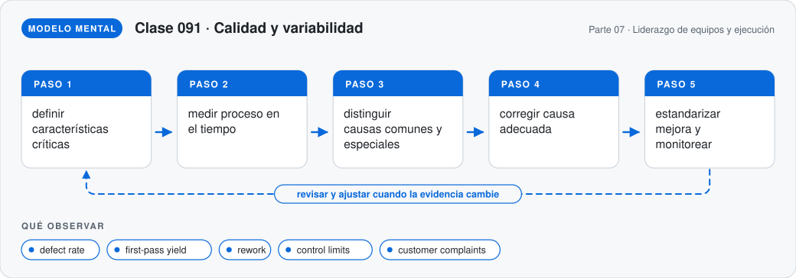

# Clase 091 — Calidad y variabilidad

<!-- nav:inicio -->
> **Parte 07 · Operaciones, procesos y calidad** — clase 7 de 12 · [índice de la parte](../../README.md) · [temario](../../../../SYLLABUS.md)
<!-- nav:fin -->

**Parte:** 07 — Operaciones, procesos y calidad  
**Nivel:** Etapa 2 — Jefe → Manager  
**Duración sugerida:** 150–180 minutos · **Estándar:** deep-class-v2

## 🎯 Propósito

Dos procesos pueden tener el mismo promedio y comportarse de manera muy distinta: uno entrega siempre cerca del objetivo y el otro oscila entre excelente y desastroso. La **variabilidad** es el enemigo silencioso de la calidad, y gestionarla exige distinguir entre lo normal del sistema y lo que viene de un hecho específico. Reaccionar a cada resultado malo como si fuera un incidente empeora el proceso; ignorar una señal real deja pasar un problema.

La clase se apoya en la crítica de Deming a las metas sin método y a la reacción a la variación común, en el control estadístico de procesos explicado por Wheeler y Chambers y en los requisitos de calidad de ISO 9001. Al terminar sabrás distinguir causas comunes y especiales, interpretar un gráfico de control simple, medir la capacidad de un proceso frente a lo que el cliente exige y decidir cuándo cambiar el sistema y cuándo investigar un hecho.

## 📚 Resultados de aprendizaje

Al finalizar podrás:

1. **Definir** calidad como cumplimiento de lo que el cliente necesita, medido en el proceso.
2. **Distinguir** variación por causas comunes y por causas especiales.
3. **Leer** un gráfico de control e identificar señales.
4. **Comparar** la variación del proceso con la tolerancia que exige el cliente.
5. **Decidir** si la respuesta es cambiar el sistema o investigar un hecho concreto.

## 🧭 Agenda

| Tramo | Qué se hace |
|---|---|
| 0–20 min | Recuperación: ¿qué métrica de tu área sube y baja y qué haces cuando baja? |
| 20–60 min | Calidad, variación y control estadístico. |
| 60–105 min | Ejemplo trabajado: tiempo de respuesta de un servicio. |
| 105–150 min | Caso ejecutivo y práctica de lectura de datos. |
| 150–175 min | Límites y entregable. |

## 🧩 Conceptos centrales

| Concepto | Definición | Cómo se reconoce |
|---|---|---|
| **Calidad** | Grado en que el resultado cumple lo que el cliente necesita y espera. | Se define con requisitos medibles. |
| **Variación** | Diferencia entre resultados del mismo proceso. | Ningún proceso entrega siempre lo mismo. |
| **Causas comunes** | Fuentes de variación propias del sistema, siempre presentes. | Los resultados oscilan dentro de un rango estable. |
| **Causas especiales** | Fuentes de variación ajenas al funcionamiento normal. | Un punto o patrón fuera de lo esperado. |
| **Gráfico de control** | Gráfico en el tiempo con límites calculados desde el propio proceso. | Distingue señal de ruido. |
| **Capacidad del proceso** | Relación entre la variación del proceso y la tolerancia exigida. | Un proceso estable puede no cumplir lo que se pide. |

## 🧠 Modelo mental

**Cómo leer el diagrama.** Dos paneles que se tratan de forma distinta. Las **causas comunes** son el ruido normal del sistema: se ven como puntos dentro de los límites y la respuesta correcta es **cambiar el sistema**, no reaccionar a cada punto. Las **causas especiales** son señales: un punto fuera de límites o un patrón anómalo; la respuesta es **investigar y actuar sobre esa causa**. Confundirlas es la fuente de la mayoría de las malas decisiones con datos.

## 📖 Desarrollo

### 1. Qué es calidad

Calidad no es «lo mejor posible», sino **cumplir lo que el cliente necesita** de forma consistente y a un costo razonable. Se concreta en requisitos medibles: un plazo, una tolerancia, una tasa de error aceptable. ISO 9001 plantea la calidad como un sistema de gestión: entender al cliente, definir procesos, medir, corregir y mejorar. Deming insiste en que la calidad se construye en el proceso, no se inspecciona al final: inspeccionar encuentra defectos, pero no los evita y los paga dos veces.

### 2. La variación existe siempre

Ningún proceso produce resultados idénticos. Dos cajeros, dos máquinas o el mismo empleado en dos días darán resultados distintos. El problema no es la variación, sino **no entenderla**. Un gerente que ve que las ventas de una semana fueron 8 % menores y pide explicaciones al equipo puede estar mirando ruido. Wheeler y Chambers enseñan que, antes de interpretar un cambio, hay que saber cuánta variación es normal en ese proceso.

### 3. Causas comunes y especiales

Shewhart y Deming distinguieron dos fuentes. Las **causas comunes** son inherentes al sistema: el diseño del proceso, los materiales, la formación, el entorno; producen un patrón estable de variación. Las **causas especiales** surgen de hechos concretos: una máquina descalibrada, un proveedor nuevo, un error de datos. Deming estimaba que la gran mayoría de los problemas de calidad se debe a causas comunes, es decir, es responsabilidad de la dirección, que diseña el sistema; las personas pueden hacer poco para reducir la variación común si el sistema no cambia.

### 4. Gráficos de control

Un gráfico de control grafica el resultado en el tiempo con una línea central y **límites de control** calculados a partir de la variación del propio proceso (en general, promedio más y menos tres desviaciones, estimadas según el método del gráfico). Los límites no son metas ni tolerancias del cliente: describen lo que el proceso hace. Señales habituales: un punto fuera de los límites, una racha larga de puntos del mismo lado de la línea central o una tendencia sostenida. Dentro de los límites y sin patrones, el proceso es estable y predecible.

### 5. Estable no es aceptable

Un proceso puede ser estable y aun así incumplir lo que el cliente requiere. Si los límites de control están fuera de la tolerancia, el proceso es predecible pero incapaz: se necesita rediseñarlo, no perseguir puntos. Por el contrario, un proceso inestable no permite predecir su capacidad. El orden es: primero se estabiliza (se eliminan causas especiales) y luego se mejora su capacidad (se reduce la variación común). Se compara la **voz del proceso** (los límites) con la **voz del cliente** (la tolerancia).

### 6. Errores típicos de reacción

Wheeler y Chambers describen dos errores simétricos. **Error tipo 1**: tratar una causa común como especial; se culpa a una persona o se cambia algo por un punto normal, lo que aumenta la variación (cada intervención añade ruido). **Error tipo 2**: tratar una causa especial como común y no investigar una señal real. Metas numéricas que se persiguen sin método, comparaciones de «este mes contra el anterior» y rankings de personas por diferencias que caen dentro de la variación normal son ejemplos del primer error.

### 7. Qué hacer con los datos

Antes de actuar: ¿cuántos datos hay?, ¿cuál es el rango normal?, ¿hay una señal? Si es causa especial, se investiga qué cambió (qué, cuándo, dónde, quién, por qué) y se corrige o se incorpora si es una mejora. Si es causa común, se estudia el sistema: proceso, entradas, métodos, equipos. Se evita reaccionar a puntos individuales y se mantienen los gráficos como parte de la gestión diaria. Con pocos datos, se declara la incertidumbre en vez de afirmar tendencias.

## 📚 Lectura comparada

| Obra | Qué aporta | Qué no resuelve | Pregunta para contrastar |
|---|---|---|---|
| Deming | Causas comunes y especiales; crítica a metas sin método. | Es un manifiesto de gestión; no es un manual estadístico. | ¿Qué parte del problema es del sistema? |
| Wheeler y Chambers | Lectura práctica de gráficos de control. | Se centra en procesos repetitivos. | ¿Tienes señal o ruido? |
| ISO 9001 | Sistema de gestión de calidad basado en procesos. | Pide mejorar, no dice cómo medir variación. | ¿Qué mide tu sistema de calidad? |
| Slack y Brandon-Jones | Calidad como parte de la dirección de operaciones. | Es general. | ¿Qué costos de calidad tienes? |
| Womack y Jones | Calidad en la fuente y flujo sin defectos. | Contexto manufacturero. | ¿Dónde se origina el defecto? |

## 🧮 Ejemplo trabajado

**Situación (hipotética).** Un servicio de atención por chat mide el tiempo hasta la primera respuesta, en minutos, durante 20 días. Los valores diarios promedio fueron: 6,1; 5,8; 6,4; 7,0; 5,5; 6,2; 6,0; 5,9; 6,6; 6,3; 5,7; 6,1; 6,5; 5,8; 6,0; 10,8; 6,2; 6,4; 5,9; 6,1. La política exige menos de 8 minutos y la gerencia pide explicaciones por el día 4 (7,0) y por el día 16 (10,8).

**Cálculo simple.** Sin el día 16, el promedio de los otros 19 es aproximadamente 6,1 minutos y la variación diaria típica ronda 0,4 minutos; los límites de control, de unos 6,1 ± 1,2, van de 4,9 a 7,3 minutos.

| Dato | Lectura |
|---|---|
| Día 4 (7,0) | Dentro de los límites: causa común. No requiere explicación individual. |
| Día 16 (10,8) | Muy fuera de límites: causa especial. Se investiga. |
| Cumplimiento | El proceso, con límites hasta 7,3, cabe bajo el requisito de 8: es capaz. |

**Investigación del día 16.** Se descubre que el sistema de colas falló dos horas y los mensajes no se asignaron; no es un problema de personas. Se agrega una alerta de cola sin asignar y un plan manual.

**Qué muestra.** (1) Pedir explicaciones por el día 4 habría sido reaccionar al ruido. (2) El día 16 sí era señal. (3) Además de estable, el proceso era capaz frente al requisito de 8 minutos; si el requisito fuera 6, habría que cambiar el sistema y no perseguir puntos.

## 🔀 Comparación y límites

**Control frente a especificación.** Los límites de control vienen del proceso; la especificación viene del cliente. Un punto puede estar dentro de la especificación y fuera de control (señal de problema que aún no daña al cliente) o dentro del control y fuera de especificación (proceso incapaz).

**Límites.** Los gráficos de control requieren datos en orden de tiempo y un proceso razonablemente repetitivo; en trabajo único o con muy pocos datos, su uso es limitado. Los cálculos de límites varían según el tipo de dato y gráfico, y aquí se simplificaron. La interpretación estadística exige cuidado: ver un patrón no prueba una causa. Y los requisitos de calidad regulados (alimentos, salud, seguridad) tienen exigencias propias que se comprueban en la norma vigente.

## 🪜 De profesional a owner

| Nivel | Cómo trata la variabilidad |
|---|---|
| **Profesional** | Registra datos fiables y reporta anomalías con contexto. |
| **Jefe / Team Lead** | Lee gráficos de su proceso y evita reaccionar a puntos individuales. |
| **Gerente** | Distingue problemas del sistema de problemas de ejecución. |
| **CEO / Director** | Evita metas sin método y corrige el sistema que produce la variación. |
| **Founder / Owner** | Mide pocas métricas de calidad desde temprano y las lee con criterio. |

## 🏢 Caso ejecutivo

Una empresa de logística mide la proporción de entregas a tiempo cada semana. Durante seis meses fluctúa entre 88 % y 94 %. La dirección ha cambiado dos veces al gerente de operaciones tras semanas de 88 %, ha premiado a jefes de bodega por semanas de 94 % y ha fijado una meta de 97 %. Un analista muestra que el proceso es estable alrededor de 91 % con límites de 86 % a 96 %, salvo una semana de 76 % en la que hubo un paro de transportistas.

Entrega un **análisis de calidad y variabilidad** con: (a) lectura del gráfico y distinción de causas comunes y especiales; (b) el juicio sobre las decisiones tomadas (cambios de gerente, premios, meta); (c) la capacidad frente a la meta de 97 %; (d) qué cambios de sistema harían falta para alcanzarla y su costo; (e) cómo se investigará la semana de 76 %; (f) el conjunto de medidas y reglas de lectura que usará la dirección.

## 🧪 Práctica

1. Reúne 20 datos en orden de tiempo de una métrica de tu proceso.
2. Calcula el promedio y la variación típica, y marca los límites aproximados.
3. Identifica puntos que sean señal y puntos que sean ruido.
4. Compara los límites con lo que exige el cliente.
5. Escribe qué decisión tomarías si es causa común y cuál si es especial.

## ⚠️ Errores frecuentes

| Error | Por qué ocurre | Cómo corregirlo |
|---|---|---|
| Reaccionar a cada punto | Se busca responsable | Mirar el patrón con límites. |
| Premiar o castigar por ruido | Se interpretan diferencias pequeñas | Comparar con la variación normal. |
| Metas sin método | Se fija un número deseado | Estudiar la capacidad del sistema. |
| Confundir control con especificación | Ambas parecen «límites» | Distinguir voz del proceso y del cliente. |
| Inspeccionar al final | Es lo habitual | Calidad en el proceso. |
| Declarar tendencia con pocos datos | Se quiere una conclusión | Declarar la incertidumbre. |

## ❓ Preguntas de comprobación

1. ¿Cómo se define calidad en esta clase?
2. ¿Qué diferencia hay entre causas comunes y especiales?
3. ¿Qué señales indica un gráfico de control?
4. ¿Qué significa que un proceso sea estable pero incapaz?
5. ¿Qué dos errores de reacción describen Wheeler y Chambers?
6. ¿Por qué las metas sin método son problemáticas?
7. ¿Qué límites tiene el uso de gráficos de control?

Claves de respuesta

1. Cumplir de forma consistente lo que el cliente necesita, con requisitos medibles.
2. Las comunes son propias del sistema y siempre presentes; las especiales vienen de un hecho concreto y no son parte normal del proceso.
3. Un punto fuera de límites, una racha larga de un mismo lado de la línea central o una tendencia sostenida.
4. Que es predecible, pero su variación no cabe en lo que exige el cliente; hay que rediseñar el sistema.
5. Tratar una causa común como especial, y tratar una causa especial como común.
6. Porque se persigue un número sin cambiar el sistema que lo produce, lo que genera presión, manipulación o ruido.
7. Requieren datos en orden y procesos repetitivos; con pocos datos o trabajo único son limitados y un patrón no prueba una causa.

## 📥 Entregable

Guarda en `portfolio/091-calidad-y-variabilidad/`:

- `operating-improvement-brief.md` (plantilla [Operating Improvement Brief](../../../../templates/operating-improvement-brief.md)) con el análisis del caso ejecutivo;
- `process-map.md` (plantilla [Process map](../../../../templates/process-map.md)) con el gráfico de control y los puntos de control propuestos;
- `decision-journal.md` con las reglas de lectura acordadas y las decisiones sobre causas especiales.

## 📗 Fuentes y verificación

- W. Edwards Deming — *Out of the Crisis* (The MIT Press, 2000). **Uso en esta clase:** causas comunes y especiales y crítica a las metas sin método. Lectura selectiva sobre **calidad y variabilidad**. **Localizador:** [ISBN-13 9780262541152](https://openlibrary.org/isbn/9780262541152).
- Donald J. Wheeler & David S. Chambers — *Understanding Statistical Process Control* (SPC Press, 1992). **Uso en esta clase:** lectura práctica de gráficos de control. Lectura selectiva sobre **calidad y variabilidad**. **Localizador:** [ISBN-13 9780945320135](https://openlibrary.org/isbn/9780945320135).
- ISO — *ISO 9001 Quality management systems*. **Uso en esta clase:** sistema de gestión de calidad basado en procesos. **Localizador pendiente:** ver [el registro de fuentes](../../../../docs/FUENTES.md).
- Nigel Slack & Alistair Brandon-Jones — *Operations Management* (Pearson Education, Limited, 2019). **Uso en esta clase:** calidad como parte de la dirección de operaciones. Lectura selectiva sobre **calidad y variabilidad**. **Localizador:** [ISBN-13 9781292254036](https://openlibrary.org/isbn/9781292254036).
- James P. Womack & Daniel T. Jones — *Lean Thinking* (Free Press, 2003). **Uso en esta clase:** calidad en la fuente y flujo sin defectos. Lectura selectiva sobre **calidad y variabilidad**. **Localizador:** [ISBN-13 9780743231640](https://openlibrary.org/isbn/9780743231640).

> **Regla de fuentes para Calidad y variabilidad:** las obras anteriores estructuran las perspectivas de esta materia; cualquier norma, ley o estándar vivo mencionado debe comprobarse nuevamente en su fuente primaria vigente, incluidas las exigencias regulatorias del sector. Los ejemplos y casos son hipotéticos, con cifras ilustrativas. El desarrollo es original y no reproduce capítulos protegidos.

<!-- pie:inicio -->
---

| Anterior | Índice | Siguiente |
|---|---|---|
| [← 090 · Lean y eliminación de desperdicio](../090-lean-y-eliminacion-de-desperdicio/README.md) | [Parte 07](../../README.md) · [Programa](../../../../SYLLABUS.md) | [092 · SLA, SLO y niveles de servicio →](../092-sla-slo-y-niveles-de-servicio/README.md) |
<!-- pie:fin -->
