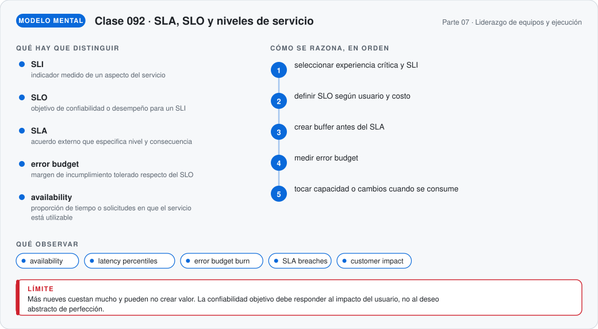

# Clase 092 — SLA, SLO y niveles de servicio

<!-- nav:inicio -->
> **Parte 07 · Operaciones, procesos y calidad** — clase 8 de 12 · [índice de la parte](../../README.md) · [temario](../../../../SYLLABUS.md)
<!-- nav:fin -->

**Parte:** 07 — Operaciones, procesos y calidad  
**Nivel:** Etapa 2 — Jefe → Manager  
**Duración sugerida:** 150–180 minutos · **Estándar:** deep-class-v2

## 🎯 Propósito

Un servicio sin nivel acordado se juzga por la última queja. «Rápido», «disponible» o «confiable» significan cosas distintas para quien presta y quien recibe, y la diferencia se descubre en el peor momento. Definir **niveles de servicio** convierte esas palabras en compromisos medibles: qué se mide, cuánto se promete, desde cuándo, con qué excepciones y qué ocurre si no se cumple. Es una de las herramientas más útiles para alinear áreas internas, proveedores y clientes.

La clase integra la práctica de ingeniería de confiabilidad de sitios (Beyer y otros) —indicadores, objetivos y presupuesto de error—, la gestión de operaciones de servicio de Slack y Brandon-Jones y los requisitos de gestión de calidad de ISO 9001. Al terminar sabrás elegir indicadores que reflejen la experiencia del usuario, fijar objetivos realistas, distinguir objetivo interno de acuerdo contractual y usar el presupuesto de error para decidir entre estabilidad y cambio.

## 📚 Resultados de aprendizaje

Al finalizar podrás:

1. **Distinguir** indicador (SLI), objetivo (SLO) y acuerdo (SLA).
2. **Elegir** indicadores que reflejen lo que el usuario percibe.
3. **Fijar** objetivos con base en datos y en lo que el cliente necesita.
4. **Calcular** un presupuesto de error y usarlo en decisiones.
5. **Redactar** un acuerdo de servicio con medición, exclusiones y consecuencias claras.

## 🧭 Agenda

| Tramo | Qué se hace |
|---|---|
| 0–20 min | Recuperación: ¿qué servicio interno te «prometen» sin que exista un número acordado? |
| 20–60 min | Indicadores, objetivos, acuerdos y presupuesto de error. |
| 60–105 min | Ejemplo trabajado: un servicio de pagos. |
| 105–150 min | Caso ejecutivo y práctica de redacción. |
| 150–175 min | Límites y entregable. |

## 🧩 Conceptos centrales

| Concepto | Definición | Cómo se reconoce |
|---|---|---|
| **SLI (indicador de nivel de servicio)** | Medida cuantitativa de un aspecto del servicio que importa al usuario. | Porcentaje de solicitudes atendidas bajo un tiempo dado. |
| **SLO (objetivo de nivel de servicio)** | Valor o rango que se busca lograr para un SLI en un período. | «99,5 % de solicitudes en menos de 2 s en 30 días». |
| **SLA (acuerdo de nivel de servicio)** | Compromiso con el cliente, con consecuencias si no se cumple. | Tiene créditos, penalizaciones o derechos de salida. |
| **Presupuesto de error** | Diferencia entre 100 % y el SLO: falla tolerable en el período. | Se consume con incidentes y cambios. |
| **Ventana de medición** | Período sobre el que se calcula el indicador. | Mensual, trimestral, móvil. |
| **Exclusión** | Condición que no cuenta contra el nivel (mantenimiento acordado, fuerza mayor). | Se define con precisión en el acuerdo. |

## 🧠 Modelo mental

**Cómo leer el diagrama.** Cuatro peldaños que se apoyan entre sí. Primero se elige un **indicador** que refleje lo que el usuario percibe. Sobre él se fija un **objetivo** interno. El **acuerdo** con el cliente se pone por debajo del objetivo, para dejar margen. Y el **presupuesto de error** —lo que el objetivo permite fallar— se usa para decidir entre lanzar cambios o estabilizar. Saltarse un peldaño produce promesas que nadie sabe medir.

## 📖 Desarrollo

### 1. Del adjetivo al número

«Respondemos rápido» no es un compromiso. «El 95 % de las solicitudes recibe una primera respuesta en menos de 4 horas hábiles, medido mensualmente» sí lo es. Para llegar ahí se responden cinco preguntas: ¿qué se mide?, ¿en qué unidad?, ¿con qué umbral?, ¿en qué ventana? y ¿quién mide? Un nivel de servicio útil es **específico, medible, comprensible para el cliente y controlable por quien lo presta**. Medir algo que no se controla produce frustración; medir algo irrelevante produce falsa tranquilidad.

### 2. Elegir indicadores desde la experiencia del usuario

Beyer y su equipo recomiendan partir de lo que el usuario experimenta: **disponibilidad** (¿pudo usar el servicio?), **latencia** (¿cuánto tardó?), **calidad o corrección** (¿obtuvo el resultado correcto?) y **rendimiento o capacidad**. Un indicador técnico, como el uso de CPU de un servidor, rara vez es un buen SLI porque el usuario no lo percibe. En servicios no técnicos aplican lo mismo: tiempo de primera respuesta, tiempo de resolución, porcentaje resuelto al primer contacto. Conviene pocos indicadores bien elegidos.

### 3. Fijar el objetivo

El objetivo no debería ser «lo más alto posible». Cada punto adicional de disponibilidad cuesta más: pasar de 99 % a 99,9 % puede ser razonable; de 99,99 % a 99,999 % puede costar un orden de magnitud más. Se fija con tres insumos: lo que el cliente **necesita** (¿qué ocurre si falla una hora?), lo que el sistema **hoy logra** (datos históricos) y lo que **cuesta** mejorarlo. Un objetivo que nunca se cumple pierde credibilidad; uno que se cumple siempre con holgura quizá es demasiado bajo o desperdicia capacidad.

### 4. SLO interno y SLA externo

El **SLO** es una meta interna para orientar al equipo; el **SLA** es una promesa contractual con consecuencias. Se recomienda que el SLO sea **más exigente** que el SLA, para que el equipo reaccione antes de incumplir la promesa. Un SLA incluye: indicadores, umbrales, ventana, exclusiones, procedimiento de medición, reporte, remedios (créditos, multas, derecho de terminación) y límite de responsabilidad. Los aspectos contractuales y de responsabilidad son jurídicos y se redactan con asesoría, no con lo que enseña esta clase.

### 5. Presupuesto de error

Si el objetivo de disponibilidad es 99,9 % en 30 días, el presupuesto de error es 0,1 %: unos 43 minutos de falla tolerables. Mientras queda presupuesto, el equipo puede lanzar cambios con cierto riesgo; si se agota, se prioriza la estabilidad. Esto convierte una discusión de opiniones («¿lanzamos o esperamos?») en una regla compartida entre quienes quieren cambiar y quienes quieren estabilidad. El principio sirve más allá de la tecnología: es una forma explícita de decidir cuánta imperfección se tolera.

### 6. Medir, reportar y actuar

Un nivel de servicio solo existe si se mide de forma confiable y se reporta con regularidad a quienes pueden actuar. Se define **quién** mide (idealmente alguien independiente del que presta), **cómo** (fuente de datos, muestreo) y **cuándo** se revisa. Los reportes muestran el cumplimiento, el presupuesto consumido y las causas principales de incumplimiento. Las revisiones periódicas ajustan los objetivos con base en datos: se endurecen si hay holgura constante o se revisan si el cliente cambió lo que necesita.

### 7. Servicios internos

Los acuerdos entre áreas de una misma empresa (tecnología, compras, personas, finanzas) funcionan igual y evitan la fricción cotidiana: «¿cuánto tarda en procesarse una contratación?», «¿en cuántos días se paga a un proveedor?». Se redactan con tono de colaboración, no de castigo: su finalidad es hacer visible el servicio y priorizar la mejora. Un acuerdo interno sin consecuencias ni revisión se convierte en un documento más; uno con medición y conversación periódica mejora el servicio.

## 📚 Lectura comparada

| Obra | Qué aporta | Qué no resuelve | Pregunta para contrastar |
|---|---|---|---|
| Beyer y otros (*Site Reliability Engineering*) | Indicadores, objetivos y presupuesto de error. | Contexto de sistemas de software a gran escala. | ¿Qué indicador percibe tu usuario? |
| Slack y Brandon-Jones | Medidas de desempeño en operaciones de servicio. | Es general. | ¿Qué prometes y qué entregas? |
| ISO 9001 | Seguimiento de la satisfacción y del desempeño del sistema. | No fija umbrales. | ¿Cómo mides la satisfacción? |
| Womack y Jones | Valor desde el cliente. | No da métricas de servicio. | ¿Qué plazo valora el cliente? |
| Deming | Variación y sistema detrás de los resultados. | Sin enfoque contractual. | ¿Es una falla del sistema o un hecho especial? |

## 🧮 Ejemplo trabajado

**Situación (hipotética).** Una empresa de pagos ofrece una interfaz de programación a comercios. Hoy no hay SLA formal. Un comercio grande exige «99,99 % de disponibilidad». El historial de los últimos 6 meses muestra una disponibilidad real de 99,93 %.

| Paso | Qué se decide |
|---|---|
| **Indicador** | Proporción de solicitudes de pago respondidas sin error del servidor en menos de 1 s, en vez de «el servidor está encendido». |
| **Objetivo interno** | 99,9 % mensual: presupuesto de error de 0,1 %, unos 43 minutos equivalentes por mes. |
| **Acuerdo** | 99,5 % mensual, con créditos escalonados bajo ese valor; deja margen de 0,4 puntos. |
| **Exclusiones** | Mantenimientos avisados con 72 horas, fuerza mayor definida, fallas del comercio. |
| **Medición** | Registro de la plataforma con acceso del cliente a un tablero. |

**Uso del presupuesto.** En un mes, un incidente consume 35 de 43 minutos. Se acuerda congelar lanzamientos no urgentes hasta el siguiente período y priorizar una mejora de resiliencia.

**Respuesta al comercio.** Con datos, se explica que 99,99 % admite solo 4 minutos de falla al mes, que hoy no se logra y que exigirlo supondría una inversión que se traduciría en precio. Se ofrece 99,5 % contractual, con objetivo interno de 99,9 % y un plan para evaluar un nivel superior con tarifa adicional.

**Qué muestra.** (1) El indicador se definió desde el usuario. (2) El acuerdo quedó bajo el objetivo, con margen. (3) El presupuesto de error ordenó una decisión de cambio.

## 🔀 Comparación y límites

**SLA frente a garantía.** Un SLA no garantiza que el servicio no falle; define qué pasa cuando falla. El valor para el cliente está en la previsibilidad y en el remedio.

**Límites.** Los objetivos altos tienen costos crecientes y no siempre vale la pena pagarlos. Un indicador mal elegido puede cumplirse mientras la experiencia empeora. La práctica de presupuesto de error nació en ingeniería de software; su adaptación a otros servicios exige criterio. Los remedios, exclusiones y responsabilidades de un acuerdo tienen implicancias legales que deben revisarse con abogados y según la normativa aplicable, incluida la protección del consumidor cuando corresponda.

## 🪜 De profesional a owner

| Nivel | Cómo participa en niveles de servicio |
|---|---|
| **Profesional** | Conoce el objetivo de su servicio y avisa antes de incumplirlo. |
| **Jefe / Team Lead** | Mide los indicadores de su equipo y los conversa con sus clientes internos. |
| **Gerente** | Negocia acuerdos realistas con otras áreas y proveedores. |
| **CEO / Director** | Decide qué nivel vale su costo y qué promesas hace al mercado. |
| **Founder / Owner** | Evita prometer de más al inicio y construye credibilidad con lo que sí cumple. |

## 🏢 Caso ejecutivo

Una empresa de salud digital ofrece teleconsulta a aseguradoras. El contrato actual promete «alta disponibilidad» sin número. Tras un corte de tres horas durante una campaña de vacunación, una aseguradora exige un SLA con multas. Operaciones dice que el servicio tiene 99,7 % de disponibilidad; la aseguradora mide solo sus horarios de mayor uso y afirma que fue de 98 %. Hay un proveedor de video del que depende el servicio.

Entrega una **propuesta de niveles de servicio** que incluya: (a) los indicadores desde la experiencia de pacientes y aseguradoras; (b) los objetivos internos y el SLA propuesto con su margen; (c) la ventana de medición, incluyendo horarios críticos; (d) quién mide y cómo se resuelven discrepancias; (e) el presupuesto de error y la regla de decisión asociada; (f) cómo se refleja la dependencia del proveedor de video y qué aspectos contractuales se derivarán a asesoría legal.

## 🧪 Práctica

1. Elige un servicio y define dos indicadores desde la experiencia del usuario.
2. Revisa datos históricos y fija un objetivo con su justificación.
3. Propón un acuerdo con margen respecto del objetivo.
4. Calcula el presupuesto de error en minutos o en solicitudes.
5. Redacta la regla: qué hará el equipo cuando se agote el presupuesto.

## ⚠️ Errores frecuentes

| Error | Por qué ocurre | Cómo corregirlo |
|---|---|---|
| Prometer «lo máximo» | Se quiere vender | Fijar el objetivo con datos y costo. |
| Indicadores técnicos que el usuario no percibe | Son fáciles de medir | Partir de la experiencia. |
| SLA igual al SLO | Se quiere simplicidad | Dejar margen entre ambos. |
| Medir sin acuerdo sobre la fuente | Cada parte usa sus datos | Definir quién mide y cómo. |
| Exclusiones vagas | Se evita la negociación | Definir con precisión. |
| Acuerdos internos sin revisión | Se firman y se olvidan | Revisión periódica con datos. |

## ❓ Preguntas de comprobación

1. ¿Qué diferencia hay entre SLI, SLO y SLA?
2. ¿Por qué se parte de la experiencia del usuario para elegir indicadores?
3. ¿Por qué el SLO suele ser más exigente que el SLA?
4. ¿Qué es el presupuesto de error y cómo se usa?
5. ¿Qué debe definirse sobre la medición?
6. ¿Por qué no conviene fijar el objetivo «lo más alto posible»?
7. ¿Qué parte de un acuerdo requiere asesoría legal?

Claves de respuesta

1. El SLI es la medida, el SLO el valor interno que se busca y el SLA el compromiso con el cliente, con consecuencias.
2. Porque un indicador que el usuario no percibe puede cumplirse mientras la experiencia empeora.
3. Para dejar margen y reaccionar antes de incumplir la promesa contractual.
4. Es la falla tolerable que permite el objetivo; se usa para decidir entre lanzar cambios y priorizar la estabilidad.
5. Quién mide, con qué fuente, cómo, en qué ventana y cómo se resuelven discrepancias.
6. Porque cada punto adicional cuesta más y un objetivo inalcanzable pierde credibilidad.
7. Los remedios, exclusiones, límites de responsabilidad y las normas de protección que apliquen.

## 📥 Entregable

Guarda en `portfolio/092-sla-slo-y-niveles-de-servicio/`:

- `operating-improvement-brief.md` (plantilla [Operating Improvement Brief](../../../../templates/operating-improvement-brief.md)) con la propuesta de niveles de servicio del caso ejecutivo;
- `process-map.md` (plantilla [Process map](../../../../templates/process-map.md)) con el recorrido de medición, reporte y escalamiento;
- `decision-journal.md` con los objetivos fijados, el margen elegido y la regla del presupuesto de error.

## 📗 Fuentes y verificación

- Betsy Beyer, Chris Jones, Jennifer Petoff & Niall Richard Murphy — *Site Reliability Engineering* (O'Reilly Media, 2016). **Uso en esta clase:** indicadores, objetivos y presupuesto de error. Lectura selectiva sobre **sla, slo y niveles de servicio**. **Localizador:** [ISBN-13 9781491929124](https://openlibrary.org/isbn/9781491929124).
- Nigel Slack & Alistair Brandon-Jones — *Operations Management* (Pearson Education, Limited, 2019). **Uso en esta clase:** medidas de desempeño en operaciones de servicio. Lectura selectiva sobre **sla, slo y niveles de servicio**. **Localizador:** [ISBN-13 9781292254036](https://openlibrary.org/isbn/9781292254036).
- ISO — *ISO 9001 Quality management systems*. **Uso en esta clase:** seguimiento de la satisfacción y del desempeño del sistema. **Localizador pendiente:** ver [el registro de fuentes](../../../../docs/FUENTES.md).
- James P. Womack & Daniel T. Jones — *Lean Thinking* (Free Press, 2003). **Uso en esta clase:** valor definido desde el cliente. Lectura selectiva sobre **sla, slo y niveles de servicio**. **Localizador:** [ISBN-13 9780743231640](https://openlibrary.org/isbn/9780743231640).
- W. Edwards Deming — *Out of the Crisis* (The MIT Press, 2000). **Uso en esta clase:** variación y sistema detrás de los resultados. Lectura selectiva sobre **sla, slo y niveles de servicio**. **Localizador:** [ISBN-13 9780262541152](https://openlibrary.org/isbn/9780262541152).

> **Regla de fuentes para SLA, SLO y niveles de servicio:** las obras anteriores estructuran las perspectivas de esta materia; cualquier norma, ley o estándar vivo mencionado debe comprobarse nuevamente en su fuente primaria vigente, y los contratos y acuerdos se revisan con asesoría legal. Los ejemplos y casos son hipotéticos, con cifras ilustrativas. El desarrollo es original y no reproduce capítulos protegidos.

<!-- pie:inicio -->
---

| Anterior | Índice | Siguiente |
|---|---|---|
| [← 091 · Calidad y variabilidad](../091-calidad-y-variabilidad/README.md) | [Parte 07](../../README.md) · [Programa](../../../../SYLLABUS.md) | [093 · Proveedores y terceros →](../093-proveedores-y-terceros/README.md) |
<!-- pie:fin -->
