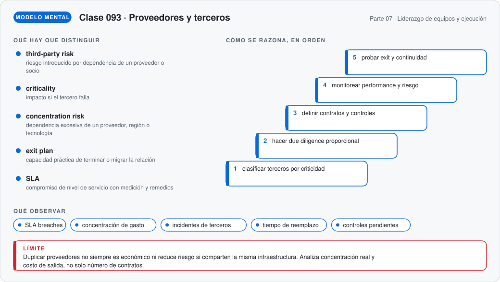

# Clase 093 — Proveedores y terceros

<!-- nav:inicio -->
> **Parte 07 · Operaciones, procesos y calidad** — clase 9 de 12 · [índice de la parte](../../README.md) · [temario](../../../../SYLLABUS.md)
<!-- nav:fin -->

**Parte:** 07 — Operaciones, procesos y calidad  
**Nivel:** Etapa 2 — Jefe → Manager  
**Duración sugerida:** 150–180 minutos · **Estándar:** deep-class-v2

## 🎯 Propósito

Ninguna empresa hace todo sola. Proveedores, subcontratistas, plataformas, distribuidores y socios forman parte de la operación, y cuando uno falla, el cliente no distingue a quién culpar: la falla es de quien le vendió. Gestionar terceros no es solo negociar precio, sino decidir **qué se hace dentro y qué se compra fuera**, cuánto depender de cada proveedor y qué plan existe si dejan de cumplir. La dependencia no declarada es un riesgo operativo y estratégico.

La clase se apoya en la economía de costos de transacción de Williamson para entender cuándo conviene hacer o comprar y cuándo aparece dependencia, en los requisitos de ISO 9001 sobre control de procesos suministrados externamente, en ISO 22301 sobre continuidad y en la gestión de operaciones de Slack y Brandon-Jones. Al terminar sabrás clasificar proveedores por impacto y facilidad de sustitución, estructurar la relación según esa clasificación, evaluarlos y preparar salidas.

## 📚 Resultados de aprendizaje

Al finalizar podrás:

1. **Decidir** de forma razonada qué hacer internamente y qué comprar a terceros.
2. **Clasificar** proveedores por impacto en el negocio y dificultad de sustitución.
3. **Evaluar** proveedores con criterios más amplios que el precio.
4. **Estructurar** acuerdos de servicio, seguimiento y plan de salida.
5. **Identificar** la dependencia de proveedores de proveedores y concentración.

## 🧭 Agenda

| Tramo | Qué se hace |
|---|---|
| 0–20 min | Recuperación: ¿qué proveedor, si desaparece mañana, detendría tu operación? |
| 20–60 min | Hacer o comprar, clasificación, evaluación y salida. |
| 60–105 min | Ejemplo trabajado: un proveedor de plataforma de pagos. |
| 105–150 min | Caso ejecutivo y práctica. |
| 150–175 min | Límites y entregable. |

## 🧩 Conceptos centrales

| Concepto | Definición | Cómo se reconoce |
|---|---|---|
| **Hacer o comprar** | Decisión de producir internamente o adquirir a un tercero. | Se compara costo, control, riesgo y capacidades. |
| **Proveedor crítico** | Tercero cuya falla detiene o degrada una operación esencial. | No tiene reemplazo rápido. |
| **Costo de transacción** | Costo de buscar, negociar, vigilar y hacer cumplir un acuerdo. | Aumenta con la incertidumbre y la inversión específica. |
| **Activo específico** | Inversión que vale mucho en una relación y poco fuera de ella. | Crea dependencia mutua o unilateral. |
| **Concentración** | Dependencia de un solo proveedor, región o tecnología. | Un solo punto de falla. |
| **Plan de salida** | Preparación para terminar la relación o cambiar de proveedor. | Datos, conocimiento y alternativa identificados. |

## 🧠 Modelo mental

**Cómo leer el diagrama.** Dos ejes: cuánto afecta el proveedor al negocio y cuán difícil es reemplazarlo. En la zona de **alto impacto y difícil sustitución** se necesita relación cercana, contrato claro y plan de salida; donde el impacto es alto pero la sustitución es fácil basta con **tener una alternativa probada**; donde el impacto es bajo se **simplifica la compra**, pero se vigila que la dependencia no crezca sin que se note.

## 📖 Desarrollo

### 1. Hacer o comprar

La pregunta de fondo es qué actividades debe controlar la empresa y cuáles puede adquirir. Williamson explica que el mercado es eficiente cuando los bienes son estándar y fáciles de comparar, pero que, cuando la relación exige inversiones específicas, hay incertidumbre y se repite, aparecen costos de transacción y riesgo de dependencia que pueden favorecer integrar la actividad o pactar contratos más elaborados. En términos prácticos: se produce internamente lo que **es central a la ventaja competitiva** o **es demasiado riesgoso de depender**, y se compra lo que es estándar y tiene mercado competitivo.

### 2. Clasificar a los proveedores

No todos requieren la misma atención. Una clasificación simple usa dos preguntas: **¿cuánto afecta al negocio si falla?** y **¿qué tan difícil es reemplazarlo?** Esto da cuatro grupos: críticos y difíciles de sustituir (alianza y plan de salida), críticos pero sustituibles (alternativa probada), poco críticos y sustituibles (compra simple) y poco críticos pero difíciles de sustituir (vigilar). La clasificación se revisa cuando cambia el negocio: un proveedor que era marginal puede volverse crítico sin que nadie lo note.

### 3. Evaluar más allá del precio

El precio es un criterio, no el único. Se evalúan **capacidad y estabilidad** (¿puede crecer con nosotros?, ¿está financieramente sano?), **calidad y desempeño** (historial, indicadores), **riesgos** (concentración geográfica, dependencias propias, seguridad de la información, continuidad), **cumplimiento** (normativa, ética, protección de datos) y **relación** (flexibilidad, transparencia). ISO 9001 exige determinar los controles de procesos y servicios suministrados externamente en proporción a su impacto y a la capacidad del proveedor. El costo total de propiedad incluye gestión, fallas y salida.

### 4. Estructurar la relación

Los acuerdos se ajustan a la clasificación. Con un proveedor crítico: **niveles de servicio medibles** (clase 092), derechos de auditoría, obligaciones de aviso de incidentes, planes de continuidad, responsabilidades y remedios, propiedad y portabilidad de datos y condiciones de terminación y transición. Con uno estándar: términos simples y comparables. La redacción y las cláusulas jurídicas se preparan con asesoría legal; lo operativo se define con quien usa el servicio. Un contrato sin seguimiento es un papel: se acuerda una frecuencia de reuniones, informes y revisión.

### 5. Concentración y dependencias ocultas

La concentración aparece en varias formas: un único proveedor para una función esencial, varios proveedores que dependen de la misma infraestructura o región, o una tecnología sin alternativas viables. Los proveedores de proveedores (la cuarta parte) también importan: si el servicio de pagos depende de una nube específica, una falla de esa nube te afecta aunque el contrato sea con otro. Se mapea la cadena de dependencias para los procesos críticos y se decide dónde diversificar, dónde mantener un respaldo mínimo y dónde aceptar el riesgo con conciencia.

### 6. Seguimiento y desempeño

Se mide el desempeño del proveedor con indicadores acordados, se registran incidentes y se revisa periódicamente con él. La conversación no es solo de reclamo: los proveedores que comprenden el negocio del cliente pueden aportar mejoras. Se evita la relación puramente adversarial con quienes son críticos, porque la transparencia en los problemas es la que permite reaccionar a tiempo. Y se registran las decisiones: por qué se eligió, qué se esperaba y qué cambió, para aprender del historial.

### 7. Plan de salida

Todo contrato crítico debería tener un plan de salida **antes** de necesitarlo: qué datos y conocimiento se pueden recuperar y en qué formato, qué alternativas existen y cuánto tardaría cambiar, qué costos tiene y qué obligaciones de transición asume el proveedor. En algunos casos conviene mantener un segundo proveedor activo con un volumen pequeño para conservar la capacidad de cambiar. Un plan de salida nunca ejercido es una hipótesis: se prueba con un ejercicio parcial (por ejemplo, restaurar datos exportados) para comprobar que funciona.

## 📚 Lectura comparada

| Obra | Qué aporta | Qué no resuelve | Pregunta para contrastar |
|---|---|---|---|
| Williamson (1979) | Costos de transacción, activos específicos y dependencia. | Marco teórico; no da una lista de verificación. | ¿Qué inversión específica ata tu relación? |
| ISO 9001 | Control de procesos y servicios suministrados externamente. | Exige determinar controles, no los define. | ¿Qué control aplicas a cada proveedor? |
| ISO 22301 | Continuidad que incluye dependencias de terceros. | Es un estándar de sistema, no un contrato. | ¿Qué ocurre si cae tu proveedor? |
| Slack y Brandon-Jones | Gestión de la cadena de suministro y relaciones. | Es general. | ¿Qué relación necesita cada proveedor? |
| Hammer y Champy | Reducir fronteras que añaden traspasos. | Su enfoque radical tiene costos. | ¿Qué traspasos con terceros añaden espera? |

## 🧮 Ejemplo trabajado

**Situación (hipotética).** Una tienda en línea con ventas anuales de USD 20 millones usa un único proveedor de plataforma de pagos, que procesa el 100 % de las transacciones. El proveedor sube su comisión de 2,4 % a 2,9 % con aviso de 30 días. Migrar costaría unas 8 semanas de trabajo técnico y riesgo de interrupción.

| Pregunta | Respuesta |
|---|---|
| Impacto si falla | Alto: sin pagos no hay ventas. |
| Dificultad de sustitución | Alta: integración propia, historial de clientes y tarjetas guardadas dentro del proveedor. |
| Zona del cuadrante | Alto impacto y difícil de sustituir: alianza y plan de salida. |
| Costo del alza | 0,5 puntos × USD 20 millones = USD 100.000 al año. |
| Costo de migrar | Estimado entre USD 60.000 y USD 120.000 más riesgo de interrupción. |

**Decisión.** La empresa no migra de inmediato, pero (a) negocia con el proveedor usando una cotización de un segundo proveedor como referencia, (b) integra al segundo proveedor para el 10 % de las transacciones, (c) exige portabilidad de las tarjetas guardadas con un procedimiento documentado y (d) incorpora en el contrato un aviso de 90 días para cambios de precio.

**Resultado.** El proveedor acepta 2,6 % y los 90 días de aviso; la empresa mantiene el segundo proveedor como respaldo. El costo se evalúa trimestralmente contra el de migrar completamente.

**Qué muestra.** (1) La dependencia estaba escondida en la comodidad. (2) El segundo proveedor fue una herramienta de negociación y de continuidad. (3) El plan de salida se hizo antes de necesitarlo.

## 🔀 Comparación y límites

**Tercerizar frente a integrar.** Tercerizar baja la inversión y da flexibilidad; integrar da control y protege conocimiento. La decisión cambia con el tiempo: lo que era marginal puede volverse central.

**Límites.** El cuadrante simplifica; algunos proveedores caen en el límite entre zonas y requieren juicio. Evaluar proveedores exige datos que no siempre se obtienen (finanzas, subcontratistas). Los aspectos contractuales —responsabilidad, protección de datos, cláusulas de salida— son jurídicos y se resuelven con asesoría y la normativa aplicable, incluyendo la de datos personales y la sectorial. Y la diversificación tiene costo: dos proveedores duplican parte de la gestión.

## 🪜 De profesional a owner

| Nivel | Cómo participa con terceros |
|---|---|
| **Profesional** | Usa el servicio y reporta fallas con evidencia. |
| **Jefe / Team Lead** | Hace seguimiento operativo del proveedor de su área. |
| **Gerente** | Clasifica proveedores, negocia acuerdos y vigila la concentración. |
| **CEO / Director** | Decide qué actividades se controlan internamente y qué dependencias se aceptan. |
| **Founder / Owner** | Evita depender de un solo proveedor para lo esencial sin un respaldo mínimo. |

## 🏢 Caso ejecutivo

Una fintech en crecimiento depende de una empresa que le entrega los datos de identificación de clientes, de otra que aloja su plataforma y de una tercera que envía las notificaciones. La empresa de identificación ha sufrido dos caídas en tres meses y está en conversaciones para ser adquirida por un competidor. El proveedor de alojamiento tiene el 100 % de la infraestructura en una sola región. El equipo de compras propone cambiar a quien ofrezca menor precio.

Entrega un **plan de gestión de terceros** que contenga: (a) la decisión de hacer o comprar para cada función; (b) la clasificación de los tres proveedores; (c) los criterios de evaluación más allá del precio; (d) las condiciones contractuales que se pedirán, señalando qué se derivará a asesoría legal; (e) los riesgos de concentración y dependencias ocultas; (f) el plan de salida y el ejercicio para probarlo.

## 🧪 Práctica

1. Lista tus diez proveedores principales y clasifícalos en el cuadrante.
2. Elige uno crítico y mapea de qué depende él.
3. Define cinco criterios de evaluación con su evidencia.
4. Escribe qué contendría un plan de salida para ese proveedor.
5. Propón un ejercicio parcial para probar el plan.

## ⚠️ Errores frecuentes

| Error | Por qué ocurre | Cómo corregirlo |
|---|---|---|
| Decidir solo por precio | Es lo comparable | Evaluar riesgo, capacidad y costo total. |
| No clasificar proveedores | Todos se tratan igual | Usar impacto y sustituibilidad. |
| Dependencia oculta | Nadie la mapea | Mapear la cadena de dependencias. |
| Contrato sin seguimiento | Se firma y se archiva | Reuniones, indicadores y revisión. |
| Sin plan de salida | Parece pesimista | Prepararlo antes y probarlo. |
| Relación solo adversarial | Se busca presión | Transparencia con los críticos. |

## ❓ Preguntas de comprobación

1. ¿Qué criterio práctico decide hacer o comprar?
2. ¿Qué dos ejes clasifican a los proveedores?
3. ¿Qué es un activo específico y por qué crea dependencia?
4. ¿Qué se evalúa de un proveedor además del precio?
5. ¿Qué incluye un acuerdo con un proveedor crítico?
6. ¿Por qué importan los proveedores de los proveedores?
7. ¿Por qué se prueba el plan de salida?

Claves de respuesta

1. Se produce lo central a la ventaja competitiva o demasiado riesgoso de depender, y se compra lo estándar con mercado competitivo.
2. Impacto en el negocio si falla y dificultad de sustituirlo.
3. Una inversión que vale mucho en esa relación y poco fuera de ella; ata a quien la hizo.
4. Capacidad y estabilidad, calidad, riesgos, cumplimiento y relación.
5. Niveles de servicio, derechos de auditoría, aviso de incidentes, continuidad, portabilidad de datos, remedios y transición; redactado con asesoría legal.
6. Porque su falla puede afectar tu servicio aunque no tengas contrato con ellos.
7. Porque un plan no ejercitado es una hipótesis; probarlo revela lo que no funcionaría.

## 📥 Entregable

Guarda en `portfolio/093-proveedores-y-terceros/`:

- `leadership-decision-brief.md` (plantilla [Leadership Decision Brief](../../../../templates/leadership-decision-brief.md)) con el plan de gestión de terceros del caso ejecutivo;
- `risk-register.md` (plantilla [Risk register](../../../../templates/risk-register.md)) con la concentración y las dependencias ocultas;
- `decision-journal.md` con la clasificación, los criterios de evaluación y el plan de salida.

## 📗 Fuentes y verificación

- Oliver E. Williamson — *Transaction-Cost Economics: The Governance of Contractual Relations* (The Journal of Law and Economics, 1979). **Uso en esta clase:** costos de transacción, activos específicos y dependencia. Lectura selectiva sobre **proveedores y terceros**. **Localizador:** [DOI 10.1086/466942](https://doi.org/10.1086/466942).
- ISO — *ISO 9001 Quality management systems*. **Uso en esta clase:** control de procesos y servicios suministrados externamente. **Localizador pendiente:** ver [el registro de fuentes](../../../../docs/FUENTES.md).
- ISO — *ISO 22301 Business continuity management systems*. **Uso en esta clase:** continuidad que incluye dependencias de terceros. **Localizador pendiente:** ver [el registro de fuentes](../../../../docs/FUENTES.md).
- Nigel Slack & Alistair Brandon-Jones — *Operations Management* (Pearson Education, Limited, 2019). **Uso en esta clase:** gestión de la cadena de suministro y relaciones. Lectura selectiva sobre **proveedores y terceros**. **Localizador:** [ISBN-13 9781292254036](https://openlibrary.org/isbn/9781292254036).
- Michael Hammer & James Champy — *Reengineering the Corporation* (HarperBusiness, 2001). **Uso en esta clase:** reducir fronteras que añaden traspasos. Lectura selectiva sobre **proveedores y terceros**. **Localizador:** [ISBN-13 9780066621128](https://openlibrary.org/isbn/9780066621128).

> **Regla de fuentes para Proveedores y terceros:** las obras anteriores estructuran las perspectivas de esta materia; cualquier norma, ley o estándar vivo mencionado debe comprobarse nuevamente en su fuente primaria vigente, y los contratos, la protección de datos y la normativa sectorial se revisan con asesoría legal. Los ejemplos y casos son hipotéticos, con cifras ilustrativas. El desarrollo es original y no reproduce capítulos protegidos.

<!-- pie:inicio -->
---

| Anterior | Índice | Siguiente |
|---|---|---|
| [← 092 · SLA, SLO y niveles de servicio](../092-sla-slo-y-niveles-de-servicio/README.md) | [Parte 07](../../README.md) · [Programa](../../../../SYLLABUS.md) | [094 · Continuidad operacional →](../094-continuidad-operacional/README.md) |
<!-- pie:fin -->
