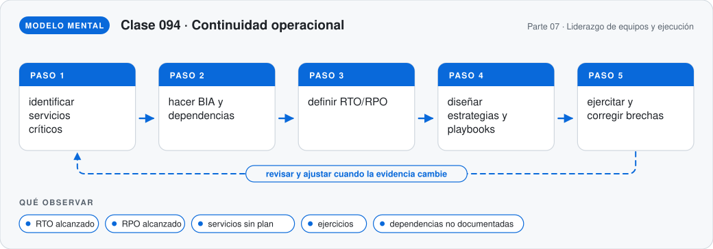

# Clase 094 — Continuidad operacional

<!-- nav:inicio -->
> **Parte 07 · Operaciones, procesos y calidad** — clase 10 de 12 · [índice de la parte](../../README.md) · [temario](../../../../SYLLABUS.md)
<!-- nav:fin -->

**Parte:** 07 — Operaciones, procesos y calidad  
**Nivel:** Etapa 2 — Jefe → Manager  
**Duración sugerida:** 150–180 minutos · **Estándar:** deep-class-v2

## 🎯 Propósito

Una operación eficiente en un día normal puede ser frágil frente a un día anormal: un incendio, una caída de sistemas, la salida de una persona clave, un proveedor que falla, un ciberataque o una huelga. La **continuidad operacional** responde a una pregunta simple y poco cómoda: si esto se detiene, ¿cuánto tiempo podemos estar detenidos, qué perdemos y cómo volvemos? No busca evitar toda interrupción, sino decidir con anticipación qué es crítico, cuánta interrupción se tolera y qué se hará.

La clase se apoya en la norma ISO 22301 de sistemas de gestión de continuidad del negocio, en la visión de Deming sobre la mejora del sistema, en la advertencia de Liker sobre la fragilidad de las operaciones sin reservas y en la gestión de operaciones de Slack y Brandon-Jones. Al terminar sabrás realizar un análisis de impacto simplificado, fijar tiempos tolerables, elegir estrategias, escribir un plan utilizable y ejercitarlo, y conectar la continuidad con la gestión de crisis.

## 📚 Resultados de aprendizaje

Al finalizar podrás:

1. **Identificar** procesos críticos con un análisis de impacto.
2. **Fijar** tiempos máximos de interrupción y de pérdida de información tolerables.
3. **Comparar** estrategias de continuidad con su costo y su cobertura.
4. **Escribir** un plan que otra persona pueda ejecutar bajo presión.
5. **Ejercitar y mejorar** el plan con simulaciones y lecciones de incidentes.

## 🧭 Agenda

| Tramo | Qué se hace |
|---|---|
| 0–20 min | Recuperación: ¿cuál es el proceso cuya detención por un día te dolería más y por qué? |
| 20–60 min | Impacto, tiempos tolerables, estrategias, planes y ejercicios. |
| 60–105 min | Ejemplo trabajado: una operación de pedidos en línea. |
| 105–150 min | Caso ejecutivo y práctica. |
| 150–175 min | Límites y entregable. |

## 🧩 Conceptos centrales

| Concepto | Definición | Cómo se reconoce |
|---|---|---|
| **Continuidad del negocio** | Capacidad de seguir entregando productos o servicios, a un nivel aceptable, tras una interrupción. | Hay plan, recursos y práctica. |
| **Análisis de impacto (BIA)** | Estudio de los efectos de detener cada proceso a lo largo del tiempo. | Prioriza lo que importa más. |
| **Tiempo objetivo de recuperación (RTO)** | Tiempo máximo tolerable para restablecer un proceso. | Se define por el daño creciente. |
| **Punto objetivo de recuperación (RPO)** | Cantidad máxima de información que se tolera perder, medida en tiempo. | Define la frecuencia de respaldo. |
| **Plan de continuidad** | Instrucciones para operar y recuperar durante una interrupción. | Dice quién hace qué, con qué y en qué orden. |
| **Ejercicio** | Simulación o prueba del plan. | Revela lo que el papel no muestra. |

## 🧠 Modelo mental

**Cómo leer el diagrama.** Cinco pasos con una flecha de retorno. El **análisis de impacto** muestra qué es crítico; los **tiempos tolerables** convierten esa criticidad en metas; las **estrategias** son las alternativas para cumplirlas; los **planes** las vuelven acciones y los **ejercicios** las ponen a prueba. Lo aprendido en cada ejercicio vuelve al análisis. Un plan que se escribe sin pasar por los primeros pasos se parece a un documento y no a una capacidad.

## 📖 Desarrollo

### 1. Qué es continuidad y qué no

La continuidad es la capacidad de mantener o restablecer lo esencial tras una interrupción. No es lo mismo que la **recuperación ante desastres** de tecnología (que se enfoca en sistemas) ni que la **gestión de crisis** (que decide y comunica en el momento, clase 190), aunque se superponen. ISO 22301 define el sistema de gestión: entender la organización, fijar políticas, analizar impacto y riesgos, definir estrategias, preparar planes, ejercitar, evaluar y mejorar. Es una norma que se puede certificar, pero su valor está en la práctica, no en el sello.

### 2. Análisis de impacto

Para cada proceso se pregunta: ¿qué ocurre si se detiene una hora, un día, una semana? Se estiman impactos financieros (ventas perdidas, multas), operativos, legales, de reputación y de seguridad de las personas, y cómo **crecen con el tiempo**. También se identifican las **dependencias**: personas, instalaciones, sistemas, proveedores, datos. El resultado es una lista priorizada de procesos críticos y de los recursos que los sostienen. Se hace con quienes operan el proceso, no solo con gerentes: ellos saben qué se rompe primero.

### 3. Tiempos tolerables

Con el impacto se fijan dos valores por proceso crítico. El **RTO** es cuánto se puede estar detenido antes de que el daño sea inaceptable. El **RPO** es cuánta información reciente se puede perder: un respaldo cada 24 horas implica hasta un día de datos perdidos. Los valores nacen de la tolerancia al daño, no de lo que la tecnología ya ofrece. Si el negocio necesita volver en dos horas y los respaldos tardan un día en restaurarse, la brecha es un riesgo que se debe cerrar o aceptar de manera explícita.

### 4. Estrategias

Las alternativas incluyen: **redundancia** (duplicar recursos críticos), **respaldo y restauración**, **sitio o proveedor alternativo**, **procedimientos manuales temporales**, **inventario de seguridad**, **capacitación cruzada** (que más de una persona sepa hacer lo crítico) y **seguros** para el daño residual. Cada una tiene costo, tiempo de activación y cobertura. Se eligen según el RTO/RPO y el impacto: no se justifica gastar en redundancia total para un proceso que tolera una semana de interrupción. Liker recuerda que la eficiencia extrema sin reservas hace vulnerable al sistema (clase 090).

### 5. Escribir un plan utilizable

Un plan sirve si una persona que no lo escribió puede ejecutarlo bajo estrés. Incluye: **activación** (quién declara la contingencia y con qué criterio), **roles y contactos** (con suplentes), **pasos por proceso crítico** en orden, **recursos y datos necesarios** (dónde están y cómo se accede si el sistema principal falla), **comunicación** a personas, clientes y proveedores y **criterios de retorno a la normalidad**. Se escribe corto, en listas de acciones, no en prosa. Se guarda copia fuera de los sistemas que podrían caer, en versión impresa o en un medio independiente.

### 6. Ejercitar y aprender

Los ejercicios van de la **revisión en mesa** (el equipo recorre un escenario conversando) a la **simulación** (con roles y tiempos) y la **prueba técnica** (se restaura un respaldo, se conmuta un sistema). Cada ejercicio produce hallazgos: contactos desactualizados, accesos que nadie tenía, pasos faltantes, tiempos de recuperación mayores a los del plan. Los incidentes reales son también ejercicios: se hace una revisión posterior sin culpas y se actualiza el plan. Un plan nunca probado probablemente falla, y falla en el peor momento.

### 7. Continuidad, cultura y personas

La continuidad depende de personas que saben qué hacer, tienen autoridad para actuar y confían en el plan. Se entrena a los equipos, se asignan suplentes y se cuida que la urgencia no vuelva peligroso el trabajo: las personas también son parte de la continuidad y su seguridad es la primera prioridad. En crisis, la comunicación honesta con clientes y colaboradores sostiene la confianza. Y la dirección debe asignar recursos y revisar los resultados: sin patrocinio, la continuidad se vuelve un documento que nadie actualiza.

## 📚 Lectura comparada

| Obra | Qué aporta | Qué no resuelve | Pregunta para contrastar |
|---|---|---|---|
| ISO 22301 | Estructura del sistema de gestión de continuidad. | Es un requisito de sistema; no dice qué es crítico para ti. | ¿Qué procesos son críticos y por qué? |
| Deming | Mirar el sistema, mejorar de forma continua. | No trata de desastres. | ¿Qué falla del sistema revela un incidente? |
| Liker | Fragilidad de operaciones sin reservas y cultura de resolver problemas. | Es un caso de manufactura. | ¿Qué reserva protegerías? |
| Slack y Brandon-Jones | Fiabilidad y resiliencia en la dirección de operaciones. | Es general. | ¿Qué tolera tu cliente? |
| Beyer y otros | Respuesta a incidentes y revisiones sin culpas. | Contexto de sistemas de software. | ¿Cómo aprendes de un incidente? |

## 🧮 Ejemplo trabajado

**Situación (hipotética).** Una empresa de pedidos en línea de 80 personas vende USD 40.000 diarios. Tiene tres procesos: recepción de pedidos (sitio web), preparación y despacho (bodega) y atención a clientes. Sus sistemas están en un solo proveedor, con respaldo diario nocturno.

| Proceso | Impacto de 1 hora | Impacto de 1 día | RTO | RPO |
|---|---|---|---|---|
| Recepción de pedidos | Pérdida de unos USD 1.700 | USD 40.000 y daño de reputación | 2 horas | 15 minutos |
| Preparación y despacho | Atrasos moderados | Incumplimiento de promesas de entrega | 8 horas | 4 horas |
| Atención a clientes | Bajo | Reclamos acumulados | 24 horas | 24 horas |

**Brecha.** El respaldo diario implica un RPO de hasta 24 horas, frente a los 15 minutos que necesita la recepción de pedidos; restaurar tarda unas 6 horas, frente a las 2 horas de RTO. Hay dos brechas.

**Estrategias evaluadas.** (a) Replicar la base de datos de pedidos de forma continua en otra región (costo mensual de USD 900; RPO de minutos; RTO de 1 hora). (b) Un procedimiento manual: tomar pedidos por formulario y WhatsApp mientras se recupera (costo mínimo; cubre un día). (c) Capacitación cruzada: dos personas más pueden operar la preparación sin el jefe de bodega.

**Decisión.** Se adopta (a) para recepción de pedidos, (b) como respaldo documentado y (c). Se ejercita un fallo simulado: la conmutación tarda 1 hora 20 minutos y se descubre que dos personas no tenían acceso al sistema alternativo; se corrige y se vuelve a probar.

**Qué muestra.** (1) El análisis de impacto dirigió la inversión. (2) Las brechas se vieron al comparar RTO/RPO con la realidad. (3) El ejercicio descubrió un problema que el plan no había anticipado.

## 🔀 Comparación y límites

**Continuidad frente a prevención.** La prevención reduce la probabilidad de un evento; la continuidad reduce el daño cuando ocurre. Ambas se necesitan, y se priorizan con el análisis de riesgos (clase 181 en adelante).

**Límites.** No se pueden prever todos los escenarios; los planes basados en causas concretas fallan ante sorpresas, por lo que se diseñan por **consecuencias** (sin sistema, sin instalaciones, sin personas, sin proveedor). Los tiempos del análisis son estimaciones y se revisan. La certificación de una norma no garantiza resiliencia. Y las obligaciones legales o sectoriales (seguridad laboral, protección de datos, continuidad regulada en banca o salud) se comprueban en la normativa vigente.

## 🪜 De profesional a owner

| Nivel | Cómo participa en continuidad |
|---|---|
| **Profesional** | Conoce su rol en el plan y mantiene actualizados sus contactos y accesos. |
| **Jefe / Team Lead** | Documenta el proceso crítico de su equipo y ejercita suplencias. |
| **Gerente** | Lidera el análisis de impacto y fija prioridades de inversión. |
| **CEO / Director** | Patrocina, aprueba tolerancias y exige ejercicios. |
| **Founder / Owner** | Evita que el negocio dependa únicamente de él o de un solo sistema. |

## 🏢 Caso ejecutivo

Una cadena de farmacias depende de un sistema central de inventario y recetas. Un fin de semana, una falla en el proveedor de alojamiento deja los locales sin sistema por 14 horas. Algunos locales venden «a mano», otros cierran; no se pueden verificar las recetas controladas; las redes sociales se llenan de reclamos. El directorio pide explicaciones el lunes. El plan de continuidad existe desde hace tres años, pero nadie lo había leído y los teléfonos de contacto estaban desactualizados.

Entrega un **plan de continuidad operacional** con: (a) el análisis de impacto de los procesos críticos; (b) RTO y RPO por proceso, con la brecha frente a la situación actual; (c) las estrategias comparadas con costo y cobertura; (d) el plan de activación y los pasos para los locales sin sistema; (e) la comunicación a clientes, personal y autoridades; (f) el programa de ejercicios y cómo se incorporarán las lecciones del incidente.

## 🧪 Práctica

1. Lista cinco procesos de tu área y estima el impacto de detenerlos una hora, un día y una semana.
2. Fija RTO y RPO para los dos más críticos.
3. Compara dos estrategias para el más crítico, con costo y tiempo de activación.
4. Escribe una página de plan con activación, roles y pasos.
5. Diseña un ejercicio de mesa de 45 minutos con un escenario.

## ⚠️ Errores frecuentes

| Error | Por qué ocurre | Cómo corregirlo |
|---|---|---|
| Plan sin análisis de impacto | Se copia una plantilla | Partir de lo que es crítico. |
| Confundir respaldo con continuidad | Se cree que basta copiar datos | Probar la restauración y el tiempo. |
| Plan largo y nunca leído | Se busca cobertura total | Corto, en acciones y con suplentes. |
| No ejercitar | Se considera costoso | Ejercicios simples y periódicos. |
| Depender de una persona | Se confía en el experto | Capacitación cruzada. |
| Olvidar a los proveedores | Se mira solo lo interno | Incluir dependencias de terceros. |

## ❓ Preguntas de comprobación

1. ¿Qué es un análisis de impacto y qué produce?
2. ¿Qué diferencia hay entre RTO y RPO?
3. ¿Por qué los tiempos tolerables nacen del negocio y no de la tecnología?
4. Menciona tres estrategias de continuidad.
5. ¿Qué debe tener un plan que se pueda ejecutar bajo estrés?
6. ¿Por qué se ejercitan los planes?
7. ¿Por qué se diseña por consecuencias y no solo por causas?

Claves de respuesta

1. Estudio de los efectos de detener cada proceso en el tiempo; produce una lista priorizada de procesos críticos y de sus dependencias.
2. El RTO es el tiempo máximo tolerable de interrupción; el RPO es la cantidad máxima de información reciente que se tolera perder.
3. Porque dependen del daño que el negocio puede soportar, no de lo que los sistemas ya ofrecen.
4. Por ejemplo: redundancia, respaldo y restauración, proveedor alternativo, procedimientos manuales, capacitación cruzada o seguros.
5. Activación, roles con suplentes, pasos en orden, recursos y accesos, comunicación y criterios de retorno.
6. Porque un plan no probado probablemente falla; los ejercicios revelan contactos, accesos, pasos y tiempos que el papel no muestra.
7. Porque no se pueden prever todas las causas, pero sí las consecuencias: sin sistema, sin instalaciones, sin personas o sin proveedor.

## 📥 Entregable

Guarda en `portfolio/094-continuidad-operacional/`:

- `operating-improvement-brief.md` (plantilla [Operating Improvement Brief](../../../../templates/operating-improvement-brief.md)) con el plan de continuidad del caso ejecutivo;
- `risk-register.md` (plantilla [Risk register](../../../../templates/risk-register.md)) con las brechas de RTO y RPO;
- `decision-journal.md` con el análisis de impacto, las estrategias elegidas y el programa de ejercicios.

## 📗 Fuentes y verificación

- ISO — *ISO 22301 Business continuity management systems*. **Uso en esta clase:** sistema de gestión de continuidad del negocio. **Localizador pendiente:** ver [el registro de fuentes](../../../../docs/FUENTES.md).
- W. Edwards Deming — *Out of the Crisis* (The MIT Press, 2000). **Uso en esta clase:** mirar el sistema y mejorar de forma continua. Lectura selectiva sobre **continuidad operacional**. **Localizador:** [ISBN-13 9780262541152](https://openlibrary.org/isbn/9780262541152).
- Jeffrey K. Liker — *The Toyota Way* (American Media International, 2005). **Uso en esta clase:** fragilidad de las operaciones sin reservas. Lectura selectiva sobre **continuidad operacional**. **Localizador:** [ISBN-13 9781932378702](https://openlibrary.org/isbn/9781932378702).
- Nigel Slack & Alistair Brandon-Jones — *Operations Management* (Pearson Education, Limited, 2019). **Uso en esta clase:** fiabilidad y resiliencia en la dirección de operaciones. Lectura selectiva sobre **continuidad operacional**. **Localizador:** [ISBN-13 9781292254036](https://openlibrary.org/isbn/9781292254036).
- Betsy Beyer, Chris Jones, Jennifer Petoff & Niall Richard Murphy — *Site Reliability Engineering* (O'Reilly Media, 2016). **Uso en esta clase:** respuesta a incidentes y revisiones sin culpas. Lectura selectiva sobre **continuidad operacional**. **Localizador:** [ISBN-13 9781491929124](https://openlibrary.org/isbn/9781491929124).

> **Regla de fuentes para Continuidad operacional:** las obras anteriores estructuran las perspectivas de esta materia; cualquier norma, ley o estándar vivo mencionado debe comprobarse nuevamente en su fuente primaria vigente, incluidas las exigencias regulatorias del sector. Los ejemplos y casos son hipotéticos, con cifras ilustrativas. El desarrollo es original y no reproduce capítulos protegidos.

<!-- pie:inicio -->
---

| Anterior | Índice | Siguiente |
|---|---|---|
| [← 093 · Proveedores y terceros](../093-proveedores-y-terceros/README.md) | [Parte 07](../../README.md) · [Programa](../../../../SYLLABUS.md) | [095 · Automatización de procesos →](../095-automatizacion-de-procesos/README.md) |
<!-- pie:fin -->
