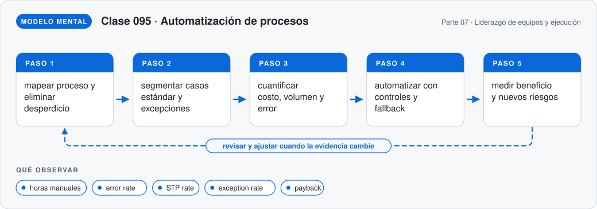

# Clase 095 — Automatización de procesos

<!-- nav:inicio -->
> **Parte 07 · Operaciones, procesos y calidad** — clase 11 de 12 · [índice de la parte](../../README.md) · [temario](../../../../SYLLABUS.md)
<!-- nav:fin -->

**Parte:** 07 — Operaciones, procesos y calidad  
**Nivel:** Etapa 2 — Jefe → Manager  
**Duración sugerida:** 150–180 minutos · **Estándar:** deep-class-v2

## 🎯 Propósito

Automatizar parece la salida natural a la lentitud y al error humano: si una máquina o un programa hace la tarea, será más rápido, más barato y más consistente. A veces es cierto, y a veces se descubre tarde que se automatizó un proceso defectuoso, que las excepciones quedaron para las personas en su versión más difícil o que el equipo perdió la habilidad para intervenir cuando el sistema falla. Automatizar bien es una decisión de diseño de procesos y de personas, no solo de tecnología.

La clase integra la advertencia clásica de Bainbridge sobre las «ironías de la automatización», el análisis de uso, mal uso y abandono de Parasuraman y Riley, la crítica de Hammer y Champy a automatizar procesos heredados en lugar de rediseñarlos y los principios de simplificación de Womack y Jones. Al terminar sabrás decidir qué automatizar y en qué orden, cómo diseñar la relación entre persona y sistema, qué riesgos nuevos aparecen y cómo medir el beneficio real.

## 📚 Resultados de aprendizaje

Al finalizar podrás:

1. **Decidir** si un proceso conviene simplificarlo, estandarizarlo, automatizarlo o dejarlo manual.
2. **Evaluar** el beneficio con costo total, calidad y riesgo.
3. **Diseñar** la interacción entre persona y sistema, incluidas las excepciones.
4. **Reconocer** los efectos de la automatización en habilidades, vigilancia y confianza.
5. **Planificar** la implantación con pruebas, plan manual y revisión posterior.

## 🧭 Agenda

| Tramo | Qué se hace |
|---|---|
| 0–20 min | Recuperación: ¿qué tarea de tu área hace una persona que «debería» hacer un sistema, y qué podría salir mal si lo hiciera? |
| 20–60 min | Orden, beneficios, riesgos y diseño persona-sistema. |
| 60–105 min | Ejemplo trabajado: automatizar la conciliación de pagos. |
| 105–150 min | Caso ejecutivo y práctica. |
| 150–175 min | Límites y entregable. |

## 🧩 Conceptos centrales

| Concepto | Definición | Cómo se reconoce |
|---|---|---|
| **Automatización** | Uso de sistemas para ejecutar tareas con poca o ninguna intervención humana. | Reglas, robots de software, integraciones, máquinas. |
| **Excepción** | Caso que no sigue el flujo normal y requiere juicio. | Es lo que queda para las personas. |
| **Supervisión humana** | Persona que vigila, interviene y decide cuando el sistema falla o duda. | Requiere habilidad y atención sostenidas. |
| **Ironías de la automatización** | Efectos paradójicos: lo automatizado deja a las personas las tareas más difíciles con menos práctica. | Se observan tras la implantación. |
| **Confianza calibrada** | Nivel de confianza en el sistema que corresponde a su fiabilidad real. | Ni exceso ni rechazo. |
| **Costo total** | Costo de construir, operar, mantener y corregir la automatización. | Incluye cambios y fallas. |

## 🧠 Modelo mental

**Cómo leer el diagrama.** Dos paneles. A la izquierda, lo que aporta automatizar: **consistencia**, **velocidad y escala** y **trazabilidad**. A la derecha, lo que puede degradarse en quienes supervisan: **habilidad** (se pierde práctica), **vigilancia** (es difícil atender lo que casi nunca falla) y **confianza mal calibrada** (se confía de más o se descarta el sistema). La decisión no es automatizar o no, sino cómo hacerlo conservando la capacidad humana para intervenir.

## 📖 Desarrollo

### 1. Primero simplificar, luego estandarizar, luego automatizar

Hammer y Champy criticaron que muchas empresas usaban la tecnología para **pavimentar caminos de vacas**: automatizar el proceso heredado con todos sus rodeos en lugar de rediseñarlo. El orden recomendado es: eliminar lo que no agrega valor (clase 090), estandarizar lo que queda (clase 087) y recién entonces automatizar. Automatizar un proceso malo produce errores más rápido y con más difusión. Un proceso simple y estable es mucho más fácil —y barato— de automatizar y mantener.

### 2. Qué conviene automatizar

Las candidatas son tareas **frecuentes**, **basadas en reglas claras**, **con datos estructurados**, **propensas a error humano por repetición** y **de volumen suficiente** para justificar el esfuerzo. Los candidatos débiles son tareas con muchas excepciones, con reglas que cambian, con juicio ético o relacional o con poco volumen. Una prueba práctica: ¿se puede escribir la regla? Si los expertos no logran explicar cómo deciden, la automatización total probablemente fallará; se puede automatizar la parte estructurada y dejar el juicio a la persona, con ayudas.

### 3. Beneficio y costo reales

El beneficio nominal (horas ahorradas) no es el real. Hay que contar: horas **efectivamente liberadas** y qué se hace con ellas, **reducción de errores y retrabajo**, **velocidad percibida por el cliente**, y por el lado de los costos, **construcción, licencias, integración, mantenimiento, monitoreo, cambios de reglas** y **tratamiento de excepciones**. Muchas automatizaciones se justifican con la primera línea y se descubren caras por la segunda. Se estima el caso con rangos y se contrasta tras la implantación, no solo antes.

### 4. Las ironías de la automatización

Bainbridge describió en 1983 varias paradojas. Quien diseña automatización suele considerar a la persona como fuente de error, pero la deja encargada de lo que el sistema no puede hacer: **excepciones y fallas**, que son lo más difícil. Y al reducir la práctica, **deteriora la habilidad** necesaria para intervenir cuando se la necesita. Además, vigilar un sistema que casi nunca falla es una tarea que los humanos hacen mal por períodos largos. Las implicancias: planificar entrenamiento y ejercicios, diseñar alertas útiles y mantener alguna práctica manual en lo crítico.

### 5. Uso, mal uso y abandono

Parasuraman y Riley clasificaron los comportamientos hacia la automatización: **uso** apropiado, **mal uso** (confiar de más y dejar de vigilar), **desuso** (desconfiar y desactivar un sistema que funciona) y **abuso** (automatizar sin considerar sus efectos en las personas). La confianza depende de la fiabilidad percibida, del historial de errores y de la transparencia: si el sistema no explica lo que hizo, las personas no saben cuándo dudar. Diseñar buenas interfaces, mostrar el estado y las razones y reportar los errores abiertamente ayuda a calibrar la confianza.

### 6. Diseñar la relación persona-sistema

Se decide qué hace el sistema, qué hace la persona y cómo se pasan el control. Preguntas: ¿qué se muestra a la persona y cuándo?, ¿qué decisiones requieren aprobación humana?, ¿qué pasa si el sistema se detiene?, ¿cómo se detecta un error silencioso? Un sistema que falla de forma visible es manejable; el peligroso es el que falla sin que nadie lo note. Se establecen **controles independientes** (conciliaciones, muestreos) para detectar errores y un **plan manual** probado para continuar si el sistema cae (clase 094).

### 7. Implantar con cuidado

La implantación se hace por etapas: un **piloto** con un subconjunto, **ejecución en paralelo** con el proceso manual para comparar resultados, **métricas de calidad y excepciones**, **capacitación** y **comunicación** con el equipo sobre su rol. Si el personal teme perder su empleo, no reportará los errores del sistema. Tras la implantación, se hace una **revisión** a los tres y seis meses: ¿se lograron los beneficios?, ¿qué excepciones aparecieron?, ¿qué habilidades se están perdiendo? El mantenimiento de las reglas es parte del costo permanente.

## 📚 Lectura comparada

| Obra | Qué aporta | Qué no resuelve | Pregunta para contrastar |
|---|---|---|---|
| Bainbridge (1983) | Ironías de la automatización y efectos en la supervisión. | Contexto de control de procesos industriales. | ¿Qué queda para las personas? |
| Parasuraman y Riley (1997) | Uso, mal uso, desuso y abuso; confianza. | Se basa en entornos como aviación. | ¿Cuánta confianza merece el sistema? |
| Hammer y Champy | Rediseñar antes de automatizar. | Su enfoque radical tiene costos. | ¿Estás automatizando un camino de vacas? |
| Womack y Jones | Simplificar y eliminar desperdicio antes. | Contexto lean. | ¿Qué paso eliminarías antes? |
| Slack y Brandon-Jones | Tecnología de proceso y decisiones de operaciones. | Es general. | ¿Qué cuesta mantenerlo? |

## 🧮 Ejemplo trabajado

**Situación (hipotética).** El área de finanzas de una empresa concilia pagos de clientes con facturas: 4 personas, 2.500 pagos al mes, 6 minutos por pago de media; 8 % de errores que generan reclamos. Se propone automatizar con un sistema de reglas.

| Paso | Qué ocurre |
|---|---|
| **Simplificar** | Se descubre que el 40 % del tiempo se pierde buscando referencias de factura que los clientes omiten; se agrega un campo obligatorio en el cobro. |
| **Estandarizar** | Se acuerdan reglas de imputación para pagos parciales y múltiples. |
| **Estimar** | 2.500 × 6 minutos = 250 horas al mes; con el cambio de referencias bajan a 160 horas; automatizar el 75 % de los pagos más simples libera unas 100 horas. |
| **Costos** | Construcción USD 18.000; mantenimiento USD 400 al mes; revisión de excepciones: 60 horas al mes. |
| **Diseño persona-sistema** | El sistema concilia los pagos con coincidencia exacta; el resto va a una cola de excepciones para una analista; un muestreo de 5 % de los conciliados automáticamente se revisa a mano. |
| **Implantación** | Dos meses en paralelo; se comparan resultados; se ajustan reglas. |

**Resultado a los seis meses.** Las horas efectivamente liberadas fueron 90, no 100; los errores bajaron de 8 % a 2,5 %; un cambio de formato del banco rompió una regla durante tres días y se detectó gracias al muestreo. Las analistas redestinan tiempo a cobranza.

**Qué muestra.** (1) Simplificar antes ahorró más que automatizar. (2) El beneficio real fue menor que el nominal. (3) El control independiente detectó una falla silenciosa.

## 🔀 Comparación y límites

**Automatizar frente a rediseñar.** Rediseñar cambia el proceso para que haga falta menos trabajo; automatizar hace el trabajo existente con una máquina. Lo primero suele ser más barato y más duradero.

**Límites.** Los hallazgos de factores humanos provienen sobre todo de aviación y plantas de control; su traslado a procesos administrativos es razonable pero no automático. Las estimaciones de ahorro tienen incertidumbre grande. La inteligencia artificial introduce errores distintos (resultados plausibles pero incorrectos) que exigen controles específicos (parte 19). Y automatizar decisiones sobre personas o clientes puede tener implicancias legales de protección de datos y no discriminación que se verifican con asesoría.

## 🪜 De profesional a owner

| Nivel | Cómo participa en la automatización |
|---|---|
| **Profesional** | Documenta cómo hace la tarea y las excepciones que conoce. |
| **Jefe / Team Lead** | Lidera el rediseño con su equipo y vigila la calidad tras implantar. |
| **Gerente** | Prioriza por beneficio real, costo total y riesgo. |
| **CEO / Director** | Decide cuánta autonomía se da al sistema en procesos críticos. |
| **Founder / Owner** | Automatiza lo repetitivo temprano, pero mantiene el entendimiento del proceso. |

## 🏢 Caso ejecutivo

Un banco regional automatizó la evaluación de solicitudes de crédito de consumo con un modelo que aprueba o rechaza en segundos. El tiempo de respuesta bajó de tres días a diez minutos y el volumen creció 40 %. A los seis meses se detecta que el modelo rechaza con más frecuencia a solicitantes de ciertas comunas, que los analistas ya no revisan las alertas por exceso de falsos positivos y que, cuando el sistema cayó un día, nadie recordaba cómo evaluar manualmente. Los clientes rechazados reclaman sin que el banco pueda explicar la razón.

Entrega un **plan de gobierno de la automatización** que contenga: (a) el diagnóstico de qué se simplificó, qué se estandarizó y qué se automatizó; (b) los riesgos de supervisión, habilidad y confianza; (c) los controles independientes y el plan manual; (d) cómo se explicará a los clientes y qué aspectos legales de datos y no discriminación se derivarán a asesoría; (e) las métricas de beneficio real y de calidad; (f) el calendario de revisión y entrenamiento.

## 🧪 Práctica

1. Elige un proceso y marca qué se puede eliminar, qué estandarizar y qué automatizar.
2. Estima el beneficio nominal y el real, y el costo total de dos años.
3. Lista las excepciones y define quién las atiende y con qué información.
4. Diseña un control independiente que detecte errores silenciosos.
5. Escribe el plan manual para un día sin sistema.

## ⚠️ Errores frecuentes

| Error | Por qué ocurre | Cómo corregirlo |
|---|---|---|
| Automatizar un proceso defectuoso | Se quiere resultado rápido | Simplificar y estandarizar primero. |
| Contar solo horas ahorradas | Es la cifra visible | Costo total y beneficio efectivo. |
| Dejar las excepciones sin diseño | Se piensa en el caso normal | Cola de excepciones con información y dueño. |
| Confiar de más en el sistema | Rara vez falla | Controles independientes y muestreo. |
| Perder la habilidad manual | No se practica | Entrenamiento y ejercicios. |
| No mantener las reglas | Se considera terminado | Mantenimiento y revisión periódica. |

## ❓ Preguntas de comprobación

1. ¿En qué orden se simplifica, estandariza y automatiza, y por qué?
2. ¿Qué tareas son buenas candidatas a automatizar?
3. ¿Qué son las ironías de la automatización?
4. ¿Qué diferencia hay entre mal uso y desuso?
5. ¿Qué costos se olvidan al justificar una automatización?
6. ¿Por qué se necesita un control independiente?
7. ¿Qué límite tienen los hallazgos de factores humanos en este contexto?

Claves de respuesta

1. Primero simplificar, luego estandarizar y al final automatizar, porque automatizar un proceso malo produce errores más rápido.
2. Frecuentes, con reglas claras, datos estructurados, propensas a error por repetición y de volumen suficiente.
3. Efectos paradójicos: la persona queda con las excepciones más difíciles y con menos práctica, y debe vigilar algo que casi nunca falla.
4. Mal uso es confiar de más y dejar de vigilar; desuso es desconfiar y desactivar un sistema que funciona.
5. Mantenimiento, monitoreo, cambios de reglas, tratamiento de excepciones y fallas.
6. Para detectar errores silenciosos que el propio sistema no reporta.
7. Provienen sobre todo de aviación y plantas de control; su traslado a otros procesos exige verificación caso a caso.

## 📥 Entregable

Guarda en `portfolio/095-automatizacion-de-procesos/`:

- `operating-improvement-brief.md` (plantilla [Operating Improvement Brief](../../../../templates/operating-improvement-brief.md)) con el plan de gobierno de la automatización del caso ejecutivo;
- `process-map.md` (plantilla [Process map](../../../../templates/process-map.md)) con el proceso simplificado, las excepciones y el plan manual;
- `decision-journal.md` con el beneficio estimado, el beneficio medido y las revisiones.

## 📗 Fuentes y verificación

- Lisanne Bainbridge — *Ironies of automation* (Automatica, 1983). **Uso en esta clase:** ironías de la automatización y efectos en la supervisión. Lectura selectiva sobre **automatización de procesos**. **Localizador:** [DOI 10.1016/0005-1098(83)90046-8](https://doi.org/10.1016/0005-1098(83)90046-8).
- Raja Parasuraman & Victor Riley — *Humans and Automation: Use, Misuse, Disuse, Abuse* (Human Factors, 1997). **Uso en esta clase:** uso, mal uso, desuso y abuso de la automatización. Lectura selectiva sobre **automatización de procesos**. **Localizador:** [DOI 10.1518/001872097778543886](https://doi.org/10.1518/001872097778543886).
- Michael Hammer & James Champy — *Reengineering the Corporation* (HarperBusiness, 2001). **Uso en esta clase:** rediseñar antes de automatizar. Lectura selectiva sobre **automatización de procesos**. **Localizador:** [ISBN-13 9780066621128](https://openlibrary.org/isbn/9780066621128).
- James P. Womack & Daniel T. Jones — *Lean Thinking* (Free Press, 2003). **Uso en esta clase:** simplificar y eliminar desperdicio antes de automatizar. Lectura selectiva sobre **automatización de procesos**. **Localizador:** [ISBN-13 9780743231640](https://openlibrary.org/isbn/9780743231640).
- Nigel Slack & Alistair Brandon-Jones — *Operations Management* (Pearson Education, Limited, 2019). **Uso en esta clase:** tecnología de proceso y decisiones de operaciones. Lectura selectiva sobre **automatización de procesos**. **Localizador:** [ISBN-13 9781292254036](https://openlibrary.org/isbn/9781292254036).

> **Regla de fuentes para Automatización de procesos:** las obras anteriores estructuran las perspectivas de esta materia; cualquier norma, ley o estándar vivo mencionado debe comprobarse nuevamente en su fuente primaria vigente, incluidas la protección de datos y la no discriminación en decisiones automatizadas. Los ejemplos y casos son hipotéticos, con cifras ilustrativas. El desarrollo es original y no reproduce capítulos protegidos.

<!-- pie:inicio -->
---

| Anterior | Índice | Siguiente |
|---|---|---|
| [← 094 · Continuidad operacional](../094-continuidad-operacional/README.md) | [Parte 07](../../README.md) · [Programa](../../../../SYLLABUS.md) | [096 · Capstone: rediseñar una operación →](../096-capstone-redisenar-una-operacion/README.md) |
<!-- pie:fin -->
