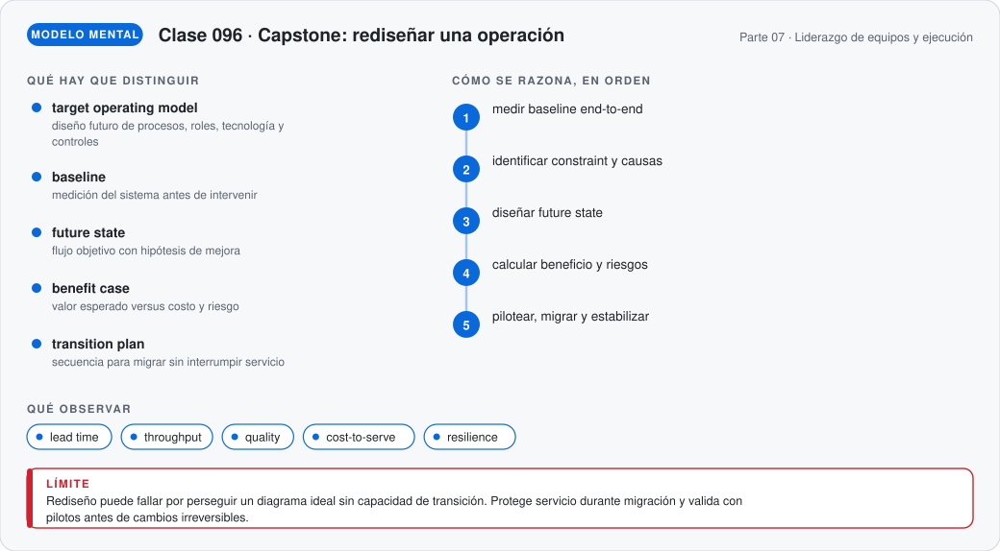

# Clase 096 — Capstone: rediseñar una operación

<!-- nav:inicio -->
> **Parte 07 · Operaciones, procesos y calidad** — clase 12 de 12 · [índice de la parte](../../README.md) · [temario](../../../../SYLLABUS.md)
<!-- nav:fin -->

**Parte:** 07 — Operaciones, procesos y calidad  
**Nivel:** Etapa 2 — Jefe → Manager  
**Duración sugerida:** 150–180 minutos · **Estándar:** deep-class-v2

## 🎯 Propósito

Rediseñar una operación exige usar las herramientas de la parte en el orden correcto y con la humildad de quien sabe que cada una resuelve un tipo de problema. Se entiende el sistema (085), se mapea el flujo real (086), se mide la demanda y la capacidad (088), se encuentra la restricción (089), se elimina desperdicio (090), se mide la variación (091), se estandariza el flujo resultante (087), se fijan niveles de servicio (092), se decide sobre proveedores (093), se protege con continuidad (094) y, solo al final, se automatiza (095).

Este capstone integra la parte 07 y se apoya en Slack y Brandon-Jones, Goldratt y Cox, Womack y Jones, Rummler y Brache y Deming. Al terminar sabrás conducir un rediseño de punta a punta: diagnosticar con datos, decidir dónde intervenir, probar el cambio en pequeño, medir el efecto y dejar la operación sostenida por un estándar, un dueño y una rutina de revisión.

## 📚 Resultados de aprendizaje

Al finalizar podrás:

1. **Diagnosticar** una operación con mapa, tiempos, capacidad y variación.
2. **Priorizar** las intervenciones según la restricción y el efecto en el cliente.
3. **Secuenciar** simplificación, estandarización, niveles de servicio y automatización.
4. **Diseñar** el cambio con piloto, métricas y plan de continuidad.
5. **Sostener** la mejora con un dueño, un estándar y una revisión periódica.

## 🧭 Agenda

| Tramo | Qué se hace |
|---|---|
| 0–20 min | Recuperación: ordena las herramientas de la parte según cuál usarías primero ante una operación lenta y qué dato pedirías. |
| 20–60 min | Secuencia de diagnóstico, rediseño y sostenimiento. |
| 60–105 min | Ejemplo trabajado: rediseño de la operación de reclamos de una aseguradora. |
| 105–150 min | Caso ejecutivo integrado. |
| 150–175 min | Rúbrica, límites y entregable. |

## 🧩 Conceptos centrales

| Concepto | Definición | Cómo se reconoce |
|---|---|---|
| **Rediseño de operación** | Cambio planificado del flujo, las reglas y los recursos para mejorar el servicio al cliente. | Hay diagnóstico, hipótesis, piloto y medición. |
| **Línea base** | Medición del desempeño antes del cambio. | Permite saber si hubo mejora. |
| **Piloto** | Prueba acotada del cambio antes de generalizarlo. | Tiene alcance, plazo y criterio de éxito. |
| **Dueño de proceso** | Persona responsable del resultado de punta a punta. | Responde por la medida común. |
| **Rutina de revisión** | Reunión periódica para revisar indicadores y decidir acciones. | Tiene calendario, datos y acuerdos registrados. |
| **Deuda operativa** | Atajos o parches que acumulan costo futuro. | Se registran con fecha de pago. |

## 🧠 Modelo mental

**Cómo leer el diagrama.** Tres columnas con las herramientas de la parte en el orden de uso. **Diagnosticar** apoya las decisiones en datos: mapa, demanda, capacidad, restricción, variación y nivel de servicio. **Rediseñar** elimina desperdicio, estandariza y recién entonces decide qué automatizar y qué comprar fuera. **Sostener** deja una operación que se mide, tiene plan de continuidad y se revisa. Las cifras entre paréntesis remiten a las clases donde se desarrolla cada herramienta.

## 📖 Desarrollo

### 1. Empezar por el cliente y el dato

Un rediseño comienza con una definición de qué espera el cliente (plazo, calidad, trato) y una **línea base** medida: tiempo total, tiempo de espera, tasa de retrabajo, nivel de servicio actual, satisfacción. Sin línea base, cualquier mejora es una opinión. Se acuerda con el patrocinador qué problema se resuelve y qué se considerará éxito, de forma que el rediseño no se convierta en reorganización permanente. Aquí se usan las clases 085 (sistema), 086 (mapa) y 092 (nivel de servicio).

### 2. Diagnosticar de punta a punta

Se sigue una muestra de casos reales y se calcula qué proporción del tiempo es espera. Se estima la demanda con su patrón y la capacidad útil (088). Se identifica la restricción con colas y utilización (089). Se mide el retrabajo y la variación del tiempo y de la calidad, distinguiendo causas comunes y especiales (091). Se mapean los proveedores y las dependencias críticas (093). El resultado es un diagnóstico con tres o cuatro hallazgos que explican la mayor parte del problema, no una lista de cuarenta observaciones.

### 3. Priorizar con criterio

Con el diagnóstico se priorizan intervenciones según su **efecto en el cliente**, su **efecto sobre la restricción**, su **costo y facilidad** y su **riesgo**. Un cambio sobre la restricción vale más que diez mejoras en otras partes. Se descartan conscientemente mejoras atractivas que no mueven el resultado, y se dejan registradas por si la restricción cambia. Se resiste la tentación de comenzar por la herramienta de moda: la tecnología es un medio, no un objetivo.

### 4. El orden del rediseño

La secuencia sugerida es: **eliminar** pasos y esperas que el cliente no valora (090); **estandarizar** el flujo resultante con SOP y puntos de control (087); **fijar niveles de servicio** con indicadores del cliente (092); **decidir** sobre proveedores (hacer o comprar) y concentración (093); **asegurar la continuidad** del proceso crítico (094); y solo después **automatizar** lo estructurado y estable (095). Alterar el orden duplica el costo: automatizar antes de estandarizar fija los defectos en el sistema.

### 5. Probar en pequeño

El cambio se prueba en un **piloto**: una sede, un equipo, un segmento de casos. Se define de antemano qué se medirá y qué resultado justificaría generalizarlo, y qué resultado lo detendría. Se compara con la línea base y, cuando es posible, con un grupo que siga como antes. Se vigilan efectos laterales: el tiempo baja pero sube el retrabajo, o la mejora se logra con horas extra que no son sostenibles. El piloto es una forma de aprender barato antes de comprometer a toda la organización.

### 6. Personas y cambio

Los rediseños fallan por falta de adhesión más que por mala técnica. Se involucra desde el inicio a quienes hacen el trabajo, se explica el porqué y se aclara qué ocurrirá con los roles. Se capacita, se escucha y se ajusta. Las mejoras que liberan capacidad requieren una decisión explícita de qué se hará con ella: crecer, mejorar la calidad o reasignar. Si el equipo teme que cada mejora le cueste su empleo, dejará de proponerlas. Los cambios de estructura, jornada o funciones tienen condiciones laborales que se verifican con asesoría.

### 7. Sostener

Una mejora que no se sostiene se pierde en meses. Se asegura con un **dueño de proceso** con medida común, un **estándar** vivo, **indicadores visibles** con límites de control, una **rutina de revisión** (semanal o mensual) con decisiones registradas y un **plan de continuidad** probado. Se documenta la deuda operativa y se programa su pago. Y se cierra el rediseño con una revisión: qué resultado se logró frente a la línea base, qué se aprendió y qué viene después. La mejora continua es el estado normal, no un proyecto.

## 📚 Lectura comparada

| Obra | Qué aporta | Qué no resuelve | Pregunta para contrastar |
|---|---|---|---|
| Slack y Brandon-Jones | Marco de dirección de operaciones y decisiones de diseño. | Es general. | ¿Qué decisión de diseño tomaste? |
| Goldratt y Cox | Foco en la restricción. | Requiere medir bien el flujo. | ¿Qué cambio mueve la restricción? |
| Womack y Jones | Valor, flujo y eliminación de desperdicio. | Contexto lean. | ¿Qué desperdicio dominante eliminas? |
| Rummler y Brache | Niveles y traspasos. | Es una guía general. | ¿Dónde están los espacios en blanco? |
| Deming | Mejora del sistema y variación. | Es una filosofía de gestión. | ¿Qué es ruido y qué señal? |

## 🧮 Ejemplo trabajado

**Situación (hipotética).** Una aseguradora de seguros de vehículos liquida reclamos en 22 días hábiles promedio, con un compromiso de 10. La satisfacción es baja y hay 9 % de reclamos que vuelven a abrirse. Tiene 36 personas en la operación, con una demanda de 1.100 reclamos al mes.

| Etapa | Hallazgo |
|---|---|
| **Línea base** | Tiempo total de 22 días; solo 2 días de trabajo activo; 9 % de reaperturas; cumplimiento del compromiso de 10 días: 24 %. |
| **Mapa** | Cinco traspasos: recepción, peritaje, evaluación, aprobación y pago. La mayor espera (8 días) es antes del peritaje. |
| **Capacidad y restricción** | Hay 6 peritos con capacidad útil de 4 casos por día cada uno: 24 por día frente a una demanda de 50 por día laborable; la restricción es el peritaje. |
| **Variación** | El tiempo de evaluación es estable (causa común); hay semanas de pico por tormentas (causa especial). |
| **Desperdicio** | 31 % de los casos faltan documentos y vuelven al cliente; se revisan tres veces antes de aprobar. |

**Intervenciones, en orden.** (1) **Eliminar**: formulario con documentos obligatorios para evitar que los casos vuelvan; peritaje remoto por fotografías para el 55 % de los casos de bajo monto. (2) **Estandarizar**: lista de verificación del peritaje y criterios de aprobación por monto, con aprobación solo por excepción. (3) **Nivel de servicio**: indicador de «días de recepción a pago»; objetivo interno de 8 días y compromiso al cliente de 10. (4) **Proveedores**: red de talleres con convenio para presupuesto rápido y un proveedor adicional de peritaje en picos. (5) **Continuidad**: plan para peritaje manual si falla la aplicación de fotos. (6) **Automatizar** el cotejo de pólizas y la verificación de documentos.

**Piloto y resultado.** En una sede durante tres meses: tiempo total de 22 a 11 días; reaperturas de 9 % a 5 %; cumplimiento del compromiso de 24 % a 71 %. Se detecta que el peritaje remoto aumenta los pagos en casos de bajo monto en 3 %: se revisa el criterio con el área de riesgo antes de generalizar.

**Qué muestra.** (1) La restricción estaba en peritaje y no donde la dirección pensaba (evaluación). (2) El orden eliminar-estandarizar-medir-automatizar redujo el tiempo a la mitad con poca tecnología. (3) El piloto reveló un efecto lateral a vigilar.

## 🔀 Comparación y límites

**Rediseño frente a mejora continua.** El rediseño es un cambio mayor, con diagnóstico y piloto; la mejora continua son ajustes pequeños y permanentes. Un rediseño sin mejora continua se erosiona; la mejora continua sin rediseño no corrige problemas estructurales.

**Límites.** Los resultados de un piloto pueden no replicarse a escala. Las cifras de ejemplo son ilustrativas. El diagnóstico depende de la calidad de los datos disponibles. Los cambios que afectan a personas, contratos o datos requieren verificación laboral y legal, y cualquier decisión regulada se comprueba en la normativa vigente. Y ninguna herramienta reemplaza el juicio sobre qué conviene a este cliente, en este contexto.

## 🪜 De profesional a owner

| Nivel | Cómo participa en un rediseño |
|---|---|
| **Profesional** | Aporta cómo se hace realmente el trabajo y prueba el cambio. |
| **Jefe / Team Lead** | Lidera el piloto con su equipo y mide su efecto. |
| **Gerente** | Conduce el rediseño, prioriza y sostiene la rutina de revisión. |
| **CEO / Director** | Patrocina, decide inversiones y corrige incentivos que lo impiden. |
| **Founder / Owner** | Diseña la operación para que pueda crecer sin depender de él. |

## 🏢 Caso ejecutivo

Una empresa de distribución de productos de consumo masivo atiende 4.000 clientes (almacenes y supermercados). El 18 % de los pedidos llega incompleto o tarde; el tiempo desde el pedido hasta la entrega varía entre 1 y 9 días; el costo logístico sube 11 % anual. La bodega opera al 95 % de su capacidad en horas pico; compras mantiene inventario alto de algunos productos y quiebres en otros; el proveedor de transporte concentra el 70 % de las rutas y subió tarifas. Los sistemas fallaron dos veces el último año. La dirección quiere «digitalizar todo» con un nuevo sistema de gestión.

Entrega un **plan integrado de rediseño operativo** que contenga: (a) la línea base y el diagnóstico con las herramientas de la parte; (b) la restricción identificada y las intervenciones priorizadas; (c) la secuencia eliminar–estandarizar–medir–decidir proveedores–asegurar continuidad–automatizar, con la razón de cada paso; (d) los niveles de servicio propuestos; (e) el piloto, sus métricas y el criterio para generalizar; (f) cómo involucrarás a las personas y qué verificaciones laborales y legales corresponden; (g) cómo se sostendrá la mejora y qué deuda operativa se asume.

## 🧪 Práctica

1. Define la línea base de una operación con cuatro indicadores.
2. Identifica su restricción con datos de cola y capacidad.
3. Prioriza cinco intervenciones por efecto, costo y riesgo.
4. Diseña un piloto con alcance, plazo, métricas y criterio de decisión.
5. Define el dueño, la rutina de revisión y los indicadores visibles.

## ⚠️ Errores frecuentes

| Error | Por qué ocurre | Cómo corregirlo |
|---|---|---|
| Comenzar por la tecnología | Presión por una solución visible | Diagnosticar primero. |
| Mejorar sin línea base | Falta de medición previa | Medir antes de cambiar. |
| Intervenir fuera de la restricción | Se atiende la queja más fuerte | Priorizar por efecto en el flujo. |
| Saltarse el piloto | Se quiere rapidez | Probar en pequeño. |
| No cuidar a las personas | Se ve la mejora como técnica | Involucrar, comunicar y verificar condiciones. |
| No sostener | Se da por terminado el proyecto | Dueño, estándar y revisión. |

## ❓ Preguntas de comprobación

1. ¿Por qué se mide una línea base antes de rediseñar?
2. ¿Qué herramientas componen el diagnóstico?
3. ¿Por qué priorizar según la restricción?
4. ¿Cuál es el orden de rediseño y por qué se automatiza al final?
5. ¿Qué define un buen piloto?
6. ¿Qué elementos sostienen una mejora?
7. ¿Qué límites tiene un rediseño basado en un piloto?

Claves de respuesta

1. Para poder saber si hubo mejora; sin ella, el resultado es una opinión.
2. Mapa y tiempos, demanda y capacidad, restricción, variación, desperdicio, nivel de servicio y dependencias de terceros.
3. Porque un cambio sobre la restricción mueve el resultado del sistema, mientras que otras mejoras solo acumulan trabajo.
4. Eliminar, estandarizar, medir con niveles de servicio, decidir proveedores, asegurar continuidad y automatizar al final, porque automatizar antes fija los defectos.
5. Alcance, plazo, métricas acordadas y criterio de generalizar o detener, comparado con la línea base.
6. Dueño de proceso, estándar vivo, indicadores visibles, rutina de revisión y plan de continuidad.
7. Los resultados pueden no replicarse a escala, y los datos y cambios que afectan a personas requieren verificación.

## 📥 Entregable

Guarda en `portfolio/096-capstone-redisenar-una-operacion/`:

- `operating-improvement-brief.md` (plantilla [Operating Improvement Brief](../../../../templates/operating-improvement-brief.md)) con el plan integrado del caso ejecutivo;
- `process-map.md` (plantilla [Process map](../../../../templates/process-map.md)) con el mapa actual, el rediseñado y los puntos de control;
- `risk-register.md` (plantilla [Risk register](../../../../templates/risk-register.md)) con los riesgos del piloto y la deuda operativa;
- `decision-journal.md` con la línea base, las decisiones y la rutina de revisión.

## 📗 Fuentes y verificación

- Nigel Slack & Alistair Brandon-Jones — *Operations Management* (Pearson Education, Limited, 2019). **Uso en esta clase:** marco de dirección de operaciones y decisiones de diseño. Lectura selectiva sobre **capstone: rediseñar una operación**. **Localizador:** [ISBN-13 9781292254036](https://openlibrary.org/isbn/9781292254036).
- Eliyahu M. Goldratt & Jeff Cox — *The Goal* (HighBridge Audio, 2014). **Uso en esta clase:** foco en la restricción. Lectura selectiva sobre **capstone: rediseñar una operación**. **Localizador:** [ISBN-13 9781622313945](https://openlibrary.org/isbn/9781622313945).
- James P. Womack & Daniel T. Jones — *Lean Thinking* (Free Press, 2003). **Uso en esta clase:** valor, flujo y eliminación de desperdicio. Lectura selectiva sobre **capstone: rediseñar una operación**. **Localizador:** [ISBN-13 9780743231640](https://openlibrary.org/isbn/9780743231640).
- Geary A. Rummler & Alan P. Brache — *Improving Performance* (Jossey-Bass, 1995). **Uso en esta clase:** niveles de desempeño y traspasos. Lectura selectiva sobre **capstone: rediseñar una operación**. **Localizador:** [ISBN-13 9780787900908](https://openlibrary.org/isbn/9780787900908).
- W. Edwards Deming — *Out of the Crisis* (The MIT Press, 2000). **Uso en esta clase:** mejora del sistema y distinción de la variación. Lectura selectiva sobre **capstone: rediseñar una operación**. **Localizador:** [ISBN-13 9780262541152](https://openlibrary.org/isbn/9780262541152).

> **Regla de fuentes para Capstone: rediseñar una operación:** las obras anteriores estructuran las perspectivas de esta materia; cualquier norma, ley o estándar vivo mencionado debe comprobarse nuevamente en su fuente primaria vigente, incluidas las condiciones laborales y regulatorias aplicables a los cambios. Los ejemplos y casos son hipotéticos y no describen a ninguna empresa real. El desarrollo es original y no reproduce capítulos protegidos.

<!-- pie:inicio -->
---

| Anterior | Índice | Siguiente |
|---|---|---|
| [← 095 · Automatización de procesos](../095-automatizacion-de-procesos/README.md) | [Parte 07](../../README.md) · [Programa](../../../../SYLLABUS.md) | [097 · De actividad a outcome →](../../../08-management-systems-kpis-okrs/classes/097-de-actividad-a-outcome/README.md) |
<!-- pie:fin -->
