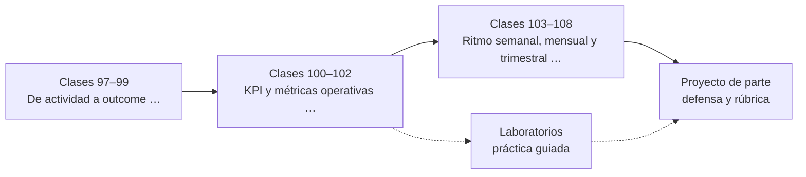

# Parte 08 — Sistemas de gestión, KPI y OKR

<!-- parte:inicio -->

> ← [Parte 07 — Operaciones, procesos y calidad](../07-operations-process-quality/README.md) · [Temario](../../SYLLABUS.md) · [Parte 09 — Finanzas y contabilidad para gerentes](../09-managerial-finance-accounting/README.md) →

*Dirigir con objetivos, métricas y ritmos de revisión*

**Etapa:** 3 — Gestión de negocio  
**Duración:** 12 clases · 30 horas  
**Resultado de salida:** Dirigir mediante objetivos, métricas, ritmos de revisión y asignación explícita de recursos.

🟣 [Ver las 6 etapas](../../SYLLABUS.md) · 12 clases (097–108) · 4 laboratorios · [proyecto de parte](project.md)

## 🎯 De qué trata esta parte

Medir no es dirigir. Muchos tableros muestran actividad y ocultan si el negocio avanza. Esta parte enseña a elegir qué medir, con qué cadencia revisarlo y qué decisión se espera de cada número.

El eje es **de actividad a resultado**: objetivos bien formulados, indicadores adelantados y rezagados, y reuniones de revisión que deciden en lugar de informar.

## 🧱 Con qué hay que llegar

| Parte | Qué aporta |
|---|---|
| [01 — Pensamiento crítico y toma de decisiones](../01-critical-thinking-and-decisions/README.md) | Decisiones con evidencia. |
| [07 — Operaciones, procesos y calidad](../07-operations-process-quality/README.md) | Procesos que se pueden medir. |

Cada clase supone la anterior: el orden importa, y saltarse una deja sin base a las que vienen después.

## 📚 Resultados de la parte

Al terminar esta parte podrás:

1. **Diferenciar** actividad, producto y resultado.
2. **Diseñar** objetivos y decidir cuándo conviene OKR.
3. **Elegir** KPI con indicadores adelantados y rezagados.
4. **Establecer** un ritmo semanal, mensual y trimestral.
5. **Conducir** business reviews y gestionar por excepción.

## 🗺️ Mapa de la parte

## 🧭 Cómo se encadenan las 12 clases

Las clases **97 a 99** fijan qué se persigue: resultado, objetivos y OKR con sus límites.

Las clases **100 a 102** definen cómo se mide: KPI, indicadores y tableros.

Las clases **103 a 108** cubren cómo se gobierna: ritmo, business reviews, priorización, recursos, escalamiento y el capstone de operating review.

## 📘 Las 12 clases

| # | Clase | Qué se trabaja | Entregable | Min |
|---:|---|---|---|---:|
| 097 | [De actividad a outcome](classes/097-de-actividad-a-outcome/README.md) | Actividad, Producto entregado (output), Resultado (outcome) | [leadership-decision-brief](../../templates/leadership-decision-brief.md) | 150 |
| 098 | [Diseño de objetivos](classes/098-diseno-de-objetivos/README.md) | Objetivo, Meta de resultado, Meta de aprendizaje | [leadership-decision-brief](../../templates/leadership-decision-brief.md) | 150 |
| 099 | [OKR: cuándo sirven y cuándo no](classes/099-okr-cuando-sirven-y-cuando-no/README.md) | Objetivo (O), Resultado clave (KR), Meta de estiramiento | [leadership-decision-brief](../../templates/leadership-decision-brief.md) | 150 |
| 100 | [KPI y métricas operativas](classes/100-kpi-y-metricas-operativas/README.md) | Métrica, KPI, Métrica operativa | [leadership-decision-brief](../../templates/leadership-decision-brief.md) | 150 |
| 101 | [Leading y lagging indicators](classes/101-leading-y-lagging-indicators/README.md) | Indicador rezagado (lagging), Indicador adelantado (leading), Indicador coincidente | [leadership-decision-brief](../../templates/leadership-decision-brief.md) | 150 |
| 102 | [Balanced Scorecard y tableros](classes/102-balanced-scorecard-y-tableros/README.md) | Cuadro de mando integral, Perspectiva financiera, Perspectiva de clientes | [leadership-decision-brief](../../templates/leadership-decision-brief.md) | 150 |
| 103 | [Ritmo semanal, mensual y trimestral](classes/103-ritmo-semanal-mensual-y-trimestral/README.md) | Ritmo de gestión, Reunión operativa, Revisión de gestión | [leadership-decision-brief](../../templates/leadership-decision-brief.md) | 150 |
| 104 | [Business reviews](classes/104-business-reviews/README.md) | Revisión de negocio, Desvío, Diálogo franco | [monthly-business-review](../../templates/monthly-business-review.md) | 150 |
| 105 | [Priorización y portfolio](classes/105-priorizacion-y-portfolio/README.md) | Priorización, Portafolio, Valor esperado | [strategy-memo](../../templates/strategy-memo.md) | 150 |
| 106 | [Asignación de recursos](classes/106-asignacion-de-recursos/README.md) | Asignación de recursos, Inercia presupuestaria, Presupuesto base cero | [leadership-decision-brief](../../templates/leadership-decision-brief.md) | 150 |
| 107 | [Escalamiento y gestión por excepción](classes/107-escalamiento-y-gestion-por-excepcion/README.md) | Gestión por excepción, Umbral (tolerancia), Escalamiento | [leadership-decision-brief](../../templates/leadership-decision-brief.md) | 150 |
| 108 | [Capstone: operating review gerencial](classes/108-capstone-operating-review-gerencial/README.md) | Sistema de gestión, Revisión operativa (operating review), Línea de visión | [risk-governance-brief](../../templates/risk-governance-brief.md) | 150 |

## ⚠️ Riesgos característicos

- Medir lo fácil y no lo importante.
- Aplicar OKR como ritual sin estrategia.
- Revisar números sin decidir nada.
- Premiar una métrica que se manipula.

## 🔤 Glosario de la parte

70 conceptos definidos en las clases, con la definición operacional que usa cada una.

| Concepto | Definición operacional |
|---|---|
| **Actividad** | Acción que el equipo ejecuta. |
| **Alineación** | Relación entre OKR de distintos niveles. |
| **Asignación de recursos** | Decisión de cuánto dinero, talento y tiempo recibe cada uso. |
| **Capacidad limitada** | Tiempo, talento y atención disponibles. |
| **Cierre del ciclo** | Verificación de compromisos, ajuste de objetivos y registro de aprendizajes. |
| **Compromiso** | Aceptación real del objetivo por quien debe cumplirlo. |
| **Compromiso verificable** | Acuerdo con dueño, fecha y criterio de cumplimiento. |
| **Control de diagnóstico** | Vigilancia por excepción de resultados programados. |
| **Costo de oportunidad** | Valor de la mejor alternativa a la que se renuncia. |
| **Costo de reunión** | Tiempo de las personas multiplicado por su costo, más el costo de oportunidad. |
| **Costo hundido** | Gasto ya realizado e irrecuperable. |
| **Cuadro de mando integral** | Sistema que traduce la estrategia en objetivos e indicadores en cuatro perspectivas. |
| **Desvío** | Diferencia entre lo esperado y lo ocurrido. |
| **Disciplina gerencial** | Constancia en el ritmo y en el seguimiento. |
| **Diálogo franco** | Conversación que dice lo que se piensa con respeto y con hechos. |
| **Escalamiento** | Traslado de un asunto a un nivel con más autoridad o recursos. |
| **Falso positivo** | Alerta que no era un problema real. |
| **Ficha de indicador** | Documento que define el indicador sin ambigüedad. |
| **Gestión por excepción** | Atender solo lo que se aparta de lo esperado más allá de un umbral. |
| **Hipótesis causal** | Creencia de que un eslabón produce el siguiente. |
| **Impacto** | Efecto sobre los objetivos del negocio: ingresos, costos, riesgo, reputación. |
| **Impulsor (driver)** | Variable sobre la que la organización puede actuar y que influye en el resultado. |
| **Indicador adelantado (leading)** | Cambia antes del resultado y se supone que lo anticipa. |
| **Indicador coincidente** | Se mueve junto con el resultado. |
| **Indicador estratégico** | Medida del avance de la estrategia. |
| **Indicador rezagado (lagging)** | Mide un resultado ya ocurrido. |
| **Inercia presupuestaria** | Tendencia a repetir la asignación previa con ajustes menores. |
| **Insumo previo (pre-read)** | Información enviada antes para usar la reunión en decidir. |
| **KPI** | Indicador que informa el avance hacia un objetivo importante y apoya decisiones. |
| **Ley de Campbell / Goodhart (informal)** | Cuando una medida se vuelve meta, tiende a perder su valor como medida. |
| **Línea de visión** | Conexión entre el trabajo del equipo y el objetivo de la empresa. |
| **Mapa de estrategia** | Diagrama de objetivos conectados por causalidad. |
| **Medida de contrapeso** | Indicador que vigila un efecto lateral posible. |
| **Meta de aprendizaje** | Compromiso con adquirir conocimiento o habilidad. |
| **Meta de estiramiento** | Objetivo muy ambicioso, con probabilidad baja de lograrse del todo. |
| **Meta de resultado** | Valor a lograr en una variable final. |
| **Métrica** | Medida cuantitativa de algo. |
| **Métrica de vanidad** | Cifra que crece sin que cambie nada importante. |
| **Métrica operativa** | Medida de la ejecución diaria de un proceso. |
| **Objetivo** | Estado futuro deseado, con medida, plazo y responsable. |
| **Objetivo (O)** | Descripción cualitativa y motivadora de lo que se quiere lograr en un ciclo. |
| **Omisión (falso negativo)** | Problema real que no activó la alerta. |
| **Perspectiva de aprendizaje y crecimiento** | Capital humano, de información y organizacional que habilita los procesos. |
| **Perspectiva de clientes** | Propuesta de valor y su percepción. |
| **Perspectiva de procesos internos** | Procesos críticos para entregar la propuesta de valor. |
| **Perspectiva financiera** | Resultado económico esperado de la estrategia. |
| **Portafolio** | Conjunto de iniciativas gestionado como cartera. |
| **Presupuesto base cero** | Método que obliga a justificar cada asignación desde cero. |
| **Priorización** | Elección ordenada de qué hacer primero y qué no hacer con recursos limitados. |
| **Producto entregado (output)** | Lo que sale terminado de la actividad. |
| **Proxy** | Medida sustituta de algo difícil de medir. |
| **Puntuación y cierre** | Valoración al final del ciclo y registro de lecciones. |
| **Reasignación** | Movimiento de recursos de un uso a otro. |
| **Resultado (outcome)** | Cambio en el comportamiento o la condición de clientes, personas o procesos. |
| **Resultado clave (KR)** | Medida cuantitativa que indica si el objetivo se logró. |
| **Retardo** | Tiempo entre un cambio en el adelantado y su efecto en el resultado. |
| **Reunión operativa** | Coordinación de corto plazo para desbloquear el trabajo. |
| **Revisión de gestión** | Análisis periódico de desempeño y desvíos. |
| **Revisión de negocio** | Reunión periódica que compara resultados con el plan y decide acciones. |
| **Revisión estratégica** | Evaluación de supuestos, prioridades y apuestas. |
| **Revisión operativa (operating review)** | Revisión periódica del desempeño de un área con decisiones. |
| **Revisión sin culpas** | Análisis centrado en el sistema y no en los individuos. |
| **Ritmo de gestión** | Calendario de reuniones y revisiones con propósito y decisión definidos. |
| **Rúbrica de calidad** | Criterios para juzgar la calidad del sistema y de la revisión. |
| **Sesgo de grupo** | Distorsión del juicio por influencia mutua en la discusión. |
| **Sistema de gestión** | Conjunto articulado de objetivos, indicadores, ritmo, revisiones y decisiones. |
| **Talento clave** | Personas cuyo trabajo tiene un impacto desproporcionado en las apuestas. |
| **Tiempo directivo** | Horas de la alta dirección disponibles para decisiones y liderazgo. |
| **Umbral (tolerancia)** | Límite a partir del cual se actúa o se escala. |
| **Valor esperado** | Beneficio estimado ponderado por su probabilidad. |

## 📦 Qué queda como evidencia

- Un árbol de KPI conectado con el objetivo.
- Un tablero con 5 a 7 indicadores.
- Un calendario de revisiones con agenda y decisiones.
- El capstone: operating review gerencial.

## 🔗 Cómo se conecta

Alimenta la parte 09 (finanzas), la 13 (estrategia) y los tableros del CEO en la parte 16 y del dueño en la 22.

## 🧪 Cómo se trabaja

Son **12 clases de 150 minutos** —30 horas— con **4 laboratorios** y un proyecto integrador. Cada clase trae su propósito, sus conceptos, un caso, práctica, errores frecuentes, preguntas de comprobación, entregable y fuentes, y se evalúa con su `assessment.md`. Los laboratorios se resuelven con datos propios o sintéticos, nunca con datos reales de terceros, y la parte se cierra con el proyecto y su defensa. Las reglas de recorrido están en [la guía de navegación](../../docs/NAVIGATION.md).

<!-- parte:fin -->

## Laboratorios

- [Lab 01 — KPI tree](labs/lab-01.md)
- [Lab 02 — OKR clinic](labs/lab-02.md)
- [Lab 03 — Monthly business review](labs/lab-03.md)
- [Lab 04 — Resource allocation game](labs/lab-04.md)

## Proyecto de parte

Construir y defender un sistema de gestión para una unidad de negocio.

## Bibliografía rectora

- John Doerr — *Measure What Matters* (OKR)
- Andrew S. Grove — *High Output Management* (Management)
- Robert S. Kaplan & David P. Norton — *The Balanced Scorecard* (Control de gestión)
- Peter F. Drucker — *Management: Tasks, Responsibilities, Practices* (Management)
- Bernard Marr — *Key Performance Indicators* (Métricas)

## Criterio de aprobación

80/100 y entrega del proyecto integrador.
