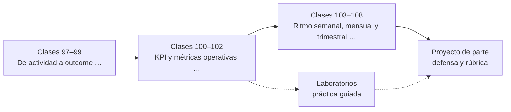

# Parte 08 — Sistemas de gestión, KPI y OKR

<!-- parte:inicio -->

> ← [Parte 07 — Operaciones, procesos y calidad](../07-operations-process-quality/README.md) · [Temario](../../SYLLABUS.md) · [Parte 09 — Finanzas y contabilidad para gerentes](../09-managerial-finance-accounting/README.md) →

*Dirigir con objetivos, métricas y ritmos de revisión*

**Etapa:** 3 — Gestión de negocio  
**Duración:** 12 clases · 30 horas  
**Resultado de salida:** Dirigir mediante objetivos, métricas, ritmos de revisión y asignación explícita de recursos.

🟣 [Ver las 6 etapas](../../SYLLABUS.md) · 12 clases (097–108) · 4 laboratorios · [proyecto de parte](project.md)

## 🎯 De qué trata esta parte

Medir no es dirigir. Muchos tableros muestran actividad y ocultan si el negocio avanza. Esta parte enseña a elegir qué medir, con qué cadencia revisarlo y qué decisión se espera de cada número.

El eje es **de actividad a resultado**: objetivos bien formulados, indicadores adelantados y rezagados, y reuniones de revisión que deciden en lugar de informar.

## 🧱 Con qué hay que llegar

| Parte | Qué aporta |
|---|---|
| [01 — Pensamiento crítico y toma de decisiones](../01-critical-thinking-and-decisions/README.md) | Decisiones con evidencia. |
| [07 — Operaciones, procesos y calidad](../07-operations-process-quality/README.md) | Procesos que se pueden medir. |

Cada clase supone la anterior: el orden importa, y saltarse una deja sin base a las que vienen después.

## 📚 Resultados de la parte

Al terminar esta parte podrás:

1. **Diferenciar** actividad, producto y resultado.
2. **Diseñar** objetivos y decidir cuándo conviene OKR.
3. **Elegir** KPI con indicadores adelantados y rezagados.
4. **Establecer** un ritmo semanal, mensual y trimestral.
5. **Conducir** business reviews y gestionar por excepción.

## 🗺️ Mapa de la parte

## 🧭 Cómo se encadenan las 12 clases

Las clases **97 a 99** fijan qué se persigue: resultado, objetivos y OKR con sus límites.

Las clases **100 a 102** definen cómo se mide: KPI, indicadores y tableros.

Las clases **103 a 108** cubren cómo se gobierna: ritmo, business reviews, priorización, recursos, escalamiento y el capstone de operating review.

## 📘 Las 12 clases

| # | Clase | Qué se trabaja | Entregable | Min |
|---:|---|---|---|---:|
| 097 | [De actividad a outcome](classes/097-de-actividad-a-outcome/README.md) | activity, output, outcome | [leadership-decision-brief](../../templates/leadership-decision-brief.md) | 150 |
| 098 | [Diseño de objetivos](classes/098-diseno-de-objetivos/README.md) | objective, target, constraint | [leadership-decision-brief](../../templates/leadership-decision-brief.md) | 150 |
| 099 | [OKR: cuándo sirven y cuándo no](classes/099-okr-cuando-sirven-y-cuando-no/README.md) | Objective, Key Result, initiative | [leadership-decision-brief](../../templates/leadership-decision-brief.md) | 150 |
| 100 | [KPI y métricas operativas](classes/100-kpi-y-metricas-operativas/README.md) | metric, KPI, definition | [leadership-decision-brief](../../templates/leadership-decision-brief.md) | 150 |
| 101 | [Leading y lagging indicators](classes/101-leading-y-lagging-indicators/README.md) | leading indicator, lagging indicator, driver | [leadership-decision-brief](../../templates/leadership-decision-brief.md) | 150 |
| 102 | [Balanced Scorecard y tableros](classes/102-balanced-scorecard-y-tableros/README.md) | financial perspective, customer perspective, process perspective | [leadership-decision-brief](../../templates/leadership-decision-brief.md) | 150 |
| 103 | [Ritmo semanal, mensual y trimestral](classes/103-ritmo-semanal-mensual-y-trimestral/README.md) | weekly cadence, monthly review, quarterly review | [leadership-decision-brief](../../templates/leadership-decision-brief.md) | 150 |
| 104 | [Business reviews](classes/104-business-reviews/README.md) | variance, forecast, root cause | [leadership-decision-brief](../../templates/leadership-decision-brief.md) | 150 |
| 105 | [Priorización y portfolio](classes/105-priorizacion-y-portfolio/README.md) | portfolio, strategic fit, capacity constraint | [strategy-memo](../../templates/strategy-memo.md) | 150 |
| 106 | [Asignación de recursos](classes/106-asignacion-de-recursos/README.md) | resource allocation, fixed commitment, discretionary capacity | [leadership-decision-brief](../../templates/leadership-decision-brief.md) | 150 |
| 107 | [Escalamiento y gestión por excepción](classes/107-escalamiento-y-gestion-por-excepcion/README.md) | tolerance, exception, threshold | [leadership-decision-brief](../../templates/leadership-decision-brief.md) | 150 |
| 108 | [Capstone: operating review gerencial](classes/108-capstone-operating-review-gerencial/README.md) | operating review, scorecard, forecast | [risk-governance-brief](../../templates/risk-governance-brief.md) | 150 |

## ⚠️ Riesgos característicos

- Medir lo fácil y no lo importante.
- Aplicar OKR como ritual sin estrategia.
- Revisar números sin decidir nada.
- Premiar una métrica que se manipula.

## 🔤 Glosario de la parte

57 conceptos definidos en las clases, con la definición operacional que usa cada una.

| Concepto | Definición operacional |
|---|---|
| **activity** | acción ejecutada que consume recursos. |
| **capacity constraint** | límite de personas, dinero o atención. |
| **causal link** | relación que debe contrastarse antes de gestionar como palanca. |
| **check-in** | revisión breve de progreso, confianza y aprendizaje. |
| **commitment** | objetivo que la organización asume como promesa operacional. |
| **constraint** | límite que debe respetarse al perseguir la meta. |
| **customer perspective** | valor y comportamiento del cliente. |
| **decision ask** | decisión requerida del foro. |
| **decision log** | registro de elecciones y owners. |
| **decision right** | autoridad definida para resolver una clase de excepción. |
| **definition** | regla exacta de cálculo, población y periodo. |
| **denominator** | base que hace comparables tasas y ratios. |
| **discretionary capacity** | capacidad reasignable. |
| **driver** | métrica con relación causal o predictiva plausible. |
| **early warning** | señal previa al breach. |
| **escalation** | movimiento de excepciones hacia el nivel que puede resolverlas. |
| **exception** | desviación material fuera de tolerancia. |
| **financial perspective** | resultados económicos finales. |
| **fixed commitment** | recurso difícil de mover en corto plazo. |
| **forecast** | mejor estimación actual, distinta de presupuesto original. |
| **hurdle rate** | umbral mínimo de retorno o valor para inversión. |
| **impact** | efecto de largo plazo al que contribuyen múltiples factores. |
| **initiative** | actividad elegida para mover un KR, sustituible si no funciona. |
| **Key Result** | resultado cuantitativo que evidencia progreso hacia el Objective. |
| **kill criteria** | condiciones que justifican detener una iniciativa. |
| **KPI** | indicador material para una decisión o resultado clave. |
| **lagging indicator** | resultado que se observa después de que el sistema actuó. |
| **leading indicator** | señal anticipada o driver cercano a una acción. |
| **learning perspective** | personas, datos y capacidades que sostienen procesos. |
| **management by exception** | foco en señales fuera de rango material. |
| **management narrative** | explicación coherente de qué cambió, por qué y qué se hará. |
| **metric** | medida cuantitativa de una propiedad. |
| **monthly review** | análisis de desempeño, forecast y causas. |
| **objective** | estado futuro cualitativo que orienta decisiones. |
| **operating review** | foro periódico de performance y decisiones. |
| **operating rhythm** | arquitectura integrada de reuniones y decisiones. |
| **option value** | valor de preservar aprendizaje o posibilidad futura. |
| **outcome** | cambio observable en cliente, negocio o capacidad. |
| **output** | producto directo y controlable de una actividad. |
| **owner** | rol responsable de calidad y uso del indicador. |
| **portfolio** | conjunto de inversiones gestionadas en relación entre sí. |
| **process perspective** | capacidades operativas que entregan la propuesta. |
| **proxy** | medida sustituta usada cuando el outcome es lento o difícil. |
| **quarterly review** | revisión de estrategia, recursos y objetivos. |
| **reallocation cost** | costo de cambiar personas, contratos o capital. |
| **resource allocation** | decisión sobre dónde ubicar capital, personas y atención. |
| **root cause** | explicación respaldada del cambio. |
| **scorecard** | conjunto compacto de señales. |
| **strategic fit** | grado de contribución a elecciones estratégicas. |
| **strategy map** | hipótesis causal entre objetivos de las perspectivas. |
| **stretch** | grado deliberado de ambición más allá del baseline. |
| **target** | valor cuantitativo esperado para una métrica. |
| **theory of change** | hipótesis que conecta actividades, outputs y outcomes. |
| **threshold** | valor observable que activa escalamiento. |
| **tolerance** | rango dentro del cual un equipo puede decidir sin escalar. |
| **variance** | diferencia entre actual y plan o forecast. |
| **weekly cadence** | ritmo corto de compromisos, bloqueos y señales. |

## 📦 Qué queda como evidencia

- Un árbol de KPI conectado con el objetivo.
- Un tablero con 5 a 7 indicadores.
- Un calendario de revisiones con agenda y decisiones.
- El capstone: operating review gerencial.

## 🔗 Cómo se conecta

Alimenta la parte 09 (finanzas), la 13 (estrategia) y los tableros del CEO en la parte 16 y del dueño en la 22.

## 🧪 Cómo se trabaja

Son **12 clases de 150 minutos** —30 horas— con **4 laboratorios** y un proyecto integrador. Cada clase trae su propósito, sus conceptos, un caso, práctica, errores frecuentes, preguntas de comprobación, entregable y fuentes, y se evalúa con su `assessment.md`. Los laboratorios se resuelven con datos propios o sintéticos, nunca con datos reales de terceros, y la parte se cierra con el proyecto y su defensa. Las reglas de recorrido están en [la guía de navegación](../../docs/NAVIGATION.md).

<!-- parte:fin -->

## Laboratorios

- [Lab 01 — KPI tree](labs/lab-01.md)
- [Lab 02 — OKR clinic](labs/lab-02.md)
- [Lab 03 — Monthly business review](labs/lab-03.md)
- [Lab 04 — Resource allocation game](labs/lab-04.md)

## Proyecto de parte

Construir y defender un sistema de gestión para una unidad de negocio.

## Bibliografía rectora

- John Doerr — *Measure What Matters* (OKR)
- Andrew S. Grove — *High Output Management* (Management)
- Robert S. Kaplan & David P. Norton — *The Balanced Scorecard* (Control de gestión)
- Peter F. Drucker — *Management: Tasks, Responsibilities, Practices* (Management)
- Bernard Marr — *Key Performance Indicators* (Métricas)

## Criterio de aprobación

80/100 y entrega del proyecto integrador.
