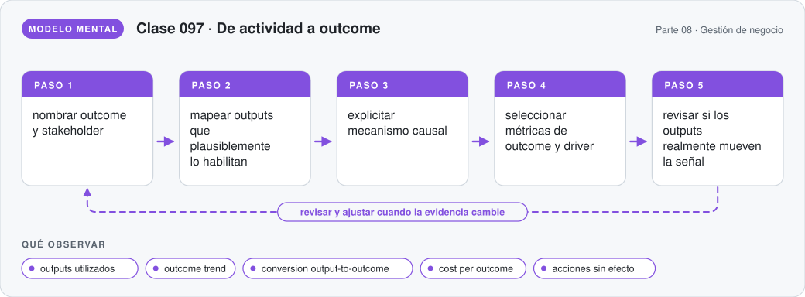

# Clase 097 — De actividad a outcome

<!-- nav:inicio -->
> **Parte 08 · Sistemas de gestión, KPI y OKR** — clase 1 de 12 · [índice de la parte](../../README.md) · [temario](../../../../SYLLABUS.md)
<!-- nav:fin -->

**Parte:** 08 — Sistemas de gestión, KPI y OKR  
**Nivel:** Etapa 3 — Manager → Gerente  
**Duración sugerida:** 150–180 minutos · **Estándar:** deep-class-v2

## 🎯 Propósito

Un equipo puede estar muy ocupado y no lograr nada que importe. Las reuniones se hacen, los informes se entregan, las campañas se lanzan y, sin embargo, el cliente no cambia su comportamiento ni el negocio mejora. La confusión entre **actividad**, **producto entregado**, **resultado** e **impacto** es la causa más frecuente de sistemas de gestión que miden mucho y orientan poco. Aprender a subir por esa cadena es la base de todo lo que sigue en la parte: objetivos, indicadores, tableros y revisiones.

La clase se apoya en la idea de Drucker de que los resultados están fuera de la organización y no dentro de ella, en el enfoque de Kaplan y Norton sobre cómo traducir la estrategia en medidas conectadas por causas y en la exigencia de Rumelt de que una estrategia nombre un problema y una acción coherente. Al terminar sabrás distinguir los cuatro eslabones, reescribir un plan de actividades como un plan de resultados y decidir en qué eslabón conviene medir y exigir.

## 📚 Resultados de aprendizaje

Al finalizar podrás:

1. **Distinguir** actividad, producto entregado, resultado (outcome) e impacto.
2. **Reescribir** un plan de actividades como una cadena de resultados con hipótesis.
3. **Elegir** el eslabón en que un equipo debe ser responsable.
4. **Detectar** métricas de vanidad y de actividad.
5. **Formular** la pregunta que conecta cada eslabón con el siguiente.

## 🧭 Agenda

| Tramo | Qué se hace |
|---|---|
| 0–20 min | Recuperación: toma el último informe de tu área y marca cada línea como actividad, producto, resultado o impacto. |
| 20–60 min | Cadena de resultados, hipótesis causales y responsabilidad. |
| 60–105 min | Ejemplo trabajado: un plan de capacitación comercial. |
| 105–150 min | Caso ejecutivo y práctica de reescritura. |
| 150–175 min | Límites y entregable. |

## 🧩 Conceptos centrales

| Concepto | Definición | Cómo se reconoce |
|---|---|---|
| **Actividad** | Acción que el equipo ejecuta. | Verbos como realizar, lanzar, reunir. |
| **Producto entregado (output)** | Lo que sale terminado de la actividad. | Se puede mostrar o contar. |
| **Resultado (outcome)** | Cambio en el comportamiento o la condición de clientes, personas o procesos. | Hay un antes y un después en quien recibe. |
| **Impacto** | Efecto sobre los objetivos del negocio: ingresos, costos, riesgo, reputación. | Se mide con variables financieras o estratégicas. |
| **Hipótesis causal** | Creencia de que un eslabón produce el siguiente. | Se puede contrastar con datos. |
| **Métrica de vanidad** | Cifra que crece sin que cambie nada importante. | Se celebra y no se usa para decidir. |

## 🧠 Modelo mental

**Cómo leer el diagrama.** Cuatro eslabones con una pregunta cada uno. En la **actividad** se pregunta si se hizo; en el **producto**, si quedó listo; en el **resultado**, si cambió algo para quien lo recibe; en el **impacto**, si valió la pena para el negocio. Cuanto más a la derecha, más importante y más difícil de atribuir. La disciplina gerencial consiste en no quedarse en los eslabones de la izquierda y, a la vez, no exigir a un equipo un impacto que no controla.

## 📖 Desarrollo

### 1. Los resultados están afuera

Drucker sostuvo que, dentro de una organización, solo hay costos; los resultados existen fuera, en los clientes y en el entorno. Medir lo que ocurre adentro (horas trabajadas, reuniones realizadas, informes publicados) describe esfuerzo, no logro. Esto no significa que la actividad sea irrelevante: es el medio por el cual se produce el resultado y también el costo que se paga. La pregunta gerencial es si ese costo está produciendo un cambio real que alguien fuera del equipo pueda reconocer.

### 2. Los cuatro eslabones

Una actividad (capacitar a 40 vendedores) produce un **producto** (40 personas con un curso terminado). Ese producto puede generar un **resultado** (los vendedores cambian cómo llevan la conversación comercial y la tasa de cierre de propuestas sube) y, a su vez, un **impacto** (crecen los ingresos y el margen). Cada flecha es una hipótesis: capacitar no garantiza que se aprenda; aprender no garantiza que se aplique; aplicar no garantiza que se venda más. Un plan serio explicita esas hipótesis y define cómo comprobarlas.

### 3. Dónde pedir cuentas

Si se exige solo el producto («terminar el curso»), el equipo cumple y nada cambia. Si se exige solo el impacto («aumentar ventas 15 %»), el equipo responde por variables que no controla del todo: precios, competencia, ciclo económico. El eslabón más útil para pedir cuentas a un equipo suele ser el **resultado**: un cambio que depende en buena medida de su trabajo y que se puede observar con relativa rapidez. El impacto se usa para evaluar si la estrategia tiene sentido; el resultado, para saber si el equipo avanza.

### 4. Métricas de vanidad y de actividad

Una **métrica de vanidad** crece sin informar decisiones: visitas a una página, descargas de un documento, número de reuniones. Una **métrica de actividad** mide esfuerzo: tareas cerradas, correos enviados. No son inútiles, pero se vuelven peligrosas cuando se transforman en meta: el equipo optimiza lo medido. Una prueba sencilla: ¿qué decisión cambiaría si esta cifra subiera o bajara 20 %? Si nadie puede responder, la métrica probablemente no sirve para gestionar.

### 5. Hipótesis y evidencia

Kaplan y Norton enfatizan que una estrategia es un conjunto de **hipótesis sobre causas y efectos** que se prueban con datos. Un mapa de estrategia es eso: una cadena de creencias («si mejoramos la formación, mejorará la ejecución comercial; si mejora la ejecución, aumentará la retención de clientes»). La gestión de resultados exige volver periódicamente a las hipótesis y preguntar si se están cumpliendo. Si el producto se entrega y el resultado no aparece, el problema puede estar en el diseño del producto, en su aplicación o en que la hipótesis era errónea.

### 6. La estrategia debe nombrar un problema

Rumelt critica los planes que son listas de metas y actividades sin diagnóstico. Una buena estrategia identifica el desafío crítico, define una política que lo enfrenta y coordina acciones coherentes. Pasar de actividad a resultado obliga a explicitar qué problema se resuelve. Sin esa claridad, cada área llena su calendario y nadie puede decir qué cambiará. Por eso la reescritura de un plan de actividades empieza por la pregunta: ¿qué situación queremos ver distinta y cómo lo notaremos?

### 7. Reescribir un plan

El método práctico tiene cuatro pasos. (1) Para cada actividad del plan, preguntar «¿para qué?» hasta llegar a un cambio en alguien o algo fuera del equipo. (2) Formular ese cambio como resultado observable con una medida y un plazo. (3) Escribir la hipótesis que une actividad y resultado y la forma de verificarla. (4) Decidir qué actividades se mantienen, cuáles se cambian y cuáles se eliminan porque no tienen un resultado asociado. Es habitual que entre una cuarta parte y la mitad de las actividades de un plan no resistan esa pregunta.

## 📚 Lectura comparada

| Obra | Qué aporta | Qué no resuelve | Pregunta para contrastar |
|---|---|---|---|
| Drucker | Resultados fuera de la organización; gestión por objetivos con autocontrol. | Es amplio; no entrega fichas de medición. | ¿Quién fuera del equipo notaría el cambio? |
| Kaplan y Norton (*Strategy Maps*) | Cadena causal entre perspectivas y medidas. | Exige una estrategia ya definida. | ¿Qué hipótesis une tus eslabones? |
| Rumelt | Diagnóstico, política y acciones coherentes. | No prescribe medidas. | ¿Qué problema crítico enfrentas? |
| Marr | Criterios para elegir indicadores. | Poco sobre estrategia. | ¿Qué decisión cambia con este indicador? |
| Doerr | Resultados clave medibles frente a tareas. | Casos seleccionados. | ¿Tu resultado clave es una tarea disfrazada? |

## 🧮 Ejemplo trabajado

**Situación (hipotética).** La gerencia comercial de una empresa de software de gestión para clínicas presenta su plan anual con cinco líneas: (1) capacitar a 40 ejecutivos, (2) lanzar 12 campañas de correo, (3) asistir a 6 ferias, (4) rediseñar la página web, (5) implementar un CRM nuevo.

| Línea | Eslabón | Pregunta «¿para qué?» | Reescritura como resultado |
|---|---|---|---|
| Capacitar a 40 ejecutivos | Actividad | Para que conduzcan mejor las demostraciones | La tasa de avance de demostración a propuesta sube de 28 % a 38 % en el segundo semestre |
| 12 campañas de correo | Actividad | Para generar reuniones con clínicas medianas | 60 reuniones calificadas por trimestre con clínicas de 10 a 50 profesionales |
| 6 ferias | Actividad | Para conocer más clínicas | No hay un resultado claro; se evalúa cada feria por reuniones calificadas y costo por reunión |
| Rediseñar la web | Producto | Para que quienes llegan pidan una demostración | Las solicitudes de demostración desde la web suben de 40 a 70 al mes |
| Implementar un CRM | Producto | Para que el equipo registre el avance de cada oportunidad | 90 % de las oportunidades con etapa y próxima acción actualizada semanalmente |

**Hipótesis explícitas.** (a) Mejores demostraciones elevan la conversión a propuesta. (b) Más reuniones calificadas elevan las propuestas, si el equipo tiene capacidad para atenderlas (la capacidad se verifica). (c) Registrar etapas permite detectar oportunidades estancadas y actuar.

**Decisión.** Se mantienen las líneas 1, 2, 4 y 5 con sus resultados. La línea 3 se reduce a dos ferias con criterio de reuniones calificadas; los recursos liberados financian pruebas del segmento.

**Qué muestra.** (1) Cada línea se conectó con un cambio externo. (2) Las hipótesis quedaron explícitas y verificables. (3) Una actividad sin resultado claro se redujo en lugar de repetirse por costumbre.

## 🔀 Comparación y límites

**Resultado frente a impacto.** El resultado es el cambio que el equipo puede provocar; el impacto es su efecto en el negocio, mezclado con muchas otras causas. Exigir impacto a un equipo sin autoridad sobre las demás causas genera frustración y manipulación.

**Límites.** No todo resultado es fácil de medir en el corto plazo (reputación, aprendizaje, cultura); en esos casos se usan indicadores indirectos con cautela. La cadena causal es una simplificación: los efectos suelen tener varias causas y retardos. Y la exigencia de resultados no debe empujar a ocultar el costo humano o a descuidar actividades necesarias pero invisibles, como el mantenimiento o el cumplimiento normativo, que tienen su propio criterio de «hecho».

## 🪜 De profesional a owner

| Nivel | Cómo piensa en resultados |
|---|---|
| **Profesional** | Pregunta para qué sirve su tarea y qué cambio produce. |
| **Jefe / Team Lead** | Plantea a su equipo resultados y no solo tareas. |
| **Gerente** | Conecta los resultados de sus equipos con los impactos de la estrategia. |
| **CEO / Director** | Pide hipótesis y evidencia antes de aprobar actividades. |
| **Founder / Owner** | Evita construir por inercia y mide si lo que hace cambia algo para el cliente. |

## 🏢 Caso ejecutivo

Una cadena de colegios privados presenta al directorio su plan de «transformación digital»: comprar tabletas para 3.000 estudiantes, capacitar a 180 docentes en una plataforma y lanzar una aplicación para apoderados. Cada línea tiene presupuesto y fecha. El presidente del directorio pregunta qué cambiará en la experiencia de los estudiantes y qué se espera en matrículas y retención. La gerencia responde con el avance de las compras y las horas de capacitación. Hay tensión: los docentes sienten que se les exige usar una plataforma sin saber para qué; los apoderados reclaman por información que no llega.

Entrega un **plan de resultados** que contenga: (a) la cadena actividad–producto–resultado–impacto de cada línea; (b) los resultados observables con medida y plazo; (c) las hipótesis causales y cómo se verificarán; (d) el eslabón en que se pedirá cuentas a cada equipo; (e) las actividades que se cambiarían o eliminarían; (f) qué decisión del directorio tomarías según los primeros resultados.

## 🧪 Práctica

1. Clasifica diez líneas de un plan real como actividad, producto, resultado o impacto.
2. Reescribe tres actividades como resultados con medida y plazo.
3. Escribe la hipótesis que une una actividad con su resultado y cómo la verificarías.
4. Identifica una métrica de vanidad de tu área y propón una alternativa.
5. Define en qué eslabón pedirás cuentas a un equipo y por qué.

## ⚠️ Errores frecuentes

| Error | Por qué ocurre | Cómo corregirlo |
|---|---|---|
| Medir solo actividad | Es fácil de contar | Preguntar «¿para qué?» hasta el cambio externo. |
| Exigir impacto a quien no lo controla | Se quiere responsabilidad total | Pedir cuentas por el resultado. |
| Dar por cierta la hipótesis | Parece obvia | Explicitarla y verificarla. |
| Celebrar métricas de vanidad | Suben solas | Preguntar qué decisión cambiaría. |
| Resultados sin plazo ni medida | Se redactan como deseos | Medida, línea base y fecha. |
| Mantener actividades sin resultado | Costumbre | Revisar y eliminar. |

## ❓ Preguntas de comprobación

1. ¿Qué diferencia hay entre producto entregado y resultado?
2. ¿Por qué Drucker dice que los resultados están fuera de la organización?
3. ¿En qué eslabón suele convenir pedir cuentas a un equipo?
4. ¿Qué es una métrica de vanidad y cómo se detecta?
5. ¿Qué es una hipótesis causal en un plan?
6. ¿Qué cuatro pasos tiene la reescritura de un plan de actividades?
7. ¿Qué límite tiene la cadena de resultados?

Claves de respuesta

1. El producto es lo que sale terminado; el resultado es el cambio que produce en quien lo recibe.
2. Porque dentro solo hay esfuerzo y costo; el valor lo reconocen clientes y entorno.
3. En el resultado, porque el equipo lo puede influir en buena medida y observar con rapidez.
4. Una cifra que crece sin informar decisiones; se detecta preguntando qué decisión cambiaría si subiera o bajara 20 %.
5. Una creencia de que un eslabón produce el siguiente, que se puede contrastar con datos.
6. Preguntar «¿para qué?», formular el resultado observable, escribir la hipótesis y su verificación, y decidir qué actividades se mantienen, cambian o eliminan.
7. Es una simplificación: los efectos tienen varias causas y retardos, y algunos resultados son difíciles de medir en el corto plazo.

## 📥 Entregable

Guarda en `portfolio/097-de-actividad-a-outcome/`:

- `leadership-decision-brief.md` (plantilla [Leadership Decision Brief](../../../../templates/leadership-decision-brief.md)) con el plan de resultados del caso ejecutivo;
- `kpi-tree.md` (plantilla [KPI tree](../../../../templates/kpi-tree.md)) con la cadena actividad–producto–resultado–impacto;
- `decision-journal.md` con las hipótesis, su verificación y las actividades eliminadas.

## 📗 Fuentes y verificación

- Peter F. Drucker — *Management: Tasks, Responsibilities, Practices* (Harper & Row, 1974). **Uso en esta clase:** resultados fuera de la organización y gestión por objetivos. Lectura selectiva sobre **de actividad a outcome**. **Localizador:** [ISBN-13 9780060110925](https://openlibrary.org/isbn/9780060110925).
- Robert S. Kaplan & David P. Norton — *Strategy Maps* (Harvard Business School Press, 2004). **Uso en esta clase:** cadena causal entre perspectivas y medidas. Lectura selectiva sobre **de actividad a outcome**. **Localizador:** [ISBN-13 9781591391340](https://openlibrary.org/isbn/9781591391340).
- Richard Rumelt — *Good Strategy/Bad Strategy* (Profile Books, 2011). **Uso en esta clase:** diagnóstico, política y acciones coherentes. Lectura selectiva sobre **de actividad a outcome**. **Localizador:** [ISBN-13 9781846684807](https://openlibrary.org/isbn/9781846684807).
- Bernard Marr — *Key Performance Indicators* (Pearson Financial Times Pub., 2012). **Uso en esta clase:** criterios para elegir indicadores. Lectura selectiva sobre **de actividad a outcome**. **Localizador:** [ISBN-13 9780273750116](https://openlibrary.org/isbn/9780273750116).
- John Doerr — *Measure What Matters* (Penguin Random House USA Ex, 2018). **Uso en esta clase:** resultados clave medibles frente a tareas. Lectura selectiva sobre **de actividad a outcome**. **Localizador:** [ISBN-13 9780525538349](https://openlibrary.org/isbn/9780525538349).

> **Regla de fuentes para De actividad a outcome:** las obras anteriores estructuran las perspectivas de esta materia; cualquier norma, ley o estándar vivo mencionado debe comprobarse nuevamente en su fuente primaria vigente. Los ejemplos y casos son hipotéticos, con cifras ilustrativas. El desarrollo es original y no reproduce capítulos protegidos.

<!-- pie:inicio -->
---

| Anterior | Índice | Siguiente |
|---|---|---|
| [← 096 · Capstone: rediseñar una operación](../../../07-operations-process-quality/classes/096-capstone-redisenar-una-operacion/README.md) | [Parte 08](../../README.md) · [Programa](../../../../SYLLABUS.md) | [098 · Diseño de objetivos →](../098-diseno-de-objetivos/README.md) |
<!-- pie:fin -->
