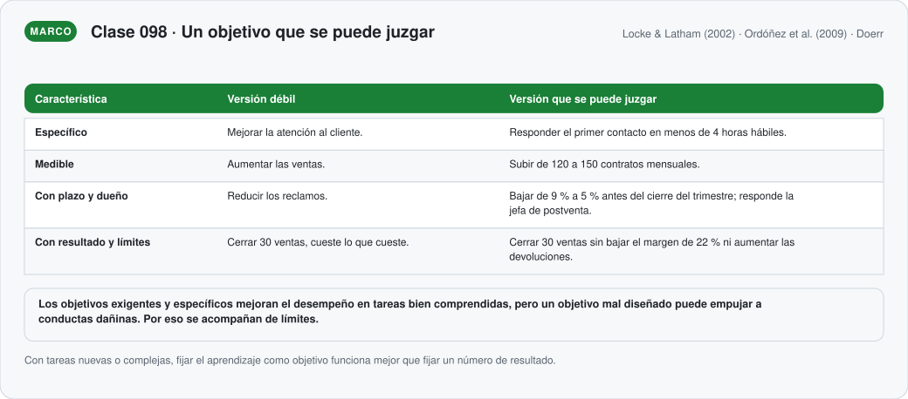

# Clase 098 — Diseño de objetivos

<!-- nav:inicio -->
> **Parte 08 · Sistemas de gestión, KPI y OKR** — clase 2 de 12 · [índice de la parte](../../README.md) · [temario](../../../../SYLLABUS.md)
<!-- nav:fin -->

**Parte:** 08 — Sistemas de gestión, KPI y OKR  
**Nivel:** Etapa 3 — Manager → Gerente  
**Duración sugerida:** 150–180 minutos · **Estándar:** deep-class-v2

## 🎯 Propósito

Un objetivo es una promesa de qué cambiará y cuándo, hecha antes de saber si se cumplirá. Bien diseñado, orienta la atención, moviliza esfuerzo y permite aprender de la diferencia entre lo esperado y lo ocurrido. Mal diseñado, genera conductas indeseadas: se persigue el número y se descuida lo que importa, se esconden los problemas o se fijan metas tan seguras que no exigen nada. La investigación sobre fijación de metas muestra ambas caras con la misma claridad.

La clase se apoya en la teoría de la fijación de metas de Locke y Latham, en la advertencia de Ordóñez y sus colegas sobre los efectos secundarios de recetar metas sin cuidado y en la práctica de objetivos y resultados clave descrita por Doerr. Al terminar sabrás formular objetivos específicos, medibles, con dueño y plazo, cuándo conviene una meta de resultado y cuándo una de aprendizaje, y cómo acompañarlos con límites que eviten daños colaterales.

## 📚 Resultados de aprendizaje

Al finalizar podrás:

1. **Formular** un objetivo específico, medible, con dueño, plazo y resultado esperado.
2. **Distinguir** objetivos de resultado, de proceso y de aprendizaje.
3. **Calibrar** la dificultad: exigente pero alcanzable según el contexto.
4. **Anticipar** efectos secundarios y fijar límites y medidas de contrapeso.
5. **Revisar** un objetivo ante nueva información sin perder credibilidad.

## 🧭 Agenda

| Tramo | Qué se hace |
|---|---|
| 0–20 min | Recuperación: toma un objetivo de tu equipo y pregúntate cómo sabrías, sin discusión, si se cumplió. |
| 20–60 min | Características, tipos de meta, dificultad y efectos secundarios. |
| 60–105 min | Ejemplo trabajado: objetivos de un área de postventa. |
| 105–150 min | Caso ejecutivo y práctica de reescritura. |
| 150–175 min | Límites y entregable. |

## 🧩 Conceptos centrales

| Concepto | Definición | Cómo se reconoce |
|---|---|---|
| **Objetivo** | Estado futuro deseado, con medida, plazo y responsable. | Se puede juzgar sin discusión al llegar la fecha. |
| **Meta de resultado** | Valor a lograr en una variable final. | «Subir la retención a 90 %». |
| **Meta de aprendizaje** | Compromiso con adquirir conocimiento o habilidad. | «Probar tres formas de reducir el tiempo de respuesta». |
| **Compromiso** | Aceptación real del objetivo por quien debe cumplirlo. | La persona participó o entiende el porqué. |
| **Medida de contrapeso** | Indicador que vigila un efecto lateral posible. | Calidad junto a velocidad. |
| **Meta de estiramiento** | Objetivo muy ambicioso, con probabilidad baja de lograrse del todo. | Se acuerda que cumplir el 70 % puede ser buen resultado. |

## 🧠 Modelo mental

**Cómo leer el diagrama.** Cada fila toma una característica —específico, medible, con plazo y dueño, con resultado y límites— y muestra una formulación débil y su versión corregida. El patrón común: la versión débil es una intención («mejorar», «aumentar», «reducir»), mientras que la corregida permite verificar sin discusión qué se logró y a qué costo. La última fila agrega los límites que evitan lograr el objetivo dañando algo más.

## 📖 Desarrollo

### 1. Qué dice la investigación sobre metas

Locke y Latham resumieron décadas de estudios: las metas **específicas y difíciles** conducen a mejor desempeño que las vagas («hacer lo mejor posible») o fáciles, siempre que la persona tenga **compromiso**, reciba **retroalimentación** y cuente con la **habilidad** y los recursos necesarios. Las metas dirigen la atención, movilizan esfuerzo, aumentan la persistencia y estimulan la búsqueda de estrategias. El efecto es robusto en tareas relativamente bien comprendidas; en tareas muy complejas o nuevas, la presión por un resultado puede perjudicar el aprendizaje.

### 2. Los efectos secundarios

Ordóñez y sus coautores argumentan que fijar metas se receta con demasiada ligereza. Los riesgos documentados incluyen: **foco excesivo** en lo medido y descuido de lo que no se mide; **conductas poco éticas** para alcanzar el número; **asunción excesiva de riesgos**; **daño a la cooperación** cuando las metas individuales compiten; y **erosión de la motivación intrínseca**. No se trata de evitar las metas, sino de diseñarlas con cuidado, como un medicamento con efectos adversos conocidos: se prescribe con dosis, supervisión y contraindicaciones.

### 3. Metas de resultado, de proceso y de aprendizaje

Una meta de **resultado** fija el valor final («cerrar 150 contratos»). Una de **proceso** compromete conductas que se creen eficaces («hacer cinco visitas a clientes por semana»). Una de **aprendizaje** compromete a descubrir («probar tres modelos de precio y decidir con datos»). Cuando la relación entre acciones y resultados es conocida, la meta de resultado orienta bien. Cuando es incierta, las metas de proceso o de aprendizaje evitan que se castigue la exploración. Mezclar los tres tipos en un mismo conjunto de objetivos es habitual y sano.

### 4. Específico, medible, con dueño y plazo

Un objetivo bien formulado permite responder cuatro preguntas sin discusión: **¿qué cambiará?** (específico), **¿cómo sabremos cuánto?** (medida con línea base y valor meta), **¿quién responde?** (un dueño, no un comité) y **¿para cuándo?** (fecha). A esto se suma una quinta: **¿a qué costo no se admitirá lograrlo?** (límites). La medida debe poder obtenerse con datos que existan o se puedan obtener; un objetivo cuyo cumplimiento nadie puede verificar solo genera debate sobre cifras.

### 5. Dificultad y compromiso

La dificultad óptima depende de la persona y de la tarea. Una meta demasiado fácil no moviliza; una imposible desmoraliza o incita a trampas. El compromiso aumenta cuando la persona **entiende el porqué**, **participa en fijar la meta**, confía en que es alcanzable y percibe justicia en la evaluación. Imponer metas con explicaciones débiles produce cumplimiento aparente. Doerr describe los objetivos ambiciosos como una forma de pensar en grande, con la cláusula de que no se usen para castigar ni para determinar la remuneración de forma mecánica.

### 6. Límites y contrapesos

Todo objetivo cuantitativo debería acompañarse de al menos una **medida de contrapeso** que vigile lo que podría deteriorarse: si se persigue velocidad, se mide calidad; si se persigue volumen de ventas, se mide margen y devoluciones; si se reduce costo, se mide satisfacción. También se acuerdan **límites explícitos**: lo que no se hará para lograrlo (descuentos sobre un piso, atajos de seguridad, prácticas comerciales cuestionables). Esta parte del diseño es la que más protege la integridad de la organización y la que más se omite por apuro.

### 7. Revisar sin perder credibilidad

Los objetivos se fijan con información incompleta. Si el contexto cambia radicalmente, mantenerlos intactos puede ser absurdo; si se cambian con cada dificultad, pierden sentido. Una regla útil: se revisan en momentos acordados (trimestre, hito), con criterios explícitos (cambio de supuestos, nueva información material) y con registro de la decisión y su razón. La revisión no se oculta ni se usa para evitar la rendición de cuentas: se conserva la meta original y la ajustada para aprender de la diferencia.

## 📚 Lectura comparada

| Obra | Qué aporta | Qué no resuelve | Pregunta para contrastar |
|---|---|---|---|
| Locke y Latham (2002) | Síntesis de la teoría de fijación de metas. | Parte de estudios con tareas definidas. | ¿Tu tarea es bien comprendida? |
| Ordóñez et al. (2009) | Efectos secundarios sistemáticos de las metas. | No cubre toda la evidencia a favor. | ¿Qué conducta indeseada podría incentivar? |
| Doerr | Objetivos inspiradores y resultados clave medibles. | Casos de empresas exitosas. | ¿Tu objetivo inspira o solo exige? |
| Drucker | Gestión por objetivos con autocontrol. | Es una visión general. | ¿Quién fija y quién se compromete? |
| Kahneman et al. (*Noise*) | Variabilidad del juicio al evaluar desempeño. | No trata de metas. | ¿Se evaluará de manera consistente? |

## 🧮 Ejemplo trabajado

**Situación (hipotética).** La jefa de postventa de una empresa de electrodomésticos recibe del gerente tres objetivos para el año: «mejorar la satisfacción del cliente», «reducir los costos de garantía» y «aumentar la productividad del equipo». Los reescribe con el equipo.

| Objetivo original | Problema | Objetivo reescrito |
|---|---|---|
| Mejorar la satisfacción | No dice cuánto ni cómo se mide | Subir la satisfacción posterior a la visita técnica de 3,9 a 4,4 sobre 5 en seis meses; mide la encuesta enviada a todos los clientes atendidos |
| Reducir costos de garantía | Podría lograrse rechazando garantías legítimas | Bajar el costo promedio por garantía de USD 78 a USD 70 **sin** aumentar la proporción de reclamos escalados (hoy 6 %) ni bajar la satisfacción |
| Aumentar la productividad | Podría lograrse bajando calidad | Aumentar de 5,2 a 6 las visitas resueltas por técnico y día, manteniendo la resolución en la primera visita sobre 82 % |

**Tipos de meta.** La primera es de resultado; la segunda, de resultado con límite; la tercera, de resultado con contrapeso. Se agrega una meta de **aprendizaje**: probar durante dos meses un diagnóstico remoto para determinar qué fallas pueden resolverse sin visita y decidir su adopción con datos.

**Compromiso y revisión.** Se fijan los valores con el equipo a partir de los datos de los últimos 12 meses (la satisfacción de 3,9 varió entre 3,7 y 4,1). Se acuerda una revisión a los tres meses; si se cambia el modelo de producto, se renegocia.

**Qué muestra.** (1) Los objetivos pasaron de intención a verificables. (2) Los límites evitaron lograr costos dañando a los clientes. (3) Se agregó una meta de aprendizaje donde la relación entre acción y resultado era incierta.

## 🔀 Comparación y límites

**Objetivo frente a pronóstico.** Un pronóstico dice qué se espera que ocurra; un objetivo dice qué se quiere lograr. Confundirlos produce metas que se fijan por inercia o pronósticos que se inflan por presión.

**Límites.** La evidencia de laboratorio y de estudios de campo sobre metas no cubre todos los contextos; el efecto depende de la tarea, la cultura y la forma de evaluación. Vincular metas rígidamente a remuneración variable aumenta el riesgo de manipulación. Los números del ejemplo son ilustrativos. Y los objetivos de personas tienen implicancias laborales (evaluación, remuneración) que deben respetar la normativa y los contratos vigentes.

## 🪜 De profesional a owner

| Nivel | Cómo trabaja los objetivos |
|---|---|
| **Profesional** | Pregunta qué se espera, cómo se medirá y qué no se debe sacrificar. |
| **Jefe / Team Lead** | Fija objetivos con su equipo y revisa avances con datos. |
| **Gerente** | Alinea objetivos entre áreas y define límites y contrapesos. |
| **CEO / Director** | Cuida que la presión por metas no erosione la integridad. |
| **Founder / Owner** | Evita metas que le sirvan a él pero que su equipo no entienda ni comparta. |

## 🏢 Caso ejecutivo

Una empresa de telecomunicaciones fija a su fuerza de ventas una meta anual de «300 nuevos clientes corporativos» con un bono creciente. A mitad de año, la dirección descubre que se está ofreciendo descuentos no autorizados, que se registran como «cerrados» contratos sin firma completa y que los ejecutivos evitan compartir contactos con colegas. La rotación de clientes nuevos a seis meses subió de 8 % a 19 %. El gerente comercial defiende la meta como «clara y exigente»; el gerente de personas pide reemplazarla por algo «más equilibrado».

Entrega un **rediseño de objetivos** que contenga: (a) el diagnóstico de los efectos secundarios observados con base en la evidencia; (b) los objetivos reformulados con medida, plazo, dueño y límites; (c) las medidas de contrapeso; (d) cómo combinarás metas de resultado, de proceso y de aprendizaje; (e) cómo se fijarán con la fuerza de ventas y cómo se revisarán; (f) qué cambios en la remuneración variable deberán consultarse con asesoría laboral.

## 🧪 Práctica

1. Reescribe tres objetivos vagos de tu área con medida, plazo, dueño y límites.
2. Para un objetivo cuantitativo, define una medida de contrapeso.
3. Clasifica tus objetivos en resultado, proceso y aprendizaje.
4. Identifica una conducta indeseada que podría incentivar un objetivo tuyo y cómo la evitarías.
5. Define cuándo y con qué criterios revisarás un objetivo.

## ⚠️ Errores frecuentes

| Error | Por qué ocurre | Cómo corregirlo |
|---|---|---|
| Objetivos como intenciones | Es más cómodo | Medida, línea base, meta y plazo. |
| Un número sin límites | Se mide solo lo central | Límites y contrapesos. |
| Imponer sin explicar | Se supone obediencia | Explicar el porqué y fijar con el equipo. |
| Metas de resultado en tareas nuevas | Se quiere control | Metas de aprendizaje. |
| Vincular todo a remuneración | Parece incentivo claro | Separar o suavizar el vínculo. |
| Cambiar el objetivo sin registro | Se busca evitar un fracaso | Revisión con criterios y registro. |

## ❓ Preguntas de comprobación

1. ¿Qué condiciones hacen que las metas específicas y difíciles mejoren el desempeño?
2. Menciona tres efectos secundarios de las metas descritos por Ordóñez y sus colegas.
3. ¿Cuándo conviene una meta de aprendizaje?
4. ¿Qué cuatro preguntas responde un objetivo bien formulado?
5. ¿Qué es una medida de contrapeso?
6. ¿Qué eleva el compromiso con una meta?
7. ¿Cómo se revisa un objetivo sin perder credibilidad?

Claves de respuesta

1. Compromiso, retroalimentación, habilidad y recursos, y una tarea razonablemente comprendida.
2. Por ejemplo: foco excesivo en lo medido, conductas poco éticas, asunción excesiva de riesgos, daño a la cooperación y erosión de la motivación intrínseca.
3. Cuando la relación entre acciones y resultados es incierta o la tarea es nueva.
4. Qué cambiará, cuánto y cómo se medirá, quién responde y para cuándo.
5. Un indicador que vigila lo que podría deteriorarse al perseguir el objetivo, como la calidad junto a la velocidad.
6. Entender el porqué, participar en fijarla, creerla alcanzable y percibir justicia en la evaluación.
7. En momentos y con criterios acordados, registrando la decisión y conservando la meta original y la ajustada.

## 📥 Entregable

Guarda en `portfolio/098-diseno-de-objetivos/`:

- `leadership-decision-brief.md` (plantilla [Leadership Decision Brief](../../../../templates/leadership-decision-brief.md)) con el rediseño de objetivos del caso ejecutivo;
- `kpi-tree.md` (plantilla [KPI tree](../../../../templates/kpi-tree.md)) con los objetivos, sus medidas y sus contrapesos;
- `decision-journal.md` con los criterios de revisión y los efectos secundarios vigilados.

## 📗 Fuentes y verificación

- Edwin A. Locke & Gary P. Latham — *Building a Practically Useful Theory of Goal Setting and Task Motivation: A 35-Year Odyssey* (American Psychologist, 2002). **Uso en esta clase:** síntesis de la teoría de fijación de metas. Lectura selectiva sobre **diseño de objetivos**. **Localizador:** [DOI 10.1037/0003-066X.57.9.705](https://doi.org/10.1037/0003-066X.57.9.705).
- Lisa D. Ordóñez, Maurice E. Schweitzer, Adam D. Galinsky & Max H. Bazerman — *Goals Gone Wild: The Systematic Side Effects of Overprescribing Goal Setting* (Academy of Management Perspectives, 2009). **Uso en esta clase:** efectos secundarios sistemáticos de las metas. Lectura selectiva sobre **diseño de objetivos**. **Localizador:** [DOI 10.5465/amp.2009.37007999](https://doi.org/10.5465/amp.2009.37007999).
- John Doerr — *Measure What Matters* (Penguin Random House USA Ex, 2018). **Uso en esta clase:** objetivos ambiciosos y resultados clave medibles. Lectura selectiva sobre **diseño de objetivos**. **Localizador:** [ISBN-13 9780525538349](https://openlibrary.org/isbn/9780525538349).
- Peter F. Drucker — *Management: Tasks, Responsibilities, Practices* (Harper & Row, 1974). **Uso en esta clase:** gestión por objetivos con autocontrol. Lectura selectiva sobre **diseño de objetivos**. **Localizador:** [ISBN-13 9780060110925](https://openlibrary.org/isbn/9780060110925).
- Daniel Kahneman, Olivier Sibony & Cass R. Sunstein — *Noise* (Little, Brown Spark, 2021). **Uso en esta clase:** variabilidad del juicio al evaluar desempeño. Lectura selectiva sobre **diseño de objetivos**. **Localizador:** [ISBN-13 9780316451383](https://openlibrary.org/isbn/9780316451383).

> **Regla de fuentes para Diseño de objetivos:** las obras anteriores estructuran las perspectivas de esta materia; cualquier norma, ley o estándar vivo mencionado debe comprobarse nuevamente en su fuente primaria vigente, incluidas las normas laborales sobre evaluación y remuneración. Los ejemplos y casos son hipotéticos, con cifras ilustrativas. El desarrollo es original y no reproduce capítulos protegidos.

<!-- pie:inicio -->
---

| Anterior | Índice | Siguiente |
|---|---|---|
| [← 097 · De actividad a outcome](../097-de-actividad-a-outcome/README.md) | [Parte 08](../../README.md) · [Programa](../../../../SYLLABUS.md) | [099 · OKR: cuándo sirven y cuándo no →](../099-okr-cuando-sirven-y-cuando-no/README.md) |
<!-- pie:fin -->
