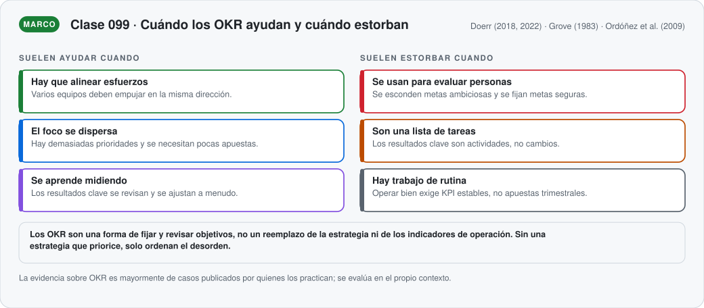

# Clase 099 — OKR: cuándo sirven y cuándo no

<!-- nav:inicio -->
> **Parte 08 · Sistemas de gestión, KPI y OKR** — clase 3 de 12 · [índice de la parte](../../README.md) · [temario](../../../../SYLLABUS.md)
<!-- nav:fin -->

**Parte:** 08 — Sistemas de gestión, KPI y OKR  
**Nivel:** Etapa 3 — Manager → Gerente  
**Duración sugerida:** 150–180 minutos · **Estándar:** deep-class-v2

## 🎯 Propósito

Los OKR (objetivos y resultados clave) se han vuelto un estándar de moda: muchas empresas los adoptan esperando alineación y foco, y varias los abandonan frustradas porque terminaron como una planilla trimestral más. La diferencia no está en la herramienta sino en las condiciones en que se usa. Los OKR son un mecanismo para **elegir pocas apuestas, alinear equipos y revisar con frecuencia si el avance es real**; no son un sistema de evaluación de personas, ni un reemplazo de la estrategia, ni un tablero de operación.

La clase se apoya en la descripción de Doerr (*Measure What Matters* y *Speed & Scale*), en el origen del método en el trabajo de Grove sobre gestión de alto rendimiento y en la advertencia de Ordóñez y colegas sobre los efectos de las metas mal diseñadas. Al terminar sabrás escribir objetivos y resultados clave de buena calidad, decidir cuándo adoptar OKR, diferenciarlos de los KPI y evitar los fallos más comunes.

## 📚 Resultados de aprendizaje

Al finalizar podrás:

1. **Redactar** un objetivo cualitativo inspirador y de dos a cinco resultados clave medibles.
2. **Diferenciar** OKR de KPI, de tareas y de evaluación del desempeño.
3. **Decidir** si la organización está lista para adoptar OKR y con qué alcance.
4. **Diseñar** un ciclo de OKR con cascada, revisión y cierre.
5. **Reconocer** los modos de fallo y proponer correcciones.

## 🧭 Agenda

| Tramo | Qué se hace |
|---|---|
| 0–20 min | Recuperación: ¿cuántas prioridades tiene tu equipo ahora y cuántas puede perseguir de verdad? |
| 20–60 min | Estructura, condiciones de uso y fallos. |
| 60–105 min | Ejemplo trabajado: un ciclo de OKR de una empresa de servicios. |
| 105–150 min | Caso ejecutivo y práctica de redacción. |
| 150–175 min | Límites y entregable. |

## 🧩 Conceptos centrales

| Concepto | Definición | Cómo se reconoce |
|---|---|---|
| **Objetivo (O)** | Descripción cualitativa y motivadora de lo que se quiere lograr en un ciclo. | Se entiende y entusiasma sin cifras. |
| **Resultado clave (KR)** | Medida cuantitativa que indica si el objetivo se logró. | Tiene línea base, meta y fecha. |
| **Meta de estiramiento** | OKR ambicioso cuyo logro pleno es poco probable. | Se acuerda qué puntaje se considera bueno. |
| **Compromiso** | OKR que se espera cumplir al 100 %. | Se distingue explícitamente de los de estiramiento. |
| **Alineación** | Relación entre OKR de distintos niveles. | Cada equipo puede ver cómo aporta. |
| **Puntuación y cierre** | Valoración al final del ciclo y registro de lecciones. | Se compara lo esperado con lo ocurrido. |

## 🧠 Modelo mental

**Cómo leer el diagrama.** Dos paneles. A la izquierda, tres condiciones en que los OKR suelen aportar: alinear esfuerzos, enfocar cuando hay demasiadas prioridades y aprender midiendo con revisiones frecuentes. A la derecha, tres en que suelen estorbar: si se usan para evaluar personas, si los resultados clave son tareas y si el trabajo es de rutina estable. La decisión de adoptar OKR parte de preguntar a cuál de los dos paneles se parece más la situación real.

## 📖 Desarrollo

### 1. Origen y propósito

Grove, en *High Output Management*, describió un sistema de objetivos y resultados clave para centrar la atención de una organización técnica en lo que importa. Doerr lo introdujo en Google y lo popularizó. La premisa: pocos objetivos, con resultados medibles, revisados con frecuencia, públicos dentro de la organización. El método busca responder dos preguntas: **¿hacia dónde vamos?** (el objetivo) y **¿cómo sabremos que llegamos?** (los resultados clave). La claridad compartida sobre esas dos preguntas es el beneficio central.

### 2. Cómo se escribe un buen OKR

El **objetivo** es breve, cualitativo y memorable: «Ser la primera opción de las clínicas medianas». Los **resultados clave** son de dos a cinco, medibles, y describen **resultados**, no tareas (clase 097): «Subir el NPS de clínicas medianas de 32 a 45», «Pasar de 18 a 30 clínicas activas mensuales». Una señal de calidad: un tercero puede decir sin ambigüedad si cada resultado clave se logró. Una señal de alerta: los resultados clave empiezan con verbos de actividad («lanzar», «implementar»), lo que indica que son un plan de trabajo y no una medida de logro.

### 3. Compromiso y estiramiento

Doerr distingue los OKR **comprometidos**, que se espera cumplir por completo y se asocian a responsabilidades operativas, de los OKR de **estiramiento** (*moonshots*), que buscan resultados excepcionales y se considera exitoso lograr entre el 60 % y el 70 %. Mezclar ambos sin aclararlo genera confusión: un equipo no sabe si un 70 % es un fracaso o un éxito. Por eso el ciclo comienza con un acuerdo explícito sobre qué tipo de OKR es cada uno y cómo se valorará, y se evita usar el cumplimiento de los de estiramiento como evaluación individual.

### 4. OKR frente a KPI

Los **KPI** vigilan la salud estable de lo que ya se opera (tasa de entregas a tiempo, margen, rotación); sus valores se mantienen o se mejoran gradualmente. Los **OKR** impulsan un cambio en un período determinado, centrados en pocas apuestas. Ambos coexisten: un KPI que se deteriora puede convertirse en un OKR de corrección; un OKR logrado puede transformarse en KPI de mantenimiento. Usar OKR para todo lo que el equipo hace deja el trabajo de rutina sin atención. Usar solo KPI deja a la empresa sin mecanismo de cambio.

### 5. Cascada y alineación

La alineación no exige que los OKR de arriba se descompongan mecánicamente hacia abajo. Funciona mejor un diálogo: la dirección define pocas prioridades, los equipos proponen cómo contribuyen y negocian los resultados clave, y se verifican las dependencias entre equipos. La transparencia (cada persona puede ver los OKR de los demás) facilita la coordinación. Una cascada rígida convierte los OKR en órdenes y quita compromiso; una falta de alineación produce equipos que optimizan lo suyo.

### 6. Ritmo del ciclo

Un ciclo típico es trimestral con un marco anual. Incluye: **definición** (dos semanas antes), **seguimiento semanal** breve (confianza en alcanzar cada resultado clave, bloqueos), **revisión de mitad de ciclo** y **cierre** con puntuación y aprendizaje. Si los OKR solo se miran al principio y al final, funcionan como un deseo; si se miran cada semana sin decisión, como un trámite. El valor aparece cuando la revisión cambia el trabajo: se detiene lo que no avanza y se refuerza lo que sí.

### 7. Cuándo no usar OKR y modos de fallo

Fallos frecuentes: **demasiados OKR** (diluye el foco); **resultados clave que son tareas**; **vincularlos a la remuneración de forma automática** (los equipos fijan metas seguras y esconden ambición, justo lo que Ordóñez y colegas advierten); **no revisarlos**; **usarlos como control** en lugar de aprendizaje; y **aplicarlos sin estrategia**: ordenan prioridades, pero no las crean. Conviene no usar OKR cuando la organización es muy pequeña y sus prioridades ya son evidentes, o cuando la cultura penaliza el no cumplimiento, porque no se declararán apuestas reales.

## 📚 Lectura comparada

| Obra | Qué aporta | Qué no resuelve | Pregunta para contrastar |
|---|---|---|---|
| Doerr (*Measure What Matters*) | Estructura, casos y principios del método. | Relatos de organizaciones exitosas. | ¿Qué parte aplica a tu contexto? |
| Doerr (*Speed & Scale*) | Uso de OKR en objetivos de gran escala. | Mezcla método con visión de impacto. | ¿Cuál es tu apuesta grande? |
| Grove | Origen en la gestión de alto rendimiento. | Estilo de empresa de semiconductores de su época. | ¿Qué mide la producción de tu equipo? |
| Ordóñez et al. | Riesgos de metas mal diseñadas. | No evalúa OKR específicamente. | ¿Qué conducta podría incentivar tu OKR? |
| Rumelt | Sin diagnóstico no hay estrategia. | No ofrece un método de seguimiento. | ¿Qué desafío crítico atacan tus OKR? |

## 🧮 Ejemplo trabajado

**Situación (hipotética).** Una consultora de 120 personas adopta OKR para el siguiente trimestre. El equipo de dirección fija un objetivo de empresa: «Ser la consultora de referencia en operaciones para empresas medianas».

**OKR de la empresa.**

| Resultado clave | Línea base | Meta |
|---|---|---|
| Proyectos recomendados por clientes que cierran con nuevos trabajos | 22 % | 35 % |
| Clientes medianos nuevos (50–500 empleados) | 9 por trimestre | 15 por trimestre |
| Margen de proyecto promedio | 31 % | 31 % o más (se mantiene) |

**Calidad.** Los tres resultados son medidas y no tareas; el tercero es un **contrapeso** que impide crecer sacrificando margen. El primero y el tercero son de compromiso; el segundo, de estiramiento (se considerará bueno llegar a 12).

**OKR del equipo de propuestas.** Objetivo: «Presentar propuestas que ganen». Resultados clave: subir la tasa de conversión de propuestas de 24 % a 32 % y bajar el tiempo de elaboración de 9 a 6 días. La actividad «capacitar al equipo en un nuevo método» queda como iniciativa, no como resultado clave.

**Seguimiento.** Cada lunes, 15 minutos: confianza de 1 a 10 por resultado clave. En la semana 5, el segundo baja a 4; se descubre que el equipo comercial no tiene capacidad de atención; la dirección reasigna dos personas. En el cierre se puntúa: 0,8; 0,6; 1,0. Se registra que la meta de estiramiento se alcanzó al 60 % y se decide mantenerla otro trimestre.

**Qué muestra.** (1) Los resultados clave eran medidas con contrapeso. (2) La revisión semanal permitió corregir a tiempo. (3) Se distinguió lo comprometido de lo de estiramiento.

## 🔀 Comparación y límites

**OKR frente a gestión por objetivos clásica.** Los OKR agregan transparencia, ciclos cortos, estiramiento y separación del vínculo directo con compensación; la gestión por objetivos clásica suele ser anual y asociada a evaluación. Las diferencias son de práctica, no de principio.

**Límites.** La evidencia de efectividad proviene sobre todo de relatos de empresas que los adoptaron, sin comparaciones controladas; el éxito puede deberse a otros factores. Los OKR requieren una cultura donde se pueda declarar una apuesta y no lograrla sin castigo. Son costosos de mantener y su beneficio disminuye si se aplican en exceso. Y vincular su resultado a remuneración o desvinculaciones tiene implicancias laborales que se verifican con asesoría.

## 🪜 De profesional a owner

| Nivel | Cómo usa OKR |
|---|---|
| **Profesional** | Entiende cómo su trabajo aporta a un resultado clave y avisa de bloqueos. |
| **Jefe / Team Lead** | Propone los OKR de su equipo y los revisa semanalmente. |
| **Gerente** | Negocia las prioridades entre equipos y cuida el contrapeso. |
| **CEO / Director** | Elige pocas apuestas, da el ejemplo de transparencia y protege el estiramiento. |
| **Founder / Owner** | Usa OKR para alinear al equipo sin burocracia, cuando ya hay más de un equipo. |

## 🏢 Caso ejecutivo

Una empresa de logística con 600 personas adoptó OKR hace un año. Cada gerencia tiene entre 8 y 12 OKR por trimestre; la mayoría de los resultados clave son hitos («implementar el módulo de rutas», «realizar 10 capacitaciones»). Se calculan puntajes y se vinculan al bono anual. En los últimos tres ciclos, el 92 % de los OKR se cumplió y la utilidad cayó. Los equipos dicen que fijan metas «seguras» porque «los OKR son parte de la evaluación». El nuevo director general quiere abandonar los OKR; el gerente de estrategia quiere mantenerlos y «hacerlos bien».

Entrega una **evaluación y rediseño del sistema de OKR** que contenga: (a) el diagnóstico de los fallos según las condiciones de uso; (b) la decisión de mantener, reducir o abandonar los OKR, con criterios; (c) el rediseño: número de OKR, calidad de los resultados clave, compromiso y estiramiento, contrapesos; (d) qué parte pasará a KPI; (e) la relación con la remuneración y los aspectos laborales a consultar; (f) el ciclo y la revisión.

## 🧪 Práctica

1. Redacta un objetivo y tres resultados clave para tu equipo.
2. Clasifica tus resultados clave en resultado o actividad y corrige los que sean tareas.
3. Define cuál es de compromiso y cuál de estiramiento.
4. Define un contrapeso para el OKR más importante.
5. Diseña el ritmo semanal de seguimiento de 15 minutos.

## ⚠️ Errores frecuentes

| Error | Por qué ocurre | Cómo corregirlo |
|---|---|---|
| Demasiados OKR | Se quiere cubrir todo | Dos a cinco objetivos con pocos resultados clave. |
| Resultados clave como tareas | Es más fácil de redactar | Medir el cambio. |
| Vincular a la remuneración | Parece incentivo claro | Separar o suavizar. |
| Mezclar compromiso y estiramiento | No se aclara | Etiquetar cada OKR. |
| No revisar | Se cree que basta fijarlos | Seguimiento semanal con decisión. |
| Aplicar sin estrategia | El método parece suficiente | Definir primero el desafío crítico. |

## ❓ Preguntas de comprobación

1. ¿Qué es un objetivo y qué es un resultado clave?
2. ¿Qué diferencia hay entre OKR y KPI?
3. ¿Qué distingue un OKR de compromiso de uno de estiramiento?
4. ¿Por qué un resultado clave no debería ser una tarea?
5. ¿Por qué vincular los OKR a la remuneración puede perjudicar?
6. ¿En qué condiciones conviene no usar OKR?
7. ¿Qué límite tiene la evidencia sobre su efectividad?

Claves de respuesta

1. El objetivo es cualitativo y motivador; el resultado clave es una medida cuantitativa, con línea base, meta y fecha, que indica si se logró.
2. Los KPI vigilan la salud estable de lo que se opera; los OKR impulsan un cambio en pocas apuestas durante un ciclo.
3. El de compromiso se espera cumplir por completo; el de estiramiento es muy ambicioso y se considera bueno un logro parcial.
4. Porque mide esfuerzo y no logro; un tercero no podría verificar si hubo cambio.
5. Los equipos fijan metas seguras y ocultan ambición para asegurar el pago, lo que anula el sentido del estiramiento.
6. Organización muy pequeña con prioridades evidentes, cultura que castiga no cumplir, trabajo de rutina estable o ausencia de estrategia.
7. Proviene sobre todo de relatos de empresas exitosas, sin comparaciones controladas.

## 📥 Entregable

Guarda en `portfolio/099-okr-cuando-sirven-y-cuando-no/`:

- `leadership-decision-brief.md` (plantilla [Leadership Decision Brief](../../../../templates/leadership-decision-brief.md)) con la evaluación y el rediseño del caso ejecutivo;
- `kpi-tree.md` (plantilla [KPI tree](../../../../templates/kpi-tree.md)) con los OKR, los KPI y los contrapesos;
- `decision-journal.md` con la decisión de adopción y los criterios de revisión.

## 📗 Fuentes y verificación

- John Doerr — *Measure What Matters* (Penguin Random House USA Ex, 2018). **Uso en esta clase:** estructura, casos y principios del método. Lectura selectiva sobre **okr: cuándo sirven y cuándo no**. **Localizador:** [ISBN-13 9780525538349](https://openlibrary.org/isbn/9780525538349).
- John Doerr — *Speed & Scale* (Penguin Publishing Group, 2021). **Uso en esta clase:** uso de OKR en objetivos de gran escala. Lectura selectiva sobre **okr: cuándo sirven y cuándo no**. **Localizador:** [ISBN-13 9780593420478](https://openlibrary.org/isbn/9780593420478).
- Andrew S. Grove — *High Output Management* (Random House, 1983). **Uso en esta clase:** origen del método en la gestión de alto rendimiento. Lectura selectiva sobre **okr: cuándo sirven y cuándo no**. **Localizador:** [ISBN-13 9780394532349](https://openlibrary.org/isbn/9780394532349).
- Lisa D. Ordóñez, Maurice E. Schweitzer, Adam D. Galinsky & Max H. Bazerman — *Goals Gone Wild: The Systematic Side Effects of Overprescribing Goal Setting* (Academy of Management Perspectives, 2009). **Uso en esta clase:** riesgos de metas mal diseñadas. Lectura selectiva sobre **okr: cuándo sirven y cuándo no**. **Localizador:** [DOI 10.5465/amp.2009.37007999](https://doi.org/10.5465/amp.2009.37007999).
- Richard Rumelt — *Good Strategy/Bad Strategy* (Profile Books, 2011). **Uso en esta clase:** diagnóstico del desafío crítico antes de fijar metas. Lectura selectiva sobre **okr: cuándo sirven y cuándo no**. **Localizador:** [ISBN-13 9781846684807](https://openlibrary.org/isbn/9781846684807).

> **Regla de fuentes para OKR: cuándo sirven y cuándo no:** las obras anteriores estructuran las perspectivas de esta materia; cualquier norma, ley o estándar vivo mencionado debe comprobarse nuevamente en su fuente primaria vigente, incluidas las normas laborales sobre evaluación y remuneración. Los ejemplos y casos son hipotéticos, con cifras ilustrativas. El desarrollo es original y no reproduce capítulos protegidos.

<!-- pie:inicio -->
---

| Anterior | Índice | Siguiente |
|---|---|---|
| [← 098 · Diseño de objetivos](../098-diseno-de-objetivos/README.md) | [Parte 08](../../README.md) · [Programa](../../../../SYLLABUS.md) | [100 · KPI y métricas operativas →](../100-kpi-y-metricas-operativas/README.md) |
<!-- pie:fin -->
