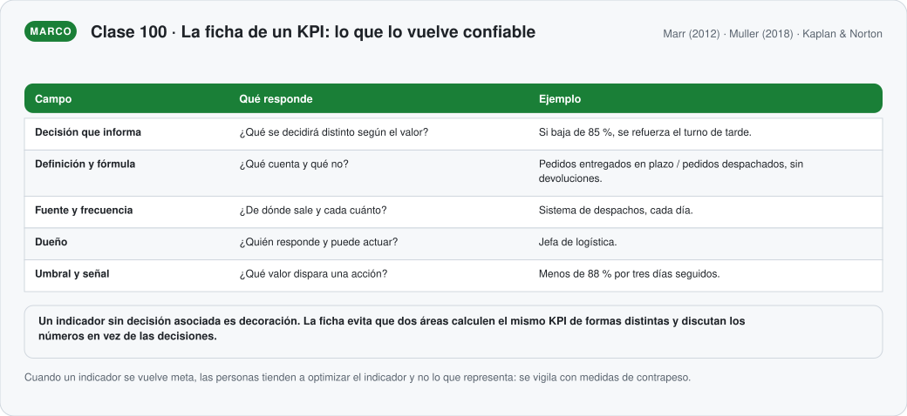

# Clase 100 — KPI y métricas operativas

<!-- nav:inicio -->
> **Parte 08 · Sistemas de gestión, KPI y OKR** — clase 4 de 12 · [índice de la parte](../../README.md) · [temario](../../../../SYLLABUS.md)
<!-- nav:fin -->

**Parte:** 08 — Sistemas de gestión, KPI y OKR  
**Nivel:** Etapa 3 — Manager → Gerente  
**Duración sugerida:** 150–180 minutos · **Estándar:** deep-class-v2

## 🎯 Propósito

Casi toda organización tiene más indicadores de los que usa. Los tableros se llenan de cifras que nadie sabe de dónde salen, que dos áreas calculan de formas distintas y que no cambian ninguna decisión. Un **indicador clave de desempeño (KPI)** vale por la decisión que informa, no por la cantidad de datos que muestra. Elegir pocos, definirlos con precisión, asignarles un dueño y asociarles un umbral de acción es un trabajo de diseño tan importante como la estrategia que pretenden vigilar.

La clase se apoya en la guía práctica de Marr para seleccionar y definir indicadores, en la advertencia de Muller sobre la «tiranía de las métricas» cuando la medición sustituye al juicio, y en la lógica de medidas conectadas de Kaplan y Norton. Al terminar sabrás construir la ficha de un KPI, distinguir métricas operativas de indicadores estratégicos, detectar los efectos de convertir un indicador en meta y diseñar contrapesos.

## 📚 Resultados de aprendizaje

Al finalizar podrás:

1. **Elegir** pocos indicadores a partir de las decisiones que deben informar.
2. **Escribir** la ficha de un KPI con definición, fuente, frecuencia, dueño y umbral.
3. **Distinguir** métricas operativas, KPI e indicadores estratégicos.
4. **Anticipar** los efectos de convertir un indicador en meta.
5. **Diseñar** contrapesos y revisiones para mantener la confiabilidad del indicador.

## 🧭 Agenda

| Tramo | Qué se hace |
|---|---|
| 0–20 min | Recuperación: elige un indicador de tu tablero y pregúntate qué decisión cambió el último mes por su valor. |
| 20–60 min | Selección, ficha, tipos de indicador y efectos de la medición. |
| 60–105 min | Ejemplo trabajado: el indicador de entregas a tiempo de una distribuidora. |
| 105–150 min | Caso ejecutivo y práctica de fichas. |
| 150–175 min | Límites y entregable. |

## 🧩 Conceptos centrales

| Concepto | Definición | Cómo se reconoce |
|---|---|---|
| **Métrica** | Medida cuantitativa de algo. | Cualquier cifra calculada. |
| **KPI** | Indicador que informa el avance hacia un objetivo importante y apoya decisiones. | Tiene decisión, dueño y umbral. |
| **Métrica operativa** | Medida de la ejecución diaria de un proceso. | Se mira con frecuencia alta y acción inmediata. |
| **Indicador estratégico** | Medida del avance de la estrategia. | Cambia lento y se revisa periódicamente. |
| **Ficha de indicador** | Documento que define el indicador sin ambigüedad. | Dos personas calculan lo mismo. |
| **Ley de Campbell / Goodhart (informal)** | Cuando una medida se vuelve meta, tiende a perder su valor como medida. | Se observa manipulación del número. |

## 🧠 Modelo mental

**Cómo leer el diagrama.** Cada fila es un campo de la ficha con la pregunta que responde y un ejemplo. El primer campo es el más importante y el más olvidado: la **decisión que informa**. Si no se puede decir qué se haría distinto según el valor, el indicador es decoración. Los demás campos (definición, fuente, dueño, umbral) evitan que el indicador sea una opinión disfrazada de dato.

## 📖 Desarrollo

### 1. Partir de las decisiones

Marr propone una pregunta inicial: ¿qué necesitamos saber para dirigir mejor? En lugar de preguntar qué se puede medir, se pregunta qué decisiones se toman y qué información las mejoraría. El resultado suele ser un conjunto corto: entre 5 y 10 indicadores por equipo o por proceso. Cada KPI debe poder responder: ¿qué objetivo apoya?, ¿qué decisión informa?, ¿quién actuará?, ¿con qué frecuencia se revisa?, ¿qué valor dispara una acción? Si faltan respuestas, el indicador no está listo.

### 2. La ficha del indicador

La ficha elimina ambigüedades. Incluye: **nombre**; **objetivo al que apoya**; **definición y fórmula** con lo que entra y lo que se excluye; **unidad**; **fuente de datos** y su responsable; **frecuencia** de medición y de revisión; **dueño**, que puede influir en el valor; **umbral o señal de acción**; **valor meta y línea base**; y **limitaciones conocidas**. El ejemplo clásico: «entregas a tiempo» puede significar entregas antes de la hora prometida, del día prometido o dentro de una ventana; sin definición, dos áreas reportarán cifras distintas y discutirán el número en lugar de la logística.

### 3. Operativo, de gestión y estratégico

Los indicadores operan en capas. **Operativos**: miden la ejecución diaria (pedidos despachados, tiempo de atención) y se revisan con alta frecuencia. **De gestión (KPI)**: resumen el desempeño de un proceso o área (cumplimiento de plazo, rotación, margen) y se revisan semanal o mensualmente. **Estratégicos**: indican si la estrategia avanza (participación en un segmento, retención de clientes ideales) y se revisan trimestralmente. Una buena cascada conecta las capas: los operativos explican los KPI, y los KPI los estratégicos. Un tablero que mezcla capas sin orden confunde a quienes deben decidir.

### 4. Cuando medir distorsiona

Muller documenta cómo, en educación, salud, policía y empresas, la medición con incentivos genera efectos indeseados: **foco en lo medido** a costa de lo importante, **manipulación** (clasificar casos para mejorar el número), **desplazamiento de metas**, **desmoralización** de profesionales que sienten que se reemplaza su juicio por cifras y **burocracia** por el costo de medir. No propone abandonar la medición, sino usarla con **juicio**: complementar con información cualitativa, evitar vincular mecánicamente indicadores a premios y castigos y aceptar que algunas dimensiones valiosas no se miden bien.

### 5. Contrapesos y familias de indicadores

Un indicador solo puede ser engañoso; un conjunto equilibrado reduce el riesgo. Si se mide velocidad de atención, se acompaña con calidad de la resolución; si se mide ventas, con margen y devoluciones; si se mide productividad, con calidad y bienestar del equipo. Es la idea de **familias de indicadores**: unos empujan el desempeño y otros vigilan los efectos laterales. El diseño responde a la pregunta: «si alguien quisiera cumplir este número haciendo lo menos deseable, ¿cómo lo haría y qué indicador lo detectaría?».

### 6. Calidad del dato

Un indicador confiable necesita datos confiables: fuente única, proceso de captura claro, controles de calidad, tratamiento de datos faltantes y historial de cambios en la definición. Cuando se modifica una fórmula, se deja constancia y se recalculan las series para poder comparar. Se verifican periódicamente las cifras contra una fuente independiente (por ejemplo, una muestra revisada a mano). Y se declara la **incertidumbre**: con pocos datos o variabilidad alta, un cambio pequeño puede ser ruido (clase 091), por lo que se informan rangos o tendencias en lugar de comparar puntos aislados.

### 7. Revisar y retirar

Los indicadores tienen ciclo de vida. Se **revisan** cada seis o doce meses: ¿siguen apoyando una decisión?, ¿alguien los usó?, ¿cambió la estrategia? Se **retiran** los que no informan decisiones y se **agregan** los que surgen de nuevos objetivos. Un tablero que solo crece termina ignorado. Una regla práctica es exigir que, al agregar un indicador, se retire otro o se justifique por qué la atención adicional vale el costo de medirlo y revisarlo.

## 📚 Lectura comparada

| Obra | Qué aporta | Qué no resuelve | Pregunta para contrastar |
|---|---|---|---|
| Marr | Selección y definición de indicadores desde las decisiones. | Es una guía práctica; poca evidencia empírica. | ¿Qué decisión informa tu indicador? |
| Muller | Efectos de medir con incentivos y límites del juicio métrico. | Es una crítica; ofrece pocas fórmulas. | ¿Qué conducta indeseada produce tu medida? |
| Kaplan y Norton | Medidas conectadas por hipótesis causales. | Requiere una estrategia explícita. | ¿Qué relación causal supones? |
| Deming | Variación y crítica a metas numéricas sin método. | No da fichas de indicadores. | ¿Es señal o ruido? |
| Simons | Sistemas de control de diagnóstico e interactivos. | Marco general. | ¿Qué indicadores discutes y cuáles solo vigilas? |

## 🧮 Ejemplo trabajado

**Situación (hipotética).** Una distribuidora de alimentos reporta «entregas a tiempo» de 94 %. Los clientes reclaman retrasos. Finanzas cuenta como «a tiempo» cualquier entrega realizada el día prometido; logística, la que llega dentro de la ventana de dos horas pactada con el cliente; comercial, la que llegó antes de la hora de cierre del local.

| Campo | Definición acordada |
|---|---|
| **Decisión que informa** | Si baja de 88 % por tres días seguidos, se refuerzan rutas y se revisa la planificación del turno de tarde. |
| **Definición** | Pedidos entregados dentro de la ventana de dos horas acordada, dividido por pedidos despachados en el día; se excluyen los rechazados por el cliente por motivos ajenos a la logística. |
| **Fuente y frecuencia** | Sistema de seguimiento de rutas; se calcula cada día y se revisa semanalmente. |
| **Dueño** | Jefa de logística. |
| **Umbral** | Verde sobre 92 %; ámbar entre 88 % y 92 %; rojo bajo 88 %. |
| **Contrapesos** | Costo por entrega y proporción de entregas con producto dañado, para evitar mejorar el plazo con rutas costosas o apuradas. |

**Resultado de la nueva definición.** El indicador pasa de 94 % a 81 %. La diferencia no es un empeoramiento, sino una definición más cercana a la experiencia del cliente. El equipo no se desalienta porque se acuerda la línea base de 81 %, la meta de 90 % en seis meses y los contrapesos.

**Uso.** En la tercera semana, el indicador cae a 84 % en una zona; se descubre que las rutas se planifican por la mañana con pedidos que llegan hasta mediodía. Se cambia el corte de pedidos. En dos meses sube a 89 %, con costo por entrega estable.

**Qué muestra.** (1) La definición explícita cambió el número y la conversación. (2) El indicador dirigió una decisión concreta. (3) El contrapeso evitó lograr plazo a costa de costo o daño.

## 🔀 Comparación y límites

**Indicador frente a objetivo.** El indicador mide; el objetivo fija un valor a lograr. Convertir cada indicador en objetivo multiplica los incentivos a manipular: se fijan metas solo en los indicadores que representan el logro buscado.

**Límites.** No todo lo importante se mide con precisión (confianza, cultura, reputación). Un indicador rezagado informa tarde. La precisión aparente de un número puede dar falsa seguridad. Según Muller, la medición reemplaza al juicio cuando se la usa para premiar o castigar de forma mecánica. Y los indicadores sobre personas (productividad, desempeño) tienen implicancias laborales y de protección de datos que se verifican en la normativa vigente.

## 🪜 De profesional a owner

| Nivel | Cómo trabaja con indicadores |
|---|---|
| **Profesional** | Registra datos con cuidado y señala cuando una definición no refleja la realidad. |
| **Jefe / Team Lead** | Usa pocos indicadores operativos para decidir cada semana. |
| **Gerente** | Define KPI con ficha, dueño y umbral, y diseña contrapesos. |
| **CEO / Director** | Selecciona indicadores estratégicos y evita que la medición reemplace al juicio. |
| **Founder / Owner** | Mide pocas cosas desde temprano y las revisa con rigor para no gobernarse por intuición. |

## 🏢 Caso ejecutivo

Una empresa de salud con 14 clínicas tiene un tablero de 62 indicadores que el directorio recibe cada mes. El tiempo de espera de pacientes se calcula de tres formas distintas según la clínica. Los directores de clínica son evaluados por «cumplimiento del tiempo de espera menor a 30 minutos» y por «productividad médica (consultas por hora)». Desde que se introdujo la meta, el tiempo de espera medido bajó de 41 a 26 minutos, pero aumentaron las reclamaciones por consultas apuradas y aparecieron clínicas que registran la «hora de llegada» al momento de pasar a box. El gerente general quiere un tablero más corto y confiable.

Entrega un **rediseño del sistema de indicadores** que contenga: (a) la selección de 8 a 12 indicadores con la decisión que informa cada uno; (b) tres fichas completas, incluida la del tiempo de espera; (c) las familias de indicadores con contrapesos; (d) el análisis de manipulación y cómo se detectará; (e) la separación entre indicadores operativos, de gestión y estratégicos; (f) la política de revisión y retiro, y los aspectos de datos de pacientes y de evaluación de personas que deberán verificarse con asesoría.

## 🧪 Práctica

1. Lista los indicadores de tu tablero y marca cuáles informan una decisión concreta.
2. Escribe la ficha completa de tres indicadores clave.
3. Define una familia de indicadores con un contrapeso para el principal.
4. Identifica cómo alguien podría «cumplir» el número sin lograr el objetivo.
5. Propón qué indicador retirarías y por qué.

## ⚠️ Errores frecuentes

| Error | Por qué ocurre | Cómo corregirlo |
|---|---|---|
| Tablero con decenas de indicadores | Se agregan sin retirar | Seleccionar por decisión y retirar los que no sirven. |
| Definiciones distintas del mismo indicador | No hay ficha | Ficha única y control de cambios. |
| Convertir cada indicador en meta | Se busca control | Metas solo en los centrales, con contrapesos. |
| Sin dueño | Se asigna a «el área» | Una persona que puede influir. |
| Comparar puntos aislados | Se interpreta ruido | Tendencias y rangos. |
| Premiar o castigar mecánicamente | Parece objetivo | Combinar con juicio y contexto. |

## ❓ Preguntas de comprobación

1. ¿Por qué se parte de las decisiones para elegir indicadores?
2. ¿Qué campos tiene la ficha de un KPI?
3. ¿Qué diferencia hay entre indicadores operativos, de gestión y estratégicos?
4. ¿Qué efectos describe Muller al medir con incentivos?
5. ¿Qué es un contrapeso y qué problema evita?
6. ¿Cómo se protege la calidad del dato?
7. ¿Por qué se retiran indicadores?

Claves de respuesta

1. Porque un indicador vale por la decisión que informa; elegir por lo que se puede medir llena el tablero de cifras sin uso.
2. Nombre, objetivo, definición y fórmula, unidad, fuente, frecuencia, dueño, umbral, meta y línea base, y limitaciones.
3. Los operativos miden la ejecución diaria, los de gestión resumen un proceso o área y los estratégicos indican el avance de la estrategia.
4. Foco en lo medido, manipulación, desplazamiento de metas, desmoralización y burocracia.
5. Un indicador que vigila un efecto lateral; evita cumplir un número a costa de otra dimensión importante.
6. Fuente única, captura clara, controles, tratamiento de faltantes, historial de cambios y verificación con una fuente independiente.
7. Porque los que no informan decisiones consumen atención y costo, y un tablero que solo crece termina ignorado.

## 📥 Entregable

Guarda en `portfolio/100-kpi-y-metricas-operativas/`:

- `leadership-decision-brief.md` (plantilla [Leadership Decision Brief](../../../../templates/leadership-decision-brief.md)) con el rediseño del caso ejecutivo;
- `kpi-tree.md` (plantilla [KPI tree](../../../../templates/kpi-tree.md)) con los indicadores, sus capas y sus contrapesos;
- `decision-journal.md` con las tres fichas y la política de revisión.

## 📗 Fuentes y verificación

- Bernard Marr — *Key Performance Indicators* (Pearson Financial Times Pub., 2012). **Uso en esta clase:** selección y definición de indicadores desde las decisiones. Lectura selectiva sobre **kpi y métricas operativas**. **Localizador:** [ISBN-13 9780273750116](https://openlibrary.org/isbn/9780273750116).
- Jerry Z. Muller — *The Tyranny of Metrics* (Princeton University Press, 2018). **Uso en esta clase:** efectos de medir con incentivos y límites del juicio métrico. Lectura selectiva sobre **kpi y métricas operativas**. **Localizador:** [ISBN-13 9780691174952](https://openlibrary.org/isbn/9780691174952).
- Robert S. Kaplan & David P. Norton — *The Balanced Scorecard* (Harvard Business School Press, 1996). **Uso en esta clase:** medidas conectadas por hipótesis causales. Lectura selectiva sobre **kpi y métricas operativas**. **Localizador:** [ISBN-13 9780875846514](https://openlibrary.org/isbn/9780875846514).
- W. Edwards Deming — *Out of the Crisis* (The MIT Press, 2000). **Uso en esta clase:** variación y crítica a las metas numéricas sin método. Lectura selectiva sobre **kpi y métricas operativas**. **Localizador:** [ISBN-13 9780262541152](https://openlibrary.org/isbn/9780262541152).
- Robert Simons — *Levers of Control* (Harvard Business School Press, 1995). **Uso en esta clase:** sistemas de control de diagnóstico e interactivos. Lectura selectiva sobre **kpi y métricas operativas**. **Localizador:** [ISBN-13 9780875845593](https://openlibrary.org/isbn/9780875845593).

> **Regla de fuentes para KPI y métricas operativas:** las obras anteriores estructuran las perspectivas de esta materia; cualquier norma, ley o estándar vivo mencionado debe comprobarse nuevamente en su fuente primaria vigente, incluidas las normas de protección de datos. Los ejemplos y casos son hipotéticos, con cifras ilustrativas. El desarrollo es original y no reproduce capítulos protegidos.

<!-- pie:inicio -->
---

| Anterior | Índice | Siguiente |
|---|---|---|
| [← 099 · OKR: cuándo sirven y cuándo no](../099-okr-cuando-sirven-y-cuando-no/README.md) | [Parte 08](../../README.md) · [Programa](../../../../SYLLABUS.md) | [101 · Leading y lagging indicators →](../101-leading-y-lagging-indicators/README.md) |
<!-- pie:fin -->
