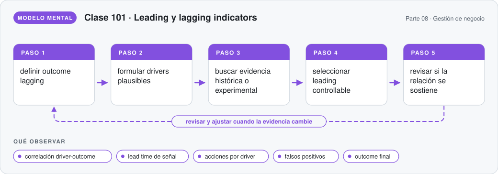

# Clase 101 — Leading y lagging indicators

<!-- nav:inicio -->
> **Parte 08 · Sistemas de gestión, KPI y OKR** — clase 5 de 12 · [índice de la parte](../../README.md) · [temario](../../../../SYLLABUS.md)
<!-- nav:fin -->

**Parte:** 08 — Sistemas de gestión, KPI y OKR  
**Nivel:** Etapa 3 — Manager → Gerente  
**Duración sugerida:** 150–180 minutos · **Estándar:** deep-class-v2

## 🎯 Propósito

Un tablero de indicadores rezagados es un espejo retrovisor: confirma con precisión lo que ya pasó, cuando ya no se puede cambiar. Los ingresos, la rotación, la utilidad y la satisfacción trimestral llegan tarde. Los **indicadores adelantados** prometen avisar antes, y por eso son tan atractivos: permitirían corregir el rumbo mientras aún hay tiempo. Pero un indicador adelantado es una **hipótesis**, no un hecho: se supone que anticipa un resultado, y esa suposición puede ser falsa, estar desactualizada o ser fácil de manipular.

La clase se apoya en el estudio de Ittner y Larcker sobre si las medidas no financieras anticipan el desempeño financiero, en la lógica causal de los mapas de estrategia de Kaplan y Norton y en la guía de selección de indicadores de Marr. Al terminar sabrás distinguir indicadores adelantados, coincidentes y rezagados, validar la relación entre un adelantado y su resultado, evitar el engaño de los proxies manipulables y diseñar una familia de indicadores con ambos tipos.

## 📚 Resultados de aprendizaje

Al finalizar podrás:

1. **Clasificar** indicadores como adelantados, coincidentes o rezagados.
2. **Formular** la hipótesis que une un indicador adelantado con su resultado.
3. **Validar** esa hipótesis con datos y reconocer sus límites.
4. **Detectar** proxies fáciles de manipular y diseñar controles.
5. **Diseñar** una familia de indicadores equilibrada con ambos tipos.

## 🧭 Agenda

| Tramo | Qué se hace |
|---|---|
| 0–20 min | Recuperación: elige un resultado que te importa y lista qué señales previas crees que lo anticipan. |
| 20–60 min | Tipos, hipótesis, validación y manipulación. |
| 60–105 min | Ejemplo trabajado: anticipar la rotación de clientes de una empresa de suscripción. |
| 105–150 min | Caso ejecutivo y práctica de validación. |
| 150–175 min | Límites y entregable. |

## 🧩 Conceptos centrales

| Concepto | Definición | Cómo se reconoce |
|---|---|---|
| **Indicador rezagado (lagging)** | Mide un resultado ya ocurrido. | Ingresos, utilidad, rotación anual. |
| **Indicador adelantado (leading)** | Cambia antes del resultado y se supone que lo anticipa. | Uso del producto antes de una baja. |
| **Indicador coincidente** | Se mueve junto con el resultado. | Pedidos del día frente a ventas del día. |
| **Impulsor (driver)** | Variable sobre la que la organización puede actuar y que influye en el resultado. | Se puede intervenir directamente. |
| **Proxy** | Medida sustituta de algo difícil de medir. | Representa, no es, lo que importa. |
| **Retardo** | Tiempo entre un cambio en el adelantado y su efecto en el resultado. | Se estima con datos históricos. |

## 🧠 Modelo mental

**Cómo leer el diagrama.** Tres columnas ordenadas en el tiempo. Los **adelantados** cambian antes y permiten actuar, pero su valor depende de que la relación con el resultado sea real. Los **coincidentes** describen el presente. Los **rezagados** confirman lo que pasó y son difíciles de discutir, pero llegan tarde. La nota recuerda lo esencial: un adelantado es una hipótesis que hay que verificar, no una certeza.

## 📖 Desarrollo

### 1. Por qué ambos tipos

Un tablero solo con rezagados es fiable pero tardío: informa cuánto vendimos, no cuánto venderemos. Un tablero solo con adelantados es oportuno pero especulativo: informa señales cuya relación con el resultado puede ser débil. La gestión equilibrada usa los adelantados para **actuar** y los rezagados para **verificar** si esas acciones funcionaron. Kaplan y Norton lo describen en el cuadro de mando: las medidas de resultado (rezagadas) y los impulsores del desempeño (adelantados) deben ir juntos y vinculados por una cadena causal.

### 2. El adelantado como hipótesis

Decir que «las demostraciones agendadas anticipan las ventas» es una hipótesis causal o predictiva. Se puede estar equivocado: quizás las demostraciones crecen por campañas que atraen interesados que nunca comprarán. Por eso toda propuesta de indicador adelantado debe responder: ¿**por qué** debería anticipar el resultado?, ¿**cuánto antes**?, ¿**con qué fuerza**? y ¿**qué evidencia** hay? La respuesta no es «parece lógico», sino un análisis con datos propios o, al menos, un plan para probarla.

### 3. Validar con datos

Ittner y Larcker se preguntaron si las medidas no financieras (como la satisfacción de clientes) anticipan el desempeño contable; el artículo plantea que la relación debe comprobarse con datos y no darse por supuesta, y que la evidencia disponible depende del contexto y del período estudiados. La lección práctica: para validar, se compara la serie del adelantado con la del resultado a lo largo del tiempo, con **retardos** distintos, en distintos segmentos, y se verifica si cambios del adelantado preceden cambios del resultado. La correlación no prueba causalidad: puede haber una causa común o un efecto inverso.

### 4. Manipulación y proxies

Un adelantado **fácil de mover** es especialmente vulnerable: si se premia el número de visitas a clientes, se harán visitas inútiles; si se premia el uso de una función, se empujará a las personas a usarla sin necesidad. Cuando el adelantado se convierte en meta, deja de anticipar con la misma fuerza (el efecto que se resumió en la clase 100). Defensas: **no premiar mecánicamente** los adelantados, **volver periódicamente al resultado** para comprobar que sigue la relación y **auditar** una muestra de casos para ver si el indicador refleja el hecho que pretende medir.

### 5. Elegir adelantados útiles

Un buen adelantado cumple cinco condiciones: es **accionable** (un equipo puede influirlo), **temprano** (da tiempo de respuesta), **relacionado** con el resultado con evidencia, **difícil de manipular** sin lograr el resultado, y **barato** de medir. En un negocio de suscripción, por ejemplo, la frecuencia de uso en las primeras semanas suele anticipar la baja; en ventas B2B, el avance a la etapa de propuesta con decisores involucrados suele anticipar el cierre; en proyectos, la proporción de entregables aceptados a la primera suele anticipar el cumplimiento del plazo. Son ejemplos de hipótesis que se validan, no verdades universales.

### 6. Retardos y ventanas

La relación entre adelantado y resultado tiene un retardo: la satisfacción de este trimestre puede reflejarse en la retención de dos o tres trimestres más tarde. Ignorar el retardo conduce a conclusiones erróneas: se abandona una iniciativa que aún no tuvo tiempo de rendir o se atribuye un resultado a una acción reciente cuando se debe a una anterior. Se define, para cada adelantado, **cuánto tiempo se espera** para ver efecto y se evalúa en esa ventana, sin sobrerreaccionar a variaciones de corto plazo que pueden ser ruido (clase 091).

### 7. Una familia equilibrada

Se diseña para cada objetivo una **pequeña familia**: uno o dos rezagados (el resultado), dos o tres adelantados (los impulsores), y un contrapeso. Por ejemplo, para «retener clientes»: tasa de bajas (rezagado), uso del producto en la semana 2 y satisfacción de la primera interacción con soporte (adelantados), y margen por cliente (contrapeso, para no retener a costa de regalar el servicio). Cada trimestre se revisa si los adelantados siguen anticipando; si no, se reemplazan, y se registra el aprendizaje.

## 📚 Lectura comparada

| Obra | Qué aporta | Qué no resuelve | Pregunta para contrastar |
|---|---|---|---|
| Ittner y Larcker (1998) | Pregunta y método para contrastar medidas no financieras con el desempeño. | Su evidencia depende del contexto estudiado. | ¿Has validado tu relación con datos propios? |
| Kaplan y Norton | Resultados e impulsores unidos por una cadena causal. | Requiere estrategia explícita. | ¿Qué hipótesis causal supones? |
| Marr | Selección de indicadores desde las preguntas clave. | Evidencia limitada. | ¿Qué pregunta responde el adelantado? |
| Muller | Riesgos de manipular medidas. | Es una crítica general. | ¿Cómo se podría manipular tu proxy? |
| Deming | Distinguir señal de ruido. | No trata de validar relaciones. | ¿El cambio es mayor que la variación normal? |

## 🧮 Ejemplo trabajado

**Situación (hipotética).** Una empresa de software por suscripción mensual tiene una tasa de baja de clientes de 3,8 % mensual (rezagado). Quiere un adelantado. Propone: «número de inicios de sesión en los primeros 14 días».

**Validación con datos.** Analiza 1.200 clientes nuevos de los últimos 12 meses y clasifica por inicios de sesión en 14 días:

| Inicios de sesión en 14 días | Clientes | Bajas en los siguientes 90 días |
|---|---|---|
| 0 a 2 | 260 | 31 % |
| 3 a 9 | 540 | 12 % |
| 10 o más | 400 | 5 % |

**Lectura.** La asociación es fuerte y consistente. Pero la correlación no prueba que mover el número reduzca las bajas: clientes motivados inician sesión más y también se quedan más. Para probar el efecto causal se hace un **experimento**: a la mitad de los clientes nuevos con menos de 3 sesiones se les ofrece una guía de inicio con acompañamiento; la otra mitad queda como control.

**Resultado del experimento.** En el grupo con acompañamiento, las bajas a 90 días son 22 %, frente a 31 % del control. Parte de la mejora se explica porque el acompañamiento fue de valor, no solo por subir las sesiones. Se decide mantener el adelantado, pero no premiar a nadie por «sesiones» y medir también el uso de la función central.

**Familia final.** Rezagado: baja mensual a 90 días. Adelantados: sesiones en 14 días y uso de la función central en 30 días. Contrapeso: costo de acompañamiento por cliente. Se revisa cada trimestre si la relación se mantiene.

**Qué muestra.** (1) Se validó con datos propios. (2) Se distinguió asociación de efecto. (3) Se evitó premiar el proxy.

## 🔀 Comparación y límites

**Adelantado frente a predictor estadístico.** Un adelantado de gestión se elige por ser accionable y comprensible; un predictor estadístico puede ser más preciso pero menos intervenible. Un modelo que predice bajas sin decir qué hacer sirve para priorizar, no necesariamente para mejorar.

**Límites.** Las relaciones entre indicadores cambian con el tiempo, el segmento y el contexto. Con pocos datos, las relaciones observadas pueden ser casualidad. La evidencia sobre medidas no financieras depende del contexto, y no hay garantías de que un adelantado válido en una empresa lo sea en otra. Los experimentos con clientes o personas requieren consideraciones éticas y, cuando corresponde, de protección de datos y consentimiento.

## 🪜 De profesional a owner

| Nivel | Cómo trabaja con adelantados y rezagados |
|---|---|
| **Profesional** | Registra bien las señales tempranas y avisa cuando algo no encaja. |
| **Jefe / Team Lead** | Usa pocos adelantados semanales y verifica con el resultado. |
| **Gerente** | Valida las hipótesis de sus indicadores y evita premiar proxies. |
| **CEO / Director** | Exige ver ambos tipos y la evidencia de su relación. |
| **Founder / Owner** | Empieza con pocos adelantados simples y los contrasta con la caja y los clientes reales. |

## 🏢 Caso ejecutivo

Una empresa de formación corporativa mide como indicador principal de sus ejecutivos comerciales el «número de reuniones con clientes por mes», porque cree que anticipa las ventas. Durante seis meses las reuniones aumentaron 45 % y las ventas no. El gerente comercial defiende que «hay un rezago»; el director financiero propone eliminar la medición de reuniones. Un analista descubre que muchas reuniones son de seguimiento con clientes actuales, que los ejecutivos agendan reuniones breves para cumplir y que las reuniones con decisores nuevos sí se asocian a propuestas posteriores.

Entrega un **rediseño de la familia de indicadores** que contenga: (a) la clasificación de los indicadores actuales; (b) la hipótesis causal y la validación propuesta con datos; (c) los adelantados alternativos y sus condiciones de calidad; (d) el análisis del retardo esperado; (e) las medidas contra la manipulación y el uso en la evaluación de personas; (f) el contrapeso y la revisión trimestral.

## 🧪 Práctica

1. Elige un resultado y lista tres posibles adelantados con su hipótesis.
2. Define el retardo esperado entre cada adelantado y el resultado.
3. Diseña cómo validarías la relación con datos propios.
4. Identifica cómo podría manipularse cada adelantado y cómo lo detectarías.
5. Arma una familia con un rezagado, dos adelantados y un contrapeso.

## ⚠️ Errores frecuentes

| Error | Por qué ocurre | Cómo corregirlo |
|---|---|---|
| Dar por válido un adelantado | Parece lógico | Validar con datos propios. |
| Confundir correlación con efecto | Se quiere una acción simple | Pruebas controladas o análisis cuidadoso. |
| Premiar el proxy | Es fácil de medir | No vincularlo mecánicamente a incentivos. |
| Ignorar el retardo | Se quiere resultado rápido | Fijar la ventana de evaluación. |
| Solo rezagados | Son los fiables | Sumar adelantados validados. |
| No revisar la relación | Se supone estable | Revisión trimestral. |

## ❓ Preguntas de comprobación

1. ¿Qué diferencia hay entre indicador adelantado, coincidente y rezagado?
2. ¿Por qué un adelantado es una hipótesis?
3. ¿Cómo se valida la relación entre un adelantado y su resultado?
4. ¿Por qué un adelantado fácil de mover es peligroso?
5. ¿Qué condiciones tiene un buen adelantado?
6. ¿Qué papel cumple el retardo?
7. ¿Qué compone una familia equilibrada de indicadores?

Claves de respuesta

1. El adelantado cambia antes del resultado, el coincidente se mueve con él y el rezagado lo confirma después.
2. Porque supone que anticipa el resultado, y esa relación puede no existir o cambiar.
3. Comparando series en el tiempo con distintos retardos y segmentos, y con experimentos cuando sea posible; la correlación sola no prueba causalidad.
4. Porque, al convertirse en meta, se manipula y deja de anticipar el resultado.
5. Accionable, temprano, relacionado con evidencia, difícil de manipular y barato de medir.
6. Define cuánto tiempo esperar para ver el efecto y evita abandonar o atribuir iniciativas erróneamente.
7. Uno o dos rezagados, dos o tres adelantados y un contrapeso, revisados periódicamente.

## 📥 Entregable

Guarda en `portfolio/101-leading-y-lagging-indicators/`:

- `leadership-decision-brief.md` (plantilla [Leadership Decision Brief](../../../../templates/leadership-decision-brief.md)) con el rediseño del caso ejecutivo;
- `kpi-tree.md` (plantilla [KPI tree](../../../../templates/kpi-tree.md)) con la familia de indicadores y sus hipótesis;
- `decision-journal.md` con la validación, los retardos y las medidas contra la manipulación.

## 📗 Fuentes y verificación

- Christopher D. Ittner & David F. Larcker — *Are Nonfinancial Measures Leading Indicators of Financial Performance?* (Journal of Accounting Research, 1998). **Uso en esta clase:** evidencia sobre medidas no financieras y desempeño financiero. Lectura selectiva sobre **leading y lagging indicators**. **Localizador:** [DOI 10.2307/2491304](https://doi.org/10.2307/2491304).
- Robert S. Kaplan & David P. Norton — *Strategy Maps* (Harvard Business School Press, 2004). **Uso en esta clase:** resultados e impulsores unidos por una cadena causal. Lectura selectiva sobre **leading y lagging indicators**. **Localizador:** [ISBN-13 9781591391340](https://openlibrary.org/isbn/9781591391340).
- Bernard Marr — *Key Performance Indicators* (Pearson Financial Times Pub., 2012). **Uso en esta clase:** selección de indicadores desde las preguntas clave. Lectura selectiva sobre **leading y lagging indicators**. **Localizador:** [ISBN-13 9780273750116](https://openlibrary.org/isbn/9780273750116).
- Jerry Z. Muller — *The Tyranny of Metrics* (Princeton University Press, 2018). **Uso en esta clase:** riesgos de manipular medidas. Lectura selectiva sobre **leading y lagging indicators**. **Localizador:** [ISBN-13 9780691174952](https://openlibrary.org/isbn/9780691174952).
- W. Edwards Deming — *Out of the Crisis* (The MIT Press, 2000). **Uso en esta clase:** distinción entre señal y ruido. Lectura selectiva sobre **leading y lagging indicators**. **Localizador:** [ISBN-13 9780262541152](https://openlibrary.org/isbn/9780262541152).

> **Regla de fuentes para Leading y lagging indicators:** las obras anteriores estructuran las perspectivas de esta materia; cualquier norma, ley o estándar vivo mencionado debe comprobarse nuevamente en su fuente primaria vigente, incluida la protección de datos en experimentos con clientes o personas. Los ejemplos y casos son hipotéticos, con cifras ilustrativas. El desarrollo es original y no reproduce capítulos protegidos.

<!-- pie:inicio -->
---

| Anterior | Índice | Siguiente |
|---|---|---|
| [← 100 · KPI y métricas operativas](../100-kpi-y-metricas-operativas/README.md) | [Parte 08](../../README.md) · [Programa](../../../../SYLLABUS.md) | [102 · Balanced Scorecard y tableros →](../102-balanced-scorecard-y-tableros/README.md) |
<!-- pie:fin -->
