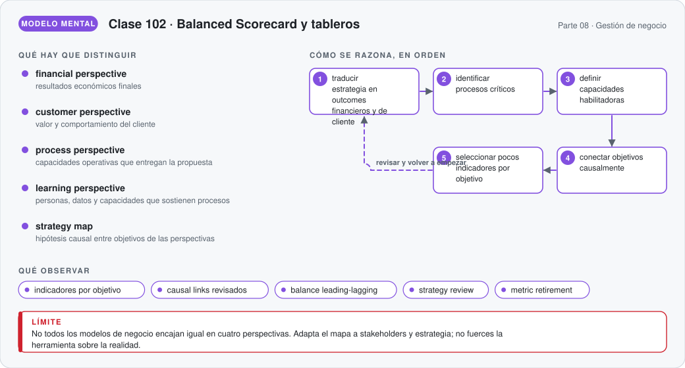

# Clase 102 — Balanced Scorecard y tableros

<!-- nav:inicio -->
> **Parte 08 · Sistemas de gestión, KPI y OKR** — clase 6 de 12 · [índice de la parte](../../README.md) · [temario](../../../../SYLLABUS.md)
<!-- nav:fin -->

**Parte:** 08 — Sistemas de gestión, KPI y OKR  
**Nivel:** Etapa 3 — Manager → Gerente  
**Duración sugerida:** 150–180 minutos · **Estándar:** deep-class-v2

## 🎯 Propósito

Un tablero es un instrumento para decidir, no una galería de gráficos. El **cuadro de mando integral (balanced scorecard)**, propuesto por Kaplan y Norton, nació de una crítica: las empresas se gestionaban casi solo con medidas financieras, que llegan tarde y no explican cómo se genera el valor. Su propuesta fue medir también a clientes, procesos internos y aprendizaje, y sobre todo **conectar** esas medidas con la estrategia mediante relaciones de causa y efecto. Hoy abundan tableros con cuatro cuadrantes que no cumplen esa lógica.

La clase se apoya en los libros de Kaplan y Norton (*The Balanced Scorecard* y *Strategy Maps*), en la guía de diseño de indicadores de Marr y en la visión de Simons sobre sistemas de control. Al terminar sabrás construir un cuadro de mando con perspectivas conectadas, diseñar un tablero legible para quien decide, evitar los errores de diseño más frecuentes y distinguir tablero estratégico, de gestión y operativo.

## 📚 Resultados de aprendizaje

Al finalizar podrás:

1. **Explicar** las cuatro perspectivas del cuadro de mando y su relación causal.
2. **Construir** un mapa de estrategia con objetivos, indicadores y metas.
3. **Diseñar** un tablero legible para la decisión que debe apoyar.
4. **Distinguir** tablero estratégico, de gestión y operativo.
5. **Detectar** tableros decorativos y corregirlos.

## 🧭 Agenda

| Tramo | Qué se hace |
|---|---|
| 0–20 min | Recuperación: toma un tablero de tu empresa y señala qué decisión apoya cada panel. |
| 20–60 min | Perspectivas, mapa de estrategia y diseño del tablero. |
| 60–105 min | Ejemplo trabajado: un cuadro de mando de una cadena de gimnasios. |
| 105–150 min | Caso ejecutivo y práctica de diseño. |
| 150–175 min | Límites y entregable. |

## 🧩 Conceptos centrales

| Concepto | Definición | Cómo se reconoce |
|---|---|---|
| **Cuadro de mando integral** | Sistema que traduce la estrategia en objetivos e indicadores en cuatro perspectivas. | Hay relaciones causales entre perspectivas. |
| **Perspectiva financiera** | Resultado económico esperado de la estrategia. | Crecimiento, margen, rentabilidad. |
| **Perspectiva de clientes** | Propuesta de valor y su percepción. | Satisfacción, retención, participación. |
| **Perspectiva de procesos internos** | Procesos críticos para entregar la propuesta de valor. | Calidad, tiempo, innovación. |
| **Perspectiva de aprendizaje y crecimiento** | Capital humano, de información y organizacional que habilita los procesos. | Competencias, sistemas, cultura. |
| **Mapa de estrategia** | Diagrama de objetivos conectados por causalidad. | Se lee de abajo arriba. |

## 🧠 Modelo mental

**Cómo leer el diagrama.** Una escalera que se lee de abajo arriba. El **aprendizaje y el crecimiento** (personas, información, cultura) habilitan los **procesos internos**; procesos bien ejecutados generan lo que valoran los **clientes**; y la satisfacción de clientes produce el resultado **financiero**. Cada peldaño es una hipótesis causal que se debe verificar. Si las perspectivas se miden sin esa conexión, el cuadro de mando se convierte en cuatro listas de indicadores sin historia.

## 📖 Desarrollo

### 1. Por qué un cuadro de mando

Kaplan y Norton observaron que los indicadores financieros son necesarios pero insuficientes: informan resultados pasados y no indican cómo mejorar el futuro. Propusieron complementar con medidas de clientes, procesos y aprendizaje, que actúan como **impulsores** del resultado. La idea central es el **equilibrio**: entre corto y largo plazo, entre resultado e impulsor, entre medidas objetivas y subjetivas, entre perspectiva externa e interna. El valor no está en tener cuatro cuadrantes, sino en la coherencia entre ellos.

### 2. Las cuatro perspectivas

La **financiera** responde: ¿qué esperan los accionistas? (crecimiento, rentabilidad, uso de capital). La de **clientes** responde: ¿qué valor ofrecemos a quién? (satisfacción, retención, adquisición, participación en segmentos objetivo). La de **procesos internos** responde: ¿en qué procesos debemos sobresalir? (operaciones, relación con clientes, innovación, regulación y sociedad). La de **aprendizaje y crecimiento** responde: ¿qué capacidades necesitamos? (competencias de personas, sistemas de información, cultura y liderazgo). Las perspectivas se adaptan al tipo de organización: una entidad sin fines de lucro puede poner la misión en lo más alto.

### 3. Mapa de estrategia

Los mapas de estrategia son la pieza que evita la lista de indicadores sin sentido. Se arma de abajo arriba o de arriba abajo, pero siempre con flechas causales: «si capacitamos a los asesores en el diagnóstico de clientes (aprendizaje), mejorará la calidad de las propuestas (procesos), aumentará la satisfacción (clientes) y crecerá la retención (financiera)». Cada objetivo tiene **indicador, meta e iniciativa**. Se escoge un número pequeño de objetivos (15 a 25 en total para una organización mediana) y se verifica con datos que las flechas funcionan.

### 4. Del mapa al tablero

El mapa es el diseño; el **tablero** es la interfaz que usa quien decide. Un buen tablero comienza con la pregunta: ¿qué decisión debe tomar esta persona y con qué frecuencia? Para un comité de dirección mensual, serán pocos indicadores estratégicos con tendencia, meta y estado; para un jefe de turno, indicadores operativos casi en tiempo real. Los principios de lectura: **pocas cifras**, **comparación** con meta y período anterior, **tendencia** más que punto, **señal de estado** clara y **acceso al detalle** cuando algo se desvía.

### 5. Errores de diseño

Los más frecuentes: **demasiados indicadores** (el ojo no sabe dónde mirar); **cuatro cuadrantes sin conexión**; **colores sin criterio** (semáforos sin umbral definido); **gráficos decorativos** (3D, tortas con muchas porciones) que dificultan comparar; **ausencia de meta** (se muestra un valor sin saber si es bueno); **datos desactualizados** o con definiciones cambiantes; y **mezcla de audiencias** (un solo tablero para todos). Un test simple: si se oculta el título, ¿quien lo mira sabe qué decidir y con qué frecuencia?

### 6. Tablero y conversación

Simons distingue sistemas de control de **diagnóstico**, que se vigilan por excepción, y **interactivos**, en los que la dirección dedica atención recurrente y conversa con los equipos sobre incertidumbres estratégicas. Un cuadro de mando útil combina ambos: la mayoría de los indicadores se revisan por excepción y unos pocos, los de mayor incertidumbre estratégica, se discuten en cada reunión de dirección con preguntas abiertas: ¿qué supuesto cambió?, ¿qué estamos aprendiendo? El tablero es una invitación a la conversación, no una sentencia.

### 7. Cascada y mantenimiento

El cuadro de mando de la empresa se despliega en cuadros de áreas que contribuyen a los objetivos superiores. La cascada debe conservar la lógica causal y evitar duplicar o contradecir medidas. Se actualiza cuando cambia la estrategia o cuando los datos muestran que una relación no funciona. Un cuadro de mando que no cambia en tres años probablemente no está siendo usado. Su ciclo de vida incluye revisión anual de la estrategia, trimestral de indicadores y mensual de resultados.

## 📚 Lectura comparada

| Obra | Qué aporta | Qué no resuelve | Pregunta para contrastar |
|---|---|---|---|
| Kaplan y Norton (*The Balanced Scorecard*) | Cuatro perspectivas y equilibrio de medidas. | Puede aplicarse mecánicamente. | ¿Qué relación causal une tus perspectivas? |
| Kaplan y Norton (*Strategy Maps*) | Mapas de estrategia y alineación. | Requiere estrategia explícita. | ¿Qué objetivo falta en tu cadena? |
| Marr | Selección y definición de indicadores. | Menos estructura de mapa. | ¿Qué pregunta responde cada indicador? |
| Simons | Control de diagnóstico e interactivo. | Marco general. | ¿Qué discutes y qué solo vigilas? |
| Rumelt | Estrategia con diagnóstico y acciones coherentes. | No ofrece medición. | ¿Tu mapa expresa una estrategia o una lista de deseos? |

## 🧮 Ejemplo trabajado

**Situación (hipotética).** Una cadena de 25 gimnasios decide pasar de competir por precio a competir por experiencia y comunidad. Su estrategia: retener más socios con una propuesta distinta.

| Perspectiva | Objetivo | Indicador | Meta |
|---|---|---|---|
| **Finanzas** | Crecer ingresos recurrentes con margen sostenido | Ingresos por socio; margen de sede | +9 %; 24 % |
| **Clientes** | Fidelizar socios con experiencia diferenciada | Retención a 12 meses; satisfacción | 68 % a 76 %; 4,2 a 4,5 |
| **Procesos** | Excelente primera experiencia; clases de calidad | Socios con plan personal en 14 días; clases con ocupación entre 60 % y 90 % | 45 % a 75 %; 70 % de las clases |
| **Aprendizaje** | Entrenadores con capacidades de acompañamiento | Entrenadores certificados en coaching; rotación de entrenadores | 30 % a 80 %; de 35 % a 20 % |

**Hipótesis causales.** Entrenadores capacitados elaboran mejores planes personales, que mejoran la primera experiencia; la primera experiencia eleva la satisfacción y la retención; mayor retención sube ingresos por socio con costos de adquisición menores.

**Tablero de la reunión mensual de dirección.** Doce indicadores en una página: por perspectiva, valor actual, meta, tendencia de seis meses y estado. Dos indicadores se marcan «interactivos»: el porcentaje de socios con plan personal en 14 días y la retención a 6 meses, que se discuten en cada reunión con la pregunta «¿qué estamos aprendiendo?».

**Verificación a los seis meses.** Las sedes con 70 % o más de socios con plan en 14 días tienen retención a 6 meses de 84 %, frente a 71 % del resto. Pero se descubre que esas sedes también tienen entrenadores más antiguos; se decide un piloto en sedes con entrenadores nuevos para separar el efecto.

**Qué muestra.** (1) Cada indicador tenía un lugar en una cadena causal. (2) El tablero respondía a una decisión mensual. (3) Se verificó la hipótesis, con prudencia sobre un factor de confusión.

## 🔀 Comparación y límites

**Cuadro de mando frente a OKR.** El cuadro de mando describe la estrategia y vigila sus medidas de forma estable; los OKR impulsan apuestas de un ciclo. Se complementan: los OKR de un trimestre pueden mover indicadores del cuadro de mando.

**Límites.** La aplicación mecánica del cuadro de mando produce listas largas y sin causalidad. Su construcción exige una estrategia explícita; si la estrategia es difusa, el cuadro no la aclarará. Las relaciones causales son hipótesis y se validan con datos que no siempre existen. Las medidas de aprendizaje y cultura son difíciles y fácilmente se convierten en cifras decorativas. Y los indicadores sobre personas tienen implicancias de privacidad y laborales que se verifican en la normativa.

## 🪜 De profesional a owner

| Nivel | Cómo usa el cuadro de mando |
|---|---|
| **Profesional** | Entiende cómo su trabajo aparece en el tablero. |
| **Jefe / Team Lead** | Usa un tablero operativo con pocas cifras y decide con él. |
| **Gerente** | Traduce la estrategia en un mapa y un tablero de gestión de su área. |
| **CEO / Director** | Revisa pocas medidas estratégicas y conversa sobre supuestos. |
| **Founder / Owner** | Construye un tablero mínimo de cuatro a seis indicadores que vincule la caja con el cliente. |

## 🏢 Caso ejecutivo

Una aseguradora mediana presenta cada mes al directorio un tablero de 48 indicadores organizado en los cuatro cuadrantes del cuadro de mando. Las cifras financieras tienen metas; las demás no. Los semáforos cambian de color sin umbrales definidos. El directorio dedica casi todo el tiempo a discutir las cifras financieras, que ya conoce, y no tiene claro cómo la estrategia de «transformación centrada en el cliente» se refleja en los datos. El área de estrategia sostiene que el tablero «cubre todo». Los gerentes dicen que lo llenan por obligación.

Entrega un **rediseño del cuadro de mando y del tablero** con: (a) el mapa de estrategia con objetivos conectados por causalidad; (b) los indicadores, metas e iniciativas, con un máximo de 20; (c) el tablero del directorio (12 indicadores) con tendencia, meta y estado; (d) cuáles indicadores serán de diagnóstico y cuáles interactivos; (e) los tableros de gestión y operativos y su relación; (f) el plan de validación de las hipótesis y de mantenimiento.

## 🧪 Práctica

1. Dibuja un mapa de estrategia de cuatro perspectivas para tu área con flechas causales.
2. Define indicador, meta e iniciativa para cada objetivo.
3. Diseña un tablero de una página para una reunión mensual.
4. Marca dos indicadores interactivos y define las preguntas que se harán.
5. Escribe cómo comprobarías una de las hipótesis causales.

## ⚠️ Errores frecuentes

| Error | Por qué ocurre | Cómo corregirlo |
|---|---|---|
| Cuatro cuadrantes sin conexión | Se llena la plantilla | Mapa con causalidad. |
| Demasiados indicadores | No se decide qué excluir | Máximo de 15 a 25 objetivos en total. |
| Semáforos sin umbral | Se pinta a criterio | Definir umbrales por indicador. |
| Un tablero para todos | Se busca simplicidad | Tableros por audiencia y decisión. |
| Falta de metas | Se muestra solo el valor | Meta y tendencia visibles. |
| No actualizar | Se considera terminado | Revisión periódica y cambio con la estrategia. |

## ❓ Preguntas de comprobación

1. ¿Qué cuatro perspectivas propone el cuadro de mando integral?
2. ¿Qué es un mapa de estrategia y por qué importa la causalidad?
3. ¿Qué diferencia hay entre tablero estratégico, de gestión y operativo?
4. ¿Cuáles son tres errores frecuentes de diseño?
5. ¿Qué distingue el control de diagnóstico del interactivo?
6. ¿Cómo se valida una relación causal del mapa?
7. ¿Qué límite tiene el cuadro de mando si la estrategia es difusa?

Claves de respuesta

1. Financiera, de clientes, de procesos internos y de aprendizaje y crecimiento.
2. Un diagrama de objetivos conectados por relaciones de causa y efecto; sin causalidad el cuadro es una lista de indicadores.
3. El estratégico muestra pocas medidas del avance de la estrategia, el de gestión resume procesos o áreas y el operativo apoya decisiones diarias con alta frecuencia.
4. Demasiados indicadores, semáforos sin umbral, gráficos decorativos, ausencia de metas, datos desactualizados o mezcla de audiencias.
5. El de diagnóstico se vigila por excepción; el interactivo recibe atención recurrente de la dirección y se discute con los equipos.
6. Con datos propios a lo largo del tiempo, por segmentos y con pruebas controladas cuando sea posible, cuidando los factores de confusión.
7. No lo aclarará: construirlo exige una estrategia explícita.

## 📥 Entregable

Guarda en `portfolio/102-balanced-scorecard-y-tableros/`:

- `leadership-decision-brief.md` (plantilla [Leadership Decision Brief](../../../../templates/leadership-decision-brief.md)) con el rediseño del caso ejecutivo;
- `ceo-dashboard.md` (plantilla [CEO dashboard](../../../../templates/ceo-dashboard.md)) con el tablero del directorio;
- `kpi-tree.md` (plantilla [KPI tree](../../../../templates/kpi-tree.md)) con el mapa de estrategia y las hipótesis;
- `decision-journal.md` con la validación y el plan de mantenimiento.

## 📗 Fuentes y verificación

- Robert S. Kaplan & David P. Norton — *The Balanced Scorecard* (Harvard Business School Press, 1996). **Uso en esta clase:** cuatro perspectivas y equilibrio de medidas. Lectura selectiva sobre **balanced scorecard y tableros**. **Localizador:** [ISBN-13 9780875846514](https://openlibrary.org/isbn/9780875846514).
- Robert S. Kaplan & David P. Norton — *Strategy Maps* (Harvard Business School Press, 2004). **Uso en esta clase:** mapas de estrategia y alineación. Lectura selectiva sobre **balanced scorecard y tableros**. **Localizador:** [ISBN-13 9781591391340](https://openlibrary.org/isbn/9781591391340).
- Bernard Marr — *Key Performance Indicators* (Pearson Financial Times Pub., 2012). **Uso en esta clase:** selección y definición de indicadores. Lectura selectiva sobre **balanced scorecard y tableros**. **Localizador:** [ISBN-13 9780273750116](https://openlibrary.org/isbn/9780273750116).
- Robert Simons — *Levers of Control* (Harvard Business School Press, 1995). **Uso en esta clase:** control de diagnóstico e interactivo. Lectura selectiva sobre **balanced scorecard y tableros**. **Localizador:** [ISBN-13 9780875845593](https://openlibrary.org/isbn/9780875845593).
- Richard Rumelt — *Good Strategy/Bad Strategy* (Profile Books, 2011). **Uso en esta clase:** estrategia con diagnóstico y acciones coherentes. Lectura selectiva sobre **balanced scorecard y tableros**. **Localizador:** [ISBN-13 9781846684807](https://openlibrary.org/isbn/9781846684807).

> **Regla de fuentes para Balanced Scorecard y tableros:** las obras anteriores estructuran las perspectivas de esta materia; cualquier norma, ley o estándar vivo mencionado debe comprobarse nuevamente en su fuente primaria vigente, incluida la protección de datos de personas y clientes. Los ejemplos y casos son hipotéticos, con cifras ilustrativas. El desarrollo es original y no reproduce capítulos protegidos.

<!-- pie:inicio -->
---

| Anterior | Índice | Siguiente |
|---|---|---|
| [← 101 · Leading y lagging indicators](../101-leading-y-lagging-indicators/README.md) | [Parte 08](../../README.md) · [Programa](../../../../SYLLABUS.md) | [103 · Ritmo semanal, mensual y trimestral →](../103-ritmo-semanal-mensual-y-trimestral/README.md) |
<!-- pie:fin -->
