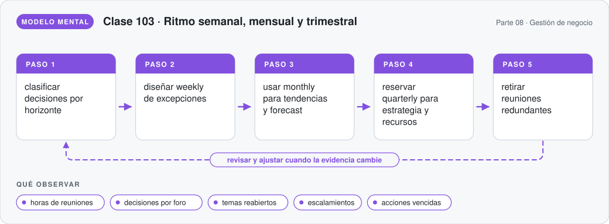

# Clase 103 — Ritmo semanal, mensual y trimestral

<!-- nav:inicio -->
> **Parte 08 · Sistemas de gestión, KPI y OKR** — clase 7 de 12 · [índice de la parte](../../README.md) · [temario](../../../../SYLLABUS.md)
<!-- nav:fin -->

**Parte:** 08 — Sistemas de gestión, KPI y OKR  
**Nivel:** Etapa 3 — Manager → Gerente  
**Duración sugerida:** 150–180 minutos · **Estándar:** deep-class-v2

## 🎯 Propósito

Una organización se gobierna, en la práctica, por el calendario de sus reuniones: lo que se revisa cada semana recibe atención; lo que se revisa una vez al año se descuida. Un **ritmo de gestión** bien diseñado asigna a cada frecuencia un propósito, un conjunto de datos y una decisión propia: la semana sirve para operar y desbloquear; el mes, para gestionar desvíos y recursos; el trimestre, para dirigir apuestas y supuestos. Cuando todas las reuniones tratan lo mismo, la dirección se pierde en la operación y nadie piensa en el rumbo; cuando faltan, los problemas se descubren cuando ya son crisis.

La clase se apoya en la descripción de Grove sobre las reuniones como instrumento de producción gerencial, en la insistencia de Bossidy y Charan en una disciplina de ejecución con revisiones regulares, y en el estudio de Mankins y Garton sobre cómo las empresas gastan el tiempo de su equipo directivo. Al terminar sabrás diseñar un calendario de gestión con agendas, insumos y decisiones, medir el costo del tiempo de reunión y eliminar las que no deciden nada.

## 📚 Resultados de aprendizaje

Al finalizar podrás:

1. **Asignar** a cada frecuencia un propósito, un insumo y una decisión.
2. **Diseñar** agendas que prioricen decisiones sobre informes.
3. **Calcular** el costo del tiempo de reunión y compararlo con su valor.
4. **Coordinar** el ritmo de equipo, de área y de empresa.
5. **Detectar** reuniones redundantes y proponer su reemplazo o eliminación.

## 🧭 Agenda

| Tramo | Qué se hace |
|---|---|
| 0–20 min | Recuperación: lista las reuniones recurrentes de tu semana y marca cuáles terminaron en una decisión. |
| 20–60 min | Tres ritmos, agendas y costo del tiempo. |
| 60–105 min | Ejemplo trabajado: calendario de gestión de una empresa de servicios. |
| 105–150 min | Caso ejecutivo y práctica de diseño. |
| 150–175 min | Límites y entregable. |

## 🧩 Conceptos centrales

| Concepto | Definición | Cómo se reconoce |
|---|---|---|
| **Ritmo de gestión** | Calendario de reuniones y revisiones con propósito y decisión definidos. | Cada reunión tiene agenda, insumos y resultado. |
| **Reunión operativa** | Coordinación de corto plazo para desbloquear el trabajo. | Breve, frecuente, pocas cifras. |
| **Revisión de gestión** | Análisis periódico de desempeño y desvíos. | Compara con plan y decide correcciones. |
| **Revisión estratégica** | Evaluación de supuestos, prioridades y apuestas. | Se discute qué cambió en el entorno. |
| **Costo de reunión** | Tiempo de las personas multiplicado por su costo, más el costo de oportunidad. | Se calcula y se compara con la decisión lograda. |
| **Insumo previo (pre-read)** | Información enviada antes para usar la reunión en decidir. | Evita leer en voz alta en la sala. |

## 🧠 Modelo mental

**Cómo leer el diagrama.** Tres columnas, tres escalas de tiempo. La **semanal** coordina y desbloquea con pocas cifras. La **mensual** revisa desvíos frente al plan, sus causas y los recursos. La **trimestral** dirige: revisa supuestos, prioridades y apuestas. La nota previene el error más común: tratar los mismos temas en todos los ritmos, lo que consume el tiempo de dirección en operar y deja sin espacio la conversación estratégica.

## 📖 Desarrollo

### 1. Las reuniones como producción gerencial

Grove sostuvo que el trabajo de un gerente consiste en gran parte en influir en otras personas, y que las reuniones son el medio principal de hacerlo; por eso son parte de la producción, no un obstáculo. Una reunión se justifica si **produce** algo: una decisión, un compromiso, una coordinación o una información que cambia lo que se hará. Clasificó las reuniones por propósito (compartir información, resolver problemas, tomar decisiones, desarrollar personas) y recomendó diseñarlas según ese propósito. Una reunión que mezcla todos los propósitos suele cumplir ninguno.

### 2. Ritmo semanal: operar

La reunión semanal de un equipo dura entre 30 y 60 minutos y responde: ¿qué logramos?, ¿qué se bloqueó?, ¿qué haremos esta semana?, ¿qué necesitamos de otros? Se revisan pocos indicadores operativos (clase 100), se asignan compromisos con dueño y fecha y se escalan los bloqueos que el equipo no puede resolver (clase 107). No es lugar para discutir la estrategia ni para presentaciones largas. Su valor es el **ritmo de cumplimiento**: la costumbre de que lo prometido se revisa pronto.

### 3. Ritmo mensual: gestionar

La revisión mensual de un área o de la empresa compara resultados con el plan y entre meses, **diagnostica los desvíos** y decide correcciones y reasignación de recursos (clases 104 y 106). Se apoya en un tablero de gestión con pocos indicadores y su tendencia, más un breve análisis de causas de los desvíos significativos. Su pregunta central es: ¿vamos a cumplir los compromisos del trimestre?, y si no, ¿qué cambiamos ahora? Es el ritmo donde se corrige el rumbo antes de que se note en los resultados trimestrales.

### 4. Ritmo trimestral: dirigir

La revisión trimestral reúne a la dirección para evaluar si la estrategia sigue siendo la correcta: **supuestos** (qué creíamos del mercado, de clientes y de competencia, y qué cambió), **prioridades y apuestas** (qué iniciativas continúan, aceleran o se detienen), **OKR del ciclo** (resultados y aprendizajes) y **asignación de recursos** (clase 106). Bossidy y Charan insisten en que la ejecución se vincula con la estrategia y con las personas mediante procesos operativos regulares; el trimestre es el punto donde se revisan los tres. Se dedican horas, no minutos, y se protege la agenda.

### 5. Ritmo anual

A los tres ritmos se suma el anual: revisión de la estrategia, presupuesto, plan de personas y de capital. El ciclo anual no debe ser una réplica de ocho trimestres seguidos; es el espacio para decisiones de mayor plazo: entrar o salir de un negocio, cambiar el modelo, reorganizar. Los tres ritmos menores alimentan al anual con datos y aprendizajes. Una organización sin ritmo anual avanza sin preguntarse si va en la dirección correcta; una sin ritmos cortos descubre los problemas tarde.

### 6. El costo del tiempo directivo

Mankins y Garton muestran que el tiempo de un equipo directivo es un recurso escaso que muchas empresas gestionan con menos rigor que el capital. Una reunión de ocho ejecutivos de dos horas cuesta 16 horas de ejecutivos, a lo que se suma la preparación. Se recomienda **presupuestar** el tiempo: cuántas horas del equipo se dedican a cada tipo de tema, y compararlo con las prioridades. Muchos equipos descubren que dedican la mayor parte del tiempo a temas operativos y casi nada a las apuestas que definen su futuro.

### 7. Diseño de una buena reunión

Cada reunión tiene: **propósito** de una línea, **agenda** con tiempos, **insumos previos** que se leen antes, **lista de quienes deciden** y solo las personas necesarias, **resultados escritos** (decisiones, compromisos con dueño y fecha) y **seguimiento** en la siguiente. Se empieza por las decisiones, no por los informes. Se usa el tiempo de la reunión para discutir, no para leer. Y se revisa cada semestre si la reunión sigue sirviendo: si no ha producido decisiones en tres meses, se elimina o se transforma.

## 📚 Lectura comparada

| Obra | Qué aporta | Qué no resuelve | Pregunta para contrastar |
|---|---|---|---|
| Grove | Reuniones como producción gerencial y su clasificación. | Estilo de una empresa técnica de su época. | ¿Qué produce tu reunión? |
| Bossidy y Charan | Disciplina de ejecución y revisiones regulares. | Se centra en grandes empresas. | ¿Qué revisión vincula estrategia, personas y operación? |
| Mankins y Garton | Gestión del tiempo directivo como recurso escaso. | Datos de empresas grandes. | ¿Cuánto del tiempo se dedica a apuestas? |
| Kaplan y Norton | Revisión estratégica con el cuadro de mando. | Requiere estrategia explícita. | ¿Qué hipótesis revisas? |
| Doerr | Seguimiento semanal y cierre trimestral de OKR. | Casos seleccionados. | ¿Tu seguimiento cambia el trabajo? |

## 🧮 Ejemplo trabajado

**Situación (hipotética).** Una empresa de servicios de ingeniería de 200 personas tiene un comité de dirección de seis personas que se reúne cada semana, dos horas, para «revisar todo». Un estudio interno de tiempo muestra: 60 % de la reunión se dedica a proyectos en curso, 25 % a temas de personas, 10 % a ventas y 5 % a estrategia. Nadie recuerda la última decisión de largo plazo.

**Costo.** 6 personas × 2 horas × 48 semanas = 576 horas de dirección al año, sin contar la preparación (otras 300 horas estimadas). A un costo promedio de USD 70 por hora, unos USD 61.000 al año, sin incluir el costo de oportunidad.

**Rediseño.**

| Ritmo | Reunión | Duración | Propósito y decisión |
|---|---|---|---|
| Semanal | Coordinación de dirección | 45 min | Bloqueos y compromisos; temas de proyectos se revisan con los gerentes de proyecto |
| Mensual | Revisión de gestión | 3 horas | Tablero de 12 indicadores, desvíos, reasignación de personas y recursos |
| Trimestral | Revisión estratégica | 1 día | Supuestos, apuestas, OKR, cartera de proyectos y precios |
| Anual | Planificación | 2 días | Estrategia, presupuesto, plan de personas |

**Nuevo costo.** Semanal: 6 × 0,75 × 48 = 216 h; mensual: 6 × 3 × 12 = 216 h; trimestral: 6 × 8 × 4 = 192 h; anual: 6 × 16 = 96 h; total 720 horas. Aumenta el tiempo de dirección, pero la proporción dedicada a revisión estratégica y planificación (trimestral y anual: 288 de 720 horas) pasa de 5 % a 40 %.

**Seguimiento.** Tras un semestre se mide cuántas decisiones tomó cada reunión; la semanal pierde 15 minutos porque los compromisos se cierran más rápido. Se elimina una reunión de coordinación que duplicaba la mensual.

**Qué muestra.** (1) El tiempo directivo se trató como presupuesto. (2) Cada ritmo tuvo una decisión propia. (3) Se verificó con datos si las reuniones producían lo esperado.

## 🔀 Comparación y límites

**Ritmo frente a respuesta a crisis.** El ritmo regular ordena lo previsible; una crisis exige reunirse fuera de calendario con otro propósito (clase 190). Un buen ritmo reduce las crisis porque los problemas se detectan antes.

**Límites.** La frecuencia ideal depende del ritmo del negocio y de su incertidumbre; los ejemplos son ilustrativos. Más reuniones no equivalen a mejor gestión: el exceso de coordinación puede ser un síntoma de roles confusos. Las reuniones a distancia exigen cuidar la participación y el tiempo. Y la medición del tiempo de personas tiene un límite práctico y ético: no debe usarse para vigilar individuos, sino para diseñar el sistema.

## 🪜 De profesional a owner

| Nivel | Cómo participa en el ritmo |
|---|---|
| **Profesional** | Llega preparado, cumple compromisos y avisa de bloqueos. |
| **Jefe / Team Lead** | Conduce una reunión semanal breve con decisiones y seguimiento. |
| **Gerente** | Diseña el calendario de su área y protege tiempo para lo importante. |
| **CEO / Director** | Presupuesta el tiempo directivo y protege el ritmo estratégico. |
| **Founder / Owner** | Evita que las reuniones lo vuelvan el cuello de botella de todas las decisiones. |

## 🏢 Caso ejecutivo

Una empresa de retail con 90 tiendas tiene un calendario saturado: reunión diaria de gerentes regionales, semanal de comité de dirección, mensual de «resultados» con 90 diapositivas, trimestral de presupuesto y una anual de estrategia que se hace en tres días de retiro. El gerente general siente que decide poco y que se entera tarde de los problemas. Los gerentes regionales dicen que el 40 % de su semana son reuniones. El directorio pide «más foco en la estrategia digital», pero esa agenda nunca llega al comité.

Entrega un **rediseño del ritmo de gestión** que contenga: (a) el inventario de reuniones con su propósito y su costo; (b) los ritmos semanal, mensual, trimestral y anual con agenda, insumo y decisión de cada uno; (c) qué reuniones se eliminan, se fusionan o se transforman; (d) el presupuesto de tiempo directivo por tipo de tema; (e) los indicadores que verán en cada ritmo; (f) cómo medirás si el nuevo ritmo produce decisiones.

## 🧪 Práctica

1. Haz el inventario de tus reuniones recurrentes y su costo mensual en horas.
2. Define el propósito y la decisión de cada una; elimina o transforma una.
3. Diseña una agenda semanal de 30 minutos con insumo previo.
4. Calcula cuánto del tiempo de tu equipo se dedica a operar y cuánto a dirigir.
5. Define una medida para saber si tu reunión mensual produce decisiones.

## ⚠️ Errores frecuentes

| Error | Por qué ocurre | Cómo corregirlo |
|---|---|---|
| Los mismos temas en todos los ritmos | Se reúne a las mismas personas | Propósito y decisión por ritmo. |
| Reuniones sin decisión | Se informa en lugar de decidir | Empezar por las decisiones. |
| Informes leídos en voz alta | No hay insumo previo | Enviar antes y discutir en sala. |
| Demasiados participantes | Se quiere no dejar a nadie fuera | Solo quienes deciden o aportan. |
| No medir el costo | Parece gratis | Calcular horas y comparar con decisiones. |
| Sin ritmo anual | Se opera sin revisar el rumbo | Planificación anual de estrategia y recursos. |

## ❓ Preguntas de comprobación

1. ¿Qué propósito tiene la reunión semanal, la mensual y la trimestral?
2. ¿Por qué Grove considera las reuniones parte de la producción gerencial?
3. ¿Cómo se calcula el costo de una reunión?
4. ¿Qué debe tener una buena agenda?
5. ¿Qué ocurre si todas las reuniones tratan los mismos temas?
6. ¿Para qué sirve el ritmo anual?
7. ¿Qué límite tiene medir el tiempo de las personas?

Claves de respuesta

1. La semanal opera y desbloquea; la mensual gestiona desvíos y recursos; la trimestral dirige supuestos, prioridades y apuestas.
2. Porque el trabajo gerencial consiste en influir en otros, y la reunión es el medio principal para decidir y coordinar.
3. Horas de cada persona por su costo, más la preparación y el costo de oportunidad, comparado con la decisión que produce.
4. Propósito, tiempos, insumos previos, participantes necesarios, resultados escritos y seguimiento.
5. El tiempo de dirección se consume en operar y la estrategia no avanza.
6. Para decisiones de mayor plazo: estrategia, presupuesto, plan de personas y capital.
7. No debe usarse para vigilar individuos, sino para diseñar el sistema.

## 📥 Entregable

Guarda en `portfolio/103-ritmo-semanal-mensual-y-trimestral/`:

- `leadership-decision-brief.md` (plantilla [Leadership Decision Brief](../../../../templates/leadership-decision-brief.md)) con el rediseño del ritmo del caso ejecutivo;
- `monthly-business-review.md` (plantilla [Monthly business review](../../../../templates/monthly-business-review.md)) con la agenda y los insumos de la revisión mensual;
- `decision-journal.md` con el presupuesto de tiempo directivo y la medición de decisiones.

## 📗 Fuentes y verificación

- Andrew S. Grove — *High Output Management* (Random House, 1983). **Uso en esta clase:** reuniones como producción gerencial y su clasificación. Lectura selectiva sobre **ritmo semanal, mensual y trimestral**. **Localizador:** [ISBN-13 9780394532349](https://openlibrary.org/isbn/9780394532349).
- Larry Bossidy & Ram Charan — *Execution* (2002). **Uso en esta clase:** disciplina de ejecución y revisiones regulares. Lectura selectiva sobre **ritmo semanal, mensual y trimestral**. **Localizador:** [ISBN-13 9781598954838](https://openlibrary.org/isbn/9781598954838).
- Michael C. Mankins & Eric Garton — *Time, Talent, Energy* (Harvard Business Review Press, 2017). **Uso en esta clase:** gestión del tiempo directivo como recurso escaso. Lectura selectiva sobre **ritmo semanal, mensual y trimestral**. **Localizador:** [ISBN-13 9781633691766](https://openlibrary.org/isbn/9781633691766).
- Robert S. Kaplan & David P. Norton — *Strategy Maps* (Harvard Business School Press, 2004). **Uso en esta clase:** revisión estratégica con el cuadro de mando. Lectura selectiva sobre **ritmo semanal, mensual y trimestral**. **Localizador:** [ISBN-13 9781591391340](https://openlibrary.org/isbn/9781591391340).
- John Doerr — *Measure What Matters* (Penguin Random House USA Ex, 2018). **Uso en esta clase:** seguimiento semanal y cierre trimestral de OKR. Lectura selectiva sobre **ritmo semanal, mensual y trimestral**. **Localizador:** [ISBN-13 9780525538349](https://openlibrary.org/isbn/9780525538349).

> **Regla de fuentes para Ritmo semanal, mensual y trimestral:** las obras anteriores estructuran las perspectivas de esta materia; cualquier norma, ley o estándar vivo mencionado debe comprobarse nuevamente en su fuente primaria vigente. Los ejemplos y casos son hipotéticos, con cifras ilustrativas. El desarrollo es original y no reproduce capítulos protegidos.

<!-- pie:inicio -->
---

| Anterior | Índice | Siguiente |
|---|---|---|
| [← 102 · Balanced Scorecard y tableros](../102-balanced-scorecard-y-tableros/README.md) | [Parte 08](../../README.md) · [Programa](../../../../SYLLABUS.md) | [104 · Business reviews →](../104-business-reviews/README.md) |
<!-- pie:fin -->
