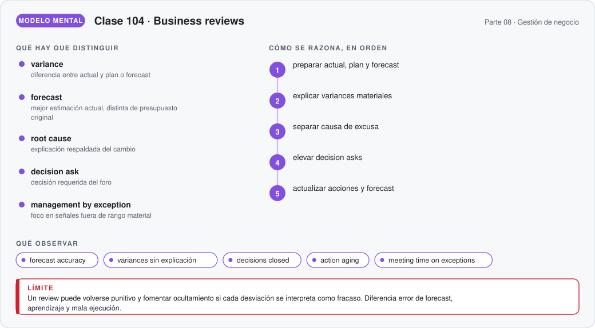

# Clase 104 — Business reviews

<!-- nav:inicio -->
> **Parte 08 · Sistemas de gestión, KPI y OKR** — clase 8 de 12 · [índice de la parte](../../README.md) · [temario](../../../../SYLLABUS.md)
<!-- nav:fin -->

**Parte:** 08 — Sistemas de gestión, KPI y OKR  
**Nivel:** Etapa 3 — Manager → Gerente  
**Duración sugerida:** 150–180 minutos · **Estándar:** deep-class-v2

## 🎯 Propósito

Una revisión de negocio (*business review*) es el momento donde un sistema de objetivos e indicadores se convierte en decisiones. Cuando funciona, la dirección ve la situación real, entiende por qué se desvió, decide qué hacer y se compromete con un seguimiento. Cuando falla, se convierte en un ritual de diapositivas: cada área defiende su cifra, se buscan culpables, nadie decide y la reunión siguiente repite el relato con otros números.

La clase se apoya en la insistencia de Bossidy y Charan en el seguimiento riguroso y el diálogo franco como núcleo de la ejecución, en la visión de Grove sobre la reunión como producción gerencial y en la evidencia de Kahneman, Sibony y Sunstein sobre cómo los grupos mejoran sus juicios cuando se estructuran. Al terminar sabrás diseñar el formato de una revisión, conducirla con preguntas que descubran causas, evitar la búsqueda de culpables y cerrarla con acuerdos verificables.

## 📚 Resultados de aprendizaje

Al finalizar podrás:

1. **Estructurar** una revisión en cinco pasos: preparar, contrastar, diagnosticar, decidir y registrar.
2. **Formular** preguntas que lleven de la cifra a la causa.
3. **Reducir** los sesgos de grupo con técnicas simples de juicio independiente.
4. **Diferenciar** el diagnóstico de los hechos de la atribución de culpas.
5. **Cerrar** con acuerdos con dueño, fecha y criterio de verificación.

## 🧭 Agenda

| Tramo | Qué se hace |
|---|---|
| 0–20 min | Recuperación: recuerda la última revisión de tu área y pregúntate qué decisión salió de ella. |
| 20–60 min | Cinco pasos, preguntas, sesgos y seguimiento. |
| 60–105 min | Ejemplo trabajado: una revisión de ventas con una desviación de 14 %. |
| 105–150 min | Caso ejecutivo y práctica de conducción. |
| 150–175 min | Límites y entregable. |

## 🧩 Conceptos centrales

| Concepto | Definición | Cómo se reconoce |
|---|---|---|
| **Revisión de negocio** | Reunión periódica que compara resultados con el plan y decide acciones. | Termina con decisiones y compromisos. |
| **Desvío** | Diferencia entre lo esperado y lo ocurrido. | Se explica con causas, no con adjetivos. |
| **Diálogo franco** | Conversación que dice lo que se piensa con respeto y con hechos. | Se discuten desacuerdos reales. |
| **Compromiso verificable** | Acuerdo con dueño, fecha y criterio de cumplimiento. | Se revisa en la próxima reunión. |
| **Sesgo de grupo** | Distorsión del juicio por influencia mutua en la discusión. | Las primeras opiniones arrastran al resto. |
| **Revisión sin culpas** | Análisis centrado en el sistema y no en los individuos. | Se pregunta qué falló en el sistema. |

## 🧠 Modelo mental

**Cómo leer el diagrama.** Cinco pasos con retorno. **Preparar** garantiza que los datos lleguen antes y sin sorpresas. **Contrastar** compara resultado y plan con la tendencia. **Diagnosticar** busca causas con hechos. **Decidir** asigna acciones, dueños y fechas. **Registrar y seguir** deja los acuerdos escritos, y la siguiente revisión parte de ellos. El retorno es lo que convierte una reunión suelta en un sistema de gestión.

## 📖 Desarrollo

### 1. Qué debe lograr una revisión

Una buena revisión logra tres cosas: **ver la situación real** (no la versión pulida), **entender causas** (no solo describir síntomas) y **cambiar algo** (una decisión, una asignación, un plan). Bossidy y Charan describen la ejecución como la disciplina de seguir con rigor, con un diálogo que sea franco y que discuta la realidad, no el relato. Si una revisión termina sin acuerdos nuevos o con los mismos de siempre, probablemente fue una presentación.

### 2. Preparar

La preparación define la calidad. Se envían **antes** (24 a 48 horas) los datos acordados, con las definiciones de la ficha del indicador (clase 100), el resultado contra la meta, la tendencia y, para los desvíos materiales, un breve análisis de causas hecho por el dueño. En la sala no se lee: se discute. Cada participante sabe qué se espera de él. Se evitan las sorpresas: nadie debería enterarse en la reunión de un problema grave de su propia área; el dueño avisa antes, y reconocer un problema temprano se valora, no se castiga.

### 3. Contrastar con el plan

Se parte de los resultados contra el plan, por exclusión: se dedican pocos minutos a lo que va bien y el tiempo principal a los desvíos significativos (clase 107). Se miran **tendencias**, no puntos aislados, para distinguir señal de ruido (clase 091), y se separan los desvíos por **volumen, precio, mezcla** u otras dimensiones relevantes. Un número agregado esconde diferencias: un resultado total en línea puede ocultar una unidad en caída compensada por otra en alza. La pregunta del paso es: ¿qué nos dice la diferencia entre lo planeado y lo ocurrido?

### 4. Diagnosticar

El diagnóstico hace la pregunta «¿por qué?» varias veces, con hechos. Un recurso útil: **separar tres niveles**: qué pasó (hechos y datos), por qué pasó (causas probables, con evidencia) y qué supuesto del plan resultó falso. Las preguntas ayudan: ¿qué sabemos con certeza y qué suponemos?, ¿qué cambió desde la última revisión?, ¿qué dato contradiría nuestra explicación? La búsqueda de culpables cierra la conversación: quien teme ser culpado ocultará información, y la revisión se vuelve defensiva. Se discute el sistema, no a la persona.

### 5. Reducir sesgos del grupo

Kahneman, Sibony y Sunstein muestran que las discusiones grupales sin estructura amplifican sesgos: las primeras opiniones influyen en el resto, quien tiene más jerarquía arrastra, y el consenso aparente puede ser cascada de información. Técnicas simples: **pedir juicios individuales por escrito antes de debatir** (por ejemplo, una estimación del resultado esperado y de la causa principal), **hablar primero los de menor jerarquía**, **asignar un abogado del diablo**, **separar la generación de opciones de su evaluación** y **registrar la incertidumbre** con rangos. Estas prácticas son baratas y mejoran la calidad de las decisiones.

### 6. Decidir y comprometerse

Cada punto de la revisión se cierra con una de cuatro respuestas: **seguir como está**, **corregir** (con una acción concreta), **escalar** (a quien puede decidir) o **replantear el objetivo o el supuesto**. Los compromisos se escriben con **qué, quién, para cuándo y cómo se verificará**. Se evita el «lo vemos» o el «trabajaremos en ello». Los recursos que se requieren se solicitan en la misma reunión y se decide si se asignan (clase 106). Un buen indicador de la calidad de una revisión es la proporción de compromisos de la reunión anterior que se cumplieron.

### 7. Seguimiento y cultura

La revisión siguiente comienza con los acuerdos anteriores: ¿se cumplieron?, ¿qué resultado produjeron? Si no se cumplen, se pregunta por qué —prioridad, capacidad, claridad— antes de pensar en sanciones. La cultura de la revisión depende del comportamiento de quien la preside: si reacciona con enojo ante malas noticias, aprenderá solo noticias buenas. Grove aconsejaba que quien lidera haga preguntas y escuche; Bossidy y Charan, que sea riguroso con los hechos y respetuoso con las personas. Las reuniones se evalúan con una pregunta final: ¿qué valió la pena y qué cambiaremos?

## 📚 Lectura comparada

| Obra | Qué aporta | Qué no resuelve | Pregunta para contrastar |
|---|---|---|---|
| Bossidy y Charan | Seguimiento, diálogo franco y ejecución. | Se centra en grandes empresas. | ¿Qué realidad se discute? |
| Grove | La reunión como instrumento gerencial. | Estilo de su época. | ¿Qué decisión produce la reunión? |
| Kahneman, Sibony y Sunstein | Reducir el ruido y los sesgos del juicio en grupo. | No es un manual de gestión. | ¿Recogiste juicios antes de debatir? |
| Edmondson (clase 042) | Seguridad psicológica para decir la verdad. | No trata de indicadores. | ¿Pueden decir un mal resultado sin temor? |
| Kaplan y Norton | Revisión estratégica con el cuadro de mando. | Requiere estrategia explícita. | ¿Qué hipótesis se revisa? |

## 🧮 Ejemplo trabajado

**Situación (hipotética).** En la revisión mensual de una empresa de equipos industriales, las ventas del mes quedan 14 % bajo el plan (USD 1,72 millones frente a 2,0). El gerente comercial dice que «el mercado está lento». El de operaciones, que «hay retrasos de entrega por falta de materia prima». Finanzas, que «los descuentos aumentaron».

**Preparación.** El dueño de ventas envió un análisis con los datos acordados: ventas por línea, por región y por tamaño de cliente, y el embudo por etapa.

**Contraste.** Por línea: dos líneas en el plan; la tercera, 41 % abajo. Por región: una región concentra el 70 % de la brecha. Por etapa: las propuestas emitidas están 8 % bajo el plan, pero la tasa de cierre bajó de 31 % a 24 %.

**Juicios independientes.** Antes del debate, cada participante escribe la causa principal del desvío. Resultados: «mercado» (2), «retrasos de entrega» (2), «precio» (1), «cambio de equipo comercial en la región» (1). No hay consenso.

**Diagnóstico.** Preguntas: ¿qué dato contradiría «el mercado está lento»? Las ventas de la competencia en esa línea subieron según una asociación sectorial, lo que contradice la hipótesis. Los retrasos de entrega afectaron a 11 pedidos, que se cerraron al mes siguiente (explica 3 puntos de los 14). La región con la brecha cambió a su jefe comercial hace tres meses; sus ejecutivos tienen la mitad de reuniones de propuesta.

**Decisiones.** (1) Plan de recuperación en la región con la gerencia comercial y recursos humanos: acompañamiento de dos ejecutivos senior (responsable: gerente comercial; plazo: 15 días; verificación: reuniones de propuesta por semana). (2) Revisión de la política de precios de la tercera línea (responsable: gerente de producto; 30 días). (3) Informar a clientes sobre retrasos y reasignar materia prima (operaciones; 7 días). (4) Revisar la meta de la región si en 60 días no se observa recuperación.

**Qué muestra.** (1) Los juicios independientes mostraron que no había una causa compartida. (2) Los hechos contradijeron una explicación cómoda. (3) Las decisiones tenían dueño, plazo y verificación.

## 🔀 Comparación y límites

**Revisión de negocio frente a auditoría.** La auditoría verifica el cumplimiento de reglas por una parte independiente; la revisión de negocio gestiona resultados con quienes los producen. La revisión no reemplaza los controles independientes.

**Límites.** Una revisión no reemplaza la conversación continua con clientes y equipos. Las técnicas para reducir sesgos tienen efecto moderado y no eliminan el juicio. Las cifras del ejemplo son ilustrativas. Y las decisiones sobre personas (cambios de jefaturas, evaluaciones) deben conducirse con debido proceso y respetar la normativa laboral; no se resuelven en una reunión de resultados.

## 🪜 De profesional a owner

| Nivel | Cómo participa en las revisiones |
|---|---|
| **Profesional** | Prepara datos fiables y habla de causas con hechos. |
| **Jefe / Team Lead** | Presenta su desvío con análisis y propuestas. |
| **Gerente** | Conduce la revisión de su área y cierra con compromisos. |
| **CEO / Director** | Pregunta, escucha y protege el diálogo franco. |
| **Founder / Owner** | Evita que las revisiones se vuelvan un espacio donde solo él habla. |

## 🏢 Caso ejecutivo

Una empresa de alimentos con 1.400 empleados realiza cada mes una revisión de negocio de cuatro horas con 22 asistentes. Cada gerente presenta 20 diapositivas; el gerente general interrumpe con críticas y a veces con enojo. Los gerentes llegan con explicaciones preparadas para defenderse; las malas noticias se suavizan o se presentan sin datos. Los compromisos se anotan en un acta que nadie revisa. Hace seis meses, un problema de calidad en una planta se conoció primero por un reclamo de un cliente grande, aunque el jefe de planta lo sabía desde hacía tres semanas.

Entrega un **rediseño de la revisión de negocio** que contenga: (a) el formato en cinco pasos con tiempos y participantes; (b) los insumos previos y las definiciones de indicadores; (c) las preguntas de diagnóstico para pasar de la cifra a la causa; (d) las técnicas para reducir sesgos del grupo; (e) el comportamiento esperado del presidente de la reunión y cómo se cultivará; (f) el sistema de compromisos y su seguimiento.

## 🧪 Práctica

1. Diseña una agenda de revisión de 90 minutos con los cinco pasos.
2. Escribe cinco preguntas de diagnóstico para un desvío concreto.
3. Prepara un ejercicio de juicios independientes para abrir una discusión.
4. Redacta tres compromisos con dueño, fecha y verificación.
5. Define cómo medirás la calidad de tus revisiones durante un trimestre.

## ⚠️ Errores frecuentes

| Error | Por qué ocurre | Cómo corregirlo |
|---|---|---|
| Presentación en vez de discusión | No hay insumo previo | Enviar antes y usar la sala para decidir. |
| Búsqueda de culpables | Se quiere cerrar rápido | Preguntar qué falló en el sistema. |
| Sorpresas en la sala | No se avisa antes | Acordar que los problemas se avisan primero. |
| Consenso aparente | Influyen los primeros en hablar | Juicios individuales antes del debate. |
| Compromisos vagos | Se evita el conflicto | Qué, quién, para cuándo y cómo se verifica. |
| No revisar acuerdos previos | Se pasa a lo nuevo | Abrir con el seguimiento. |

## ❓ Preguntas de comprobación

1. ¿Qué tres cosas debe lograr una revisión de negocio?
2. ¿Qué debe llegar antes de la reunión?
3. ¿Por qué se discuten tendencias y no puntos aislados?
4. ¿Qué tres niveles se separan en el diagnóstico?
5. ¿Qué técnicas reducen los sesgos de grupo?
6. ¿Qué respuestas puede tener cada punto de la revisión?
7. ¿Cómo influye el comportamiento de quien preside en la información que llega?

Claves de respuesta

1. Ver la situación real, entender las causas y cambiar algo con decisiones y compromisos.
2. Los datos acordados con sus definiciones, la comparación con la meta, la tendencia y el análisis de causas de los desvíos materiales.
3. Para distinguir señal de ruido y no reaccionar a variaciones normales.
4. Qué pasó, por qué pasó y qué supuesto del plan resultó falso.
5. Juicios individuales por escrito antes de debatir, hablar primero los de menor jerarquía, abogado del diablo, separar opciones de evaluación y registrar incertidumbre.
6. Seguir como está, corregir con una acción, escalar o replantear el objetivo o el supuesto.
7. Si reacciona con enojo ante malas noticias, aprenderá solo noticias buenas y se oculta información.

## 📥 Entregable

Guarda en `portfolio/104-business-reviews/`:

- `monthly-business-review.md` (plantilla [Monthly business review](../../../../templates/monthly-business-review.md)) con el formato rediseñado del caso ejecutivo;
- `leadership-decision-brief.md` (plantilla [Leadership Decision Brief](../../../../templates/leadership-decision-brief.md)) con las decisiones del ejemplo adaptadas a tu área;
- `decision-journal.md` con los juicios previos, las decisiones y su seguimiento.

## 📗 Fuentes y verificación

- Larry Bossidy & Ram Charan — *Execution* (2002). **Uso en esta clase:** seguimiento riguroso, diálogo franco y ejecución. Lectura selectiva sobre **business reviews**. **Localizador:** [ISBN-13 9781598954838](https://openlibrary.org/isbn/9781598954838).
- Andrew S. Grove — *High Output Management* (Random House, 1983). **Uso en esta clase:** la reunión como instrumento gerencial. Lectura selectiva sobre **business reviews**. **Localizador:** [ISBN-13 9780394532349](https://openlibrary.org/isbn/9780394532349).
- Daniel Kahneman, Olivier Sibony & Cass R. Sunstein — *Noise* (Little, Brown Spark, 2021). **Uso en esta clase:** reducir el ruido y los sesgos del juicio en grupo. Lectura selectiva sobre **business reviews**. **Localizador:** [ISBN-13 9780316451383](https://openlibrary.org/isbn/9780316451383).
- Amy C. Edmondson — *Psychological Safety and Learning Behavior in Work Teams* (Administrative Science Quarterly, 1999). **Uso en esta clase:** seguridad para decir la verdad. Lectura selectiva sobre **business reviews**. **Localizador:** [DOI 10.2307/2666999](https://doi.org/10.2307/2666999).
- Robert S. Kaplan & David P. Norton — *Strategy Maps* (Harvard Business School Press, 2004). **Uso en esta clase:** revisión estratégica con el cuadro de mando. Lectura selectiva sobre **business reviews**. **Localizador:** [ISBN-13 9781591391340](https://openlibrary.org/isbn/9781591391340).

> **Regla de fuentes para Business reviews:** las obras anteriores estructuran las perspectivas de esta materia; cualquier norma, ley o estándar vivo mencionado debe comprobarse nuevamente en su fuente primaria vigente, incluidas las normas laborales para decisiones sobre personas. Los ejemplos y casos son hipotéticos, con cifras ilustrativas. El desarrollo es original y no reproduce capítulos protegidos.

<!-- pie:inicio -->
---

| Anterior | Índice | Siguiente |
|---|---|---|
| [← 103 · Ritmo semanal, mensual y trimestral](../103-ritmo-semanal-mensual-y-trimestral/README.md) | [Parte 08](../../README.md) · [Programa](../../../../SYLLABUS.md) | [105 · Priorización y portfolio →](../105-priorizacion-y-portfolio/README.md) |
<!-- pie:fin -->
