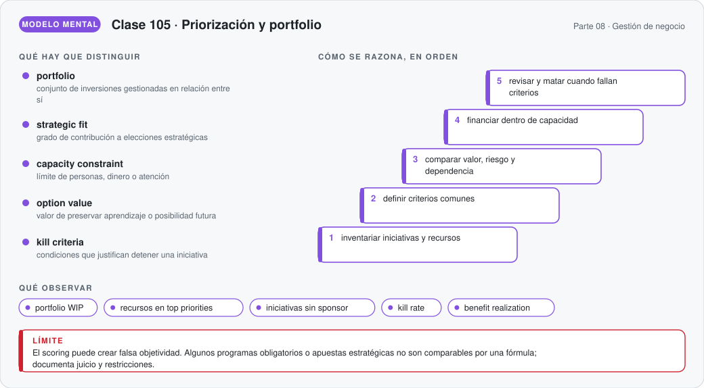

# Clase 105 — Priorización y portfolio

<!-- nav:inicio -->
> **Parte 08 · Sistemas de gestión, KPI y OKR** — clase 9 de 12 · [índice de la parte](../../README.md) · [temario](../../../../SYLLABUS.md)
<!-- nav:fin -->

**Parte:** 08 — Sistemas de gestión, KPI y OKR  
**Nivel:** Etapa 3 — Manager → Gerente  
**Duración sugerida:** 150–180 minutos · **Estándar:** deep-class-v2

## 🎯 Propósito

Toda organización tiene más ideas, proyectos y solicitudes que capacidad. Priorizar es **elegir con criterio y decir que no**, y la mayoría de las empresas lo hace mal: financian demasiadas iniciativas a medias, privilegian lo urgente o lo que defiende el ejecutivo más insistente, y mantienen proyectos que ya no se justificarían si se evaluaran hoy. Gestionar un **portafolio** significa mirar el conjunto de iniciativas como una cartera de apuestas: con balance entre riesgos y plazos, con criterios explícitos y con la disposición de detener lo que no rinde.

La clase se apoya en el diagnóstico de Rumelt sobre la mala estrategia como lista de metas sin elección, en el estudio de Eisenhardt sobre cómo los equipos de alto desempeño deciden rápido con información rica y alternativas múltiples, y en la lógica de Kaplan y Norton de alinear iniciativas con objetivos. Al terminar sabrás construir un conjunto de criterios de priorización, ordenar iniciativas con valor y esfuerzo, equilibrar un portafolio y detener proyectos con disciplina.

## 📚 Resultados de aprendizaje

Al finalizar podrás:

1. **Definir** criterios de priorización conectados con la estrategia.
2. **Ordenar** iniciativas por valor esperado, esfuerzo, riesgo y dependencia.
3. **Equilibrar** un portafolio entre apuestas de distinto plazo y riesgo.
4. **Aplicar** reglas para detener, pausar o redefinir iniciativas.
5. **Comunicar** decisiones de priorización, incluidos los «no».

## 🧭 Agenda

| Tramo | Qué se hace |
|---|---|
| 0–20 min | Recuperación: lista las iniciativas abiertas en tu área y ordénalas sin criterios; luego pregúntate cuáles detendrías. |
| 20–60 min | Criterios, método de ordenamiento, balance y salida. |
| 60–105 min | Ejemplo trabajado: priorizar 12 iniciativas de una empresa con capacidad para 5. |
| 105–150 min | Caso ejecutivo y práctica de ordenamiento. |
| 150–175 min | Límites y entregable. |

## 🧩 Conceptos centrales

| Concepto | Definición | Cómo se reconoce |
|---|---|---|
| **Priorización** | Elección ordenada de qué hacer primero y qué no hacer con recursos limitados. | Hay criterios y decisiones, incluidos los «no». |
| **Portafolio** | Conjunto de iniciativas gestionado como cartera. | Se decide el balance, no solo cada proyecto. |
| **Valor esperado** | Beneficio estimado ponderado por su probabilidad. | Se declara con supuestos. |
| **Costo de oportunidad** | Valor de la mejor alternativa a la que se renuncia. | Cada «sí» es un «no» a otra cosa. |
| **Costo hundido** | Gasto ya realizado e irrecuperable. | No debe pesar en decidir si continuar. |
| **Capacidad limitada** | Tiempo, talento y atención disponibles. | Es el recurso a repartir. |

## 🧠 Modelo mental

**Cómo leer el diagrama.** Un cuadrante con valor en vertical y esfuerzo en horizontal. **Alto valor con poco esfuerzo**: se hace primero. **Alto valor con mucho esfuerzo**: se eligen pocas apuestas y se planifican con hitos y puntos de salida. **Bajo valor con poco esfuerzo**: se hace solo si no desplaza lo importante. **Bajo valor con mucho esfuerzo**: casi siempre se descarta. Es una ayuda para ordenar la conversación, no una fórmula; el valor y el esfuerzo son estimaciones que deben explicitarse.

## 📖 Desarrollo

### 1. Priorizar es una decisión estratégica

Rumelt critica los planes que son listas de aspiraciones sin elecciones: «mala estrategia» que evita decidir qué no se hará. Una buena estrategia concentra recursos en pocas acciones coherentes que atacan el desafío crítico. Priorizar, entonces, no es una técnica administrativa sino la forma en que la estrategia se vuelve real: lo que recibe recursos es la estrategia efectiva, sin importar lo que digan los documentos. Si la lista de prioridades tiene veinte elementos, no hay prioridades.

### 2. Criterios explícitos

Antes de ordenar, se acuerdan los **criterios** y su peso. Los más usuales: **contribución a los objetivos estratégicos** (clase 097–099), **valor esperado** (ingresos, ahorro, riesgo evitado), **urgencia o ventana de oportunidad**, **esfuerzo y costo**, **riesgo de ejecución**, **dependencias** con otras iniciativas y **aprendizaje** que aportan. Los criterios se acuerdan **antes** de ver las iniciativas, para evitar diseñarlos a la medida de la que ya se quiere. Cada criterio se puntúa con una escala de definición clara (por ejemplo, 1 a 5 con descriptores), de modo que dos personas puedan asignar el mismo valor.

### 3. Ordenar con valor y esfuerzo

El cuadrante de valor y esfuerzo ordena la discusión: lo de **alto valor y bajo esfuerzo** va primero; lo de **alto valor y alto esfuerzo** se planifica con cuidado y se limita en número; lo de bajo valor y bajo esfuerzo se hace solo si hay holgura; y lo de bajo valor y alto esfuerzo se descarta. Para más rigor, se pueden usar puntajes ponderados por criterio. Tanto el cuadrante como los puntajes son **apoyos del juicio**, no sustitutos: sus resultados se contrastan con la intuición y se explora por qué difieren.

### 4. Decidir con información incierta

Las estimaciones de valor y esfuerzo son inciertas, y los sesgos de optimismo y de planificación inflan lo primero y reducen lo segundo (clase 076). Prácticas útiles: pedir **rangos** en lugar de puntos, usar la **visión desde afuera** (cómo les fue a iniciativas similares), contrastar las estimaciones de quien propone con las de un revisor independiente y registrar los **supuestos clave**. Eisenhardt mostró que los equipos que deciden bien y rápido consideran varias alternativas a la vez, buscan información abundante y en tiempo real, y usan consejeros experimentados; la rapidez no sacrifica la calidad cuando el proceso es disciplinado.

### 5. Equilibrar el portafolio

Un portafolio no es la suma de las mejores iniciativas individuales; debe tener **balance**. Dimensiones habituales: **plazo** (mejoras de corto plazo y apuestas de largo plazo), **riesgo** (iniciativas seguras y exploratorias), **tipo** (crecimiento, eficiencia, cumplimiento y mantenimiento), **dependencia de recursos** (no concentrar todo en un equipo) y **línea estratégica**. Una regla práctica es reservar una fracción para la exploración. Si el 100 % del esfuerzo se dedica a lo que ya funciona, el futuro se descuida; si se dedica a lo incierto, se arriesga la operación.

### 6. Capacidad y límite de iniciativas

Un error clásico es aprobar más iniciativas de las que la capacidad permite, lo que dispersa a los equipos, alarga los plazos y reduce la calidad (clase 088 y 080). Se **cuenta la capacidad** (personas-mes por habilidad) y se asigna explícitamente, dejando holgura para lo no planificado y para la operación. Un límite de **trabajo en curso** por equipo obliga a terminar antes de empezar. Con capacidad para cinco iniciativas, la sexta no es «una más»: es la que desplaza la calidad de las cinco.

### 7. Detener con disciplina

Detener es la parte más difícil. Reglas útiles: **revisión periódica** de todas las iniciativas con la pregunta «si empezáramos hoy con lo que sabemos, ¿la aprobaríamos?»; **criterios de salida** definidos de antemano (hitos no cumplidos, supuestos que cambiaron, costo que supera el umbral); y **cierre ordenado** que rescata lo reutilizable y registra aprendizajes. El **costo hundido** no debe pesar. Un proyecto cancelado a tiempo es una decisión de portafolio exitosa, no un fracaso; si los cierres se castigan, nadie reportará a tiempo (clase 083).

## 📚 Lectura comparada

| Obra | Qué aporta | Qué no resuelve | Pregunta para contrastar |
|---|---|---|---|
| Rumelt | Estrategia como elección y coherencia. | No ofrece un método de puntaje. | ¿Qué no harás? |
| Eisenhardt (1989) | Decidir rápido con alternativas múltiples e información rica. | Estudio de empresas de entorno de alta velocidad. | ¿Qué alternativas consideraste? |
| Kaplan y Norton | Alinear iniciativas con objetivos del mapa. | Requiere estrategia explícita. | ¿A qué objetivo contribuye? |
| Mankins y Garton | Asignar tiempo y talento como recursos escasos. | Datos de empresas grandes. | ¿Cuánta capacidad hay realmente? |
| Kahneman et al. (*Noise*) | Reducir la variabilidad del juicio al evaluar. | No es un método de portafolio. | ¿Dos revisores darían la misma puntuación? |

## 🧮 Ejemplo trabajado

**Situación (hipotética).** Una empresa de seguros tiene 12 iniciativas propuestas para el año y capacidad de tecnología y negocio para ejecutar 5. Los criterios acordados (con pesos): contribución a la retención de clientes (30 %), valor esperado en USD (30 %), esfuerzo (20 %, inverso), riesgo de ejecución (10 %, inverso) y aprendizaje estratégico (10 %). Cada criterio se puntúa de 1 a 5 con descriptores.

| Iniciativa | Valor estimado/año | Esfuerzo (persona-mes) | Puntaje ponderado |
|---|---|---|---|
| A. Autoservicio de pólizas | USD 1,8 M | 18 | 4,1 |
| B. Renovación proactiva con datos | USD 2,4 M | 24 | 4,3 |
| C. Rediseño de la web | USD 0,5 M | 16 | 2,2 |
| D. Integración con un corredor digital | USD 1,1 M | 10 | 3,9 |
| E. Nuevo sistema de reclamos | USD 1,6 M | 60 | 3,3 |
| F. Cumplimiento de nueva norma (obligatorio) | Evita multas | 14 | No se puntúa: es obligatoria |
| G. Piloto de seguro por uso | USD 0,3 M (apuesta) | 8 | 3,0 (aprendizaje alto) |
| H–L. Otras (5 iniciativas) | Entre USD 0,2 M y 0,9 M | 6 a 20 | Entre 1,8 y 2,9 |

**Capacidad.** 130 persona-mes disponibles, con 15 % reservado para operación y contingencias: 110 persona-mes.

**Decisión.** Se asignan primero las obligatorias (F: 14). Luego B (24), A (18), D (10) y, como apuesta de aprendizaje, G (8): total 74 persona-mes, lo que deja 36 de holgura. Con esa holgura podría caber E (60), pero excede; se decide replantearlo en dos fases y comenzar con una de 22 persona-mes que valida el riesgo técnico. Total: 96 persona-mes. Se comunican a las demás áreas los «no» con su razón y la fecha de revisión.

**Reglas de salida.** Cada iniciativa tiene hitos trimestrales y un criterio de detención: si en el primer hito no se cumple el supuesto clave, se revisa o se cierra.

**Qué muestra.** (1) Los criterios se definieron antes. (2) La capacidad limitó la lista. (3) Las obligatorias se trataron aparte. (4) Se reservó una apuesta de aprendizaje y se dividió una iniciativa grande.

## 🔀 Comparación y límites

**Priorizar frente a presupuestar.** El presupuesto asigna dinero; la priorización asigna atención, talento y secuencia. Ambos deben concordar, o los recursos se financiarán sin que haya capacidad para ejecutar.

**Límites.** Los puntajes dan una apariencia de objetividad a juicios inciertos; se tratan como apoyo. Un método único no sirve para todos los tipos de iniciativa: las de cumplimiento, seguridad y continuidad tienen otra lógica (se hacen porque son obligatorias o protegen la operación). Las estimaciones de valor suelen ser optimistas. Y los cambios que afectan a personas o contratos requieren comprobar las condiciones laborales y legales aplicables.

## 🪜 De profesional a owner

| Nivel | Cómo participa en la priorización |
|---|---|
| **Profesional** | Estima con honestidad y avisa cuando algo no cabe. |
| **Jefe / Team Lead** | Limita el trabajo en curso de su equipo y negocia prioridades. |
| **Gerente** | Prioriza con criterios, comunica los «no» y detiene lo que no rinde. |
| **CEO / Director** | Equilibra el portafolio y protege la capacidad para las apuestas estratégicas. |
| **Founder / Owner** | Elige pocas cosas y evita que cada oportunidad se vuelva una distracción. |

## 🏢 Caso ejecutivo

Una empresa de tecnología educativa con 180 personas tiene 27 iniciativas en curso. Cada gerente defiende las suyas: el de ventas quiere un nuevo producto para colegios; el de operaciones, una renovación de sistemas internos; el de producto, una plataforma de analítica; marketing, una campaña regional. Los equipos reportan estar al 130 % de su capacidad y los plazos se corren. Hay tres proyectos con más de dos años de retraso que nadie quiere cerrar «porque ya se invirtió mucho». La CEO tiene recursos para financiar de forma completa unas ocho iniciativas.

Entrega un **plan de priorización y portafolio** que contenga: (a) los criterios con sus pesos y las escalas; (b) el ordenamiento de las iniciativas con valor, esfuerzo, riesgo y dependencias, dejando explícitas las obligatorias; (c) el balance del portafolio por plazo, riesgo y tipo; (d) el cálculo de capacidad y el límite de iniciativas; (e) las reglas de detención y el tratamiento de los tres proyectos retrasados; (f) cómo comunicarás los «no» y qué decisión pedirás al directorio.

## 🧪 Práctica

1. Define cinco criterios con pesos para priorizar iniciativas de tu área.
2. Puntúa diez iniciativas y compara con tu intuición inicial.
3. Calcula la capacidad disponible y cuántas iniciativas caben.
4. Identifica una iniciativa que detendrías y los argumentos que usarías.
5. Redacta cómo comunicarías un «no» a un colega con una propuesta valiosa.

## ⚠️ Errores frecuentes

| Error | Por qué ocurre | Cómo corregirlo |
|---|---|---|
| Lista sin elección | Se evita decir que no | Límite de iniciativas según capacidad. |
| Criterios diseñados a medida | Se define tras ver las propuestas | Acordarlos antes. |
| Puntajes como verdad | Parecen objetivos | Usarlos como apoyo y contrastar. |
| Mantener por costo hundido | Se quiere justificar lo invertido | Preguntar si hoy se aprobaría. |
| Portafolio sin balance | Se eligen las mejores individuales | Equilibrar plazo, riesgo y tipo. |
| Sin comunicación de los «no» | Se evita el conflicto | Explicar razones y fecha de revisión. |

## ❓ Preguntas de comprobación

1. ¿Por qué priorizar es una decisión estratégica?
2. ¿Por qué se acuerdan los criterios antes de ver las iniciativas?
3. ¿Qué indica cada zona del cuadrante de valor y esfuerzo?
4. ¿Qué dimensiones se equilibran en un portafolio?
5. ¿Qué pasa si se aprueban más iniciativas que capacidad?
6. ¿Qué es el costo hundido y por qué no debe pesar?
7. ¿Qué límite tienen los puntajes ponderados?

Claves de respuesta

1. Porque lo que recibe recursos es la estrategia efectiva; sin elecciones hay una lista de aspiraciones.
2. Para evitar diseñarlos a la medida de la iniciativa que ya se quiere impulsar.
3. Alto valor y poco esfuerzo: primero; alto valor y mucho esfuerzo: pocas apuestas planificadas; bajo valor y poco esfuerzo: si sobra; bajo valor y mucho esfuerzo: descartar.
4. Plazo, riesgo, tipo de iniciativa, dependencia de recursos y línea estratégica.
5. Se dispersan los equipos, se alargan los plazos y baja la calidad.
6. Gasto ya realizado e irrecuperable; no debe pesar porque continuar no lo recupera.
7. Dan apariencia de objetividad a juicios inciertos; son un apoyo y deben contrastarse con el juicio.

## 📥 Entregable

Guarda en `portfolio/105-priorizacion-y-portfolio/`:

- `strategy-memo.md` (plantilla [Strategy memo](../../../../templates/strategy-memo.md)) con el plan de priorización y portafolio del caso ejecutivo;
- `kpi-tree.md` (plantilla [KPI tree](../../../../templates/kpi-tree.md)) con los criterios y la relación de cada iniciativa con los objetivos;
- `decision-journal.md` con las decisiones de continuar, detener y no hacer.

## 📗 Fuentes y verificación

- Richard Rumelt — *Good Strategy/Bad Strategy* (Profile Books, 2011). **Uso en esta clase:** estrategia como elección y coherencia. Lectura selectiva sobre **priorización y portfolio**. **Localizador:** [ISBN-13 9781846684807](https://openlibrary.org/isbn/9781846684807).
- Kathleen M. Eisenhardt — *Making Fast Strategic Decisions in High-Velocity Environments* (Academy of Management Journal, 1989). **Uso en esta clase:** decidir rápido con alternativas múltiples e información rica. Lectura selectiva sobre **priorización y portfolio**. **Localizador:** [DOI 10.2307/256434](https://doi.org/10.2307/256434).
- Robert S. Kaplan & David P. Norton — *Strategy Maps* (Harvard Business School Press, 2004). **Uso en esta clase:** alinear iniciativas con los objetivos del mapa. Lectura selectiva sobre **priorización y portfolio**. **Localizador:** [ISBN-13 9781591391340](https://openlibrary.org/isbn/9781591391340).
- Michael C. Mankins & Eric Garton — *Time, Talent, Energy* (Harvard Business Review Press, 2017). **Uso en esta clase:** asignar tiempo y talento como recursos escasos. Lectura selectiva sobre **priorización y portfolio**. **Localizador:** [ISBN-13 9781633691766](https://openlibrary.org/isbn/9781633691766).
- Daniel Kahneman, Olivier Sibony & Cass R. Sunstein — *Noise* (Little, Brown Spark, 2021). **Uso en esta clase:** reducir la variabilidad del juicio al evaluar. Lectura selectiva sobre **priorización y portfolio**. **Localizador:** [ISBN-13 9780316451383](https://openlibrary.org/isbn/9780316451383).

> **Regla de fuentes para Priorización y portfolio:** las obras anteriores estructuran las perspectivas de esta materia; cualquier norma, ley o estándar vivo mencionado debe comprobarse nuevamente en su fuente primaria vigente. Los ejemplos y casos son hipotéticos, con cifras ilustrativas. El desarrollo es original y no reproduce capítulos protegidos.

<!-- pie:inicio -->
---

| Anterior | Índice | Siguiente |
|---|---|---|
| [← 104 · Business reviews](../104-business-reviews/README.md) | [Parte 08](../../README.md) · [Programa](../../../../SYLLABUS.md) | [106 · Asignación de recursos →](../106-asignacion-de-recursos/README.md) |
<!-- pie:fin -->
