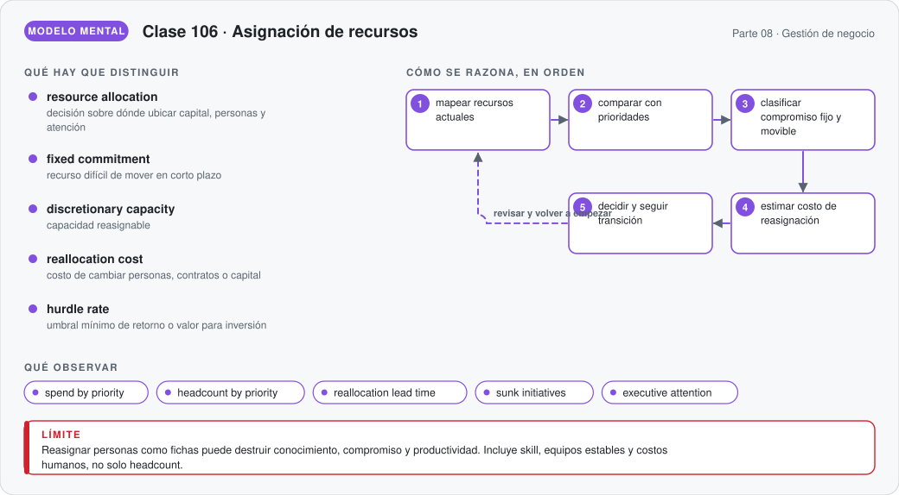

# Clase 106 — Asignación de recursos

<!-- nav:inicio -->
> **Parte 08 · Sistemas de gestión, KPI y OKR** — clase 10 de 12 · [índice de la parte](../../README.md) · [temario](../../../../SYLLABUS.md)
<!-- nav:fin -->

**Parte:** 08 — Sistemas de gestión, KPI y OKR  
**Nivel:** Etapa 3 — Manager → Gerente  
**Duración sugerida:** 150–180 minutos · **Estándar:** deep-class-v2

## 🎯 Propósito

La estrategia de una empresa no es lo que dice su plan sino lo que financia. La asignación de recursos —dinero, personas, tiempo de la dirección— revela las prioridades reales, y en la mayoría de las organizaciones es sorprendentemente inercial: el presupuesto de este año se parece mucho al del año pasado, cada área defiende su porción y las nuevas apuestas se financian con lo que sobra. Asignar con criterio exige mirar el conjunto, comparar usos alternativos y mover recursos de donde rinden menos a donde rinden más, aun cuando eso implique conflictos.

La clase se apoya en el estudio de Mankins y Garton sobre el tiempo y el talento como recursos que las empresas asignan con menos disciplina que el capital, en la crítica de Rumelt a los planes sin concentración de fuerzas y en la evidencia de Kahneman, Sibony y Sunstein sobre el ruido y los sesgos en juicios de asignación. Al terminar sabrás diagnosticar la inercia presupuestaria, asignar tiempo, talento y dinero con criterios explícitos y diseñar un proceso de reasignación que se pueda sostener.

## 📚 Resultados de aprendizaje

Al finalizar podrás:

1. **Diagnosticar** la inercia en la asignación de dinero, personas y tiempo.
2. **Asignar** recursos desde las prioridades estratégicas y no desde la historia.
3. **Tratar** el talento y el tiempo de dirección como recursos presupuestables.
4. **Diseñar** un proceso de reasignación con criterios, datos y decisores claros.
5. **Gestionar** el costo humano de las reasignaciones.

## 🧭 Agenda

| Tramo | Qué se hace |
|---|---|
| 0–20 min | Recuperación: compara el presupuesto de tu área de este año con el del anterior y calcula cuánto cambió. |
| 20–60 min | Inercia, criterios, talento y tiempo, y proceso de reasignación. |
| 60–105 min | Ejemplo trabajado: reasignación de personas en una empresa de servicios. |
| 105–150 min | Caso ejecutivo y práctica. |
| 150–175 min | Límites y entregable. |

## 🧩 Conceptos centrales

| Concepto | Definición | Cómo se reconoce |
|---|---|---|
| **Asignación de recursos** | Decisión de cuánto dinero, talento y tiempo recibe cada uso. | Se refleja en presupuestos, dotaciones y agendas. |
| **Inercia presupuestaria** | Tendencia a repetir la asignación previa con ajustes menores. | La correlación entre años es muy alta. |
| **Presupuesto base cero** | Método que obliga a justificar cada asignación desde cero. | Se revisa lo existente como lo nuevo. |
| **Talento clave** | Personas cuyo trabajo tiene un impacto desproporcionado en las apuestas. | Su ausencia detiene una iniciativa. |
| **Tiempo directivo** | Horas de la alta dirección disponibles para decisiones y liderazgo. | Es limitado y se puede presupuestar. |
| **Reasignación** | Movimiento de recursos de un uso a otro. | Hay costos de transición y de moral. |

## 🧠 Modelo mental

**Cómo leer el diagrama.** A la izquierda, lo que ocurre cuando nadie decide de forma deliberada: se repite el presupuesto, gana quien negocia mejor y todo se financia a medias. A la derecha, la asignación deliberada: se parte de las prioridades, se revisa lo que ya se financia con el mismo rigor que lo nuevo y se tratan el tiempo y el talento como recursos. La nota recuerda que el recurso más escaso suele ser la atención de la dirección, no el dinero.

## 📖 Desarrollo

### 1. La asignación es la estrategia en acción

Mankins y Garton sostienen que el éxito de una estrategia depende de si los recursos se dirigen a las prioridades. Observan que, en muchas empresas, los equipos directivos asignan el capital con ciertos procesos formales, pero el **tiempo y el talento** —que suelen ser más escasos y valiosos— se distribuyen por costumbre, por la agenda de cada uno o por la presión del momento. El primer paso es hacer visible esa distribución: cuánto del tiempo y del talento se dedica a cada prioridad, y compararlo con lo que se dice que es importante.

### 2. La inercia como regla

En muchas organizaciones, la asignación de un año es casi igual a la del anterior, más o menos un porcentaje. Las razones: es **cómodo** (evita conflictos), **creíble** (se basa en la historia), **defendible** (nadie puede acusar de arbitrariedad) y **políticamente estable**. Su costo: los recursos no siguen a las oportunidades; las unidades en decadencia conservan fondos y las emergentes carecen de ellos. Se diagnostica comparando la asignación de los últimos tres a cinco años con el desempeño y las prioridades: si no hay relación, hay inercia.

### 3. Criterios para asignar

Se pueden usar criterios similares a los de priorización (clase 105), con foco en recursos: **contribución a la estrategia**, **retorno esperado y riesgo**, **etapa y potencial** (qué necesita para crecer), **desempeño demostrado** y **costo de oportunidad**. Se acostumbra separar tres tipos de asignación: **mantener** (operación existente, con metas de eficiencia), **crecer** (apuestas con retorno esperado) y **explorar** (opciones que cuestan poco y enseñan mucho). Cada tipo se evalúa con criterios distintos: pedir el mismo retorno a una exploración que a una operación madura la mata antes de nacer.

### 4. Presupuesto base cero y revisión de lo existente

Un método para romper la inercia es examinar cada partida como si fuera nueva: ¿qué problema resuelve?, ¿qué pasaría si no existiera?, ¿cuánto cuesta alcanzar el resultado de otra forma? El presupuesto base cero completo es costoso y se usa de forma periódica o parcial (por ejemplo, una categoría de gasto cada año). Otra práctica es **comparar lo existente con lo nuevo** en un mismo proceso: quien propone una nueva iniciativa debe indicar qué se libera, de dónde sale el recurso y cuándo se detendrá algo.

### 5. Talento y tiempo como recursos presupuestables

Se asigna talento con el mismo rigor que dinero: se identifica el **talento clave** necesario para cada prioridad y se decide, de forma explícita, cuántas personas (con qué habilidades) se dedican a cada una, incluso si eso implica mover a alguien de su área de confort. Se hace un **presupuesto del tiempo** de la alta dirección: cuántas horas semanales se destinan a cada prioridad, y qué se deja de hacer. Mankins y Garton recomiendan revisar la agenda de los directivos a la luz de las prioridades y delegar o eliminar lo que no las sirve.

### 6. Procesos de reasignación

Un buen proceso tiene: **calendario** (al menos una revisión anual y una intermedia), **criterios conocidos**, **datos comparables** entre iniciativas y unidades, **decisores claros** (quién tiene la última palabra), **espacios de discusión franca** y **mecanismos para reducir el ruido**: estimaciones independientes, rangos y registro de supuestos. Kahneman y colegas muestran que los juicios de expertos sobre decisiones similares varían más de lo que se cree; estructurar la evaluación, descomponer en dimensiones y agregar juicios independientes mejora la consistencia. La reasignación se comunica con razones.

### 7. El costo humano y la transición

Mover recursos tiene costos: equipos desmovilizados, conocimientos que se pierden, conflictos entre áreas y personas que sienten castigo. Se gestionan con **claridad de criterios**, **anticipación**, **apoyo a quienes cambian de rol** (capacitación, reconocimiento), **ritmo razonable** (reasignaciones masivas y frecuentes paralizan) y **cuidado de la equidad**. Cuando la reasignación implica cambios de funciones, jornadas o desvinculaciones, se deben comprobar las condiciones laborales y legales aplicables y actuar con asesoría. Una reasignación bien explicada rara vez se percibe como arbitraria.

## 📚 Lectura comparada

| Obra | Qué aporta | Qué no resuelve | Pregunta para contrastar |
|---|---|---|---|
| Mankins y Garton | Tiempo y talento como recursos de la estrategia. | Datos de empresas grandes. | ¿Cuánto tiempo directivo se dedica a las prioridades? |
| Rumelt | Concentración de fuerzas y coherencia. | No da un método de presupuesto. | ¿Dónde concentras recursos? |
| Kahneman, Sibony y Sunstein | Ruido y sesgos en juicios de asignación. | No es un manual de presupuestos. | ¿Dos evaluadores asignarían igual? |
| Kaplan y Norton | Vincular iniciativas, presupuesto y estrategia. | Requiere estrategia explícita. | ¿Qué iniciativa financia qué objetivo? |
| Eisenhardt | Decidir con alternativas múltiples. | Estudio de entornos de alta velocidad. | ¿Qué alternativas comparaste? |

## 🧮 Ejemplo trabajado

**Situación (hipotética).** Una consultora de 150 personas tiene tres líneas: «Operaciones» (madura, 60 % de ingresos), «Datos» (creciendo 35 % anual, 25 % de ingresos) y «Sostenibilidad» (naciente, 5 % de ingresos, con alta demanda). Cada año asigna consultores senior a las líneas casi en proporción a los ingresos del año anterior.

| Línea | Ingresos | Seniors asignados | Utilización | Propuestas rechazadas por falta de gente |
|---|---|---|---|---|
| Operaciones | 60 % | 18 | 71 % | 2 |
| Datos | 25 % | 8 | 93 % | 11 |
| Sostenibilidad | 5 % | 2 | 98 % | 9 |

**Diagnóstico.** La asignación sigue a los ingresos pasados, no a la demanda: las dos líneas con mayor utilización pierden propuestas por falta de gente, mientras Operaciones tiene capacidad ociosa. Hay inercia.

**Opciones.** (a) Mantener. (b) Reasignar 4 seniors de Operaciones a Datos (3) y Sostenibilidad (1) en un año, con formación. (c) Contratar 6 seniors nuevos (costo de selección, curva de aprendizaje, tiempo).

**Cálculo orientador.** Cada senior en Datos genera unos USD 300.000 al año de ingresos con 93 % de utilización; las propuestas rechazadas representan unos USD 2,6 millones al año. Reasignar 3 seniors recupera hasta USD 0,9 millones en el primer año; la formación cuesta USD 12.000 por persona. Contratar es más lento y caro; la reasignación tiene costo humano (dos de los cuatro consultores no quieren cambiar de línea).

**Decisión.** Se aprueba (b) para dos personas voluntarias, más (c) para tres cargos; se comunica con criterios y se fija una revisión en seis meses con tres indicadores: propuestas ganadas, utilización por línea y satisfacción de los equipos. Se reserva una fracción de capacidad para exploración.

**Qué muestra.** (1) Los datos mostraron la inercia. (2) La decisión comparó alternativas con costos. (3) Se cuidó el costo humano.

## 🔀 Comparación y límites

**Asignar frente a presupuestar.** El presupuesto es el instrumento contable; la asignación es la decisión de prioridades que lo origina. Un presupuesto bien elaborado con prioridades débiles reproduce la inercia.

**Límites.** Las proyecciones de retorno por línea son inciertas, y reasignar con excesiva frecuencia desestabiliza. No todos los recursos son intercambiables: el talento tiene habilidades específicas. Un análisis financiero simple no refleja el valor estratégico de las opciones. Los números del ejemplo son ilustrativos. Las reasignaciones que afectan a las personas se rigen por la ley laboral y los contratos, que se verifican con asesoría.

## 🪜 De profesional a owner

| Nivel | Cómo participa en la asignación |
|---|---|
| **Profesional** | Explica con datos qué necesita para lograr su resultado. |
| **Jefe / Team Lead** | Propone la asignación de su equipo según prioridades y capacidad. |
| **Gerente** | Defiende y justifica la asignación con criterios, y acepta ceder recursos. |
| **CEO / Director** | Decide el balance entre mantener, crecer y explorar, y protege el talento clave. |
| **Founder / Owner** | Dirige su propio tiempo y el escaso capital a lo que más mueve la empresa. |

## 🏢 Caso ejecutivo

Una empresa de manufactura de envases con 900 empleados asigna cada año su inversión en capital y su dotación de ingeniería con el método de «histórico más 3 %». La división de plásticos, que representa el 55 % de los ingresos y está en un mercado en declive, recibe el 60 % de la inversión. La división de envases biodegradables, que crece 40 % anual y tiene lista de espera de clientes, recibe el 8 % y no logra contratar ingenieros. El comité de dirección dedica el 70 % de su tiempo a problemas de las plantas existentes. Un competidor entró al mercado biodegradable con financiamiento. Los gerentes de plásticos advierten que recortar su presupuesto pondría en riesgo la caja que financia todo.

Entrega un **plan de reasignación** que contenga: (a) el diagnóstico de la inercia con datos de tres años; (b) los criterios de asignación y la distinción entre mantener, crecer y explorar; (c) la nueva asignación de capital, talento y tiempo de dirección, con cifras y transición por etapas; (d) el análisis de riesgo para la caja y para las personas; (e) el proceso de revisión anual e intermedia con decisores y datos; (f) las verificaciones laborales y legales y la comunicación a los equipos.

## 🧪 Práctica

1. Calcula la variación de la asignación de tu área en tres años y compárala con el desempeño.
2. Presupuesta el tiempo de tu equipo directivo por prioridad durante un mes.
3. Clasifica las partidas en mantener, crecer y explorar.
4. Diseña un criterio de reasignación y aplícalo a dos opciones.
5. Redacta cómo comunicarías una reasignación a un equipo que pierde recursos.

## ⚠️ Errores frecuentes

| Error | Por qué ocurre | Cómo corregirlo |
|---|---|---|
| Histórico más porcentaje | Es cómodo y defendible | Partir de las prioridades. |
| Financiar todo a medias | Se evita decidir | Concentrar y detener. |
| Ignorar tiempo y talento | Se mira solo el dinero | Presupuestarlos. |
| Exigir el mismo retorno a todo | Se busca un criterio único | Distinguir mantener, crecer y explorar. |
| Reasignar sin explicar | Se espera obediencia | Criterios y comunicación. |
| Reasignar con demasiada frecuencia | Se reacciona a cada dato | Ritmo definido y revisión. |

## ❓ Preguntas de comprobación

1. ¿Por qué la asignación de recursos revela la estrategia real?
2. ¿Cómo se diagnostica la inercia presupuestaria?
3. ¿Por qué se distinguen mantener, crecer y explorar?
4. ¿Qué significa tratar el talento y el tiempo como recursos presupuestables?
5. ¿Qué elementos tiene un buen proceso de reasignación?
6. ¿Cómo se reduce el ruido en los juicios de asignación?
7. ¿Qué costos humanos tiene reasignar y cómo se gestionan?

Claves de respuesta

1. Porque lo que recibe recursos es lo que efectivamente se prioriza, aunque el plan diga otra cosa.
2. Comparando la asignación de varios años con el desempeño y las prioridades; si no hay relación, hay inercia.
3. Porque cada tipo requiere criterios distintos; exigir el retorno de una operación madura a una exploración la mata antes de nacer.
4. Decidir explícitamente cuántas personas y horas se dedican a cada prioridad, con el mismo rigor que el dinero.
5. Calendario, criterios conocidos, datos comparables, decisores claros, discusión franca y mecanismos contra el ruido.
6. Con estimaciones independientes, descomposición en dimensiones, rangos y agregación de juicios.
7. Equipos desmovilizados, pérdida de conocimiento y percepción de castigo; se gestionan con criterios claros, anticipación, apoyo, ritmo razonable y verificación laboral.

## 📥 Entregable

Guarda en `portfolio/106-asignacion-de-recursos/`:

- `leadership-decision-brief.md` (plantilla [Leadership Decision Brief](../../../../templates/leadership-decision-brief.md)) con el plan de reasignación del caso ejecutivo;
- `capital-allocation.md` (plantilla [Capital allocation](../../../../templates/capital-allocation.md)) con la nueva asignación de capital y talento;
- `decision-journal.md` con los criterios, las alternativas comparadas y la revisión.

## 📗 Fuentes y verificación

- Michael C. Mankins & Eric Garton — *Time, Talent, Energy* (Harvard Business Review Press, 2017). **Uso en esta clase:** tiempo y talento como recursos de la estrategia. Lectura selectiva sobre **asignación de recursos**. **Localizador:** [ISBN-13 9781633691766](https://openlibrary.org/isbn/9781633691766).
- Richard Rumelt — *Good Strategy/Bad Strategy* (Profile Books, 2011). **Uso en esta clase:** concentración de fuerzas y coherencia. Lectura selectiva sobre **asignación de recursos**. **Localizador:** [ISBN-13 9781846684807](https://openlibrary.org/isbn/9781846684807).
- Daniel Kahneman, Olivier Sibony & Cass R. Sunstein — *Noise* (Little, Brown Spark, 2021). **Uso en esta clase:** ruido y sesgos en juicios de asignación. Lectura selectiva sobre **asignación de recursos**. **Localizador:** [ISBN-13 9780316451383](https://openlibrary.org/isbn/9780316451383).
- Robert S. Kaplan & David P. Norton — *Strategy Maps* (Harvard Business School Press, 2004). **Uso en esta clase:** vincular iniciativas, presupuesto y estrategia. Lectura selectiva sobre **asignación de recursos**. **Localizador:** [ISBN-13 9781591391340](https://openlibrary.org/isbn/9781591391340).
- Kathleen M. Eisenhardt — *Making Fast Strategic Decisions in High-Velocity Environments* (Academy of Management Journal, 1989). **Uso en esta clase:** decidir con alternativas múltiples. Lectura selectiva sobre **asignación de recursos**. **Localizador:** [DOI 10.2307/256434](https://doi.org/10.2307/256434).

> **Regla de fuentes para Asignación de recursos:** las obras anteriores estructuran las perspectivas de esta materia; cualquier norma, ley o estándar vivo mencionado debe comprobarse nuevamente en su fuente primaria vigente, incluidas las condiciones laborales aplicables a las reasignaciones. Los ejemplos y casos son hipotéticos, con cifras ilustrativas. El desarrollo es original y no reproduce capítulos protegidos.

<!-- pie:inicio -->
---

| Anterior | Índice | Siguiente |
|---|---|---|
| [← 105 · Priorización y portfolio](../105-priorizacion-y-portfolio/README.md) | [Parte 08](../../README.md) · [Programa](../../../../SYLLABUS.md) | [107 · Escalamiento y gestión por excepción →](../107-escalamiento-y-gestion-por-excepcion/README.md) |
<!-- pie:fin -->
