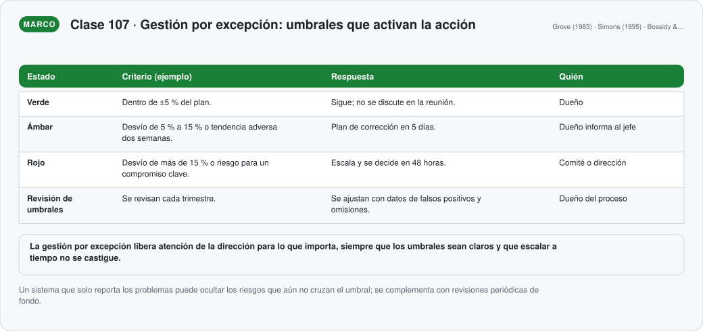

# Clase 107 — Escalamiento y gestión por excepción

<!-- nav:inicio -->
> **Parte 08 · Sistemas de gestión, KPI y OKR** — clase 11 de 12 · [índice de la parte](../../README.md) · [temario](../../../../SYLLABUS.md)
<!-- nav:fin -->

**Parte:** 08 — Sistemas de gestión, KPI y OKR  
**Nivel:** Etapa 3 — Manager → Gerente  
**Duración sugerida:** 150–180 minutos · **Estándar:** deep-class-v2

## 🎯 Propósito

Un gerente no puede mirarlo todo. Si revisa cada indicador de cada equipo, se ahoga; si no revisa nada, se entera tarde. La **gestión por excepción** resuelve el dilema: se definen de antemano los límites dentro de los cuales cada nivel actúa por su cuenta, y solo lo que los cruza llega al nivel superior. Funciona cuando los umbrales son claros, cuando escalar a tiempo se premia en lugar de castigarse y cuando se complementa con revisiones de fondo. Falla cuando los umbrales son arbitrarios, cuando se esconden los problemas por miedo o cuando se escala todo «por si acaso».

La clase se apoya en la concepción de Grove sobre el apalancamiento gerencial y las decisiones por excepción, en la distinción de Simons entre sistemas de control de diagnóstico e interactivos y en los hallazgos de Edmondson sobre la seguridad psicológica como condición para reportar problemas. Al terminar sabrás definir umbrales, diseñar reglas de escalamiento con tiempos, responsabilidades y criterios, y proteger el sistema de sus dos fallos típicos: silencio y exceso de ruido.

## 📚 Resultados de aprendizaje

Al finalizar podrás:

1. **Definir** umbrales de excepción para indicadores clave.
2. **Diseñar** reglas de escalamiento con quién, cuándo y con qué información.
3. **Distinguir** control de diagnóstico y control interactivo.
4. **Proteger** la cultura de reporte temprano.
5. **Revisar** los umbrales con datos sobre falsos positivos y omisiones.

## 🧭 Agenda

| Tramo | Qué se hace |
|---|---|
| 0–20 min | Recuperación: recuerda un problema que te llegó tarde y pregúntate por qué no subió antes. |
| 20–60 min | Umbrales, reglas de escalamiento, cultura y revisión. |
| 60–105 min | Ejemplo trabajado: semáforo de gestión de un centro de distribución. |
| 105–150 min | Caso ejecutivo y práctica. |
| 150–175 min | Límites y entregable. |

## 🧩 Conceptos centrales

| Concepto | Definición | Cómo se reconoce |
|---|---|---|
| **Gestión por excepción** | Atender solo lo que se aparta de lo esperado más allá de un umbral. | Los resultados en rango no se discuten. |
| **Umbral (tolerancia)** | Límite a partir del cual se actúa o se escala. | Se define antes, con criterio. |
| **Escalamiento** | Traslado de un asunto a un nivel con más autoridad o recursos. | Tiene destinatario, plazo e información mínima. |
| **Falso positivo** | Alerta que no era un problema real. | Genera fatiga de alertas. |
| **Omisión (falso negativo)** | Problema real que no activó la alerta. | Se descubre tarde. |
| **Control de diagnóstico** | Vigilancia por excepción de resultados programados. | Informes con alertas. |

## 🧠 Modelo mental

**Cómo leer el diagrama.** Una tabla con cuatro estados. En **verde**, dentro del rango, se sigue y no se discute en reunión. En **ámbar**, un desvío moderado o una tendencia adversa, el dueño prepara un plan de corrección en un plazo corto. En **rojo**, un desvío grande o un riesgo para un compromiso clave, se escala a quien decide y se resuelve en pocas horas. La última fila recuerda lo que más se omite: los umbrales también se revisan, con datos de falsos positivos y de problemas que no se detectaron.

## 📖 Desarrollo

### 1. Por qué gestionar por excepción

La atención de un gerente es su recurso más escaso. Grove describe el trabajo gerencial como apalancamiento: el resultado de un gerente es el de su organización, y su tiempo debe dedicarse a las actividades de mayor efecto. Revisar lo que va bien consume la atención que se necesita en lo que va mal. La gestión por excepción formaliza un acuerdo: **dentro del rango acordado, el equipo decide y actúa; fuera de él, informa y pide apoyo**. Esto da autonomía a los equipos y protege la atención de la dirección.

### 2. Definir umbrales

Los umbrales deben establecerse con criterio, no al azar. Se combinan tres fuentes: la **variación normal** del indicador (clase 091: dentro de los límites de control es ruido), el **riesgo para el objetivo** (qué desvío pone en peligro un compromiso) y la **capacidad de respuesta** (cuánto tiempo toma corregir). Se definen niveles —por ejemplo, verde, ámbar y rojo— y reglas por **tendencia** además de por valor (tres semanas seguidas de deterioro es una señal aunque cada valor esté en rango). Se documentan en la ficha del indicador (clase 100).

### 3. Reglas de escalamiento

Una regla clara responde: **qué** se escala (criterio), **a quién** (destinatario y suplente), **cuándo** (plazo máximo), **con qué información** (formato mínimo: qué pasó, cuál es el impacto, qué se hizo, qué se necesita) y **qué se espera** (decisión, recursos, información). Se distingue **informar** (se avisa, no se pide nada) de **escalar** (se pide una decisión). Un buen formato corto evita que la escalación se convierta en un correo largo que nadie lee. Y se acuerda que quien escala sigue siendo responsable hasta que el receptor acepte el asunto.

### 4. Cultura de reporte temprano

El sistema depende de que la gente escale a tiempo. Edmondson muestra que, en equipos con baja seguridad psicológica, los problemas y errores se esconden porque se teme el castigo, la humillación o el juicio. Un gerente que reacciona con enojo a las malas noticias recibirá solo buenas noticias, hasta que sea demasiado tarde. Prácticas que ayudan: **agradecer** las alertas tempranas, **separar** el análisis del problema de la búsqueda de culpables, **compartir** los errores propios y **medir** la oportunidad del reporte, no solo la ausencia de problemas.

### 5. Control de diagnóstico y control interactivo

Simons distingue dos usos de los sistemas de control. El de **diagnóstico** vigila resultados contra un estándar y actúa por excepción: es la lógica del semáforo. El **interactivo** dedica atención continua de la alta dirección a las **incertidumbres estratégicas** (qué pasa con un nuevo competidor, una tecnología, un segmento) y fomenta la conversación con los equipos. Una organización necesita ambos: la gestión por excepción libera tiempo para dedicarlo al control interactivo. Sin esta segunda parte, el sistema vigila lo conocido y ignora lo emergente.

### 6. Los dos fallos del sistema

El primero es el **silencio**: umbrales altos, miedo a reportar o definiciones que permiten ocultar desvíos; los problemas llegan como crisis. El segundo es el **ruido**: umbrales demasiado sensibles o escalamientos por seguridad que saturan a la dirección con alertas, hasta que se ignoran todas (fatiga de alertas). Se equilibran con **datos**: cuántas alertas fueron falsas, cuántos problemas importantes se detectaron tarde y qué reglas habrían evitado cada caso. Se ajustan los umbrales con esa información y se registran los cambios.

### 7. Revisiones de fondo y límites de la excepción

Gestionar por excepción no significa ignorar lo que está en verde. Hay riesgos que aún no cruzan el umbral (deterioro lento, dependencias frágiles, cumplimiento). Se complementa con **revisiones periódicas de fondo** (trimestrales) de procesos, riesgos y controles, con auditorías, con conversaciones directas con equipos y clientes y con la verificación de que los datos que alimentan el semáforo son confiables. Un semáforo verde con datos defectuosos es peor que uno rojo, porque da una falsa tranquilidad.

## 📚 Lectura comparada

| Obra | Qué aporta | Qué no resuelve | Pregunta para contrastar |
|---|---|---|---|
| Grove | Apalancamiento gerencial y decisiones por excepción. | Estilo de su época. | ¿En qué actividades se multiplica tu tiempo? |
| Simons | Control de diagnóstico e interactivo. | Marco general. | ¿Qué incertidumbres conversas y no solo vigilas? |
| Edmondson | Seguridad psicológica y reporte de errores. | No trata de umbrales. | ¿Qué pasa con quien trae una mala noticia? |
| Bossidy y Charan | Seguimiento riguroso y diálogo franco. | Se centra en grandes empresas. | ¿Qué hecho se discute y cuál se esconde? |
| Deming | Distinguir variación normal de señal. | No define reglas de escalamiento. | ¿Tu umbral reacciona a ruido? |

## 🧮 Ejemplo trabajado

**Situación (hipotética).** Un centro de distribución de una cadena de farmacias despacha 8.000 pedidos diarios. Su jefe, Ana, reporta al gerente de logística, Marcos, y este a un comité de operaciones. Marcos recibía 34 indicadores semanales y no tenía tiempo de leerlos; hace dos meses se enteró de un problema de un proveedor de transporte cuando ya había 400 pedidos retrasados.

**Diseño.** Se acuerdan seis indicadores con semáforo:

| Indicador | Verde | Ámbar | Rojo |
|---|---|---|---|
| Pedidos a tiempo | Sobre 95 % | 90 % a 95 % o baja durante 3 días | Bajo 90 % o bajo 93 % por 3 días |
| Errores de preparación | Bajo 0,8 % | 0,8 % a 1,5 % | Sobre 1,5 % |
| Disponibilidad de equipos | Sobre 97 % | 94 % a 97 % | Bajo 94 % |
| Quiebres de producto críticos | 0 | 1 o 2 productos | 3 o más o uno de la lista de esenciales |
| Accidentes con tiempo perdido | 0 | — | Cualquiera (se informa de inmediato) |
| Dotación disponible frente a plan | Sobre 92 % | 85 % a 92 % | Bajo 85 % |

**Reglas.** Ámbar: Ana prepara un plan de corrección en 24 horas y lo comparte con Marcos; no se pide decisión. Rojo: Ana llama a Marcos en menos de dos horas con el formato corto (qué pasó, impacto, acciones tomadas, qué necesita) y se decide en la misma jornada. Un rojo de seguridad se escala de inmediato, sin plazo.

**Resultados a tres meses.** Hubo 31 ámbares y 4 rojos; Marcos dedicó 3 horas semanales a excepciones en vez de 7 a lectura de informes. Un rojo en «pedidos a tiempo» por falla del proveedor de transporte se resolvió en 6 horas, con 420 pedidos retrasados evitados. Pero se detectó que una caída lenta de la «rotación del personal» (que no estaba en el semáforo) llevó a la dotación a 82 % durante dos semanas antes de activar el rojo; se agrega el indicador de rotación en ámbar y se revisan los umbrales.

**Qué muestra.** (1) Los umbrales liberaron tiempo y aceleraron la respuesta. (2) Las reglas definieron plazo y formato. (3) La revisión de omisiones mejoró el sistema.

## 🔀 Comparación y límites

**Excepción frente a microgestión.** La microgestión interviene en lo que va bien; la excepción respeta la autonomía mientras el resultado se mantenga en rango y actúa cuando se sale.

**Límites.** Los umbrales son juicios y se revisan. La gestión por excepción puede ocultar riesgos que aún no cruzan límites o que no están en los indicadores. Depende de datos confiables y de una cultura de reporte seguro; sin ellas, se vuelve un sistema de apariencia. En seguridad de las personas, medioambiente y cumplimiento, el criterio es de tolerancia cero o de reglas legales que se verifican en la normativa vigente, no de umbral estadístico.

## 🪜 De profesional a owner

| Nivel | Cómo participa en escalamiento y excepción |
|---|---|
| **Profesional** | Avisa temprano y con el formato acordado. |
| **Jefe / Team Lead** | Gestiona dentro de su rango y escala lo que lo excede. |
| **Gerente** | Define umbrales con su equipo, atiende excepciones y protege el reporte temprano. |
| **CEO / Director** | Dedica su atención a las excepciones y a las incertidumbres estratégicas. |
| **Founder / Owner** | Aprende a delegar con límites claros y a no ser quien se entera último. |

## 🏢 Caso ejecutivo

Una empresa de transporte de pasajeros con 1.200 conductores tiene un sistema de «alertas» que envía cada día más de 200 correos a la gerencia de operaciones. Los gerentes dejaron de leerlos. Hace tres semanas, una falla recurrente de frenos en una flota se había reportado en cuatro alertas ámbar que nadie atendió; un accidente sin víctimas graves hizo que el directorio exigiera cambios. Los conductores dicen que reportan fallas pero que «no pasa nada»; los jefes de taller, que si reportan todo les piden explicaciones; la dirección, que ahora quiere que «todo se escale al gerente general».

Entrega un **diseño de gestión por excepción y escalamiento** que contenga: (a) la selección de los indicadores de excepción con umbrales de verde, ámbar y rojo; (b) las reglas de escalamiento con destinatario, plazo y formato; (c) el tratamiento de los asuntos de seguridad (tolerancia cero) frente a los de desempeño; (d) cómo recuperarás la confianza de conductores y talleres para reportar temprano; (e) la medición de falsos positivos y omisiones y el ajuste de umbrales; (f) las revisiones de fondo que complementan el semáforo y las normas de seguridad vigentes que se verificarán.

## 🧪 Práctica

1. Define semáforo con umbrales para cinco indicadores de tu área.
2. Escribe una regla de escalamiento con destinatario, plazo y formato corto.
3. Distingue qué asuntos informan y cuáles escalan.
4. Diseña dos acciones para fortalecer el reporte temprano en tu equipo.
5. Define cómo medirás falsos positivos y omisiones durante un trimestre.

## ⚠️ Errores frecuentes

| Error | Por qué ocurre | Cómo corregirlo |
|---|---|---|
| Umbrales arbitrarios | Se fijan sin datos | Basarlos en variación, riesgo y respuesta. |
| Escalar todo | Se teme una omisión | Reglas claras y revisión de falsos positivos. |
| Castigar al que avisa | Se reacciona con enojo | Agradecer la alerta temprana. |
| Datos poco confiables | Se confía en el semáforo | Controles de calidad del dato. |
| Ignorar lo verde | Se asume que está bien | Revisiones de fondo periódicas. |
| Aplicar umbral estadístico a seguridad | Se trata como desempeño | Tolerancia cero y reglas legales. |

## ❓ Preguntas de comprobación

1. ¿Qué es la gestión por excepción y qué problema resuelve?
2. ¿Con qué tres fuentes se definen los umbrales?
3. ¿Qué debe incluir una regla de escalamiento?
4. ¿Por qué importa la seguridad psicológica?
5. ¿Qué distingue el control de diagnóstico del interactivo?
6. ¿Cuáles son los dos fallos del sistema?
7. ¿Qué complementa a la gestión por excepción?

Claves de respuesta

1. Atender solo lo que se aparta del rango acordado; resuelve el dilema entre ahogarse con todo y enterarse tarde.
2. La variación normal del indicador, el riesgo para el objetivo y la capacidad de respuesta.
3. Qué se escala, a quién, cuándo, con qué información y qué se espera del receptor.
4. Porque sin ella los problemas se esconden por miedo y llegan como crisis.
5. El de diagnóstico vigila resultados contra un estándar; el interactivo dedica atención de la dirección a las incertidumbres estratégicas.
6. El silencio (umbrales altos o miedo) y el ruido (alertas excesivas que se ignoran).
7. Revisiones de fondo, auditorías, conversación con equipos y clientes y verificación de la calidad de los datos.

## 📥 Entregable

Guarda en `portfolio/107-escalamiento-y-gestion-por-excepcion/`:

- `leadership-decision-brief.md` (plantilla [Leadership Decision Brief](../../../../templates/leadership-decision-brief.md)) con el diseño del caso ejecutivo;
- `risk-governance-brief.md` (plantilla [Risk & Governance Brief](../../../../templates/risk-governance-brief.md)) con los asuntos de seguridad y sus reglas;
- `decision-journal.md` con los umbrales, los ajustes y la medición de falsos positivos y omisiones.

## 📗 Fuentes y verificación

- Andrew S. Grove — *High Output Management* (Random House, 1983). **Uso en esta clase:** apalancamiento gerencial y decisiones por excepción. Lectura selectiva sobre **escalamiento y gestión por excepción**. **Localizador:** [ISBN-13 9780394532349](https://openlibrary.org/isbn/9780394532349).
- Robert Simons — *Levers of Control* (Harvard Business School Press, 1995). **Uso en esta clase:** control de diagnóstico e interactivo. Lectura selectiva sobre **escalamiento y gestión por excepción**. **Localizador:** [ISBN-13 9780875845593](https://openlibrary.org/isbn/9780875845593).
- Amy C. Edmondson — *Psychological Safety and Learning Behavior in Work Teams* (Administrative Science Quarterly, 1999). **Uso en esta clase:** seguridad psicológica y reporte de errores. Lectura selectiva sobre **escalamiento y gestión por excepción**. **Localizador:** [DOI 10.2307/2666999](https://doi.org/10.2307/2666999).
- Larry Bossidy & Ram Charan — *Execution* (2002). **Uso en esta clase:** seguimiento riguroso y diálogo franco. Lectura selectiva sobre **escalamiento y gestión por excepción**. **Localizador:** [ISBN-13 9781598954838](https://openlibrary.org/isbn/9781598954838).
- W. Edwards Deming — *Out of the Crisis* (The MIT Press, 2000). **Uso en esta clase:** distinción entre variación normal y señal. Lectura selectiva sobre **escalamiento y gestión por excepción**. **Localizador:** [ISBN-13 9780262541152](https://openlibrary.org/isbn/9780262541152).

> **Regla de fuentes para Escalamiento y gestión por excepción:** las obras anteriores estructuran las perspectivas de esta materia; cualquier norma, ley o estándar vivo mencionado debe comprobarse nuevamente en su fuente primaria vigente, incluidas las normas de seguridad aplicables al sector. Los ejemplos y casos son hipotéticos, con cifras ilustrativas. El desarrollo es original y no reproduce capítulos protegidos.

<!-- pie:inicio -->
---

| Anterior | Índice | Siguiente |
|---|---|---|
| [← 106 · Asignación de recursos](../106-asignacion-de-recursos/README.md) | [Parte 08](../../README.md) · [Programa](../../../../SYLLABUS.md) | [108 · Capstone: operating review gerencial →](../108-capstone-operating-review-gerencial/README.md) |
<!-- pie:fin -->
