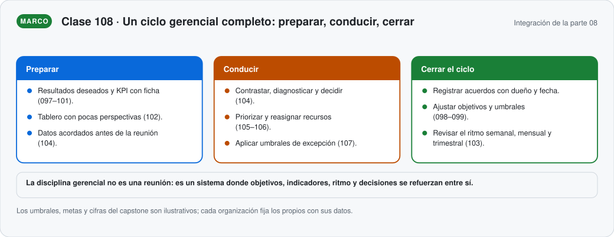

# Clase 108 — Capstone: operating review gerencial

<!-- nav:inicio -->
> **Parte 08 · Sistemas de gestión, KPI y OKR** — clase 12 de 12 · [índice de la parte](../../README.md) · [temario](../../../../SYLLABUS.md)
<!-- nav:fin -->

**Parte:** 08 — Sistemas de gestión, KPI y OKR  
**Nivel:** Etapa 3 — Manager → Gerente  
**Duración sugerida:** 150–180 minutos · **Estándar:** deep-class-v2

## 🎯 Propósito

Una disciplina gerencial no consiste en tener buenos indicadores, ni buenos objetivos, ni buenas reuniones: consiste en que todo eso funcione **como un sistema**. Los objetivos orientan, los indicadores muestran, el ritmo ordena la atención, las revisiones convierten datos en decisiones, la priorización y la asignación dirigen los recursos y el escalamiento protege la atención de la dirección. Si una pieza falla, las demás pierden eficacia: objetivos sin indicadores son deseos; indicadores sin revisión son decoración; revisiones sin decisiones son teatro.

Este capstone integra la parte 08 y se apoya en Bossidy y Charan, Kaplan y Norton, Doerr, Grove y Mankins y Garton. Al terminar sabrás diseñar y conducir un ciclo completo de revisión operativa de un área: preparar el tablero con indicadores confiables, conducir una revisión con diagnóstico y decisiones, priorizar y reasignar recursos, definir excepciones y cerrar con compromisos y ajustes de objetivos.

## 📚 Resultados de aprendizaje

Al finalizar podrás:

1. **Diseñar** un sistema de gestión coherente: objetivos, indicadores, ritmo y decisiones.
2. **Preparar** una revisión con datos confiables y un tablero legible.
3. **Conducir** el diagnóstico y las decisiones con juicio independiente y sin culpas.
4. **Priorizar y reasignar** recursos con criterios explícitos.
5. **Cerrar** el ciclo con compromisos, ajustes y aprendizajes.

## 🧭 Agenda

| Tramo | Qué se hace |
|---|---|
| 0–20 min | Recuperación: ordena las piezas del sistema de gestión según cuál falla más en tu organización. |
| 20–60 min | Preparar, conducir y cerrar el ciclo. |
| 60–105 min | Ejemplo trabajado: una revisión operativa trimestral de una unidad de servicios. |
| 105–150 min | Caso ejecutivo integrado. |
| 150–175 min | Rúbrica, límites y entregable. |

## 🧩 Conceptos centrales

| Concepto | Definición | Cómo se reconoce |
|---|---|---|
| **Sistema de gestión** | Conjunto articulado de objetivos, indicadores, ritmo, revisiones y decisiones. | Cada pieza alimenta a las otras. |
| **Revisión operativa (operating review)** | Revisión periódica del desempeño de un área con decisiones. | Tiene tablero, diagnóstico y compromisos. |
| **Línea de visión** | Conexión entre el trabajo del equipo y el objetivo de la empresa. | Cada persona ve cómo aporta. |
| **Cierre del ciclo** | Verificación de compromisos, ajuste de objetivos y registro de aprendizajes. | La próxima revisión parte de lo anterior. |
| **Disciplina gerencial** | Constancia en el ritmo y en el seguimiento. | Se mantiene aunque haya presión. |
| **Rúbrica de calidad** | Criterios para juzgar la calidad del sistema y de la revisión. | Permite mejorar con evidencia. |

## 🧠 Modelo mental

**Cómo leer el diagrama.** Tres columnas. **Preparar** reúne objetivos y resultados deseados, indicadores con ficha, un tablero con pocas perspectivas y datos acordados antes de la reunión. **Conducir** contrasta, diagnostica y decide, priorizando y reasignando recursos y aplicando umbrales de excepción. **Cerrar el ciclo** registra acuerdos con dueño y fecha, ajusta objetivos y umbrales y revisa el ritmo. Las cifras entre paréntesis remiten a las clases de la parte.

## 📖 Desarrollo

### 1. Coherencia antes que sofisticación

La primera pregunta de un sistema de gestión es: ¿qué queremos lograr y cómo lo sabremos? Se parte de un número reducido de **objetivos** formulados como resultados (097–099), cada uno con **indicadores** definidos por ficha, con dueño y umbral (100–101), organizados en un **tablero** coherente con la estrategia (102). Antes de agregar herramientas, se verifica que las existentes se hablen: ¿los objetivos tienen indicadores?, ¿los indicadores informan decisiones?, ¿las decisiones se registran y se revisan? La coherencia pesa más que la sofisticación.

### 2. Diseñar el ritmo

El sistema necesita un **calendario**: reuniones semanales de coordinación, revisión mensual de gestión, revisión trimestral de estrategia y OKR y planificación anual (103). Cada reunión tiene un propósito, un insumo y una decisión. Se presupuesta el tiempo directivo y se eliminan las reuniones redundantes. El ritmo se protege: se mantiene aunque haya urgencias, porque su valor está en la regularidad. Una revisión que se suspende cuando hay problemas es una revisión que solo funciona cuando no se necesita.

### 3. Preparar la revisión

La calidad de la revisión se define antes. Se envía el tablero con **datos confiables** (clase 100), tendencia y comparación con metas; los dueños de desvíos significativos entregan un análisis breve de causas; se identifican las decisiones que se pedirán y se invita solo a quienes deben decidir o aportar. Se pide a los participantes juicios previos por escrito en los temas más inciertos para reducir sesgos (104). Se acuerda que no habrá sorpresas: los problemas graves se avisan antes. La preparación es la mejor inversión de tiempo de todo el ciclo.

### 4. Conducir el diagnóstico y la decisión

En la sala se dedica poco tiempo a lo verde y mucho a los desvíos (107). Se hace el diagnóstico en tres niveles —qué pasó, por qué, qué supuesto falló— con preguntas que busquen causas y no culpables. Luego se decide con las cuatro respuestas posibles: seguir, corregir, escalar o replantear. Se **prioriza** si hay más demandas que capacidad (105) y se **reasigna** si hace falta (106), cuidando el costo humano. Quien preside escucha, pregunta y protege el diálogo franco. Todo compromiso sale con dueño, fecha y criterio de verificación.

### 5. Cerrar el ciclo

La revisión termina con un **acta breve**: decisiones tomadas, compromisos, escalamientos y temas pendientes. Se ajustan, si corresponde, los **objetivos** (por cambios de supuestos), los **umbrales** (según falsos positivos y omisiones) y el **ritmo** (si una reunión no produce decisiones). Se registra el aprendizaje: qué hipótesis se confirmó y cuál no. En la siguiente revisión se abre con la verificación de los compromisos anteriores. Sin ese cierre, el sistema acumula decisiones sin memoria y repite errores.

### 6. Cultura y comportamiento

El sistema es tan bueno como las conductas que produce. Si las malas noticias se castigan, los datos se maquillan; si los objetivos se usan para evaluar y castigar de forma mecánica, se fijarán metas seguras (098–099); si los líderes no cumplen sus propios compromisos, nadie lo hará. Se cultiva: seguridad para reportar (107), reconocimiento del reporte temprano, coherencia entre lo que se mide y lo que se premia y transparencia en las decisiones de reasignación. Los gerentes son responsables de ser el modelo de la disciplina que piden.

### 7. Evaluar el sistema

Se evalúa periódicamente con una **rúbrica**: ¿los objetivos son resultados medibles?, ¿los indicadores tienen ficha y dueño?, ¿el tablero cabe en una página y cada cifra informa una decisión?, ¿las revisiones terminan con acuerdos?, ¿se cumplen los compromisos?, ¿se detiene lo que no rinde?, ¿hay reporte temprano? Se asigna una escala simple por criterio y se usa para decidir una o dos mejoras por trimestre, no una reforma total. El sistema de gestión también se gestiona.

## 📚 Lectura comparada

| Obra | Qué aporta | Qué no resuelve | Pregunta para contrastar |
|---|---|---|---|
| Bossidy y Charan | Ejecución como disciplina de seguimiento. | Se centra en grandes empresas. | ¿Qué compromisos se cumplieron? |
| Kaplan y Norton | Alineación entre estrategia, indicadores y tablero. | Requiere estrategia explícita. | ¿Qué hipótesis causales revisas? |
| Doerr | Objetivos y resultados clave con ritmo trimestral. | Casos seleccionados. | ¿Qué objetivos se revisan cada semana? |
| Grove | Reuniones y apalancamiento gerencial. | Estilo de su época. | ¿Qué produce cada reunión? |
| Mankins y Garton | Tiempo y talento como recursos de la estrategia. | Datos de empresas grandes. | ¿Cuánto tiempo se dedica a lo que importa? |

## 🧮 Ejemplo trabajado

**Situación (hipotética).** Una unidad de servicios de TI de 70 personas presta soporte a 3.000 usuarios internos. Su gerente, Paula, diseña y conduce la revisión operativa del tercer trimestre.

**Preparar.** Objetivo del trimestre: «Que las áreas puedan trabajar sin interrupciones por problemas de TI». Resultados clave: reducir el tiempo de resolución de incidentes críticos de 9 a 5 horas; subir la satisfacción posterior a la atención de 3,8 a 4,3; mantener el costo por usuario en USD 62. Tablero de una página con 9 indicadores y semáforo; contrapeso: proporción de incidentes reabiertos.

**Datos del trimestre.** Incidentes críticos: 6,8 horas (meta 5; ámbar). Satisfacción: 4,0 (ámbar). Costo por usuario: USD 66 (rojo, 6 % sobre la meta). Reabiertos: 14 % (de 9 %). Rotación en el equipo de soporte: 25 % anualizada.

**Juicios previos.** Cada participante escribió la causa principal de los desvíos: capacidad insuficiente (3), falta de documentación (2), cambios no coordinados con el área de aplicaciones (2), proveedor de infraestructura (1).

**Diagnóstico.** El análisis de 47 incidentes críticos muestra que 19 se originaron en cambios no comunicados; el 62 % de los reabiertos corresponden a técnicos con menos de 6 meses de antigüedad. El costo sube por horas extra y por contratar externos para cubrir la rotación.

**Decisiones.** (1) Proceso de gestión de cambios con aprobación y aviso a soporte (responsable: Luis, jefe de aplicaciones; 30 días; verificación: cambios sin aviso = 0). (2) Programa de acompañamiento para técnicos nuevos con un mentor (responsable: Paula; inicio en 2 semanas; verificación: reabiertos de nuevos). (3) Reasignación de tres horas semanales de dos senior a documentación de los diez incidentes más frecuentes. (4) Priorización: se pospone el proyecto de portal de autoservicio (bajo valor frente a esfuerzo) y se reserva la capacidad. (5) Umbral: el costo por usuario en rojo dos meses seguidos se escala al comité financiero. (6) Se revisa el objetivo de costo si la rotación no baja en el próximo trimestre.

**Cierre.** Acta de una página con los seis acuerdos, dueños, fechas y verificaciones. En la siguiente revisión se abre con ese seguimiento.

**Qué muestra.** (1) El sistema funcionó como un conjunto: objetivo, indicadores, juicio, diagnóstico, decisión y seguimiento. (2) La priorización y la reasignación resolvieron una restricción de capacidad. (3) Las decisiones tenían dueño y verificación.

## 🔀 Comparación y límites

**Sistema de gestión frente a cultura.** El sistema define rutinas; la cultura define cómo se viven. Un sistema bueno con una cultura de miedo produce datos maquillados; una buena cultura sin sistema produce buenas intenciones sin seguimiento.

**Límites.** El ejemplo es ilustrativo y no hay un sistema único. Un exceso de instrumentos genera burocracia: la regla es usar lo mínimo que produzca decisiones. Los indicadores y las evaluaciones que afectan a personas tienen implicancias laborales y de protección de datos que se verifican con asesoría. Y ningún sistema reemplaza el juicio ni la conversación con clientes y equipos.

## 🪜 De profesional a owner

| Nivel | Cómo participa en el sistema de gestión |
|---|---|
| **Profesional** | Registra datos fiables y cumple sus compromisos. |
| **Jefe / Team Lead** | Conduce su ciclo semanal y escala con el formato acordado. |
| **Gerente** | Diseña y conduce el ciclo completo de su área. |
| **CEO / Director** | Exige coherencia, protege el ritmo y modela la cultura. |
| **Founder / Owner** | Construye un sistema mínimo antes de que el crecimiento lo exija. |

## 🏢 Caso ejecutivo

Una empresa de energía solar para viviendas, con 350 empleados, creció 60 % en dos años. Tiene OKR por equipo, un tablero de 70 indicadores, una revisión mensual de cuatro horas y un comité semanal. Los márgenes bajaron, el tiempo de instalación pasó de 12 a 24 días, la rotación de instaladores es de 38 % y los reclamos subieron. La dirección dice que «todo está medido», pero nadie puede decir qué cambió por las revisiones. Un nuevo gerente general pide al gerente de operaciones diseñar y conducir en 60 días una revisión operativa que lleve a decisiones.

Entrega un **sistema de gestión y una revisión operativa** que contenga: (a) los objetivos y resultados clave del trimestre con indicadores, fichas y contrapesos; (b) el tablero de una página y los umbrales de excepción; (c) el ritmo semanal, mensual y trimestral; (d) la preparación de la revisión, incluidos los juicios previos; (e) el diagnóstico propuesto y al menos cinco decisiones con dueño, plazo y verificación; (f) la priorización y reasignación de recursos y el costo humano; (g) el cierre del ciclo, la rúbrica de calidad del sistema y los aspectos laborales y de datos que se verificarán.

## 🧪 Práctica

1. Elige un área y diseña tres objetivos con indicadores y contrapesos.
2. Arma un tablero de una página con umbrales.
3. Prepara una revisión de 90 minutos con insumos y juicios previos.
4. Redacta cinco compromisos con dueño, fecha y verificación.
5. Aplica la rúbrica de calidad a tu sistema y elige dos mejoras.

## ⚠️ Errores frecuentes

| Error | Por qué ocurre | Cómo corregirlo |
|---|---|---|
| Piezas desconectadas | Cada una se diseña por separado | Verificar la coherencia del conjunto. |
| Revisiones sin decisiones | Se informa en lugar de decidir | Empezar por las decisiones. |
| Demasiados indicadores | No se retira nada | Máximo útil y retiro periódico. |
| No cerrar el ciclo | Se pasa a lo siguiente | Acta, seguimiento y ajustes. |
| Cultura de miedo | Se castigan las malas noticias | Reconocer el reporte temprano. |
| Sistema que crece sin límite | Se agregan herramientas | Evaluar con rúbrica y simplificar. |

## ❓ Preguntas de comprobación

1. ¿Qué piezas componen un sistema de gestión y cómo se relacionan?
2. ¿Qué se prepara antes de una revisión?
3. ¿Qué tres niveles tiene el diagnóstico?
4. ¿Qué respuestas puede tener cada punto de la revisión?
5. ¿Cómo se cierra el ciclo?
6. ¿Qué papel cumple la cultura?
7. ¿Qué límite tiene un sistema de gestión?

Claves de respuesta

1. Objetivos, indicadores, tablero, ritmo, revisiones, priorización y asignación, y escalamiento; cada pieza alimenta a las otras.
2. Datos confiables con tendencia y meta, análisis de causas de los desvíos, decisiones por pedir, participantes necesarios y juicios previos.
3. Qué pasó, por qué pasó y qué supuesto del plan falló.
4. Seguir como está, corregir, escalar o replantear el objetivo o el supuesto.
5. Con un acta de decisiones y compromisos, ajustes de objetivos, umbrales y ritmo, y aprendizajes registrados, que se revisan al abrir la siguiente.
6. Determina si los datos son veraces y si se reporta a tiempo; un sistema bueno con cultura de miedo produce datos maquillados.
7. No hay un sistema único; el exceso genera burocracia y ninguno reemplaza el juicio ni la conversación con clientes y equipos.

## 📥 Entregable

Guarda en `portfolio/108-capstone-operating-review-gerencial/`:

- `risk-governance-brief.md` (plantilla [Risk & Governance Brief](../../../../templates/risk-governance-brief.md)) con el sistema de gestión y la revisión operativa del caso ejecutivo;
- `monthly-business-review.md` (plantilla [Monthly business review](../../../../templates/monthly-business-review.md)) con el formato, los insumos y el acta de la revisión;
- `kpi-tree.md` (plantilla [KPI tree](../../../../templates/kpi-tree.md)) con los objetivos, indicadores y contrapesos;
- `decision-journal.md` con las decisiones, el seguimiento y la evaluación con la rúbrica.

## 📗 Fuentes y verificación

- Larry Bossidy & Ram Charan — *Execution* (2002). **Uso en esta clase:** ejecución como disciplina de seguimiento. Lectura selectiva sobre **capstone: operating review gerencial**. **Localizador:** [ISBN-13 9781598954838](https://openlibrary.org/isbn/9781598954838).
- Robert S. Kaplan & David P. Norton — *The Balanced Scorecard* (Harvard Business School Press, 1996). **Uso en esta clase:** alineación entre estrategia, indicadores y tablero. Lectura selectiva sobre **capstone: operating review gerencial**. **Localizador:** [ISBN-13 9780875846514](https://openlibrary.org/isbn/9780875846514).
- John Doerr — *Measure What Matters* (Penguin Random House USA Ex, 2018). **Uso en esta clase:** objetivos y resultados clave con ritmo trimestral. Lectura selectiva sobre **capstone: operating review gerencial**. **Localizador:** [ISBN-13 9780525538349](https://openlibrary.org/isbn/9780525538349).
- Andrew S. Grove — *High Output Management* (Random House, 1983). **Uso en esta clase:** reuniones y apalancamiento gerencial. Lectura selectiva sobre **capstone: operating review gerencial**. **Localizador:** [ISBN-13 9780394532349](https://openlibrary.org/isbn/9780394532349).
- Michael C. Mankins & Eric Garton — *Time, Talent, Energy* (Harvard Business Review Press, 2017). **Uso en esta clase:** tiempo y talento como recursos de la estrategia. Lectura selectiva sobre **capstone: operating review gerencial**. **Localizador:** [ISBN-13 9781633691766](https://openlibrary.org/isbn/9781633691766).

> **Regla de fuentes para Capstone: operating review gerencial:** las obras anteriores estructuran las perspectivas de esta materia; cualquier norma, ley o estándar vivo mencionado debe comprobarse nuevamente en su fuente primaria vigente, incluidas las normas laborales y de protección de datos aplicables. Los ejemplos y casos son hipotéticos y no describen a ninguna empresa real. El desarrollo es original y no reproduce capítulos protegidos.

<!-- pie:inicio -->
---

| Anterior | Índice | Siguiente |
|---|---|---|
| [← 107 · Escalamiento y gestión por excepción](../107-escalamiento-y-gestion-por-excepcion/README.md) | [Parte 08](../../README.md) · [Programa](../../../../SYLLABUS.md) | [109 · Lenguaje financiero del gerente →](../../../09-managerial-finance-accounting/classes/109-lenguaje-financiero-del-gerente/README.md) |
<!-- pie:fin -->
